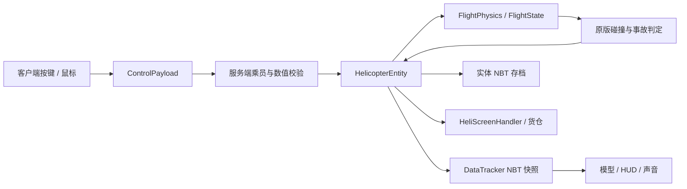

# 24号直升机开发手册

## 1. 项目总览

目标：Minecraft 1.21.1、Yarn 1.21.1+build.3、Fabric Loader 0.19.2、Fabric API 0.116.17+1.21.1。模组 ID `no_24_heli`，Java 包 `org.DJB.no_24_heli`。Loom 1.11.8 使用拆分的 main/client source set。Java 字节码目标为 21；本机使用 JDK 25 运行 Gradle 9.6.1。

项目规范真源：项目上级目录 `deveolpment_stadard.txt`。函数、常量和关键逻辑采用中文注释；仅保留本手册和面向玩家的 README 两种说明文档。临时测试源码、测试任务及生成数据完成后删除。已有许可证、项目规范、构建资源不属于新增说明文档。

构建：先选择支持 Gradle 9.6.1 的 JDK（本机为 25），在项目根目录运行 `./gradlew.bat build`。发行包为 `build/libs/No.24_Heli-1.2.1.jar`，源码包带 `-sources` 后缀。`runClient` 与 `runServer` 是 Loom 提供的开发启动任务。MP3 解码依赖 Maven Central 的 `javazoom:jlayer:1.0.1`，使用 Loom include 嵌入发行包，不要求玩家另装解码库。

## 2. 整体设计框架

服务端拥有所有物理、坐标、燃油、耐久、库存与事故判定。客户端仅提交操纵意图和离散动作，读取服务器快照绘制模型、HUD、声音与 GUI。

实体位置通过原版跟踪包同步并在客户端插值。`getControllingPassenger()` 返回 null，阻止原版载具移动包把驾驶员客户端坐标回写服务器；驾驶权限由 `isPilot()` 与 `getFirstPassenger()` 独立判定。不可随意改回返回驾驶员，否则需要重新审查位置权威。

## 3. 文件引用关系

1.2.0 新增模块：

| 文件 | 职责与引用 |
|---|---|
| `flight/NavigationController.java` | 导航距离→目标水平速度→加速度→机体姿态，复用 FlightPhysics |
| `NavigationPayload.java` | 客户端地图提交/清除导航点，实体校验机上乘员和坐标 |
| `AirspaceState.java` | 每维度 PersistentState 保存雷达位置、半径与所有者 |
| `RadarBlock.java` | 放置建区、右键打开服务器配置、破坏删区 |
| `RadarPayload.java` | 双向雷达半径请求/回执，服务端验证距离与归属 |
| `AirspacePayload.java` | 发给乘员的禁飞区快照，不发送所有者身份 |
| `client/HeliRadar.java` | 5 tick 一次扫描已跟踪玩家/其他完好飞机，共享地图目标 |
| `client/HeliMapScreen.java` | 192×112 GPU 纹理缓存；从 ExploredMap 读取已探索地形、导航设点、禁飞圈、拖动缩放 |
| `client/RadarScreen.java` | 半径输入校验、等待保存结果、只读提示 |
| `mixin/client/HeliHotbarMixin.java` | 乘机时取消 InGameHud.renderHotbar |
| `mixin/client/HeliDismountMixin.java` | KeyboardInput.tick 尾部拦截蹲下，上升沿请求服务端二次确认 |

| 文件 | 职责与主要依赖 |
|---|---|
| `No_24_heli.java` | 注册物品/方块/实体/声音/菜单/物品组，读取配置，注册网络与乘员维修事件 |
| `HeliConfig.java` | Gson 配置及数值范围校验，难度默认参数 |
| `flight/FlightState.java` | 速度、姿态、旋翼、部件、辅助及输入的纯数据 |
| `flight/FlightPhysics.java` | 20 Hz 积分器，依赖 FlightState 和 HeliConfig |
| `ControlPayload.java` | C2S 包、动作位与有限数校验 |
| `SettingsPayload.java` | 双向方块破坏设置包，服务器确认权限、结果与保存状态 |
| `DifficultyPayload.java` | 独立难度请求/回执，保持旧 settings 包格式 |
| `HelicopterEntity.java` | 权限、世界碰撞、部件、乘员、维修、GUI、自检、存档、同步 |
| `HelicopterItem.java` | 整机物品放置和空间检查 |
| `HelipadBlock.java` | 材料检查、停机坪组装与原子扣料 |
| `HeliScreenHandler.java` | 燃料槽、18 格货仓、36 格玩家背包、快速转移和访问权限 |
| `RopeSeatEntity.java` | 绳端抓取、上升/下降、空座入舱、满舱惯性悬挂与脱绳确认 |
| `client/No_24_heliClient.java` | 按键、鼠标输入、音源生命周期、客户端注册 |
| `client/HelicopterRenderer.java` | 机身、玻璃、尾梁、主/尾旋翼、起落架、绳索 |
| `client/HeliHud.java` | 空速、高度、垂速、旋翼/总距、油量、部件条、地平仪、告警 |
| `client/HeliScreen.java` | 容器绘制与物品提示 |
| `client/HeliSettingsScreen.java` | 设置按钮、服务器读取/保存反馈、本地默认设置 |
| `client/HeliView.java` | 登离机视角切换、跟随开关、指数平滑 |
| `mixin/client/HeliCameraMixin.java` | 相机更新尾部应用跟随角度与 4–24 格可调距离，保留原版墙壁检测 |
| `mixin/client/HeliMouseMixin.java` | 乘机且无界面时拦截视角锁定所绑定的鼠标键，避免触发原版选取方块 |
| `mixin/client/HeliCrewRendererMixin.java` | 隐藏直升机内 LivingEntity；绳降与下机恢复 |
| `client/RotorSound.java` | 连续旋翼声音随转速/总距/空速变调变音量 |
| `client/RopeRenderer.java` | 按绳端到机腹的实际向量绘制，独立视锥裁剪，乘员由原版渲染 |
| `src/main/resources/assets/no_24_heli` | 语言、模型 JSON、贴图、声音 |
| `src/main/resources/data/no_24_heli` | 1.21.1 单数目录 recipe、advancement、loot_table |

模板中的 DataGenerator 和服务端空 mixin 配置保留用于后续扩展。客户端 DrivingInputMixin 只在本机玩家驾驶时拦截原版 Q/E 动作，防止丢弃物品或弹出背包；不覆盖原版键绑定，离机后恢复原行为。Z/V 提供可重绑的脚蹬输入。

## 4. 函数调用关系

`ModInitializer.onInitialize → HeliConfig.load → 注册物品组、UseItemCallback、PayloadTypeRegistry、ServerPlayNetworking`。

`ClientTickEvents → ControlPayload → 服务端线程 → HelicopterEntity.control → 校验乘员/驾驶员/数据/频率 → 更新 FlightState 输入和辅助开关`。

`HelicopterEntity.tick → 输入超时清除 → 地面燃料消耗与停机坪补给 → FlightPhysics.handleAbandonment → FlightPhysics.step → Entity.move → collide / destroy → DataTracker.set`。

`interact → 维修 / 涂装 / 村民装载 / openMenu / startRiding`；`HelipadBlock.onUseWithItem → 检查材料与空间 → spawnEntity → 扣料`。

`B → safeHover → ensureRopeCarrier → attach`；机内 `Y → rappel → board(false)`，地面 `Y → 服务端近距离绳端查询 → board(true)`；`RopeSeatEntity.tick → 绳长变化/重力摆动/碰撞 → 空座入舱或接地解除乘骑`。空绳端继续保留，直到驾驶员收绳或空绳离开悬停条件。

`writeCustomDataToNbt → saveFlight + Inventories.writeNbt`；`readCustomDataFromNbt → loadFlight + Inventories.readNbt`。

## 5. 关键类与关键函数参考

### 1.2.0 高度保持与导航

`FlightPhysics.step` 在完成旋翼更新和姿态积分之后计算高度保持。高度误差乘 0.025 得目标垂速，限制 ±0.16 格/tick；垂速误差乘 0.18 得加速度指令，限制 ±0.018 格/tick²。所需总距为 `(重力 + 垂向阻尼补偿 + 指令加速度) / 当前垂向升力系数`，升力系数包含 rpm²、旋翼耐久、引擎耐久、雨天系数、cos(pitch) 与 cos(roll)。总距变化限制为每 tick 0.045。不使用积分项，因此升力不足时不会积分饱和。手动总距继续沿用每 tick 0.008，并实时重设目标高度。

`NavigationController.step` 先用 `atan2(-dx,dz)` 求目标偏航；脚蹬为 `角差×0.035-yawRate×0.7` 并限幅。角差小于 6° 且偏航角速度小于 0.7 才置 navAligned；此前目标水平速度为零，持续刹住原有漂移。对准后目标速度 `min(0.80, 距离×0.025)×max(0,cos(角差))`，速度误差增益 0.10，加速度上限 0.018；投影到机体前后/左右，再转换为倾角控制量。0.5 格内停止平移，3 格内抑制偏航以避免到点掉头。航向误差超过 30° 时重新制动对齐。NavigationPilot 在前视障碍阻挡且上方通道安全时抬高 targetAltitude，正常航段维持该高度；不能通过时目标速度为零。实体在输出前检查原始玩家轴值（绝对值大于 0.02）及辅助/引擎动作，调用 `stopAutopilot()` 恢复进入前的 trim/altitude/cruise，再交给手动操纵。失去乘员、落地、入水、动力失效同样退出。

### 1.2.0 回收、下机与动画

`canRecover()`：非残骸、无乘员、引擎关闭、rpm<0.05、水平速度<0.08、|vy|<0.08，并且落地/方块支撑/接触水之一成立。水中每 tick 水平速度乘 0.65、垂速限制不低于 -0.06、rpm 额外减 0.025；引擎耐久不影响回收许可。空手蹲下交互将 Flight 和 19 槽库存放入整机物品 `minecraft:custom_data`，唯一物品交付后清空旧库存并移除实体。`restorePacked()` 只走模组字段读取，不应用任意 Entity NBT；重新放置归零速度/旋翼/总距/弃机计时并停机。

`requestDismount()` 在服务器保存每位乘员的 60 tick 确认期限。地面、方块支撑和水中直接下机；空中第一次警告，第二次确认。客户端先屏蔽原版 input.sneaking，只在按下上升沿发送 DISMOUNT，长按不能确认。绳上 Shift 也走同一客户端按下边沿拦截，RopeSeatEntity.control 按实际离地高度决定立即释放或 60 tick 二次确认；事故强制离机不受影响。

客户端每 tick 使用 0.45/0.40 两级姿态滤波，再由渲染帧 delta 在前后 tick 间插值；起落架也使用帧间插值。主体宽从 28 增至 34 像素，机头延伸至 Z=27，实体包围盒宽从 2.8 增至 3.4 格；整机放置与停机坪组装沿用实体包围盒检查。主旋翼尺寸保留。机腹重复立方体被删除，侧窗与编号放在外壳外侧，避免共面闪烁。

### FlightPhysics.step

输入：状态、服务端配置、是否落地、所在方块是否下雨、世界 Y、世界 tick。直接修改状态中的速度和姿态，不访问 Minecraft 世界，不执行爆炸。

旋翼转速归一化到 0–1。启动以 `1/spoolTicks` 每 tick 增加；达到 0.995 才置 `armed`。未置 armed 时总距不产生升力。起飞后 armed 不因瞬时转速不足清除，允许残余转速与无动力自转产生升力；落地且转速低于 0.05 时解除。

升力基础值为 `0.072 × collective × rpm² × rotorHealth × enginePower`，再以俯仰/横滚分解到水平和垂直方向。每 tick 重力 0.04。雨天引擎系数 0.94、旋翼效率 0.97。水平阻尼休闲 0.981，曼巴 0.994，垂向阻尼 0.985。速度上限：水平各轴 ±2.2、垂直 [-2.5,1.1] 格/tick。

无动力时低总距结合下降/前飞气流驱动旋翼；高总距消耗旋翼储能。前飞与下降还贡献受上限限制的自转气动力。该模型是可玩性导向的近似，不是六自由度空气动力学求解器。

### HelicopterEntity.control

不信任客户端数值。拒绝 NaN/Infinity、未知动作位、非乘员、非驾驶员飞控。同一世界 tick 只接受一份连续轴量；离散动作独立限流，避免同 tick 到达的中性包吞掉按键；连续输入超时 10 tick 自动回中，惯性仍保留。开关动作至少间隔 5 tick，引擎启停至少间隔 20 tick。货仓/绳降可由副驾驶操作。

### FlightPhysics.handleAbandonment

每次积分前按真正的第一座驾驶员是否为玩家判断。已预转且离地的无人驾驶飞机保存目标高度，前 60 tick 清除遗留输入、抑制水平漂移，将上升速度限制为不大于 0 并调总距；之后关闭高度保持与动力，逐步降总距，横滚趋向 55°、俯仰趋向 38°，逐渐失控下降。重新登机或落地清零计时；不会自动重启已关闭的引擎。AbandonedTicks 持久化，防止重载不断刷新三秒保护。

### HeliView / 地面输入约束

登机保存原 Perspective 并设 THIRD_PERSON_BACK；离机、换乘、断线时恢复。跟随用约 350 ms 时间常数平滑相机偏航/俯仰，只修改 Camera，绝不修改玩家朝向，避免把相机运动反馈到飞控。相机初始距离 10 格，滚轮限制在 4–24 格，clipToSpace 沿观察方向收缩距离。第一人称及其他载具不受相机 mixin 影响。

客户端落地时不产生鼠标操纵量；服务端 grounded 时清除周期变距和脚蹬、归平姿态并禁止偏航。两端都约束，避免仅靠客户端过滤。

自动配平默认 J。首次升级时检查 config/no_24_heli_keys_v2.marker，只有仍绑定 K 才迁移到 J 并保存 options.txt；写入迁移标记后不再覆盖玩家后续的自定义选择。

### collide / destroy

只计算真正碰撞轴上的入射速度，不把平行擦过墙面的速度全部算作撞击，也不只计算被阻挡的剩余位移。空中横向或向上碰撞超过 0.02 格/tick 直接爆炸；向下接地仍按速度阈值判断，保留自转迫降。空中非玩家实体接触的相对速度超过 0.02 格/tick 也会爆炸。crashObstacle 统一排除玩家、观察者、本机乘员和绳降座/乘员；collidesWith 同步使用过滤规则，避免原版实体移动碰撞先产生事故。脚底 0.08 格的薄盒仅查询方块支撑，连续 3 tick 离开支撑后启用实体事故；地面与刚放置的飞机忽略其他实体接触。查询使用实际包围盒，取消先前扩大的 0.05 格预碰撞范围。地面碰撞按速度线性扣耐久或在高速时解体。地面重力贴地的小量速度不算事故。

爆炸阈值休闲 0.9、曼巴 0.66 格/tick。起落架收起乘 0.75；俯仰或横滚绝对值大于 30 度再乘 0.7。机身清零但未触发高速事故时生成非爆炸残骸。爆炸事故先复制乘员列表再解除乘骑，并使用 genericKill 对机组造成致命伤害。

`explosionBlockDamage` 同时控制点火与方块破坏。残骸复用原实体并将 Wreck 置 true，故不会因服务器重启恢复成完整飞机。货物掉落一次后清空。回收后 discard，防止重复刷零件。

### HeliScreenHandler

槽 0=燃料，槽 1–18=货仓，槽 19–45=玩家主背包，槽 46–54=快捷栏。只允许煤油和原油进入燃料槽。界面访问要求距离小于 8 格且载具完好，并满足乘员身份或载具落地。菜单传输不接受客户端直接修改飞机统计值。

## 6. 接口介绍

### 1.2.0 新增协议

| ID | 方向与字段 | 校验与处理 |
|---|---|---|
| `navigation` | C2S：double X、double Z、boolean clear | 当前第一座、有限数、±29999984、世界边界；改点退出自动驾驶 |
| `radar_settings` | 双向：BlockPos、VarInt radius、boolean update/editable/saved | 距离≤8 格、区块已加载、方块确为雷达、所有者或权限≥2、半径16–512；客户端只能信任回执 |
| `airspace` | S2C：数量，重复 BlockPos/VarInt radius | 最多512项，实体每20 tick发给乘员；按当前维度产生快照 |
| `controls` 扩展 | AUTOPILOT=256、DISMOUNT=512、AUTO_FLIGHT=1024 | 1.2.1 允许动作掩码2047；副驾驶可请求下机，自动驾驶/起降仅驾驶员 |

调用链：`M → HeliMapScreen.mouseClicked → NavigationPayload → HelicopterEntity.navigate`；`U → ControlPayload → control → NavigationPilot.step → NavigationRoute.plan / NavigationController.step → FlightPhysics.step`。

禁飞区：`RadarBlock.onPlaced → AirspaceState.put`；`onUse → RadarPayload → RadarScreen → RadarPayload → 服务端距离/归属校验 → markDirty`；`HelicopterEntity.tick 每20 tick → contains → Restricted 快照/乘员文字 → 客户端每40 tick播放警报`。方块 `onStateReplaced` 删除范围，包括爆炸替换。地面雷达并不强制加载区块，不攻击飞机。

C2S 自定义负载 ID：`no_24_heli:controls`。线格式：4 个 float（pitch, roll, pedal, collective）加 1 个 VarInt（actions）。服务端将操纵量限制到 [-1,1]。

| 动作位 | 数值 | 行为 |
|---|---:|---|
| ENGINE | 1 | 启停 |
| ALTITUDE | 2 | 高度保持 |
| TRIM | 4 | 配平 |
| CRUISE | 8 | 巡航 |
| GEAR | 16 | 起落架 |
| ROPE | 32 | 放/收绳 |
| EXIT_ROPE | 64 | 机内绳降 / 地面抓取空绳攀升 |
| MENU | 128 | 打开容器 |
| AUTOPILOT | 256 | 导航自动驾驶 |
| DISMOUNT | 512 | 二次确认下机 |
| AUTO_FLIGHT | 1024 | 一键起降/取消 |

设置负载 ID：`no_24_heli:settings`，C2S/S2C 共用 codec，依次为 4 个 boolean：update（读取/修改）、destruction（期望/实际值）、editable（服务端权限结果）、saved（服务端保存结果）。服务器忽略客户端的 editable/saved，只允许 2 级权限玩家或整合服务器房主修改。失败时回滚配置并返回真实值。界面在收到回复前禁用按钮，避免乐观更新造成假状态；成功写入 config/no_24_heli.json 后立即生效。

`ScreenEvents.AFTER_INIT → OptionsScreen 唯一按钮 → HeliSettingsScreen → SettingsPayload → 服务端线程权限校验 → HeliConfig.save → SettingsPayload 回执 → 更新界面`。主菜单界面无服务器连接时直接保存本地默认配置。暂停菜单及设置子页面不注入入口。

难度负载 `no_24_heli:difficulty` 的格式为 boolean update、VarInt mode、boolean editable、boolean saved；mode=0/1/2 对应 CASUAL/MAMBA/ZOBAYAN。服务端校验枚举编号，仅使用发包者 UUID 读写 `PlayerFlightSettings`，所有玩家可修改自己的模式，不能指定其他玩家。`get(server)` 从主世界 PersistentState 获取共享个人表，`set` 标脏后随世界保存；`mode` 缺省使用配置 difficulty。驾驶员更新立即调用本机 `applyDifficulty`，其余飞机不受影响；机体每 tick 检查当前驾驶员模式并通过 `HeliConfig.forMode` 生成飞控配置。无人时保留本机模式，`DifficultyMode` 与 `HardcoreMode` 快照继续兼容。settings 仍仅管理员可修改全服爆炸破坏/着火，客户端 editable 位不受信任。联机双方必须使用本次同一修订构建。

S2C 飞行状态使用原版 `DataTracker<NbtCompound>`，每 2 tick 更新一次，实体坐标仍使用原版跟踪包。容器 PropertyDelegate 的索引 0–7 分别为燃油、容量、旋翼、尾桨、引擎、油箱、机身、转速百分比。容量上限 30000，适配原版容器 short 属性同步。

## 7. 参数介绍

| 参数 | 默认/范围 | 作用 |
|---|---|---|
| difficulty | CASUAL / MAMBA / ZOBAYAN | 未配置个人模式时的默认值；实际飞控按驾驶员个人模式计算 |
| rotorPreSpin | true | 预转 100 / 240 tick；关闭为 1 tick |
| wind | true | 基于时间的平滑风扰动，雨天更强 |
| explosionBlockDamage | true | 爆炸破坏与着火 |
| fuelCapacity | 1200，100–30000 | 油箱容量 |
| explosionPower | 5，0–12 | 原版爆炸强度 |
| 维修恢复量 | 地面 30 / 应急 3 | 油箱只允许地面大修 |
| 维修间隔 | 20 / 200 tick | 防止每 tick 消耗维修包刷恢复 |
| 绳降门槛 | 3 < AGL ≤ 24；水平 < .10，垂直 < .075 | 单位格/tick |
| 绳降速度 | .23 格/tick | 约 4.6 格/秒 |

燃油基础消耗为 0.016/tick，按空速、周期变距、总距操纵、引擎损伤和难度放大。油箱低于 80 时，额外漏油 `(80-tank)×0.0015/tick`。

## 8. 存档格式与版本兼容

实体顶层保留原版 Entity NBT 字段。自定义 `Flight` Compound 的 Version 当前为 4；货仓按原版 `Items` 列表及 1.21.1 ItemStack 编解码器保存。实体类型 ID 不可随意更名，否则旧存档会丢失载具。1.2.1 新增字段及旧版迁移见本手册末尾。

| 字段组 | 键 |
|---|---|
| 飞行连续量 | Rpm, Collective, Pitch, Roll, Yaw, YawRate, Vx, Vy, Vz |
| 燃油与耐久 | Fuel, Rotor, Tail, Engine, Tank, Hull |
| 辅助目标 | TargetAltitude, TargetSpeed |
| 状态开关 | Running, Armed, Altitude, Trim, Cruise, Gear, Wreck, Rope, HardcoreMode |
| 外观/绳长 | Paint, RopeLength |
| 无人驾驶 | AbandonedTicks（旧版缺省为 0，加载限制 0–1000000） |

缺少部件字段时默认 100；燃油默认 0，起落架默认放下。所有连续值加载时校验有限数并限幅。重载清除操纵输入并收回机上绳索；已经在绳降座上的乘员通过原版 passenger NBT 继续下降。数据格式增加字段时提供旧版默认值；不应重置 Wreck、燃油或现有库存。

本版没有承诺与其他 Minecraft 版本二进制兼容。升级 Minecraft 时应同时检查实体 tick、DataTracker、数据包 codec、ItemStack NBT 和资源目录名。

### 新增涂装与 HUD 布局

紫金涂装追加在 PAINTS 尾部，索引 5；旧 0–4 索引保持。新增 paint_purple_gold 物品、无序配方、配方解锁、物品贴图与 heli_5.png 实体 UV 贴图。主色 RGB #552583，饰色 #FDB927。HelicopterRenderer 的 number 子模型在 paint==5 时显示，用双侧像素几何形成“24”；左右沿 Z 方向相反排列，从机外均可正读。编号用 (192,192) 附近金色 UV 区，避开机窗，不修改其他涂装贴图。

HeliHud 以 0.85 倍 GUI 比例绘制。底部组额外使用 min(1,宽度/560) 缩放：最左下为燃油/旋翼/总距仪表，控制状态和机身模式在其上方，机组占位框在文字区上方。底部中央为 150 单位宽的连续五段耐久条，无段间留白，损伤仍独立计算。最右下为空速盘，向左依次为垂速竖条和高度/垂速数字。垂速指针 ±20 m/s 范围，正值向上，零居中，超量程仅钳制指针，数字保留真实值。高度数字为世界 Y。右上为雷达及姿态仪。设置入口在横向居中的可用空行放置。

## 9. 扩展开发指南

| 常见任务 | 修改位置与检查点 |
|---|---|
| 调整飞行手感 | FlightPhysics；验证预转锁定、悬停、惯性、无动力拉平，不能只看构建 |
| 增加机型 | 独立注册实体/物品，参数化 FlightPhysics，重新定义座位与碰撞尺寸 |
| 增加后排 | canAddPassenger、updatePassengerPosition、绳降选择、模型与座舱视角一起修改 |
| 新增燃料 | 注册物品、槽位过滤、quickMove、地面补给、停机坪扫描、配方和文档同步修改 |
| 新涂装 | PAINTS、纹理、存档 Paint 范围、模型纹理选择、翻译和配方 |
| 新部件 | FlightState、NBT、DataTracker、伤害映射、维修、HUD、GUI、配方同步扩展 |
| 新控制 | ControlPayload 位掩码、valid、服务端权限、键绑定、语言文件和玩家说明 |
| 改爆炸 | 保持服务端执行与单次残骸转换；重测乘员致命伤害和方块破坏开关 |
| 改存档 | Version 递增，显式迁移逻辑，验证带货仓的旧损坏飞机与残骸 |

## 10. 常见故障定位

- 启动就崩溃：先检查 Java/Fabric/API/Minecraft 版本，再看日志中的首个异常，不把所有后续异常当作独立错误。
- 旋翼满转仍不升空：检查总距、旋翼耐久、引擎功率、雨天、是否被方块阻挡。零总距不产生升力。
- 高度保持不起作用：需要引擎运行、已完成预转、在空中且不在手动改变总距；引擎无动力会退出自动高度和巡航。
- 机体突然回弹：检查是否误启用原版客户端载具移动权威，或网络输入处理跨线程。
- HUD 有数值而机体不动：检查服务器 move、碰撞轴和客户端插值；禁止通过每 tick 瞬移修饰问题。
- 燃料不补充：必须落地，燃料槽物品正确且油箱至少能容纳完整一份；故障漏油可能抵消补给。
- 绳索不部署：检查实际地表射线距离、水平/垂直速度。世界 Y 坐标并不是离地高度。
- 物品紫黑格：检查 models/item、textures/item、注册路径和资源大小写。
- 配方不显示：1.21.1 使用 recipe 单数目录；检查 JSON result.id、解锁 advancement 与配方书搜索。
- 旧版 K 仍冲突：检查迁移标记和按键界面，手动重绑 J 或其他未占用键；迁移只执行一次。
- 设置不可点击：读取期间暂时禁用；普通玩家可修改自己的飞行模式；只有爆炸破坏与着火需要房主/管理员权限，保存失败检查写权限。
- 中键跟随不响应：必须乘坐直升机且没有打开界面；跟随与 N 鼠标飞控是独立开关。视角锁定可以在原版控制菜单中重绑键盘或鼠标。
- 编译使用 Java 8：Windows 默认 java 可能仍是 8，先明确 JAVA_HOME，再运行 wrapper。

## 11. 附录：注册 ID / 翻译键 / 常量

所有下列 ID 都以 `no_24_heli:` 为命名空间。

| 类型 | ID |
|---|---|
| 实体 | helicopter, rope_seat |
| 物品 | helicopter, rotor_assembly, tail_rotor, engine_module, fuel_tank, fuselage, repair_kit, kerosene, crude_oil |
| 涂装 | paint_olive, paint_snow, paint_desert, paint_black, paint_rescue, paint_purple_gold |
| 方块及方块物品 | helipad |
| 物品组 | equipment |
| 容器 | service |
| 声音 | rotor, alarm, rotor_damage, radio（MP3 虚拟流） |
| 网络 | controls, settings, difficulty |

语言文件 `zh_cn.json` 和 `en_us.json`。前缀包括 `item.no_24_heli.*`、`block.no_24_heli.*`、`entity.no_24_heli.*`、`key.no_24_heli.*`、`hud.no_24_heli.*`、`warning.no_24_heli.*`、`message.no_24_heli.*`、`gui.no_24_heli.*`、`subtitles.no_24_heli.*`、`screen.no_24_heli.*`。每个客户端显示文本应通过翻译键输出。

## 12. 本版验证与边界

2026-10-10：使用真实 Fabric 0.19.2 / Minecraft 1.21.1 测试服务端，10 项 GameTest 全部通过。验证项包括预转门槛、低总距禁飞、惯性与方向、尾桨失效及反向脚蹬、故障漏油与雨天功率、自转迫降、高度保持、实体/货仓保存、双座与驾驶权限、非法输入、地面燃料与应急维修、真实碰撞生成残骸。

自转测试从 55 格模拟高度开始，低总距下滑并近地拉总距，接地垂速约 0.282 格/tick，未达到解体阈值。这个结果只证明该测试情境可迫降，不代表任意姿态或损伤状态都可安全着陆。

真实客户端已成功载入测试存档，并通过驾驶 E 键拦截和村民绳降无伤落地验收（接地后生命值仍为 20）。绳降座必须清除自身 fallDistance 并覆盖 handleFallDamage，防止原版把载体跌落伤害转发给乘员。核对实体贴图、旋翼动画、飞行 HUD 和燃油/货仓界面，并修正了乘员位置、模型表面剔除与第一人称遮挡。第一人称显示驾驶 HUD 和无遮挡外部视野；第三人称显示完整机体。多人网络延迟、长时间飞行、复杂地形和大型整合包仍需要实机联机验收；原生模型、合成音效与简化飞控是首版实现。

### 1.1.0 回归验收

2026-10-10：9 项真实 Fabric GameTest 已通过：地面姿态锁定、跳机高总距悬停转下坠、重新登机中断计时、计时存档与旧格式缺省、空中撞墙/撞顶/撞实体、低速接地不爆炸、高速接地解体。其中关闭方块破坏时，撞墙爆炸后测试墙保持完整。补充 2 项 GameTest 也通过：低速空中接触实体触发爆炸、开启方块破坏后实际炸毁测试墙。本次共 11 项服务端验收。

真实客户端 13 项检查通过：登机第三人称、相机距离约 10.0000006 格、有效旧版 options.txt 中 K 迁移为 J、实际 Mouse.onMouseButton 中键回调、相机逐渐追上机头、选项页入口、设置页打开、服务器修改与文件持久化、真实无人驾驶实体在 Y=135 附近短暂悬停后下坠、退出恢复视角及关闭跟随。画面检查确认乘员模型隐藏；修正 Screen.render 再次绘制模糊背景导致说明文字模糊的问题，复拍确认标题、解释、保存反馈和按钮清晰。

尚未进行两个独立客户端的联机及第三方相机/按键模组兼容验收。测试入口、测试代码和临时世界在验收后删除，发行包不携带测试组件。

### 1.1.0 同版本修订验收

2026-10-10：本次 10 项真实 Fabric GameTest 全部通过，覆盖实际整机物品贴近玩家放置、地面动物接触、空中非乘员玩家接触、正常载人悬停不自爆、真实空中动物接触仍触发事故、撞墙、高速/低速接地、已有飞机的难度即时切换及状态保留、紫金涂装应用与 NBT 保存。飞行用例使用测试结构内部空域，避免结构外支撑把测试飞机变成地面停放。

真实客户端完成 12 项检查：GUI 2/3 下入口水平居中与不遮挡原控件、房主难度按钮可用、真实网络开启曼巴、配置持久化、现有飞机辅助立即关闭、重新打开设置读取模式、HUD 接收模式，以及暂停菜单入口。截图核对新涂装左右两侧“24”均正读、窗口无遮挡，HUD 三分区和小型姿态仪正常；现有五种涂装贴图未修改。没有进行第三方相机模组或独立多客户端联机验收。

版本号按要求保持 1.1.0，原 settings 网络格式保持；新增 difficulty 通道和 paint_purple_gold 注册项，联机需客户端与服务器使用同一修订构建。临时源码、任务、世界、截图和 IDE 测试运行配置全部在验收后清除。

## 1.2.0 存档与维护补充

- 实体 `Flight.Version=3`，新增 `Waypoint`、`WaypointX`、`WaypointZ`、`Autopilot`、`Restricted`。客户端快照读取全部字段，磁盘存档加载主动关闭 Autopilot/Restricted；旧存档缺少导航字段默认无导航点。已有 Flight 字段和货仓槽位不改名。
- 回收物品使用 `minecraft:custom_data` 下的 `Flight` 与原版 `Inventories.writeNbt` 生成的 `Items`。再次放置保留损伤及货物；创造模式也消耗带 CUSTOM_DATA 的回收机。
- 禁飞区写入各维度 `data/no_24_heli_airspace.dat`：`Version=1`，`Zones` 为列表，元素含 `Pos`（BlockPos long）、`Radius`（int）、`Owner`（UUID）。通过 PersistentStateManager 按维度管理，重启/卸载区块不丢失。
- 按键迁移标记 `config/no_24_heli_keys_v3.marker` 只把仍为旧默认 M 的鼠标操纵切换移到 N；地图默认 M，自动驾驶默认 U。已有 v2 配平迁移仍保留。
- 雷达注册 ID 为 `no_24_heli:radar`，同时用于方块、物品、模型、方块状态、配方与战利品。新增语言键使用 `key.*.map/autopilot`、`screen.*.map/radar/radius`、`hud.*.crew/radar/waypoint/autopilot`、`message.*.recovered/recover_unsafe/exit_warning/restricted` 等命名；具体文案以 zh_cn/en_us 资源为准。

### 常见改动速查与故障定位

- 调高度保持：改 FlightPhysics 的目标垂速与加速度限幅，至少回归晴雨、两种难度、80%部件、爬升初速度和前飞后回平；不能只在静止完好机上试验。
- 调导航：改 NavigationController，保留控制权先判手动再生成导航指令；不得用坐标瞬移替代物理。
- 调禁飞范围：同步修改 AirspaceState 常量、RadarScreen 输入长度/限制和文档。增加协议字段时同时更新 CODEC 双端。
- 雷达看不到远处玩家：机载雷达通过 radar_contacts 接收512米内的服务端已加载目标，每10tick刷新；检查两端是否更新、目标区块是否在服务器加载。1.2.1 地图纸色区域代表该客户端尚未记录地形，已记录的卸载区块可继续显示。
- 无法回收：检查乘员、running、rpm、速度及支撑/接水状态；引擎耐久零不应阻止回收。必须空手蹲下；普通物品蹲下是货仓入口。
- 自动驾驶开启失败：检查驾驶员、导航点、引擎、armed、实际离地至少10格，以及是否仍按住操纵键。鼠标操纵模式下转动鼠标会主动接管。
- 禁飞区保存失败：检查操作距离、方块是否仍在、所有者/管理员权限、半径范围；拆除雷达会撤销该区。达到512区上限的雷达不会新建范围，并明确提示。
- 重复设置按钮：只允许 `screen.getClass()==OptionsScreen.class` 注入，注入前删除同文案旧按钮；模组设置及暂停页面不应注入。

### 1.2.0 验证记录

正式构建通过。临时纯物理验收共12项：8组高度保持（休闲/曼巴×晴/雨×100%/80%部件，含初始垂速及前飞后归平），2组导航到点悬停，2项动力故障和预转回归。高度测试末段误差及波动均低于0.08格，导航最终距点小于0.44格。

隔离专用服务端18项验收通过：损坏机体地面/水中回收、物品交付和移除、燃油/损伤/涂装/7颗钻石货物保留、运行中禁止回收、导航坐标有限数、自动驾驶开启与接管、空中两次确认/地面直接下机、禁飞边界、NBT写入、拆雷达删区、未知动作位拒绝。

真实开发客户端连接本机专用服务端，16项检查通过：选项入口唯一/重复打开不增殖/子设置及暂停无入口、登机视角、禁飞区同步、其他飞机扫描、相机距离上下限、地图设点与雷达半径网络往返、真实U键开启自动驾驶、W接管、Shift长按不跳机及松开再按确认。已查看实际截图中的机身/机头、无快捷栏HUD、边缘状态面板、乘员、雷达、地图和半径界面。

验收针对原版Fabric开发环境。未做第三方相机/地图模组兼容或多人公网压力测试；该历史版本当时不包含自动避障；2026-10-11 修订已增加前视制动与爬升检查。临时测试代码、启动配置、测试世界、截图及产物在验收后删除，不随发行包保留。

## 1.2.1 架构、接口与维护补充

### 新模块及调用关系

| 文件 | 职责 / 调用方 |
|---|---|
| `flight/AutoFlightController` | 以起降水平锚点计算刹车杆量；预转→爬升，降落使用已有高度控制；由实体 tick 调用 |
| `client/ExploredMap` | 监听 ClientChunkEvents，采样原版地图颜色，按世界/维度缓存已探索区块；HeliMapScreen.sample 调用 color |
| `RadioPayload` | C2S VarInt track，-1关台、0–7八槽；No_24_heli 接收后调用实体 selectRadio |
| `client/RadioLibrary` | 按连接类型选择本机config或服务器缓存；公开 available/prepare/open 接口供圆盘、管理器与解码器调用 |
| `client/RadioWheelScreen` | Tab 持续按住显示，鼠标八扇区选择，松手发送 RadioPayload；中心关台，Esc 取消 |
| `client/RadioManager / RadioSound` | 每架已跟踪飞机一条音源；机内相对音源、机外按玩家实际位置衰减，切歌/离机/销毁清理 |
| `client/Mp3AudioStream` | JLayer逐帧MP3→16bit little-endian PCM，循环与偏移接入；实现 Minecraft AudioStream |
| `mixin/client/RadioSoundLoaderMixin` | 仅拦截本模组虚拟 sounds/radio 路径，将原版流加载替换成异步 MP3 解码 |

起降链：`K → ControlPayload.AUTO_FLIGHT → HelicopterEntity.toggleAutoFlight → 地形与模式校验 → autoPhase → AutoFlightController.step → FlightPhysics.step → 原版碰撞 → 接地停机`。不直接移动实体或跳过事故判定。输入接管、换点、切换模式、入水、动力故障和失去驾驶员均取消自动任务。空中按 K 会探测中心与四角 ±1.5 格，要求无流体、支撑面高差≤0.25；起飞检查包围盒向上10格的通道。降落目标设为表面下0.2格，使高度控制缓慢压向地面；终止必须 `isOnGround()`，不能只用提前0.08格触发的支撑探测。

电台链：`Tab → RadioWheelScreen → RadioPayload → selectRadio → DataTracker → RadioManager → RadioSound → SoundLoader mixin → Mp3AudioStream → OpenAL`。选曲允许本机驾驶/副驾驶，拒绝残骸、越界槽位、非乘员和5tick内重复请求。声音类别为 RECORDS；虚拟路径含槽位与从 `RadioStarted` 算出的毫秒进度，不允许服务器指定任意文件路径或 URL。客户端文件未就绪时不播放，坏文件记录日志；再次关台/选曲可清除失效音源。

### 参数与模式约束

| 参数 / 状态 | 含义 |
|---|---|
| autoPhase | 0关闭、1预转、2爬升、3降落；地面目标为当前位置+10格 |
| autoX/autoZ/autoY | 起降临时锚点，不持久化；水平位置反馈0.008、速度阻尼0.15，加速度限制±0.015 |
| navAligned | 单次导航是否已完成初始对准；重新启用U时清零，不跨存档恢复 |
| radioTrack / radioRevision / radioStartedTick | 当前槽、切歌序号、开始世界tick；序号区分同一首歌曲重新播放 |
| RadioSound.gain | 机内0.65；机外 `0.65×max(0,1-distance/64)²`，两者再乘游戏音量设置 |
| 佐巴扬飞行磨损 | 离地、armed且rpm>0.2时：引擎0.002、机身0.0005、主旋翼0.0006、尾桨0.0003 每tick |

`hardcore()` 表示曼巴或佐巴扬，控制既有硬核物理及禁用K；`unassisted()` 只表示佐巴扬。后者在网络操作门禁与物理入口双重禁用全部飞控辅助，避免旧NBT或伪造包绕过。休闲默认配平/高度保持开启、巡航关闭；曼巴默认全部关闭但可手动开启及使用U；佐巴扬始终全部关闭，不使用弃机的三秒辅助悬停。相机跟随、雷达、地图、警报、电台不属于飞控辅助，仍可使用。

雷达 `relative(dx,dz,yaw)` 统一转换实体、导航点及方位字：`x=-dx*cos(yaw)-dz*sin(yaw)`，`y=dx*sin(yaw)-dz*cos(yaw)`；Minecraft 偏航0为南。圆半径38像素，超范围导航点保持方位钳在圆周。方位字保持正立并在外圈转动，移除标题与距离文字；本机指针缩小。禁飞区边界共用 relative 变换，逐像素圆形裁剪红色弧线，圆心在雷达外也可显示边界。机体耐久以五段独立比例拼成底部横条；双座框直接读取乘员数量，不传输或渲染姓名。

### 探索地图与存档兼容

客户端每tick最多采样4个收到的区块，卸载前再采样一次，脚下区块每秒刷新。每块保存16×16原版地图色字节，以WORLD_SURFACE定位表面，透明颜色继续向下查找；高度差决定地图明暗。内存最多32768块，超出按最近使用顺序淘汰，磁盘保留。文件是 `config/no_24_heli_maps/<世界及维度UUID>/<chunkX>_<chunkZ>.bin`，长度256字节。UUID由单人存档绝对路径或服务器地址加维度ID生成；改服务器地址/移动单人存档会使用新缓存。磁盘写入通过单线程队列与临时文件替换，界面只排队，IO线程按需读取旧瓦片，最多256个在途读取，不保存或加载世界实体。未探索区域缓存为空瓦片并显示纸色。删除该目录只会清除本客户端地图记录。

`Flight.Version=4` 新增 `DifficultyMode`、`AutoPhase`、`RadioTrack`、`RadioRevision`、`RadioStarted`。快照需要读取起降/电台状态，磁盘加载则强制关闭 autoPhase/autopilot/radioTrack/restricted，不恢复未完成任务；导航点、库存、燃油、耐久和涂装照旧保留。Version<4的旧飞机迁移时关闭巡航；缺少完整难度字段时，在驾驶员登机后应用其个人模式，未配置者沿用服务器默认。回收整机继续走相同迁移流程。禁飞区PersistentState版本仍为1，不需要重设半径。

### 扩展、排查及注册ID

- 添加音乐：单人放本地 `config/no_24_heli_radio/slot_1.mp3`…`slot_8.mp3`，多人放服务器的同名目录。多人客户端自动获取服务器文件，不读本机同名歌曲或资源包。服务器添加/替换文件后重启世界以刷新目录；单人新增文件会刷新可用槽，替换当前歌曲需关台重选。
- 扩展曲目数量：同时修改 RadioFiles.TRACKS、服务端track范围、RadioManager数组、圆盘分区和NBT限制，不能只改GUI；新增的目录/下载状态数组也须保持一致。
- 修改起降：在 AutoFlightController 调整杆量，保留实体模式/碰撞门禁；不要通过setPosition实现自动飞行。若K不响应，检查模式、燃油、引擎≥30、旋翼≥70、头顶净空与地面平整。
- MP3静音：检查固定文件名、唱片机/音符盒音量、空槽提示与日志“MP3无法播放”；支持解码的是实际MP3，改文件扩展名不能转换格式。JLayer在客户端使用，专用服务端不加载声音类。
- 地图旧地形缺失：先确认该客户端安装1.2.1后实际接收过区块，再检查服务器地址/维度是否改变及缓存是否可写。不会读取服务器未发送的世界文件，不能补回安装前的探索历史。
- UV扩展：机身箱体自动UV宽为 `2×(宽+深)`，机身颜色只占贴图前128列；34×38越界，现沿Z拆成两个34×19箱体，各占106列。紫金编号底牌只采纯紫区域，数字位于底牌外层，避免金条重叠和共面闪烁。
- 新协议ID `no_24_heli:radio_control`、声音ID `no_24_heli:radio`；新按键翻译 `key.no_24_heli.auto_flight`；电台翻译前缀 `radio.no_24_heli.*`；方位字 `hud.no_24_heli.north/east/south/west`。Tab为固定键，乘机时屏蔽原版玩家列表，下机恢复。

JLayer保持未修改，其逐文件版权声明与对应源码、LGPL文本放在发行包 `META-INF/licenses/`；运行依赖由Loom单独嵌入 `META-INF/jars/`。升级依赖时同步更新该许可证/源码资源与Maven坐标，不将其混同于模组自身许可证。

### 1.2.1 验证记录

纯物理13个场景通过：休闲/曼巴各4个初始航向的先对准后到点、一键预转爬升10格、低速降落、严格模式清除辅助、引擎磨损大于机身、地面无飞行磨损。MP3使用临时1秒双声道测试音验证采样格式、非静音PCM、循环、一小时偏移接入、非法文件拒绝；该测试音不作为音乐交付。

专用服务端11项检查通过，包含真实实体起降及接地关机、默认巡航关闭、槽位边界、存档清除自动任务/电台、两种高难模式禁用K、严格模式服务端拒绝辅助。

真实客户端18项检查通过，包含方向变换、空槽、八分区选择、MP3进入OpenAL播放、机内固定音量/外放衰减函数、镜头最远时警报相对音源、M仅乘机开启及再次关闭、右键设点、区块卸载后从磁盘恢复探索地图、模式网络同步与严格限制、离机后的M门禁。已查看实际HUD、两侧紫金编号及机头、地图和电台圆盘截图，并修正雷达底部方位与标题的重叠。外放衰减验证基于客户端计算及实际音源，不声称进行了两台电脑的听感测试；未验证第三方UI/声音模组组合。临时验收入口、测试任务、世界、截图、音频及依赖测试目录完成后删除。

## 1.2.1 同版本电台来源修订

此修订不改版本号、实体NBT、选曲协议及音量规则，仅改变MP3来源。服务器与客户端都应更换为本次构建。`MinecraftClient.getServer()!=null`表示本机整合服务器，直接读本机config；专用服玩家及LAN来宾从服务器获取，LAN房主的本机config同时就是服务器config。远程目录未同步、空槽或下载失败时保持等待/静音，绝不回退成本地同名文件或资源包歌曲。

### 新增模块与网络格式

| 模块 / ID | 作用与边界 |
|---|---|
| RadioFiles | 固定八个文件名、32MiB单曲上限、24KiB分片、流式SHA-256；不接收网络路径 |
| RadioTransferServer | SERVER_STARTED后台建目录，每名听者每tick最多处理一个分片；服务器停止清理IO线程，离线清理队列 |
| `radio_catalog` S2C | 固定8组 VarInt size + 长度≤64的hash字符串；size=0/hash空代表空槽，非空必须是64位小写十六进制SHA-256 |
| `radio_request` C2S | VarInt track + VarInt offset；槽位0–7、偏移非负且按24KiB对齐、严格小于文件长度 |
| `radio_data` S2C | VarInt track + VarInt offset + 最多24KiB字节数组；空数组表示失败 |
| client/ServerRadioCache | 连接INIT/断开清理会话；缓存检查→排队→逐包获取→摘要校验→可播放，失败有超时及重试 |

上述网络ID均属于 `no_24_heli` 命名空间。分片许可还要求玩家64格内有正在播放该槽位的完好飞机，附近未乘机玩家也可获取外放。每位玩家只允许一个待处理/读取中的请求，服务器单IO线程每次仅读取一个分片，不把八首歌曲常驻内存。目录哈希计算、文件读取不阻塞服务器tick；目录初始化完成后发给在线玩家和后来加入者。读取分片时比较文件大小及修改时间，歌曲中途被替换会拒绝继续传输，管理员需重启世界建立新目录。

客户端只在需要播放时请求歌曲，不在登录时下载全部八首。完整缓存按 `config/no_24_heli_radio_cache/<会话UUID>/<SHA256>.mp3` 存储；同一连接中的相同内容可复用，不同服务器的不同内容不会串曲。复用前在IO线程校验长度与摘要；新数据按请求的槽位/偏移/剩余长度逐包写入临时 `.part` 文件，最终摘要正确才替换完整文件。一次最多下载一首，15秒无响应判失败，10秒后可重试；断线/CLIENT_STOPPING 先停止音源、关闭已打开的解码流及分片，再异步删除该会话的完整和未完成文件；快速重连换会话目录，连接代数阻止旧异步回调污染新会话。缓存不写实体存档，删除后可重新获取。

调用链新增：`RadioManager → RadioLibrary.prepare → ServerRadioCache → radio_request → RadioTransferServer → radio_data → 校验缓存 → RadioSound → Mp3AudioStream`。圆盘是否可选依服务器目录，是否可播放另由prepare判断；目录晚到时圆盘会刷新。下载完成时沿用RadioStarted进度计算，音乐不会从头与其他听者错开。单人直接打开本机文件，跳过下载链。

排查：先检查文件是否放在实际服务端运行目录的config、目录初始化日志和32MiB限制，再看客户端缓存目录写权限及下载失败提示。更换服务器歌曲后必须重启世界；本机同名文件不影响远程播放。包版本显示均为1.2.1，因此排查时还需确认双方使用本次同版本修订包。

修订验收：真实开发客户端连接专用服务器，11项检查通过，包括本地有文件但服务器空槽时不可选、服务器独有歌曲可选、本地同名内容不影响选择、多分片获取及SHA-256一致、两首服务器MP3实际播放、切歌清理、缓存复用、非法请求不中断连接和关台释放音源。另进入真实单人存档，8项检查通过，包括整合服务器识别、本机槽位目录、忽略网络目录、直接读取本地原文件、超限目录/非法摘要拒绝、本地MP3播放及不需要下载缓存。临时测试代码、测试世界、音频、缓存和启动配置验证后清理；未进行多人公网带宽压力测试。

## 17. 2026-10-11 绳索救援、航线避障及客户端性能修订

### 17.1 新增类、接口与调用关系

| 类 / 接口 | 责任与调用者 |
|---|---|
| `RadarContactsPayload` / `radar_contacts` | S2C；实体每10tick给机内玩家发送512米内最近512个已加载目标，仅含机体ID、X/Z与目标类型；HeliRadar.receive接收 |
| `NavigationRoute.Point / Circle` | 不依赖世界的平面航路数据；plan构造外接十六边形可见图，clear检查整条线段与所有禁飞圆柱的距离 |
| `NavigationPilot.step` | HelicopterEntity每tick调用；缓存AirspaceState.revision与终点，按需规划，前方与惯性方向净空检查，输出速度上限与高度目标 |
| `RopeSeatEntity.attach / board / control` | 绑定机体UUID、接收一名乘员、处理方向和Shift确认；ground玩家Y只允许从3格内空绳端进入 |
| `RopeRenderer.shouldRender / render` | 绳端与机体包围盒并集参加裁剪；四元数把模型朝向实际机腹连接点，不依赖机体本身是否可见 |
| `ServerRadioCache.clearSession` | 停止音源、清目录/分片状态、同步关闭解码输入流，退休目录交IO队列删除；关闭客户端最长等5秒完成队列 |
| `ExploredMap.color / revision` | 主线程只访问LRU或提交异步读取；世代号排除旧世界回调，新瓦片改变revision触发地图纹理刷新 |

服务器 `ControlPayload` 不增加动作位：机内Y为EXIT_ROPE，地面Y抓绳；绳上collective正/负改变攀升/下降方向，DISMOUNT交给绳端确认。非有限输入、旁观者地面抓绳、远距离抓取及已占用绳索均拒绝。绳端的getControllingPassenger返回null，客户端不能通过原版载具坐标包绕过服务端物理。

### 17.2 参数和约束

- 放绳：`3 < AGL ≤ 24`，水平速度 `<0.10`、垂速绝对值 `<0.075` 格/tick。
- 绳端：向上缩绳 `.14`、下降放绳 `.23` 格/tick；满舱保留 `2.5` 格绳长；重力 `.04`，速度阻尼 `.985`，去除拉紧时的径向外速度、保留切向惯性。落地清零乘员和绳端跌落累计。主动脱绳只继承当前速度，之后正常累计坠落。
- 地面抓取：绳端附近3格，实际查询框为玩家包围盒扩展2.5格；一根绳一次一人，已占用时拒绝收绳。空位恢复后攀升乘员自动转移入舱。
- 主动脱绳：向下4格射线，以绳端上方0.15格的人物脚部为准；`≤3` 格单次释放，`>3` 格需要60tick内第二次Shift按下边沿。
- 航线：目标速度上限 `.80` 格/tick（57.6 km/h），距离减速系数 `.025`，实际速度还受阻力限制；角差超过30°重置对齐，低于6°且角速度低于0.7再前飞。
- 禁飞规划：圆半径外预留18格安全距离；每圈16个候选点，最多取距直接航线最近的24个圈构图，但所有边都对完整禁飞区列表检查。图规模有上限，复杂包围场景找不到路线时制动悬停，每100tick可重试。贴圈终点可能没有足够安全余量。
- 局部避障：旋翼包围盒水平扩展2格、垂直扩展0.7；前视距离至少24格，随速度增加到 `speed×50+12`；惯性方向看40tick。只访问已加载区块，抬高4、8…24格逐一检查竖直通道和前方通道，没有净空时停止水平前进。
- 地图：192×112纹理、最高10Hz刷新、每帧一个地形四边形；32768块LRU/空瓦片负缓存、256个在途读取；关闭界面释放GPU纹理，区块缓存继续保留。地图宽为GUI宽-40，高为GUI高-112。
- HUD：五段耐久总宽最多240逻辑像素，外框5像素高，文字缩放0.65；主仪表随屏幕空间缩放，均有数字读数。`key.no_24_heli.follow` 默认mouse.middle，原版options保存重绑结果。

### 17.3 存档与兼容

直升机Flight存档版本仍为4，新增航线缓存属于临时状态，不写盘，不改变燃油、货仓、损伤、涂装与原导航点。绳端写入 `Anchor` UUID、`Length` 与 `Direction`，原版Passenger NBT保留乘员。旧绳降座缺少Anchor时沿用下降；机体重载依旧收绳，已离机乘员安全下降，不自动恢复无人导航。锚点未加载时先等待100tick再采用旧式下降，避免立即丢失乘员。

新增radar_contacts网络包，两端须同时更新同版本修订包。radio_cache是可丢弃下载数据，与玩家原始radio目录严格分离；正常退出清空当前会话，崩溃/强杀不保证触发退出回调。地图磁盘格式仍为每区块256字节，与既有探索记录兼容。

### 17.4 扩展与定位

- 改雷达范围：同时检查RadarContactsPayload.RADIUS、HelicopterEntity查询框、HeliRadar绘制比例和翻译文本；保持轻量快照，勿为雷达扩大完整实体跟踪或强制加载远方区块。
- 改航线：优先调整NavigationRoute的间距与节点策略；改局部障碍策略在NavigationPilot，保持未知区块阻挡与完整通道净空检查。手动FlightPhysics未为本次导航而修改。
- 绳端不显示：先检查flight.rope与锚点追踪ID，再检查RopeRenderer的并集包围盒。绳端用服务端位置插值，不能用机体小包围盒裁剪。
- 满舱不入舱：检查两座是否占满；空座且绳长缩到2.5、距离平方小于10时自动转移。下绳方向不会触发自动回舱。
- 缓存删除失败：检查文件是否被其他程序占用；内部播放流在清理前关闭，日志指出失败目录。退出清理不删除源MP3。
- 缩图首帧纸色：旧瓦片后台读取，revision变化后补绘；不会同步读盘。持续卡顿需区分瓦片采样、禁飞圈数量及外部模组渲染负载。

### 17.5 本次验证记录

17项真实Fabric GameTest通过：放绳3格边界、攀升入舱、满舱惯性与腾座后自动入舱、高空两次Shift、低空立即脱绳、沿绳落地、禁飞区设点拦截、单圈/重叠圈绕行、不可达路线、巡航提速/到点/高度、实际飞行轨迹不穿禁飞区、动态禁飞数据版本、原有地面与弃机物理、真实方块墙前制动爬升后继续、新增禁飞区重规划、人物脚部3.01格二次确认。手动飞行积分器保持原样。

14项真实客户端检查通过：渲染器注册、300米外已加载雷达目标、默认中键、改绑键盘、键盘实际切换跟随、横向地图比例、GPU地形纹理、最大缩小、缓存采样、关闭界面释放纹理、占用中的音乐流关闭并删除缓存、部署绳端存在、机体包围盒完全离开视锥、绳端仍可渲染。截图复核了HUD、正常/缩小地图及机身不可见但绳段可见的场景。

16,384次地图color内存查询在本机单次约2.23ms；这仅是采样检查，不代表完整帧耗时，也不作为所有机器帧率保证。未进行第三方整合包兼容、复杂无限迷宫导航或多人公网压力测试。全部临时入口、任务、世界、截图与输出在验证后清除，最终用clean build重新生成发行包。

## 16. 2026-10-11 乘员安全、个人模式与 HUD 修订

### 调用关系与接口

- `DifficultyPayload → PlayerFlightSettings.get/set → HelicopterEntity.applyDifficulty`；实体 tick 从驾驶员 UUID 获取模式，`flightConfig → HeliConfig.forMode → FlightPhysics.step/handleAbandonment/catastrophic`，不再从全服 difficulty 强制覆盖飞行中的其他飞机。
- `damage` 在部件扣血前检查 DamageSource 的攻击者与直接来源，机上乘员近战与可归因投射物返回 false。创造飞行由 `HeliDismountMixin` 在原版消费跳跃输入前屏蔽，服务端 tick 再清除乘员 flying 并同步；allowFlying 保留，总距仍读取 jumpKey。
- `collidesWith=false` 将机体自身移动中的实体接触从方块阻挡分离，防止动物触发撞墙爆炸。每 tick 查询移动扫掠包围盒，实体伤害按相对速度×12、冷却10 tick；速度≤`ENTITY_DAMAGE_SPEED=.5` 格/tick 不反伤机体，超过后使用原事故损伤/爆炸门槛。玩家、同载具和绳降实体保持排除。方块碰撞与软硬着陆规则保留。
- `control` 在 U 开启分支校验 `heightAboveGround()>=10`；K 一键起降保持自己的离地与净空流程。`navigate` 允许本机乘员设点/清点，仍校验有限坐标、世界边界、禁飞区，并取消旧自动任务；自动驾驶控制权限仍由 isPilot 限制。
- `HeliKeyBindingMixin` 在注册和重建键表后移除视角键占用并恢复同键原操作；`HeliMouseMixin` / `HeliKeyboardMixin` 只在本机乘机且无 GUI 时消费事件。键盘重复事件不反复切换，释放事件保留以避免原版按住状态残留。
- `ClientTickEvents → GroundProximityWarning.tick → heightAboveGround`，向下最多64格查询方块或流体，未命中返回65。未接地且 armed 才启用；HUD 与音效共用同次采样。30/20/10/5 米档间隔50/30/15/7 tick、音量0.22/0.4/0.65/0.9，越近音高越高；下机、接地或入水清除。
- `ServerRadioCache.tick` 保留下载、校验、重试，只移除 loading 通知，下载失败仍限当前乘员提示。
- `RADAR` 注册 nonOpaque，`RadarBlock.getOutlineShape` 对齐底座、支架与天线组合；避免整块遮挡剔除下方方块顶面，不需修改纹理或全局深度状态。

### 存档兼容与扩展

新增主世界 `data/no_24_heli_player_modes.dat`，Version=1，Players 列表每项为 Player(UUID) 和 Mode(0/1/2)。非法模式/缺失 UUID 忽略，未配置者使用原 JSON difficulty 默认。机体 Flight.Version 仍为4，既有燃油、耐久、货仓、绳降、导航点字段不变，旧个人表不存在时无需迁移。多人更换驾驶员时重新取新驾驶员模式，副驾驶改模式不改变本机。

修改近地阈值时同步 `band`、音效间隔/音量、HUD 档位与翻译；修改雷达范围需同步世界到圆内像素的比例。`hud.no_24_heli.altimeter` 为世界高度，`warning.no_24_heli.ground` 为真实离地距离，二者不能互换。新增翻译键：`message.no_24_heli.autopilot_low`、`warning.no_24_heli.ground`、`screen.no_24_heli.personal_saved`。

### 本次验证

12 项真实 Fabric GameTest 通过：驾驶/副驾驶攻击拦截、乘员投射物拦截、低速动物碰撞只伤实体、高速动物碰撞事故、撞墙仍解体、自动驾驶9/10米边界、副驾驶导航与控制权限、个人模式隔离及序列化、实际驾驶员模式与创造飞行、旧存档缺省模式、雷达非整块遮挡、30米射线范围。客户端7项运行时检查通过：下机中键、重绑E保留背包、近地四档边界、机上视角键、机上不误开背包、创造飞行输入与总距分离、服务器个人模式同步。另已检查实际GUI比例2/3/4的HUD及设置截图。尚未进行两台独立客户端的联机听感验收。临时测试代码、任务、存档和截图验收后清除。
