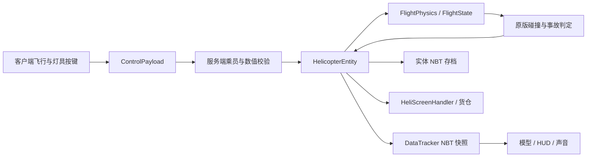

# 24号直升机开发手册

## 1. 项目总览

目标：Minecraft 1.21.1、Yarn 1.21.1+build.3、Fabric Loader 0.19.2、Fabric API 0.116.17+1.21.1。模组 ID `no_24_heli`，Java 包 `org.DJB.no_24_heli`。Loom 1.11.8 使用拆分的 main/client source set。Java 字节码目标为 21；本次使用 JDK 25 运行 Gradle 9.6.1。

本次开发遵循项目内《代码规范.txt》，曲面直升机与驾驶舱按用户提供的警用直升机参考图实现。函数、常量和关键逻辑采用中文注释；仅保留本手册和面向玩家的 README 两种说明文档。临时测试源码、测试任务及生成数据完成后删除。已有许可证、项目规范、构建资源不属于新增说明文档。

构建：先选择支持 Gradle 9.6.1 的 JDK（本次为 25，字节码目标仍为 21），在项目根目录运行 `./gradlew.bat build`。发行包为 `build/libs/No.24_Heli-2.2.1.jar`，源码包带 `-sources` 后缀；本次发行保留之前的 JAR。`runClient` 与 `runServer` 是 Loom 提供的开发启动任务。MP3 解码依赖 Maven Central 的 `javazoom:jlayer:1.0.1`，使用 Loom include 嵌入发行包，不要求玩家另装解码库。

## 2. 整体设计框架

服务端拥有所有物理、坐标、燃油、耐久、库存与事故判定。客户端仅提交操纵意图和离散动作，读取服务器快照绘制模型、HUD、声音与 GUI。



实体位置通过原版跟踪包同步并在客户端插值。`getControllingPassenger()` 返回 null，阻止原版载具移动包把驾驶员客户端坐标回写服务器；驾驶权限由 `isPilot()` 与 `getFirstPassenger()` 独立判定。不可随意改回返回驾驶员，否则需要重新审查位置权威。

## 3. 文件引用关系

1.2.0 新增模块：

| 文件 | 职责与引用 |
|---|---|
| `flight/NavigationController.java` | 导航距离→目标水平速度→加速度→机体姿态，复用 FlightPhysics |
| `network/NavigationPayload.java` | 客户端地图提交/清除导航点，实体校验机上乘员和坐标 |
| `data/AirspaceState.java` | 每维度 PersistentState 保存雷达位置、半径与所有者 |
| `block/RadarBlock.java` | 放置建区、右键打开服务器配置、破坏删区 |
| `network/RadarPayload.java` | 双向雷达半径请求/回执，服务端验证距离与归属 |
| `network/AirspacePayload.java` | 发给乘员的禁飞区快照，不发送所有者身份 |
| `client/hud/HeliRadar.java` | 5 tick 一次扫描已跟踪玩家/其他完好飞机，共享地图目标 |
| `client/screen/HeliMapScreen.java` | 分块 GPU 地形缓存；从 ExploredMap 增量读取探索区块、导航设点、禁飞圈、拖动缩放 |
| `client/screen/RadarScreen.java` | 半径输入校验、等待保存结果、只读提示 |
| `mixin/client/HeliHotbarMixin.java` | 乘机时取消 InGameHud.renderHotbar |
| `mixin/client/HeliDismountMixin.java` | KeyboardInput.tick 尾部拦截蹲下，上升沿请求服务端二次确认 |


| 文件 | 职责与主要依赖 |
|---|---|
| `No_24_heli.java` | 注册物品/方块/实体/声音/菜单/物品组，读取配置，注册网络与乘员维修事件 |
| `data/HeliConfig.java` | Gson 配置及数值范围校验，难度默认参数 |
| `flight/FlightState.java` | 速度、姿态、旋翼、部件、辅助及输入的纯数据 |
| `flight/FlightPhysics.java` | 20 Hz 积分器，依赖 FlightState 和 HeliConfig |
| `network/ControlPayload.java` | C2S 包、动作位与有限数校验 |
| `network/SettingsPayload.java` | 双向方块破坏设置包，服务器确认权限、结果与保存状态 |
| `network/DifficultyPayload.java` | 独立难度请求/回执，保持旧 settings 包格式 |
| `entity/HelicopterEntity.java` | 权限、世界碰撞、部件、乘员、维修、GUI、自检、存档、同步 |
| `item/HelicopterItem.java` | 整机物品放置和空间检查 |
| `block/HelipadBlock.java` | 材料检查、停机坪组装与原子扣料 |
| `screen/HeliScreenHandler.java` | 燃料槽、18 格货仓、36 格玩家背包、快速转移和访问权限 |
| `entity/RopeSeatEntity.java` | 分段惯性绳、多玩家独立 W/S 挂点、顶部 E 入副驾与脱绳确认 |
| `client/No_24_heliClient.java` | 按键、鼠标输入、音源生命周期、客户端注册 |
| `client/render/HelicopterRenderer.java` | 曲面机身、独立透明玻璃、主/尾旋翼、起落架及实体驾驶舱 |
| `client/render/HelicopterModel.java` | 静态平滑网格、开窗蒙皮、尾鳍、滑橇、座椅与操纵杆 |
| `client/render/CockpitDashboardRenderer.java` | 世界空间仪表、姿态/雷达、机组与右框异常/自动控制图标 |
| `client/render/CockpitTapeRenderer.java` | 方框垂速/世界高度、局部几何裁切、连续高低位数字鼓 |
| `client/render/FlightInstruments.java` | 按实体弱键缓存的连续飞行仪表读数，HUD 与机内面板共用 |
| `client/hud/HeliHud.java` | 空速、高度、垂速、旋翼/总距、油量、部件条、地平仪、告警 |
| `client/screen/HeliScreen.java` | 容器绘制与物品提示 |
| `client/screen/HeliSettingsScreen.java` | 设置按钮、服务器读取/保存反馈、本地默认设置 |
| `client/camera/HeliView.java` | 登离机视角恢复、V 切换、主副驾眼位、共同姿态与跟随 |
| `mixin/client/HeliCameraMixin.java` | 机内座位眼位及横滚投影基，机外 4–24 格距离与原版避障 |
| `mixin/client/HeliHandRendererMixin.java` | 机内隐藏第一人称手持物，不更改库存或实体装备 |
| `mixin/client/HeliMouseMixin.java` | 乘机且无界面时拦截视角锁定所绑定的鼠标键，避免触发原版选取方块 |
| `mixin/client/HeliCrewRendererMixin.java` | 主副驾固定坐姿、机体朝向与倾斜、头部自由观察及舱灯光照 |
| `client/audio/RotorSound.java` | 连续旋翼声音随转速/总距/空速变调变音量 |
| `client/render/RopeRenderer.java` | 按绳端到机腹的实际向量绘制，独立视锥裁剪，乘员由原版渲染 |
| `src/main/resources/assets/no_24_heli` | 语言、模型 JSON、贴图、声音 |
| `src/main/resources/data/no_24_heli` | 1.21.1 单数目录 recipe、advancement、loot_table |

模板中的 DataGenerator 和服务端空 mixin 配置保留用于后续扩展。客户端 DrivingInputMixin 只在本机玩家驾驶时拦截原版 Q/E 动作，防止丢弃物品或弹出背包；不覆盖原版键绑定，离机后恢复原行为。Z/X 提供可重绑的脚蹬输入；V 为机内/机外视角切换。旧默认右脚蹬 V 通过 v4 标记一次性迁到 X。

## 4. 函数调用关系

`ModInitializer.onInitialize → HeliConfig.load → 注册物品组、UseItemCallback、PayloadTypeRegistry、ServerPlayNetworking`。

`ClientTickEvents → ControlPayload → 服务端线程 → HelicopterEntity.control → 校验乘员/驾驶员/数据/频率 → 更新 FlightState 输入和辅助开关`。

`HelicopterEntity.tick → 输入超时清除 → 地面燃料消耗与停机坪补给 → FlightPhysics.handleAbandonment → FlightPhysics.step → Entity.move → collide / destroy → DataTracker.set`。

`interact → 维修 / 涂装 / 村民装载 / openMenu / startRiding`；`HelipadBlock.onUseWithItem → 检查材料与空间 → spawnEntity → 扣料`。

`B → safeHover → ensureRopeCarrier → attach`；机内 `Y → rappel → board(false)`，外部 `Y → 服务端绳形距离查询 → board(true)`；`RopeSeatEntity.tick → 分段积分/长度约束/碰撞 → 每名玩家独立挂点`。W/S 只改变个人沿绳距离，松键回中；顶部 E 经 ROPE_BOARD 显式进入副驾，空驾驶座仍按弃机规则处理。空绳继续展开，直到驾驶员收绳或飞机损毁。

`writeCustomDataToNbt → saveFlight + Inventories.writeNbt`；`readCustomDataFromNbt → loadFlight + Inventories.readNbt`。

## 5. 关键类与关键函数参考

### 1.2.0 高度保持与导航

`FlightPhysics.step` 在完成旋翼更新和姿态积分之后计算高度保持。当前 2.2.0 的高度误差乘 0.025 得目标垂速，限制 ±0.16 格/tick；垂速误差乘 0.12 得加速度指令，限制 ±0.012 格/tick²。所需总距为 `(重力 + 垂向阻尼补偿 + 指令加速度) / 当前垂向升力系数`，升力系数包含 rpm²、旋翼耐久、引擎耐久、雨天系数、cos(pitch) 与 cos(roll)。总距按目标差的 25% 渐变，每 tick 最多改变 0.008。不使用积分项，因此升力不足时不会积分饱和。空中高度保持下，升降输入指定 ±0.16 格/tick 的目标垂速，松键后先制动，再捕获新高度；地面、关闭高度保持或无动力时，手动总距仍每 tick 改变 0.008。完整衔接见第 54 章。

`NavigationController.step` 只负责导航输入：真实速度反馈加空气阻力前馈生成水平加速度，再转换为机体系俯仰和侧倾目标，沿用 `FlightPhysics` 的姿态响应、旋翼升力与高度闭环；脚蹬使用曲率前馈、航向误差与偏航角速度阻尼。杆量、目标速度和侧倾均有限幅与变化率限制。输入不随中性网络包、路径采样点或阶段切换清零。详细参数和 1.3.1b 调用链见第 20 章；手动控制与 `AutoFlightController` 保持原实现。

### 1.2.0 回收、下机与动画

`canRecover()`：非残骸、无乘员、引擎关闭、rpm<0.05、水平速度<0.08、|vy|<0.08，并且落地/方块支撑/接触水之一成立。水中每 tick 水平速度乘 0.65、垂速限制不低于 -0.06、rpm 额外减 0.025；引擎耐久不影响回收许可。空手蹲下交互将 Flight 和 19 槽库存放入整机物品 `minecraft:custom_data`，唯一物品交付后清空旧库存并移除实体。`restorePacked()` 只走模组字段读取，不应用任意 Entity NBT；重新放置归零速度/旋翼/总距/弃机计时并停机。

`requestDismount()` 在服务器保存每位乘员的 60 tick 确认期限。地面、方块支撑和水中直接下机；空中第一次警告，第二次确认。客户端先屏蔽原版 input.sneaking，只在按下上升沿发送 DISMOUNT，长按不能确认。绳上 Shift 也走同一客户端按下边沿拦截，RopeSeatEntity.control 按实际离地高度决定立即释放或 60 tick 二次确认；事故强制离机不受影响。

客户端每 tick 使用 0.45/0.40 两级姿态滤波，再由渲染帧 delta 在前后 tick 间插值；起落架也使用帧间插值。主体宽从 28 增至 34 像素，机头延伸至 Z=27，实体包围盒宽从 2.8 增至 3.4 格；整机放置与停机坪组装沿用实体包围盒检查。主旋翼尺寸保留。机腹重复立方体被删除，侧窗与编号放在外壳外侧，避免共面闪烁。


### FlightPhysics.step

输入：状态、服务端配置、是否落地、所在方块是否下雨、世界 Y、世界 tick。直接修改状态中的速度和姿态，不访问 Minecraft 世界，不执行爆炸。

旋翼转速归一化到 0–1。启动以 `1/spoolTicks` 每 tick 增加；达到 0.995 才置 `armed`。未置 armed 时总距不产生升力。起飞后 armed 不因瞬时转速不足清除，允许残余转速与无动力自转产生升力；落地且转速低于 0.05 时解除。

升力基础值为 `0.072 × collective × rpm² × rotorHealth × enginePower`，再以俯仰/横滚分解到水平和垂直方向。每 tick 重力 0.04。雨天引擎系数 0.94、旋翼效率 0.97。水平阻尼休闲 0.981，曼巴 0.994，垂向阻尼 0.985。速度上限：水平各轴 ±2.2、垂直 [-2.5,1.1] 格/tick。

无动力时低总距结合下降/前飞气流驱动旋翼；高总距消耗旋翼储能。前飞与下降还贡献受上限限制的自转气动力。该模型是可玩性导向的近似，不是六自由度空气动力学求解器。

### HelicopterEntity.control

不信任客户端数值。拒绝 NaN/Infinity、未知动作位、非乘员、非驾驶员飞控。同一世界 tick 只接受一份连续轴量；离散动作独立限流，避免同 tick 到达的中性包吞掉按键；连续输入超时 10 tick 自动回中，惯性仍保留。开关动作至少间隔 5 tick，引擎启停至少间隔 20 tick。货仓/绳降可由副驾驶操作。

### FlightPhysics.handleAbandonment

每次积分前按真正的第一座驾驶员是否为玩家判断。已预转且离地的无人驾驶飞机保存目标高度，前 60 tick 清除遗留输入、抑制水平漂移，将上升速度限制为不大于 0 并调总距；之后关闭高度保持与动力，逐步降总距，横滚趋向 55°、俯仰趋向 38°，逐渐失控下降。重新登机或落地清零计时；不会自动重启已关闭的引擎。AbandonedTicks 持久化，防止重载不断刷新三秒保护。

### HeliView / 地面输入约束

登机保存原 Perspective 并设 THIRD_PERSON_BACK；离机、换乘、断线时恢复。第三人称跟随用约 350 ms 时间常数平滑相机偏航/俯仰，只修改 Camera。机外距离初始 10 格，滚轮限制在 4–24 格，clipToSpace 沿观察方向收缩距离。座舱第一人称使用真实眼位、自由观察及独立滚轮 FOV，禁止锁定；其他载具保持原逻辑。当前机内视角与照明见第 41 章。

鼠标在空中与地面均不再产生飞控轴；俯仰、横滚仅来自 W/S、A/D。服务端 grounded 时清除周期变距和脚蹬、归平姿态并禁止偏航；原飞行物理保持。

自动配平默认 J。首次升级时检查 config/no_24_heli_keys_v2.marker，只有仍绑定 K 才迁移到 J 并保存 options.txt；写入迁移标记后不再覆盖玩家后续的自定义选择。

### collide / destroy

只计算真正碰撞轴上的入射速度，不把平行擦过墙面的速度全部算作撞击，也不只计算被阻挡的剩余位移。空中横向或向上碰撞超过 0.02 格/tick 直接爆炸；向下接地仍按速度阈值判断，保留自转迫降。空中非玩家实体接触的相对速度超过 0.02 格/tick 也会爆炸。crashObstacle 统一排除玩家、观察者、本机乘员和绳降座/乘员；collidesWith 同步使用过滤规则，避免原版实体移动碰撞先产生事故。脚底 0.08 格的薄盒仅查询方块支撑，连续 3 tick 离开支撑后启用实体事故；地面与刚放置的飞机忽略其他实体接触。查询使用实际包围盒，取消先前扩大的 0.05 格预碰撞范围。地面碰撞按速度线性扣耐久或在高速时解体。地面重力贴地的小量速度不算事故。

爆炸阈值休闲 0.9、曼巴 0.66 格/tick。起落架收起乘 0.75；俯仰或横滚绝对值大于 30 度再乘 0.7。机身清零但未触发高速事故时生成非爆炸残骸。爆炸事故先复制乘员列表再解除乘骑，并使用 genericKill 对机组造成致命伤害。

`explosionBlockDamage` 同时控制点火与方块破坏。残骸复用原实体并将 Wreck 置 true，故不会因服务器重启恢复成完整飞机。货物掉落一次后清空。回收后 discard，防止重复刷零件。

### HeliScreenHandler

槽 0=燃料，槽 1–18=货仓，槽 19–45=玩家主背包，槽 46–54=快捷栏。只允许煤油和原油进入燃料槽。界面访问要求距离小于 8 格且载具完好，并满足乘员身份或载具落地。菜单传输不接受客户端直接修改飞机统计值。

## 6. 接口介绍

### 1.2.0 新增协议

| ID | 方向与字段 | 校验与处理 |
|---|---|---|
| `navigation` | C2S：double X、double Z、boolean clear | 当前机上乘员、有限数、±29999984、世界边界；改点退出自动驾驶，仅驾驶员能开启 |
| `radar_settings` | 双向：BlockPos、VarInt radius、boolean update/editable/saved | 距离≤8 格、区块已加载、方块确为雷达、所有者或权限≥2、半径16–512；客户端只能信任回执 |
| `airspace` | S2C：VarInt 数量，重复 BlockPos/VarInt radius | 实体每20 tick发给乘员；按当前维度产生快照。1.3.1a取消512项上限，按包内实际剩余字节校验数量，字段顺序保持 |
| `controls` 扩展 | AUTOPILOT=256、DISMOUNT=512、AUTO_FLIGHT=1024、ROPE_BOARD=2048、灯具4096～65536 | 当前允许动作掩码131071；副驾驶可请求下机，自动驾驶/起降和探照灯仅驾驶员 |

调用链：`M → HeliMapScreen.mouseClicked → NavigationPayload → HelicopterEntity.navigate`；`U → ControlPayload → control → NavigationPilot.step → NavigationPlanningService.submit → 后台 NavigationRoute.plan → 主线程取结果 → NavigationController.step → FlightPhysics.step`。当前任务取消、结果失效与平面算法见第 20 章。

禁飞区：`RadarBlock.onPlaced → AirspaceState.put`；`onUse → RadarPayload → RadarScreen → RadarPayload → 服务端距离/归属校验 → markDirty`；`HelicopterEntity.tick 每20 tick → contains → Restricted 快照/乘员文字 → 客户端每40 tick播放警报`。方块 `onStateReplaced` 删除范围，包括爆炸替换。地面雷达并不强制加载区块，不攻击飞机。


C2S 自定义负载 ID：`no_24_heli:controls`。线格式：4 个 float（pitch, roll, pedal, collective）加 1 个 VarInt（actions）。服务端将操纵量限制到 [-1,1]。

| 动作位 | 数值 | 行为 |
|---|---:|---|
| ENGINE | 1 | 启停 |
| ALTITUDE | 2 | 高度保持 |
| TRIM | 4 | 配平 |
| CRUISE | 8 | 巡航 |
| GEAR | 16 | 起落架 |
| ROPE | 32 | 放/收绳 |
| EXIT_ROPE | 64 | 机内挂绳 / 外部抓取任意绳段 |
| MENU | 128 | 打开容器 |
| AUTOPILOT | 256 | 导航自动驾驶 |
| DISMOUNT | 512 | 二次确认下机 |
| AUTO_FLIGHT | 1024 | 一键起降/取消 |
| ROPE_BOARD | 2048 | 绳顶按 E 进入空闲副驾 |
| SEARCHLIGHT | 4096 | N 开关探照灯，独立五 tick 限流 |
| LIGHT_LEFT / LIGHT_RIGHT | 8192 / 16384 | 开灯时每 tick 左右调云台，各两度 |
| LIGHT_UP / LIGHT_DOWN | 32768 / 65536 | 开灯时抬高/压低光束，各两度 |

设置负载 ID：`no_24_heli:settings`，C2S/S2C 共用 codec，依次为 4 个 boolean：update（读取/修改）、destruction（期望/实际值）、editable（服务端权限结果）、saved（服务端保存结果）。服务器忽略客户端的 editable/saved，只允许 2 级权限玩家或整合服务器房主修改。失败时回滚配置并返回真实值。界面在收到回复前禁用按钮，避免乐观更新造成假状态；成功写入 config/no_24_heli.json 后立即生效。

`ScreenEvents.AFTER_INIT → OptionsScreen 唯一按钮 → HeliSettingsScreen → SettingsPayload → 服务端线程权限校验 → HeliConfig.save → SettingsPayload 回执 → 更新界面`。主菜单界面无服务器连接时直接保存本地默认配置。暂停菜单及设置子页面不注入入口。

难度负载 `no_24_heli:difficulty` 的格式为 boolean update、VarInt mode、boolean editable、boolean saved；mode=0/1/2 对应 CASUAL/MAMBA/ZOBAYAN。服务端校验枚举编号，仅使用发包者 UUID 读写 `PlayerFlightSettings`，所有玩家可修改自己的模式，不能指定其他玩家。`get(server)` 从主世界 PersistentState 获取共享个人表，`set` 标脏后随世界保存；`mode` 缺省使用配置 difficulty。驾驶员更新立即调用本机 `applyDifficulty`，其余飞机不受影响；机体每 tick 检查当前驾驶员模式并通过 `HeliConfig.forMode` 生成飞控配置。无人时保留本机模式，`DifficultyMode` 与 `HardcoreMode` 快照继续兼容。settings 仍仅管理员可修改全服爆炸破坏/着火，客户端 editable 位不受信任。联机双方必须使用本次同一修订构建。

S2C 飞行状态使用原版 `DataTracker<NbtCompound>`，每 2 tick 更新一次，实体坐标仍使用原版跟踪包。容器 PropertyDelegate 的索引 0–7 分别为燃油、容量、旋翼、尾桨、引擎、油箱、机身、转速百分比。容量上限 30000，适配原版容器 short 属性同步。

## 7. 参数介绍

| 参数 | 默认/范围 | 作用 |
|---|---|---|
| difficulty | CASUAL / MAMBA / ZOBAYAN | 未配置个人模式时的默认值；实际飞控按驾驶员个人模式计算 |
| rotorPreSpin | true | 预转 100 / 240 tick；关闭为 1 tick |
| wind | true | 基于时间的平滑风扰动，雨天更强 |
| explosionBlockDamage | true | 爆炸破坏与着火 |
| fuelCapacity | 1200，100–30000 | 油箱容量 |
| explosionPower | 5，0–12 | 原版爆炸强度 |
| autopilotCruiseKmh | 75，20–80 km/h | 自动驾驶巡航目标，20 TPS 下除以72换算格/tick |
| autopilotLookMin | 8，4–16 格 | 低速前视弧长 |
| autopilotLookMax | 30，最小前视–48 格 | 高速前视上限 |
| gridCellSize | 2，0.25–64 格 | 八邻接 A* 的初始方格边长 |
| pathSafetyMargin | 2，0–1024 格 | 禁飞圆扩张中的附加余量，另加机体碰撞箱外接圆半径 |
| pathBoundaryMargin | 16，1–4096 格 | 全部圆及起终点的动态外边界余量 |
| pathMaxCells | 1000000，1–2000000 | 单次网格分配上限 |
| pathMaxNodes | 1000000，1–2000000 | 单次规划含细化与宽路线尝试的累计节点上限 |
| 维修恢复量 | 地面 30 / 应急 3 | 油箱只允许地面大修 |
| 维修间隔 | 20 / 200 tick | 防止每 tick 消耗维修包刷恢复 |
| 绳降门槛 | 3 < AGL ≤ 24；水平 < .10，垂直 < .075 | 单位格/tick |
| 绳降速度 | .23 格/tick | 约 4.6 格/秒 |

燃油基础消耗为 0.016/tick，按空速、周期变距、总距操纵、引擎损伤和难度放大。油箱低于 80 时，额外漏油 `(80-tank)×0.0015/tick`。

## 8. 存档格式与版本兼容

实体顶层保留原版 Entity NBT 字段。自定义 `Flight` Compound 的 Version 当前为 4；货仓按原版 `Items` 列表及 1.21.1 ItemStack 编解码器保存。实体类型 ID 不可随意更名，否则旧存档会丢失载具。1.2.1 新增字段及旧版迁移见本手册末尾。

| 字段组 | 键 |
|---|---|
| 飞行连续量 | Rpm, Collective, Pitch, Roll, Yaw, YawRate, Vx, Vy, Vz |
| 燃油与耐久 | Fuel, Rotor, Tail, Engine, Tank, Hull |
| 辅助目标 | TargetAltitude, TargetSpeed |
| 状态开关 | Running, Armed, Altitude, Trim, Cruise, Gear, Wreck, Rope, HardcoreMode |
| 外观/绳长 | Paint, RopeLength |
| 无人驾驶 | AbandonedTicks（旧版缺省为 0，加载限制 0–1000000） |

缺少部件字段时默认 100；燃油默认 0，起落架默认放下。所有连续值加载时校验有限数并限幅。重载清除操纵输入并收回机上绳索；已经在绳降座上的乘员通过原版 passenger NBT 继续下降。数据格式增加字段时提供旧版默认值；不应重置 Wreck、燃油或现有库存。

本版没有承诺与其他 Minecraft 版本二进制兼容。升级 Minecraft 时应同时检查实体 tick、DataTracker、数据包 codec、ItemStack NBT 和资源目录名。

### 新增涂装与 HUD 布局

紫金涂装追加在 PAINTS 尾部，索引 5；旧 0–4 索引保持。新增 paint_purple_gold 物品、无序配方、配方解锁、物品贴图与 heli_5.png 实体 UV 贴图。主色 RGB #552583，饰色 #FDB927。HelicopterRenderer 的 number 子模型在 paint==5 时显示，用双侧像素几何形成“24”；左右沿 Z 方向相反排列，从机外均可正读。编号用 (192,192) 附近金色 UV 区，避开机窗，不修改其他涂装贴图。

HeliHud 以 0.85 倍 GUI 比例绘制。底部组额外使用 min(1,宽度/560) 缩放：最左下为燃油/旋翼/总距仪表，控制状态和机身模式在其上方，机组占位框在文字区上方。底部中央为 150 单位宽的连续五段耐久条，无段间留白，损伤仍独立计算。最右下为空速盘，向左依次为垂速竖条和高度/垂速数字。垂速指针 ±20 m/s 范围，正值向上，零居中，超量程仅钳制指针，数字保留真实值。高度数字为世界 Y。右上为雷达及姿态仪。设置入口在横向居中的可用空行放置。

## 9. 扩展开发指南

| 常见任务 | 修改位置与检查点 |
|---|---|
| 调整飞行手感 | FlightPhysics；验证预转锁定、悬停、惯性、无动力拉平，不能只看构建 |
| 增加机型 | 独立注册实体/物品，参数化 FlightPhysics，重新定义座位与碰撞尺寸 |
| 增加后排 | canAddPassenger、updatePassengerPosition、绳降选择、模型与座舱视角一起修改 |
| 新增燃料 | 注册物品、槽位过滤、quickMove、地面补给、停机坪扫描、配方和文档同步修改 |
| 新涂装 | PAINTS、纹理、存档 Paint 范围、模型纹理选择、翻译和配方 |
| 新部件 | FlightState、NBT、DataTracker、伤害映射、维修、HUD、GUI、配方同步扩展 |
| 新控制 | ControlPayload 位掩码、valid、服务端权限、键绑定、语言文件和玩家说明 |
| 改爆炸 | 保持服务端执行与单次残骸转换；重测乘员致命伤害和方块破坏开关 |
| 改存档 | Version 递增，显式迁移逻辑，验证带货仓的旧损坏飞机与残骸 |

## 10. 常见故障定位

- 启动就崩溃：先检查 Java/Fabric/API/Minecraft 版本，再看日志中的首个异常，不把所有后续异常当作独立错误。
- 旋翼满转仍不升空：检查总距、旋翼耐久、引擎功率、雨天、是否被方块阻挡。零总距不产生升力。
- 高度保持不起作用：需要引擎运行、已完成预转且在空中；辅助开启时升降键改为指定升降速度，松键制动后捕获新高度；引擎无动力会退出自动高度和巡航。
- 机体突然回弹：检查是否误启用原版客户端载具移动权威，或网络输入处理跨线程。
- HUD 有数值而机体不动：检查服务器 move、碰撞轴和客户端插值；禁止通过每 tick 瞬移修饰问题。
- 燃料不补充：必须落地，燃料槽物品正确且油箱至少能容纳完整一份；故障漏油可能抵消补给。
- 绳索不部署：检查实际地表射线距离、水平/垂直速度。世界 Y 坐标并不是离地高度。
- 物品紫黑格：检查 models/item、textures/item、注册路径和资源大小写。
- 配方不显示：1.21.1 使用 recipe 单数目录；检查 JSON result.id、解锁 advancement 与配方书搜索。
- 旧版 K 仍冲突：检查迁移标记和按键界面，手动重绑 J 或其他未占用键；迁移只执行一次。
- 设置不可点击：读取期间暂时禁用；普通玩家可修改自己的飞行模式；只有爆炸破坏与着火需要房主/管理员权限，保存失败检查写权限。
- 中键跟随不响应：必须乘坐直升机、使用第三人称且没有打开界面；第一人称主动禁用锁定。N 控制机腹探照灯，视角锁定可以在原版控制菜单中重绑键盘或鼠标。
- 编译使用 Java 8：Windows 默认 java 可能仍是 8，先明确 JAVA_HOME，再运行 wrapper。

## 11. 附录：注册 ID / 翻译键 / 常量

所有下列 ID 都以 `no_24_heli:` 为命名空间。

| 类型 | ID |
|---|---|
| 实体 | helicopter, rope_seat |
| 物品 | helicopter, rotor_assembly, tail_rotor, engine_module, fuel_tank, fuselage, repair_kit, kerosene, crude_oil |
| 涂装 | paint_olive, paint_snow, paint_desert, paint_black, paint_rescue, paint_purple_gold |
| 方块及方块物品 | helipad |
| 物品组 | equipment |
| 容器 | service |
| 声音 | rotor, alarm, rotor_damage, radio（MP3 虚拟流） |
| 网络 | controls, settings, difficulty |

语言文件 `zh_cn.json` 和 `en_us.json`。前缀包括 `item.no_24_heli.*`、`block.no_24_heli.*`、`entity.no_24_heli.*`、`key.no_24_heli.*`、`hud.no_24_heli.*`、`warning.no_24_heli.*`、`message.no_24_heli.*`、`gui.no_24_heli.*`、`subtitles.no_24_heli.*`、`screen.no_24_heli.*`。每个客户端显示文本应通过翻译键输出。

## 12. 本版验证与边界

2026-10-10：使用真实 Fabric 0.19.2 / Minecraft 1.21.1 测试服务端，10 项 GameTest 全部通过。验证项包括预转门槛、低总距禁飞、惯性与方向、尾桨失效及反向脚蹬、故障漏油与雨天功率、自转迫降、高度保持、实体/货仓保存、双座与驾驶权限、非法输入、地面燃料与应急维修、真实碰撞生成残骸。

自转测试从 55 格模拟高度开始，低总距下滑并近地拉总距，接地垂速约 0.282 格/tick，未达到解体阈值。这个结果只证明该测试情境可迫降，不代表任意姿态或损伤状态都可安全着陆。

真实客户端已成功载入测试存档，并通过驾驶 E 键拦截和村民绳降无伤落地验收（接地后生命值仍为 20）。绳降座必须清除自身 fallDistance 并覆盖 handleFallDamage，防止原版把载体跌落伤害转发给乘员。核对实体贴图、旋翼动画、飞行 HUD 和燃油/货仓界面，并修正了乘员位置、模型表面剔除与第一人称遮挡。第一人称显示驾驶 HUD 和无遮挡外部视野；第三人称显示完整机体。多人网络延迟、长时间飞行、复杂地形和大型整合包仍需要实机联机验收；原生模型、合成音效与简化飞控是首版实现。


### 1.1.0 回归验收

2026-10-10：9 项真实 Fabric GameTest 已通过：地面姿态锁定、跳机高总距悬停转下坠、重新登机中断计时、计时存档与旧格式缺省、空中撞墙/撞顶/撞实体、低速接地不爆炸、高速接地解体。其中关闭方块破坏时，撞墙爆炸后测试墙保持完整。补充 2 项 GameTest 也通过：低速空中接触实体触发爆炸、开启方块破坏后实际炸毁测试墙。本次共 11 项服务端验收。

真实客户端 13 项检查通过：登机第三人称、相机距离约 10.0000006 格、有效旧版 options.txt 中 K 迁移为 J、实际 Mouse.onMouseButton 中键回调、相机逐渐追上机头、选项页入口、设置页打开、服务器修改与文件持久化、真实无人驾驶实体在 Y=135 附近短暂悬停后下坠、退出恢复视角及关闭跟随。画面检查确认乘员模型隐藏；修正 Screen.render 再次绘制模糊背景导致说明文字模糊的问题，复拍确认标题、解释、保存反馈和按钮清晰。

尚未进行两个独立客户端的联机及第三方相机/按键模组兼容验收。测试入口、测试代码和临时世界在验收后删除，发行包不携带测试组件。


### 1.1.0 同版本修订验收

2026-10-10：本次 10 项真实 Fabric GameTest 全部通过，覆盖实际整机物品贴近玩家放置、地面动物接触、空中非乘员玩家接触、正常载人悬停不自爆、真实空中动物接触仍触发事故、撞墙、高速/低速接地、已有飞机的难度即时切换及状态保留、紫金涂装应用与 NBT 保存。飞行用例使用测试结构内部空域，避免结构外支撑把测试飞机变成地面停放。

真实客户端完成 12 项检查：GUI 2/3 下入口水平居中与不遮挡原控件、房主难度按钮可用、真实网络开启曼巴、配置持久化、现有飞机辅助立即关闭、重新打开设置读取模式、HUD 接收模式，以及暂停菜单入口。截图核对新涂装左右两侧“24”均正读、窗口无遮挡，HUD 三分区和小型姿态仪正常；现有五种涂装贴图未修改。没有进行第三方相机模组或独立多客户端联机验收。

版本号按要求保持 1.1.0，原 settings 网络格式保持；新增 difficulty 通道和 paint_purple_gold 注册项，联机需客户端与服务器使用同一修订构建。临时源码、任务、世界、截图和 IDE 测试运行配置全部在验收后清除。


## 1.2.0 存档与维护补充

- 实体 `Flight.Version=3`，新增 `Waypoint`、`WaypointX`、`WaypointZ`、`Autopilot`、`Restricted`。客户端快照读取全部字段，磁盘存档加载主动关闭 Autopilot/Restricted；旧存档缺少导航字段默认无导航点。已有 Flight 字段和货仓槽位不改名。
- 回收物品使用 `minecraft:custom_data` 下的 `Flight` 与原版 `Inventories.writeNbt` 生成的 `Items`。再次放置保留损伤及货物；创造模式也消耗带 CUSTOM_DATA 的回收机。
- 禁飞区写入各维度 `data/no_24_heli_airspace.dat`：`Version=1`，`Zones` 为列表，元素含 `Pos`（BlockPos long）、`Radius`（int）、`Owner`（UUID）。通过 PersistentStateManager 按维度管理，重启/卸载区块不丢失。
- 旧 `no_24_heli_keys_v3.marker` 曾用于鼠标操纵键迁移；当前鼠标飞控与该迁移入口均删除，N 默认绑定新的探照灯，地图仍为 M，自动驾驶仍为 U。v2 配平和 v4 视角/脚蹬迁移保留。
- 雷达注册 ID 为 `no_24_heli:radar`，同时用于方块、物品、模型、方块状态、配方与战利品。新增语言键使用 `key.*.map/autopilot`、`screen.*.map/radar/radius`、`hud.*.crew/radar/waypoint/autopilot`、`message.*.recovered/recover_unsafe/exit_warning/restricted` 等命名；具体文案以 zh_cn/en_us 资源为准。

### 常见改动速查与故障定位

- 调高度保持：改 FlightPhysics 的目标垂速与加速度限幅，至少回归晴雨、两种难度、80%部件、爬升初速度和前飞后回平；不能只在静止完好机上试验。
- 调导航：改 NavigationController，保留控制权先判手动再生成导航指令；不得用坐标瞬移替代物理。
- 调禁飞范围：同步修改 AirspaceState 常量、RadarScreen 输入长度/限制和文档。增加协议字段时同时更新 CODEC 双端。
- 雷达看不到远处玩家：机载雷达通过 radar_contacts 接收512米内的服务端已加载目标，每10tick刷新；检查两端是否更新、目标区块是否在服务器加载。1.2.1 地图纸色区域代表该客户端尚未记录地形，已记录的卸载区块可继续显示。
- 无法回收：检查乘员、running、rpm、速度及支撑/接水状态；引擎耐久零不应阻止回收。必须空手蹲下；普通物品蹲下是货仓入口。
- 自动驾驶开启失败：检查驾驶员、导航点、引擎、armed、实际离地至少10格，以及是否仍按住操纵键。鼠标自由观察和探照灯瞄准均不会主动接管飞控。
- 禁飞区保存失败：检查操作距离、方块是否仍在、所有者/管理员权限、半径范围；拆除雷达会撤销该区。1.3.1a取消旧512区上限，NBT中的全部有效记录均会加载。
- 重复设置按钮：只允许 `screen.getClass()==OptionsScreen.class` 注入，注入前删除同文案旧按钮；模组设置及暂停页面不应注入。

### 1.2.0 验证记录

正式构建通过。临时纯物理验收共12项：8组高度保持（休闲/曼巴×晴/雨×100%/80%部件，含初始垂速及前飞后归平），2组导航到点悬停，2项动力故障和预转回归。高度测试末段误差及波动均低于0.08格，导航最终距点小于0.44格。

隔离专用服务端18项验收通过：损坏机体地面/水中回收、物品交付和移除、燃油/损伤/涂装/7颗钻石货物保留、运行中禁止回收、导航坐标有限数、自动驾驶开启与接管、空中两次确认/地面直接下机、禁飞边界、NBT写入、拆雷达删区、未知动作位拒绝。

真实开发客户端连接本机专用服务端，16项检查通过：选项入口唯一/重复打开不增殖/子设置及暂停无入口、登机视角、禁飞区同步、其他飞机扫描、相机距离上下限、地图设点与雷达半径网络往返、真实U键开启自动驾驶、W接管、Shift长按不跳机及松开再按确认。已查看实际截图中的机身/机头、无快捷栏HUD、边缘状态面板、乘员、雷达、地图和半径界面。

验收针对原版Fabric开发环境。未做第三方相机/地图模组兼容或多人公网压力测试；该历史版本当时不包含自动避障；2026-10-11 修订已增加前视制动与爬升检查。临时测试代码、启动配置、测试世界、截图及产物在验收后删除，不随发行包保留。

## 1.2.1 架构、接口与维护补充

### 新模块及调用关系

| 文件 | 职责 / 调用方 |
|---|---|
| `flight/AutoFlightController` | 以起降水平锚点计算刹车杆量；预转→爬升，降落使用已有高度控制；由实体 tick 调用 |
| `client/ExploredMap` | 监听 ClientChunkEvents，采样原版地图颜色，按世界/维度缓存已探索区块；HeliMapScreen.sample 调用 color |
| `RadioPayload` | C2S VarInt track，-1关台、0–7八槽；No_24_heli 接收后调用实体 selectRadio |
| `client/RadioLibrary` | 按连接类型选择本机config或服务器缓存；公开 available/prepare/open 接口供圆盘、管理器与解码器调用 |
| `client/RadioWheelScreen` | Tab 持续按住显示，鼠标八扇区选择，松手发送 RadioPayload；中心关台，Esc 取消 |
| `client/RadioManager / RadioSound` | 每架已跟踪飞机一条音源；机内相对音源、机外按玩家实际位置衰减，切歌/离机/销毁清理 |
| `client/Mp3AudioStream` | JLayer逐帧MP3→16bit little-endian PCM，循环与偏移接入；实现 Minecraft AudioStream |
| `mixin/client/RadioSoundLoaderMixin` | 仅拦截本模组虚拟 sounds/radio 路径，将原版流加载替换成异步 MP3 解码 |

起降链：`K → ControlPayload.AUTO_FLIGHT → HelicopterEntity.toggleAutoFlight → 地形与模式校验 → autoPhase → AutoFlightController.step → FlightPhysics.step → 原版碰撞 → 接地停机`。不直接移动实体或跳过事故判定。输入接管、换点、切换模式、入水、动力故障和失去驾驶员均取消自动任务。空中按 K 会探测中心与四角 ±1.5 格，要求无流体、支撑面高差≤0.25；起飞检查包围盒向上10格的通道。降落目标设为表面下0.2格，使高度控制缓慢压向地面；终止必须 `isOnGround()`，不能只用提前0.08格触发的支撑探测。

电台链：`Tab → RadioWheelScreen → RadioPayload → selectRadio → DataTracker → RadioManager → RadioSound → SoundLoader mixin → Mp3AudioStream → OpenAL`。选曲允许本机驾驶/副驾驶，拒绝残骸、越界槽位、非乘员和5tick内重复请求。声音类别为 RECORDS；虚拟路径含槽位与从 `RadioStarted` 算出的毫秒进度，不允许服务器指定任意文件路径或 URL。客户端文件未就绪时不播放，坏文件记录日志；再次关台/选曲可清除失效音源。

### 参数与模式约束

| 参数 / 状态 | 含义 |
|---|---|
| autoPhase | 0关闭、1预转、2爬升、3降落；地面目标为当前位置+20格，预转和爬升期间复核剩余上方净空 |
| autoX/autoZ/autoY | 起降临时锚点，不持久化；水平位置反馈0.008、速度阻尼0.15，加速度限制±0.015 |
| navAligned | 单次导航是否已完成初始对准；重新启用U时清零，不跨存档恢复 |
| radioTrack / radioRevision / radioStartedTick | 当前槽、切歌序号、开始世界tick；序号区分同一首歌曲重新播放 |
| RadioSound.gain | 机内0.65；机外 `0.65×max(0,1-distance/64)²`，两者再乘游戏音量设置 |
| 佐巴扬飞行磨损 | 离地、armed且rpm>0.2时：引擎0.002、机身0.0005、主旋翼0.0006、尾桨0.0003 每tick |

`hardcore()` 表示曼巴或佐巴扬，控制既有硬核物理及禁用K；`unassisted()` 只表示佐巴扬。后者在网络操作门禁与物理入口双重禁用全部飞控辅助，避免旧NBT或伪造包绕过。休闲默认配平/高度保持开启、巡航关闭；曼巴默认全部关闭但可手动开启及使用U；佐巴扬始终全部关闭，不使用弃机的三秒辅助悬停。相机跟随、雷达、地图、警报、电台不属于飞控辅助，仍可使用。

雷达 `relative(dx,dz,yaw)` 统一转换实体、导航点及方位字：`x=-dx*cos(yaw)-dz*sin(yaw)`，`y=dx*sin(yaw)-dz*cos(yaw)`；Minecraft 偏航0为南。圆半径38像素，超范围导航点保持方位钳在圆周。方位字保持正立并在外圈转动，移除标题与距离文字；本机指针缩小。禁飞区边界共用 relative 变换，逐像素圆形裁剪红色弧线，圆心在雷达外也可显示边界。机体耐久以五段独立比例拼成底部横条；双座框直接读取乘员数量，不传输或渲染姓名。

### 探索地图与存档兼容

客户端每tick最多采样4个收到的区块，卸载前再采样一次，脚下区块每秒刷新。每块保存16×16原版地图色字节，以WORLD_SURFACE定位表面，透明颜色继续向下查找；高度差决定地图明暗。内存最多32768块，超出按最近使用顺序淘汰，磁盘保留。文件是 `config/no_24_heli_maps/<世界及维度UUID>/<chunkX>_<chunkZ>.bin`，长度256字节。UUID由单人存档绝对路径或服务器地址加维度ID生成；改服务器地址/移动单人存档会使用新缓存。磁盘写入通过单线程队列与临时文件替换，界面只排队，IO线程按需读取旧瓦片，最多256个在途读取，不保存或加载世界实体。未探索区域缓存为空瓦片并显示纸色。删除该目录只会清除本客户端地图记录。

`Flight.Version=4` 新增 `DifficultyMode`、`AutoPhase`、`RadioTrack`、`RadioRevision`、`RadioStarted`。快照需要读取起降/电台状态，磁盘加载则强制关闭 autoPhase/autopilot/radioTrack/restricted，不恢复未完成任务；导航点、库存、燃油、耐久和涂装照旧保留。Version<4的旧飞机迁移时关闭巡航；缺少完整难度字段时，在驾驶员登机后应用其个人模式，未配置者沿用服务器默认。回收整机继续走相同迁移流程。禁飞区PersistentState版本仍为1，不需要重设半径。

### 扩展、排查及注册ID

- 添加音乐：单人放本地 `config/no_24_heli_radio/slot_1.mp3`…`slot_8.mp3`，多人放服务器的同名目录。多人客户端自动获取服务器文件，不读本机同名歌曲或资源包。服务器添加/替换文件后重启世界以刷新目录；单人新增文件会刷新可用槽，替换当前歌曲需关台重选。
- 扩展曲目数量：同时修改 RadioFiles.TRACKS、服务端track范围、RadioManager数组、圆盘分区和NBT限制，不能只改GUI；新增的目录/下载状态数组也须保持一致。
- 修改起降：在 AutoFlightController 调整杆量，保留实体模式/碰撞门禁；不要通过setPosition实现自动飞行。若K不响应，检查模式、燃油、引擎≥30、旋翼≥70、头顶净空与地面平整。
- MP3静音：检查固定文件名、唱片机/音符盒音量、空槽提示与日志“MP3无法播放”；支持解码的是实际MP3，改文件扩展名不能转换格式。JLayer在客户端使用，专用服务端不加载声音类。
- 地图旧地形缺失：先确认该客户端安装1.2.1后实际接收过区块，再检查服务器地址/维度是否改变及缓存是否可写。不会读取服务器未发送的世界文件，不能补回安装前的探索历史。
- UV扩展：机身箱体自动UV宽为 `2×(宽+深)`，机身颜色只占贴图前128列；34×38越界，现沿Z拆成两个34×19箱体，各占106列。紫金编号底牌只采纯紫区域，数字位于底牌外层，避免金条重叠和共面闪烁。
- 新协议ID `no_24_heli:radio_control`、声音ID `no_24_heli:radio`；新按键翻译 `key.no_24_heli.auto_flight`；电台翻译前缀 `radio.no_24_heli.*`；方位字 `hud.no_24_heli.north/east/south/west`。Tab为固定键，乘机时屏蔽原版玩家列表，下机恢复。

JLayer保持未修改，其逐文件版权声明与对应源码、LGPL文本放在发行包 `META-INF/licenses/`；运行依赖由Loom单独嵌入 `META-INF/jars/`。升级依赖时同步更新该许可证/源码资源与Maven坐标，不将其混同于模组自身许可证。

### 1.2.1 验证记录

纯物理13个场景通过：休闲/曼巴各4个初始航向的先对准后到点、一键预转爬升10格、低速降落、严格模式清除辅助、引擎磨损大于机身、地面无飞行磨损。MP3使用临时1秒双声道测试音验证采样格式、非静音PCM、循环、一小时偏移接入、非法文件拒绝；该测试音不作为音乐交付。

专用服务端11项检查通过，包含真实实体起降及接地关机、默认巡航关闭、槽位边界、存档清除自动任务/电台、两种高难模式禁用K、严格模式服务端拒绝辅助。

真实客户端18项检查通过，包含方向变换、空槽、八分区选择、MP3进入OpenAL播放、机内固定音量/外放衰减函数、镜头最远时警报相对音源、M仅乘机开启及再次关闭、右键设点、区块卸载后从磁盘恢复探索地图、模式网络同步与严格限制、离机后的M门禁。已查看实际HUD、两侧紫金编号及机头、地图和电台圆盘截图，并修正雷达底部方位与标题的重叠。外放衰减验证基于客户端计算及实际音源，不声称进行了两台电脑的听感测试；未验证第三方UI/声音模组组合。临时验收入口、测试任务、世界、截图、音频及依赖测试目录完成后删除。

## 1.2.1 同版本电台来源修订

此修订不改版本号、实体NBT、选曲协议及音量规则，仅改变MP3来源。服务器与客户端都应更换为本次构建。`MinecraftClient.getServer()!=null`表示本机整合服务器，直接读本机config；专用服玩家及LAN来宾从服务器获取，LAN房主的本机config同时就是服务器config。远程目录未同步、空槽或下载失败时保持等待/静音，绝不回退成本地同名文件或资源包歌曲。

### 新增模块与网络格式

| 模块 / ID | 作用与边界 |
|---|---|
| RadioFiles | 固定八个文件名、32MiB单曲上限、24KiB分片、流式SHA-256；不接收网络路径 |
| RadioTransferServer | SERVER_STARTED后台建目录，每名听者每tick最多处理一个分片；服务器停止清理IO线程，离线清理队列 |
| `radio_catalog` S2C | 固定8组 VarInt size + 长度≤64的hash字符串；size=0/hash空代表空槽，非空必须是64位小写十六进制SHA-256 |
| `radio_request` C2S | VarInt track + VarInt offset；槽位0–7、偏移非负且按24KiB对齐、严格小于文件长度 |
| `radio_data` S2C | VarInt track + VarInt offset + 最多24KiB字节数组；空数组表示失败 |
| client/ServerRadioCache | 连接INIT/断开清理会话；缓存检查→排队→逐包获取→摘要校验→可播放，失败有超时及重试 |

上述网络ID均属于 `no_24_heli` 命名空间。分片许可还要求玩家64格内有正在播放该槽位的完好飞机，附近未乘机玩家也可获取外放。每位玩家只允许一个待处理/读取中的请求，服务器单IO线程每次仅读取一个分片，不把八首歌曲常驻内存。目录哈希计算、文件读取不阻塞服务器tick；目录初始化完成后发给在线玩家和后来加入者。读取分片时比较文件大小及修改时间，歌曲中途被替换会拒绝继续传输，管理员需重启世界建立新目录。

客户端只在需要播放时请求歌曲，不在登录时下载全部八首。完整缓存按 `config/no_24_heli_radio_cache/<会话UUID>/<SHA256>.mp3` 存储；同一连接中的相同内容可复用，不同服务器的不同内容不会串曲。复用前在IO线程校验长度与摘要；新数据按请求的槽位/偏移/剩余长度逐包写入临时 `.part` 文件，最终摘要正确才替换完整文件。一次最多下载一首，15秒无响应判失败，10秒后可重试；断线/CLIENT_STOPPING 先停止音源、关闭已打开的解码流及分片，再异步删除该会话的完整和未完成文件；快速重连换会话目录，连接代数阻止旧异步回调污染新会话。缓存不写实体存档，删除后可重新获取。

调用链新增：`RadioManager → RadioLibrary.prepare → ServerRadioCache → radio_request → RadioTransferServer → radio_data → 校验缓存 → RadioSound → Mp3AudioStream`。圆盘是否可选依服务器目录，是否可播放另由prepare判断；目录晚到时圆盘会刷新。下载完成时沿用RadioStarted进度计算，音乐不会从头与其他听者错开。单人直接打开本机文件，跳过下载链。

排查：先检查文件是否放在实际服务端运行目录的config、目录初始化日志和32MiB限制，再看客户端缓存目录写权限及下载失败提示。更换服务器歌曲后必须重启世界；本机同名文件不影响远程播放。包版本显示均为1.2.1，因此排查时还需确认双方使用本次同版本修订包。

修订验收：真实开发客户端连接专用服务器，11项检查通过，包括本地有文件但服务器空槽时不可选、服务器独有歌曲可选、本地同名内容不影响选择、多分片获取及SHA-256一致、两首服务器MP3实际播放、切歌清理、缓存复用、非法请求不中断连接和关台释放音源。另进入真实单人存档，8项检查通过，包括整合服务器识别、本机槽位目录、忽略网络目录、直接读取本地原文件、超限目录/非法摘要拒绝、本地MP3播放及不需要下载缓存。临时测试代码、测试世界、音频、缓存和启动配置验证后清理；未进行多人公网带宽压力测试。


## 17. 2026-10-11 绳索救援、航线避障及客户端性能修订

本章保留当时实现与验证记录；当前多人手动攀爬和 GPU 地图增量更新以第 23 章为准。

本章保留历史修订与验收记录；其中可见图寻路、圈内驶离规则已由第 19 章的 1.3.1a 二维 BFS 替代。

### 17.1 新增类、接口与调用关系

| 类 / 接口 | 责任与调用者 |
|---|---|
| `RadarContactsPayload` / `radar_contacts` | S2C；实体每10tick给机内玩家发送512米内最近512个已加载目标，仅含机体ID、X/Z与目标类型；HeliRadar.receive接收 |
| `NavigationRoute.Point / Circle` | 不依赖世界的平面航路数据；plan构造外接十六边形可见图，clear检查整条线段与所有禁飞圆柱的距离 |
| `NavigationPilot.step` | HelicopterEntity每tick调用；缓存AirspaceState.revision与终点，按需规划，前方与惯性方向净空检查，输出速度上限与高度目标 |
| `RopeSeatEntity.attach / board / control` | 绑定机体UUID、接收一名乘员、处理方向和Shift确认；ground玩家Y只允许从3格内空绳端进入 |
| `RopeRenderer.shouldRender / render` | 绳端与机体包围盒并集参加裁剪；四元数把模型朝向实际机腹连接点，不依赖机体本身是否可见 |
| `ServerRadioCache.clearSession` | 停止音源、清目录/分片状态、同步关闭解码输入流，退休目录交IO队列删除；关闭客户端最长等5秒完成队列 |
| `ExploredMap.color / revision` | 主线程只访问LRU或提交异步读取；世代号排除旧世界回调，新瓦片改变revision触发地图纹理刷新 |

服务器 `ControlPayload` 不增加动作位：机内Y为EXIT_ROPE，地面Y抓绳；绳上collective正/负改变攀升/下降方向，DISMOUNT交给绳端确认。非有限输入、旁观者地面抓绳、远距离抓取及已占用绳索均拒绝。绳端的getControllingPassenger返回null，客户端不能通过原版载具坐标包绕过服务端物理。

### 17.2 参数和约束

- 放绳：`3 < AGL ≤ 24`，水平速度 `<0.10`、垂速绝对值 `<0.075` 格/tick。
- 绳端：向上缩绳 `.14`、下降放绳 `.23` 格/tick；满舱保留 `2.5` 格绳长；重力 `.04`，速度阻尼 `.985`，去除拉紧时的径向外速度、保留切向惯性。落地清零乘员和绳端跌落累计。主动脱绳只继承当前速度，之后正常累计坠落。
- 地面抓取：绳端附近3格，实际查询框为玩家包围盒扩展2.5格；一根绳一次一人，已占用时拒绝收绳。空位恢复后攀升乘员自动转移入舱。
- 主动脱绳：向下4格射线，以绳端上方0.15格的人物脚部为准；`≤3` 格单次释放，`>3` 格需要60tick内第二次Shift按下边沿。
- 航线：目标速度上限 `.80` 格/tick（57.6 km/h），距离减速系数 `.025`，实际速度还受阻力限制；角差超过30°重置对齐，低于6°且角速度低于0.7再前飞。
- 禁飞规划：圆半径外预留18格安全距离；每圈16个候选点，最多取距直接航线最近的24个圈构图，但所有边都对完整禁飞区列表检查。图规模有上限，复杂包围场景找不到路线时制动悬停，每100tick可重试。贴圈终点可能没有足够安全余量。
- 局部避障：旋翼包围盒水平扩展2格、垂直扩展0.7；前视距离至少24格，随速度增加到 `speed×50+12`；惯性方向看40tick。只访问已加载区块，抬高4、8…24格逐一检查竖直通道和前方通道，没有净空时停止水平前进。
- 地图：192×112纹理、最高10Hz刷新、每帧一个地形四边形；32768块LRU/空瓦片负缓存、256个在途读取；关闭界面释放GPU纹理，区块缓存继续保留。地图宽为GUI宽-40，高为GUI高-112。
- HUD：五段耐久总宽最多240逻辑像素，外框5像素高，文字缩放0.65；主仪表随屏幕空间缩放，均有数字读数。`key.no_24_heli.follow` 默认mouse.middle，原版options保存重绑结果。

### 17.3 存档与兼容

直升机Flight存档版本仍为4，新增航线缓存属于临时状态，不写盘，不改变燃油、货仓、损伤、涂装与原导航点。绳端写入 `Anchor` UUID、`Length` 与 `Direction`，原版Passenger NBT保留乘员。旧绳降座缺少Anchor时沿用下降；机体重载依旧收绳，已离机乘员安全下降，不自动恢复无人导航。锚点未加载时先等待100tick再采用旧式下降，避免立即丢失乘员。

新增radar_contacts网络包，两端须同时更新同版本修订包。radio_cache是可丢弃下载数据，与玩家原始radio目录严格分离；正常退出清空当前会话，崩溃/强杀不保证触发退出回调。地图磁盘格式仍为每区块256字节，与既有探索记录兼容。

### 17.4 扩展与定位

- 改雷达范围：同时检查RadarContactsPayload.RADIUS、HelicopterEntity查询框、HeliRadar绘制比例和翻译文本；保持轻量快照，勿为雷达扩大完整实体跟踪或强制加载远方区块。
- 改航线：优先调整NavigationRoute的间距与节点策略；改局部障碍策略在NavigationPilot，保持未知区块阻挡与完整通道净空检查。手动FlightPhysics未为本次导航而修改。
- 绳端不显示：先检查flight.rope与锚点追踪ID，再检查RopeRenderer的并集包围盒。绳端用服务端位置插值，不能用机体小包围盒裁剪。
- 满舱不入舱：检查两座是否占满；空座且绳长缩到2.5、距离平方小于10时自动转移。下绳方向不会触发自动回舱。
- 缓存删除失败：检查文件是否被其他程序占用；内部播放流在清理前关闭，日志指出失败目录。退出清理不删除源MP3。
- 缩图首帧纸色：旧瓦片后台读取，revision变化后补绘；不会同步读盘。持续卡顿需区分瓦片采样、禁飞圈数量及外部模组渲染负载。


### 17.5 本次验证记录

17项真实Fabric GameTest通过：放绳3格边界、攀升入舱、满舱惯性与腾座后自动入舱、高空两次Shift、低空立即脱绳、沿绳落地、禁飞区设点拦截、单圈/重叠圈绕行、不可达路线、巡航提速/到点/高度、实际飞行轨迹不穿禁飞区、动态禁飞数据版本、原有地面与弃机物理、真实方块墙前制动爬升后继续、新增禁飞区重规划、人物脚部3.01格二次确认。手动飞行积分器保持原样。

14项真实客户端检查通过：渲染器注册、300米外已加载雷达目标、默认中键、改绑键盘、键盘实际切换跟随、横向地图比例、GPU地形纹理、最大缩小、缓存采样、关闭界面释放纹理、占用中的音乐流关闭并删除缓存、部署绳端存在、机体包围盒完全离开视锥、绳端仍可渲染。截图复核了HUD、正常/缩小地图及机身不可见但绳段可见的场景。

16,384次地图color内存查询在本机单次约2.23ms；这仅是采样检查，不代表完整帧耗时，也不作为所有机器帧率保证。未进行第三方整合包兼容、复杂无限迷宫导航或多人公网压力测试。全部临时入口、任务、世界、截图与输出在验证后清除，最终用clean build重新生成发行包。


## 16. 2026-10-11 乘员安全、个人模式与 HUD 修订

### 调用关系与接口

- `DifficultyPayload → PlayerFlightSettings.get/set → HelicopterEntity.applyDifficulty`；实体 tick 从驾驶员 UUID 获取模式，`flightConfig → HeliConfig.forMode → FlightPhysics.step/handleAbandonment/catastrophic`，不再从全服 difficulty 强制覆盖飞行中的其他飞机。
- `damage` 在部件扣血前检查 DamageSource 的攻击者与直接来源，机上乘员近战与可归因投射物返回 false。创造飞行由 `HeliDismountMixin` 在原版消费跳跃输入前屏蔽，服务端 tick 再清除乘员 flying 并同步；allowFlying 保留，总距仍读取 jumpKey。
- `collidesWith=false` 将机体自身移动中的实体接触从方块阻挡分离，防止动物触发撞墙爆炸。每 tick 查询移动扫掠包围盒，实体伤害按相对速度×12、冷却10 tick；速度≤`ENTITY_DAMAGE_SPEED=.5` 格/tick 不反伤机体，超过后使用原事故损伤/爆炸门槛。玩家、同载具和绳降实体保持排除。方块碰撞与软硬着陆规则保留。
- `control` 在 U 开启分支校验 `heightAboveGround()>=10`；K 一键起降保持自己的离地与净空流程。`navigate` 允许本机乘员设点/清点，仍校验有限坐标、世界边界、禁飞区，并取消旧自动任务；自动驾驶控制权限仍由 isPilot 限制。
- `HeliKeyBindingMixin` 在注册和重建键表后移除视角键占用并恢复同键原操作；`HeliMouseMixin` / `HeliKeyboardMixin` 只在本机乘机且无 GUI 时消费事件。键盘重复事件不反复切换，释放事件保留以避免原版按住状态残留。
- `ClientTickEvents → GroundProximityWarning.tick → heightAboveGround`，向下最多64格查询方块或流体，未命中返回65。未接地且 armed 才启用；HUD 与音效共用同次采样。30/20/10/5 米档间隔50/30/15/7 tick、音量0.22/0.4/0.65/0.9，越近音高越高；下机、接地或入水清除。
- `ServerRadioCache.tick` 保留下载、校验、重试，只移除 loading 通知，下载失败仍限当前乘员提示。
- `RADAR` 注册 nonOpaque，`RadarBlock.getOutlineShape` 对齐底座、支架与天线组合；避免整块遮挡剔除下方方块顶面，不需修改纹理或全局深度状态。

### 存档兼容与扩展

新增主世界 `data/no_24_heli_player_modes.dat`，Version=1，Players 列表每项为 Player(UUID) 和 Mode(0/1/2)。非法模式/缺失 UUID 忽略，未配置者使用原 JSON difficulty 默认。机体 Flight.Version 仍为4，既有燃油、耐久、货仓、绳降、导航点字段不变，旧个人表不存在时无需迁移。多人更换驾驶员时重新取新驾驶员模式，副驾驶改模式不改变本机。

修改近地阈值时同步 `band`、音效间隔/音量、HUD 档位与翻译；修改雷达范围需同步世界到圆内像素的比例。`hud.no_24_heli.altimeter` 为世界高度，`warning.no_24_heli.ground` 为真实离地距离，二者不能互换。新增翻译键：`message.no_24_heli.autopilot_low`、`warning.no_24_heli.ground`、`screen.no_24_heli.personal_saved`。


### 本次验证

12 项真实 Fabric GameTest 通过：驾驶/副驾驶攻击拦截、乘员投射物拦截、低速动物碰撞只伤实体、高速动物碰撞事故、撞墙仍解体、自动驾驶9/10米边界、副驾驶导航与控制权限、个人模式隔离及序列化、实际驾驶员模式与创造飞行、旧存档缺省模式、雷达非整块遮挡、30米射线范围。客户端7项运行时检查通过：下机中键、重绑E保留背包、近地四档边界、机上视角键、机上不误开背包、创造飞行输入与总距分离、服务器个人模式同步。另已检查实际GUI比例2/3/4的HUD及设置截图。尚未进行两台独立客户端的联机听感验收。临时测试代码、任务、存档和截图验收后清除。


## 17. 2026-10-12 滚动仪表、圆盘停机坪与导航修订

### 文件职责与调用关系

| 文件 | 新增或修订职责 |
|---|---|
| `client/HeliHud` | 四行机组文字、固定中央指针、连续滚动刻度、渐变透明度、普通离地高度与下降率警告 |
| `client/GroundProximityWarning` | 50/30/20/10/5 米采样状态机、单次回调、下降率判定及语音扩展接口 |
| `HelipadBlock` | 中心、圆形分格碰撞、组装、整盘拆除、选取物品与支撑识别 |
| `HelipadSurfaceBlock` | 圆盘承重碎片，偏移状态指向唯一中心，交互转发到中心 |
| `HelipadItem` | 放置前检查完整圆盘区域，不覆盖阻挡方块，不提前扣物品 |
| `HelipadBlockEntity` | 记录方块位置供分格圆盘渲染，无额外自定义 NBT |
| `client/HelipadRenderer` | 64 边圆周、四像素厚底座、黄色边环、白色大 H，按方格裁切并缓存网格 |
| `flight/NavigationRoute` | 安全圆柱可见图，圈内驶离、边缘起点向外离开、合法边缘终点接近、切向与重叠圆节点 |
| `flight/NavigationPilot` | 动态重规划、连续前视转弯、最终剩余航程、沿航线地形扫描、限速和实际惯性通道校验 |
| `flight/NavigationController` | 导航限定的柔和姿态输出与近点微调，一键起降继续使用原控制参数 |
| `HelicopterEntity.tick` | 薄圆盘和承重碎片的停机补给支撑识别 |

`HUD render → smoothTapes / verticalTape / crewName`；`ClientTickEvents → GroundProximityWarning.tick → Monitor.update → VoiceListener.onNotice`。

`BlockItem.place → HelipadItem.getPlacementState → canBuild → HelipadBlock.onPlaced → 生成 helipad_surface`；任意碎片的 `onUseWithItem → 中心 onUseWithItem → 原子材料检查 → spawnEntity → 扣料`。`onStateReplaced → 中心拆除 / 清理碎片`。`BlockEntityRendererFactories → HelipadRenderer.render → mesh / cell / clip → 彩色顶面与侧面`。

停机坪主体现使用 `RenderLayer.getSolid()` 原版方块管线，复用既有停机坪方块图集纹理的纯白 H 中心采样，原材质配色保持。天空光和方块光从露出表面所在格、上方格及朝外相邻格取得，面明暗采用原版方块朝向亮度；避免实体光照程序对地面使用另一套定向光。仅保留真实圆周外壁，去掉按方格裁切产生的内部侧墙。底座、黄色边环和白色 H 均不自发光，不使用固定满亮度。旧 `getDebugQuads` 层曾忽略光照，随后使用的实体实心层又存在采光位置和着色方式不适合薄地面的问题；当前实现及日夜验收见第 22 章。

黄环内外半径分别为 4.62 / 4.85 格；16 盏暖黄色指示灯的中心均位于半径 4.735 格的圆周，每隔 22.5° 一盏。灯座直径 0.17 格、灯芯直径 0.12 格，均为低矮八边形；灯座底/顶高度为 0.252 / 0.277 格，灯芯顶高度为 0.289 格。灯具整体外轮廓保留在黄环的真实六十四边轮廓内。`lampMesh → lampOutline → cell` 按方格裁切并缓存灯座和灯芯，不需要重新放置已存在的圆盘。

`HelipadRenderer.render → lampsOn` 依据客户端同步的太阳角度和雨/雷梯度实时自动切换，沿用 `World.calculateAmbientDarkness` 的太阳光强、天气衰减公式与原版 `isNight` 的四级暗度阈值，时间固定、没有自然夜晚的维度保持熄灭；雷雨导致原版夜晚判定成立时也会亮灯。不能直接调用客户端 `World.isNight`：该方法读取缓存 `ambientDarkness`，而 1.21.1 的 `ClientWorld` 只在构造时计算该缓存，之后时间同步与 tick 均不刷新，可能导致入夜后仍判断为白天。实时计算只用于灯的开关，不调用世界暗度更新、不改变其他渲染的光照。白天灯芯为暗琥珀色并使用环境光照，夜间仅灯芯使用 `RenderLayer.getEntityTranslucentEmissive` 与 `LightmapTextureManager.MAX_LIGHT_COORDINATE`。灯座和圆盘主体继续走普通受光层。该指示灯为视觉模型，不写入服务端方块光照，不增加方块、碰撞、持久状态或网络协议；光晕外观取决于玩家的光影配置。

2026-10-16：本次为单处渲染光照修复，按《代码规范.txt》8.1 的小改动流程使用 JDK25 执行 `gradlew.bat build --offline --console=plain`，结果为 `BUILD SUCCESSFUL`，版本保留 1.3.1b。未启动实机或第三方光影验证；Gradle 的 `test NO-SOURCE` 不作为测试通过证据。未新增测试源码、测试世界、截图或依赖。

同日增加指示灯后再次离线构建成功，检查发行包包含灯具模型类、资源 JSON 有效、字节码目标仍为 Java21，且没有测试入口。按完整灯座外接圆验证黄环净空：距内环至少 0.030 格，距外环六十四边形边界至少 0.024158 格；16 盏角间距均为 22.5°。本次未启动实机或第三方光影验收，未新增依赖或临时测试文件。

同日针对夜间不亮的反馈检查了 1.21.1 映射字节码：`World.isNight → isDay → ambientDarkness`，客户端仅在 `ClientWorld` 构造中调用 `calculateAmbientDarkness`，时间同步与客户端 tick 不更新该缓存；灯芯原版自发光着色器不采样环境光照，因此本次根因位于灯开关。替换为实时计算后离线构建成功，编译后的渲染器已无 `World.isNight` 调用，并保留独立灯芯自发光层。按单处逻辑修复的构建验证流程交付；未进行实机或第三方光影复测。

`HelicopterEntity.tick → NavigationPilot.step → NavigationRoute.plan / travelClear → previewTerrain / corridorClear → NavigationController.step → 原 FlightPhysics.step → 原 Entity.move / 碰撞判定`。导航不改实体坐标积分器，不绕过事故判定。

### 仪表几何与透明度

空速左边从左到右为垂速、世界高度两个等大刻度带。垂速短刻度间距 5 m/s，整 10 m/s 为带数字的长刻度；高度短刻度间距 50 m，整 100 m 为带数字的长刻度。相邻刻度间距 12 个 HUD 单位，两表数字和刻度统一靠左，垂速零刻度不带符号。刻度位置 `mid + (value - mark) / step × spacing`，因此数值增加时刻度下移、减少时上移。固定中心箭头与放大数字窗的滚动规则见末尾 PFD 仪表章节。中心刻度 alpha=255，边缘 alpha=128。显示值使用 120ms 指数滤波，换乘或长帧立即初始化。世界高度仅由底部高度表显示，实际离地高度仍由近地提示提供。

原版 DrawContext 的 scissor 不随 MatrixStack 转换，所以两角先转换为屏幕坐标再裁剪，兼容 0.85 总缩放、窄窗口底部缩放及 GUI 比例 2/3/4。姓名按真实乘员列表顺序显示，空座使用翻译键；村民等非玩家乘员显示其实际实体名称。

### 近地语音接口与扩展

档位高度 `HEIGHTS={50,30,20,10,5}`，对应危险下降率 `SINK_LIMITS={6,5,4.5,4,3.5}` m/s。最低档仍高于正常辅助下降的 3.2 m/s，不按自动降落状态屏蔽告警，异常下降仍可触发。以服务器快照的 `vy × 20` 判定，负号表示下降。普通 HUD 使用 `hud.no_24_heli.ground_height`，危险下降使用 `warning.no_24_heli.sink_rate`。只有下降会产生事件，向上、悬停没有警报；未 armed、残骸、接地、入水和离机清除状态。

近地监测仅返回事件，全部音频由 `client.audio.FlightVoiceManager` 统一派发；扩展调用统一接口：

```java
// 返回 false 表示当前环境无效，或上一条高度类语音仍在播放；不排队积压。
FlightVoiceManager.announce(FlightVoiceManager.Voice.HEIGHT_10);
```

`Notice(int band, int threshold, double actualHeight, double verticalSpeed, boolean warning)` 为客户端采样事件，不新增网络协议。同一次进入一档，普通高度播报和危险警告各最多一次；普通进入后下降率恶化允许一次升级警告，但不循环。离开阈值至少 1 米才重新允许该档，避免阈值抖动。一次采样跨过多档仅播报当前最近档，避免排队播报已经过时的高度。管理器还检查真实音源是否播放结束，同类忙时丢弃请求。

修改阈值同时调整 HEIGHTS、SINK_LIMITS、band 与管理器素材映射；64 格向下地面射线覆盖 50 米档。世界 Y 高度表和实际离地高度提示不得混用。2.2.1 已加入英语合成语音，见第 59、60 节。

### 圆盘结构、存档与物品

圆盘半径 5 格、厚度 0.25 格。圆周与方格相交才生成承重碎片，外围方格只占部分面积，四角不占用；不是十乘十方形碰撞。分格碰撞按 Z 方向细分 16 条并取圆内范围。64 边渲染网格按相同中心裁切，H 与边环在顶面各错开 0.001 格避免共面闪烁。每格独立渲染，中心离开视锥不会让可见部分消失。网格首次构建后缓存。

注册项：`helipad` 中心保留原 ID 和配方，新增 `helipad_surface` 承重方块、`helipad` BlockEntityType；碎片没有物品和掉落池。`offset_x/offset_z` 整数状态 0–10 保存相对中心偏移（实际偏移=值-5），默认中心为 5/5，无新自定义 NBT 或持久状态版本。现有直升机 Flight.Version 和全部网络协议保持。旧单块停机坪需拆下后在空闲圆盘区域重新放置，不自动覆盖旧建筑。

放置先确认整片已加载、在世界边界内且可替换，失败不扣物品。一次放置消耗一个物品；任意碎片组装都转到中心，飞机脚部位于中心 Y+0.26。破坏中心清理相同中心的所有碎片；破坏碎片拆除中心，中心掉落一个完整停机坪，碎片无掉落。活塞不能拆散结构。承重碎片与中心均使用铁镐挖掘标签。中心与碎片的创造选取均返回完整停机坪。

停机补给现在检查飞机脚部 Y-0.05 的支撑方块，识别中心和碎片，保证薄圆盘与边缘着陆仍有原停机补给。燃料容量、库存、配方与组装材料没有改变。

### 自动驾驶参数、失效处理与扩展

以下为 1.2.1 历史可见图算法及当时验证记录；1.3.1a 已替换平面寻路与圈内驶离规则，当前规则以第 20 章为准。原有地形前视、高度保持与手动飞控继续沿用。

圈外跟随安全余量 `MARGIN=36` 格，规划航段额外预留 `TURN_SPACE=16` 格，总规划余量为 52 格，以更宽的外沿为连续转弯留出空间。已处于某个实际禁飞圆柱内时，允许沿目标路径离开当前占用范围，但圈外不能重新穿入；在安全余量内且实际圈外的起点只允许沿径向向外，避免以贴边起点为由穿越圆柱。终点仍拒绝实际禁飞范围，合法但贴近安全余量的终点使用该点到圆心距离作为航段最小余量，规划和实际跟随均保留这一规则。每条边检查完整线段。

图中保留最近 24 个圆的候选节点，所有边校验仍使用全部禁飞区。外接十六边形之外补充起终点径向/切向点、重叠安全圆交点，节点上限 640，A* 使用欧氏启发式。雷达数据版本、目标变化或当前航段失效立即重规划；空路线每 20 tick 重试。`lookAhead` 沿当前位置、当前节点和后续航段选取 `clamp(20+水平速度×80,20,84)` 格的连续前视目标；跨过折线拐角前检查当前位置到目标的完整 `travelClear`，不安全则用 12 次二分缩回安全位置。距离当前节点小于 `max(2,速度×12)` 或已经进入下一航段方向时，只有当前位置到下一节点的完整航段安全才推进；不要求经过节点中心，也不重置 navAligned。控制器单独接收当前位置到当前节点及后续航段的总剩余路程，只在最终目标附近刹停，避免前视点或途经节点被误当成停车点。

每 10 tick 沿剩余路线预看最多 256 格，纵向每 8 格、横向中线及左右各 3 格查询已加载地形。地形目标为 MOTION_BLOCKING_NO_LEAVES 高度+10 格。提前抬高 targetAltitude，每 tick 增量不超过 0.10 格；同时按峰前剩余距离/尚需爬升高度限制水平速度。实际前视范围至少 24 格、按当前速度增长，净空分小段扫掠，避免斜向大 AABB 误判旁侧山体。上方局部通道阻塞不继续抬高目标；顶棚环境保持局部制动检查。未知区块不强制同步加载。

仅 s.autopilot=true 使用水平加速度上限 0.008 格/tick²、周期变距上限 0.4、杆量变化上限 0.02/tick 和目标偏航角速度闭环；`FlightPhysics` 与一键起降控制器未修改。原手动物理、高度保持、相机、音乐、绳索、个人模式与碰撞事故流程保持。复杂地形没有可行通道时仍制动，不保证任意迷宫或未加载山脉必有可用路径。

2026-10-14 本次平滑绕行以正式 `NavigationRoute`、`NavigationController` 与 `FlightPhysics` 做 6 项一次性闭环轨迹检查：半径 16/128 格单圈、重叠圈、圈内驶离、合法近边界终点、曼巴模式反向初始航向。全部到点停稳，最终误差 0.44 格以内；初始对正结束且距最终目标较远的阶段没有低于 0.04 格/tick 的停车转向，实际禁飞边界均未重新穿入。普通单圈和重叠圈没有触发惯性零限速，近边界终点有 5 tick 的安全制动但未形成中途停走。此检查未创建游戏世界，不包含真实世界碰撞、地形加载或游戏内视觉手感验收；临时源码在项目外完成后删除。

### 本次验证

13 项真实 Fabric GameTest 通过：边缘多起点绕行、圈内多方向驶离、重叠圆、合法近边缘终点与非法终点、圆形承重和状态中心、放置失败原子性、单件拆除掉落、边缘组装与薄盘净空、120 格外山体的提前平缓爬升、动态雷达重规划、四航向到点与高度保持、实际飞控圈内脱离、实际飞控近边界绕行。山体验收检查在距离山体至少 60 格时已经抬高超过 4 格、全程无世界碰撞、垂速小于 3.6 m/s、俯仰横滚小于 13°；这些是该测试场景的结果，不是所有机况和地形的保证。

26 项真实客户端运行检查通过，覆盖五档边界、正常下降和危险升级、同档仅一次、上升/悬停无警报、阈值回差、重新进入、落地/离机清除、滚动方向和透明度、真实乘员顺序、圆盘与承重碎片同步、渲染器注册、实际离地采样及语音接口单次派发。实际查看 GUI 比例 2/3/4、爬升/下降仪表和完整圆盘模型。实际画面检查发现并修复原版裁剪不随缩放矩阵变化的问题；补充飞控闭环发现并修复近点重规划卡住问题。

只更新 README 与本手册作为项目说明，新增代码采用中文注释。临时测试入口、源码、任务、存档和输出完成后清理，再用 JDK25 执行 clean build --offline。未验证复杂整合包、两台独立客户端联机或公网压力场景。

## 18. PFD 垂速与高度仪表

`client/HeliHud.draw` 每帧从 `net.minecraft.entity.Entity#getLerpedPos` 读取世界 Y，从已有同步飞行状态读取 `vy × 20`（m/s），沿用 120 ms 指数滤波。两个外框的基础几何均为 58×114 HUD 像素，顶部 14 像素为单位栏；通过 `TAPE_SCALE=2/3` 连同标题和内部元素统一缩放，实际外框约 38.7×76 HUD 像素。标题局部缩放从 0.7 改为 `TAPE_TITLE_SCALE=1.05`，文字大小为此前的 1.5 倍；标题位置从 top-11 调整到 top-15，为增大的文字保留单位栏上方间距。以空速表的 `AIRSPEED_CENTER_Y+AIRSPEED_RADIUS+1` 作为共同下边界，两表底部与圆盘底部对齐。两表刻度边缘均为 x+1，刻度数字从长线右侧同一位置向右排，固定箭头均向左。只读客户端表现，不增加网络字段或写入飞行状态。

中央数字窗由左侧 18 像素高的单行框与右侧 42 像素高的低位框连通组成，外形为向左凸字形。垂速仅个位区域加高，高度仅十位和个位区域加高；左侧符号和高位仍只占一行。`tailLeft=floor(numberLeft+(digits-tailWidth+1)×DIGIT_WIDTH×scale)-READOUT_TAIL_PADDING`，垂速 tailWidth=1、高度 tailWidth=2，台阶随实际字符列位置和缩放计算，在低位左边保留 2 HUD 像素；两块内填色交叠，中央不画分隔线。高位框内部高 16 像素，容纳最大 1.25 倍缩放后约 13.75 像素的单行裁剪区域，避免换位时文字擦过边框。

`verticalTape` 绘制长短刻度，`tapeReadout` 绘制中心数字窗，`rollingDigits` 绘制被裁剪的数字鼓。取 `lower=floor(value/step)×step`，垂速 step=1 m/s，高度 step=20 m；低位保留 lower-step、lower、lower+step、lower+2×step 的相邻数字，各行沿用窗外的 `(value-mark)/step×spacing`，读数增加向下、减少向上，正负数与跨零过程使用相同规则。真实 mark 保留符号用于数轴位置计算，仅在生成数字字符时取绝对值，禁止循环取模把零的邻值误画成 9 或 80。

高位数字区域单独裁剪为 11 个基础字体像素的一行格。相邻区间上下界相同的高位固定在中央；不同时只绘制 lower 与 lower+step 的两位，让下一位滑入、当前位滑出，禁止将所有低位邻行复制到十位、百位。高位与低位共用行偏移，使垂速个位每 1 m/s 滚动、十位和百位只在进位/借位时切换。高度末两位仍以 00/20/40/60/80 成组滚动，整个 20 米区间连续过渡；710 米为 00→20 的 50% 过渡，790 米为 80→00 与百位 7→8 的同步 50% 过渡。

正负号在 `tapeReadout` 中独立绘制一次，位置固定为窗内左侧中央，距左框 `READOUT_PADDING=3` HUD 像素。数字缩放计算为左右各预留 3 像素，避免读数位数增加时与符号重叠。`centered=round(value/step)×step` 表示最靠近中心的数字行，centered=0 时隐藏符号；垂速正数加 +、负数加 -，高度正数不加 +、负数加 -，与各自外侧刻度一致。符号不进入低位滚动循环，也不随各行移动。

`tapeScissor` 使用 `net.minecraft.client.gui.DrawContext#getMatrices` 的当前位置矩阵把局部矩形转为 GUI 裁剪坐标，每次裁剪与 `disableScissor` 成对调用；高位格使用嵌套裁剪，结束后恢复外层数字窗裁剪。文字行用矩阵平移保留亚像素位置，先对读数取整会使滚动失效。发生数字窗越界时先查矩阵转换与裁剪恢复；高位出现完整多行时查中央格及两行替换范围；发生 780→800 拼接错位时检查百位是否使用相同的 20 米进位区间。

雷达下方的独立高度文字及 `hud.no_24_heli.exact_altitude` 中英双语键已移除。世界高度与 GroundProximityWarning 的真实离地高度分别取值。

本次按最新《代码规范.txt》的分级验证要求，使用 JDK 25 执行 `gradlew.bat build --offline --console=plain`，结果为 `BUILD SUCCESSFUL`。未启动客户端实机验收，未创建临时测试类、测试存档或项目截图。

## 19. 1.3.1a 二维 BFS 自动驾驶历史记录

本章保留第一版设计及其历史验证，当前实现由第 20 章替代。

本次平面算法按《Minecraft 直升机自动驾驶第一版.docx》实现，以《代码规范.txt》约束代码和验证流程。旧版外接多边形可见图、最近 24 圆截取、640 图节点上限、A* 以及自动从禁飞圆内驶离的规则已被替换；原有高度控制、地形前视、手动接管和实体物理继续使用原链路。

### 19.1 模块职责与公开接口

| 模块 | 职责与依赖 |
|---|---|
| `flight/NavigationRoute` | 纯坐标规划入口、输入校验、起终点合法性、独立封闭标记和结果状态；不访问 Minecraft 世界 |
| `flight/NavigationGrid` | 用起终点及所有扩张圆计算动态矩形；圆与方格相交即整格阻挡，不截取禁飞圆 |
| `flight/NavigationBfs` | FIFO 队列、四邻接网格搜索和可通行边界洪泛；维护访问预算及父节点 |
| `flight/NavigationRegions` | 用真实圆相交形成的闭环与绕数复核封闭性，区分真实封闭与粗网格造成的假封闭 |
| `flight/NavigationPath` | 从父节点转换世界坐标路径；简化航段前验证完整线段与全部扩张圆的安全间距 |
| `flight/NavigationPlanningService` | 全进程单后台工作线程、16 个排队任务，提交不可变快照并支持取消 |
| `flight/NavigationPilot` | 服务端 tick 制作快照、提交/取消任务、轮询结果、校验动态失效、生成水平操纵并保留地形检查 |
| `HelicopterEntity` | 驾驶员权限、U 开关、手动接管与到点退出；不把实体或世界引用传入后台任务 |

`NavigationRoute.plan(Point start, Point goal, List<Circle> zones, Settings settings)` 返回 `Result`。`Point(double x,double z)` 与 `Circle(double x,double z,double radius)` 是不可变平面记录。`Settings(double cellSize,double horizontalRadius,double safetyMargin,double boundaryMargin,int maxCells,int maxNodes)` 中所有距离以格为单位；`horizontalRadius` 来自飞机当前水平碰撞箱外接圆，宽 3.4 格时约为 `sqrt(1.7²+1.7²)=2.404` 格，不使用旧版固定 36/52 格余量。

`Result(Status status,List<Point> path,int expandedNodes,boolean startEnclosed,boolean goalEnclosed,double cellSize)` 将状态、路径、实际访问节点数、两端封闭标记和本次格长同时返回。封闭标记说明各点所在自由区域是否与外边界连通，不代替起终点之间的可达性判断；`SUCCESS` 可以同时具有两个封闭标记。

`NavigationPlanningService.submit(start,goal,circles,settings)` 返回 `Future<NavigationRoute.Result>`；`cancel(task)` 中断正在执行的任务，并从有界队列移除尚未执行的任务。所有 Minecraft / Fabric API，包括 `net.minecraft.server.world.ServerWorld`、`net.minecraft.world.PersistentState`、区块查询、碰撞箱查询、玩家提示与飞行状态修改，都只在服务端主线程使用。

### 19.2 规划步骤、边界与判定

1. 检查坐标、半径、格长和预算是否合法。先以真实圆判断起终点，圆内或边界上的点拒绝规划，分别返回起点、终点或双端非法；不再沿旧规则自动驶离。合法起终点相同时直接返回 `ALREADY_ARRIVED`。
2. 每个禁飞圆按 `真实半径 + horizontalRadius + safetyMargin` 扩张。动态矩形完整覆盖起终点及全部扩张圆，再增加 `boundaryMargin` 与可通行外边界；不允许圆被边界裁断，远处雷达也参与边界计算。
3. 以 `cellSize` 栅格化矩形。圆到方格的最短距离不大于扩张半径时整格阻挡，避免只检查格心造成漏判。合法点若被当前整格标记阻挡，明确返回 `GRID_RESOLUTION`。
4. 只按上、下、左、右访问可通行邻格，以 FIFO 队列进行 BFS，维护访问状态和父节点。成功时得到当前四邻接网格中的最少步数路径；不是连续平面欧氏最短航线承诺。
5. 分别分析起终点与自由外边界的连通性，再判断起终点是否互通。位于同一封闭自由区域时允许成功；互不连通时才区分起点封闭、终点封闭或不同封闭区域。若离散结果疑似被围住，使用真实圆相交闭环与绕数复核；真实几何未封闭时返回网格精度不足，不把粗网格结果报告为物理上无路。
6. 从父节点转换世界坐标并保留最终精确目标。路径简化和连续前视选点都检查完整航段与全部扩张圆，额外保留最多半格跟随净空；每个圆的额外量取半格与本航段两端实际安全净空的最小值，靠边的真实端点不被移动。这个额外量只约束平滑与前视，不改变 BFS 障碍范围或封闭判断。飞机继续通过原操纵和 `net.minecraft.entity.Entity#move` 运动，不用瞬移代替飞行。

平面规划只处理全高度禁飞圆柱。地形、建筑、未知区块、世界边界以及旋翼/机体净空继续由主线程的原有地形前视和局部通道检查处理；没有安全地形通道时制动等待，二维结果成功不代表任意三维地形均能通过。

### 19.3 异步任务生命周期与悬停

U 接管后，规划未完成时保持高度并制动水平漂移；提交任务只包含起终点、全部圈的不可变副本和本次配置。主线程不等待搜索完成，每 tick 检查 `Future.isDone()`，只在完成后读取结果。

提交前水平速度先降至 0.03 格/tick，减小后台起点过时的误差；实体水平外接半径由稳定的 `net.minecraft.entity.Entity#getWidth()` 计算，不能用平移后包围盒两端坐标相减的浮点噪声触发重规划。跟随时制动估计采用 0.004 格/tick² 与 12 tick 姿态响应余量，按到扩张圆的净空限速；完整安全、径向向外的航段允许按最多半格净空折算的低速推进，避免贴边静止后被径向限速永久锁住。惯性检查时长为 `max(40,水平速度/(2×0.004)+12)` tick，通道不安全仍立即零限速制动。

实际最终距离小于 0.5 格且水平速度小于 0.01 格/tick 才结束导航。后台 `ALREADY_ARRIVED` 结果发布时也复查真实位置与速度，提交后的残余漂移不会被当成已经停稳。

修改/删除/新增禁飞区、目标变化、当前航段失效、手动接管、切换飞行模式或自动任务退出会使旧结果失效。主线程取消旧任务并更新快照，不能把旧版本结果覆盖到新目标。地图更换导航点沿用原有取消行为，玩家再次按 U 后开始新规划；禁飞区动态变化由正在运行的自动驾驶重新规划。后台队列已满时明确提示 `route_busy`，制动悬停并限频重试，不在主线程补做 BFS。

失败或资源超限时保持制动悬停，玩家可以按 U 或主动操纵接管；重规划期间不继续沿失效旧路线前飞。实际到达最终导航点后退出自动驾驶，保留高度保持和悬停；到点退出不会把先前的巡航空速重新交给当前飞机。动力不足、损伤、入水、落地或失去驾驶员仍遵循原来的自动退出和物理规则。

### 19.4 配置、资源预算与数据兼容

五个新配置键见第 7 章与 README。`HeliConfig.load()` 在配置文件系统边界校验有限数与合法范围；非有限距离恢复默认值，越界值限制到合法范围，修正后记录日志并写回文件。`forMode()` 把五个键复制到驾驶员模式配置，个人难度不改变服务器规划资源和安全余量。手工修改后重启世界/服务器生效。

单次动态矩形的格数超过 `pathMaxCells` 时，在分配大数组前返回 `CELL_LIMIT`；洪泛和搜索累计访问节点超过 `pathMaxNodes` 时返回 `NODE_LIMIT`。几何栅格化与真实封闭复核的有限操作预算为 `max(262144,pathMaxCells×32)`，超过返回 `GEOMETRY_LIMIT`。后台线程数量与排队长度固定有界，任务可中断；这些限制不会截取圈列表，也不会把资源不足改报为无路。

`AirspaceState` 取消旧 `MAX_ZONES=512`，加载 NBT `Zones` 的全部有效记录，雷达半径范围仍为 16～512 格，NBT `Version=1` 保持；放置和首次认领的所有者逻辑、管理员权限不变。`AirspacePayload` 网络格式仍为 VarInt 数量后依次写 BlockPos、VarInt 半径，每项至少占 9 字节；解码拒绝负数量或超出 `readableBytes()/9` 的伪造数量，不做任意固定圈数截断。

网络仍发送完整快照，没有新增分片协议。实际包大小继续受 Minecraft 网络帧和压缩检查约束：1.21.1 的 `net.minecraft.network.handler.SizePrepender` / `SplitterHandler` 使用最多 3 字节帧长 VarInt，压缩解码器仍执行原版解压大小检查。取消旧 512 圈限制不等于取消游戏网络帧约束。实体 `Flight.Version=4` 和既有导航点、货仓、燃油、耐久、涂装存档均保持；后台任务、网格和路线不写入磁盘，重载后仍需手动启用自动驾驶。

### 19.5 状态与故障定位

| 算法状态 / 任务状态 | 提示后缀 | 含义或处理 |
|---|---|---|
| 规划中 | `route_planning` | 主线程制动等待后台结果 |
| SUCCESS | `route_success` | 获得可跟随路径，封闭标记可同时为真 |
| ALREADY_ARRIVED / 实际到点 | `route_arrived` | 不提交无意义航程，或结束已完成的自动驾驶并悬停 |
| START_FORBIDDEN / GOAL_FORBIDDEN / START_AND_GOAL_FORBIDDEN | `route_start_forbidden` / `route_goal_forbidden` / `route_both_forbidden` | 真实圆内或边界上的非法起终点 |
| START_ENCLOSED / GOAL_ENCLOSED / DIFFERENT_ENCLOSED_REGIONS | `route_start_enclosed` / `route_goal_enclosed` / `route_different_enclosed` | 真实封闭且起终点不互通；同一封闭区域不会因此失败 |
| GRID_RESOLUTION | `route_grid_resolution` | 合法点被整格阻挡或离散通道不足，检查格长和安全间距 |
| CELL_LIMIT / NODE_LIMIT / GEOMETRY_LIMIT | `route_cell_limit` / `route_node_limit` / `route_geometry_limit` | 分别检查动态边界规模、访问预算、圆栅格化与闭合复核成本 |
| INTERRUPTED | `route_interrupted` | 任务被取消或中断，禁止使用其旧路径 |
| INVALID_INPUT | `route_invalid_input` | 检查有限坐标、正半径及本次设置 |
| 队列已满 / 后台异常 | `route_busy` / `route_failed` | 限频重试或记录异常，保持制动悬停 |

服务端 SLF4J 日志记录规划状态、访问节点、路径点数、起终点封闭布尔值、格长及原因。无法规划时先看明确状态，再检查导航点与真实圆、动态矩形尺寸、配置和圈布局；不能通过提高节点预算解决真实圆封闭，也不能通过缩小格长解决飞机自身安全宽度不足的通道。动态更改后仍飞旧路线时检查取消与 revision 校验；服务器 tick 卡顿时检查是否在主线程调用纯算法或把世界 API 引入后台线程；到点仍前飞时检查最终目标与剩余路线长度、到点退出时的巡航状态。

非法输入、资源耗尽或中断状态可能尚未完成区域分类；此时两个封闭字段的默认 false 不构成已经确认开放的结论，应先依据 status 排查。安全宽度不足无法仅靠缩小网格解决。

### 19.6 本次验证与发行

2026-10-14 使用 JDK 25 执行 `gradlew.bat build --offline --console=plain`，最终构建为 `BUILD SUCCESSFUL`，编译输出仍以 Java 21 为目标。发行包为 `build/libs/No.24_Heli-1.3.1a.jar`，同时生成源码包；没有运行 clean，构建前存在的旧 JAR 逐一比对 SHA-256 均保持不变。

一次性纯 Java 算法验证共 50 项通过，覆盖文档十类场景、起点封闭、同坐标合法性、真实圆边界、负小数坐标、整格堵塞、安全宽度、0.4 格合法缝的粗网格假封闭与细网格可达、假封闭内部可达、601 个圆、三类资源状态、中断和 20 组确定性布局。成功路径每条线段均用独立几何计算确认不接触任何扩张圆。

另执行 17 项使用正式 `NavigationPilot`、`NavigationController`、`FlightPhysics`、后台服务与算法源码的闭环及任务生命周期验证。休闲和曼巴分别覆盖直线、单圆、重叠圆、完整外绕长墙、有风单圆、近安全边缘终点及已到达结果返回前的残余漂移；检查取消、禁区版本变化与目标变化不会发布旧结果。实际每 tick 移动段均通过扩张圆检查，最终距目标 0.326～0.492 格、水平速度低于 0.01 格/tick，并退出导航、保留配平/高度保持、关闭巡航。检查曾发现并修复前视切线把飞机吸到安全边缘后永久停车的问题。

后台服务另有 3 项验证通过：单线程占用时第 17 个排队请求被明确拒绝，取消及时移出排队任务，提交后的原圆列表修改不会污染快照；3000 个圆、约 86 万格的大搜索运行中被中断后，在 2 秒内退出并返回 `INTERRUPTED`。本次合计 70 项一次性验证。

这些闭环以临时空世界和实体接口替身提供 Minecraft 环境，保留正式跟随与飞行源码；它们验证平面运动和异步状态，不代替真实游戏世界的地形、方块碰撞、网络或视觉验收。本次未启动真实服务端/客户端。临时验证源码与编译输出位于项目外，验证完成后清理；发行包不携带测试入口或测试类。

## 20. 1.3.1b 连续轨迹自动驾驶

本版依据《自动驾驶第二版.docx》重做导航规划和控制。修改范围限于自动驾驶、必要的输入衔接、服务端规划配置与双语提示；沿用现有 flight 包作为实体飞控模块。禁区管理、存档协议、机体物理、高度闭环、手动飞行、一键起降、个人难度、HUD、音频和停机坪不为本次导航另行改写。

### 旧实现诊断

旧控制器以 0.008 格/tick² 限制水平加速度，没有空气阻力稳态前馈，导致目标与实际速度长期有差距；0.8 格/tick 的目标上限也只有 57.6 km/h。旧路线只作折线可见性简化，20–84 格前视与按圆径向距离限速会使切向绕行过度制动。规划原本已有后台 Future，没有每 tick 运行 BFS，也没有以服务端 setPos 模拟导航；本次针对真实控制瓶颈修正，未重写已有客户端位置插值。

`No_24_heliClient` 实际把 Q/E（兼容 Z/V）映射到 pedal 偏航，A/D 映射到 cyclicRoll；与方案中的 Q/E 侧倾假设不同。自动驾驶直接使用同一套 FlightState 输入，不模拟键盘事件，不触发丢物品。客户端持续发送的中性操纵包曾覆盖自动输入，现只刷新在线时间；有效手动操纵仍在此之前退出自动驾驶，恢复原辅助状态并立即采用玩家输入。

### 职责与调用链

| 文件 | 当前职责 |
| --- | --- |
| NavigationRoute | 输入/扩张圆校验、真实封闭区域分类、A* 入口和有限精度细化、运动射线限速 |
| NavigationGrid / NavigationAStar | 全圆快照的保守网格、八邻搜索、禁止对角切角、索引最小堆和父链 |
| NavigationRegions / NavigationPath | 原圆并集孔洞分类及完整线段简化，保留真实目标坐标 |
| NavigationTrajectory | 二次 Bezier 切角、完整采样段安全验证、累计弧长、曲率和倒推减速包络 |
| NavigationFollower | 单调局部投影、动态前视、禁止跨自交路线跳段、前视连线安全缩短 |
| NavigationController | 真实速度和姿态反馈、阻力前馈、偏航控制、侧倾/俯仰限幅及虚拟输入适配 |
| NavigationPlanningService | 单后台线程、16 项排队上限、不可变快照、旧轨迹全段检查、取消与完整结果交付 |
| NavigationPilot | 服务端状态机、任务版本检查、轻量跟随、原地形/碰撞前视与诊断统计 |

`HelicopterEntity.tick → NavigationPilot → 后台 NavigationPlanningService → NavigationRoute / NavigationTrajectory → 主线程取完整结果 → NavigationFollower → NavigationController → 原 FlightPhysics.step → Entity.move(MovementType.SELF, velocity)`。权威运动只由服务端计算，客户端继续用已有同步位置和姿态插值。

### 规划、曲线与预算

先验证有限坐标、原始圆边界和机体扩张净空，再用真实圆并集的闭环绕数区分同一孔洞与不同自由区域。能安全直达时不分配网格，仍检查全部圆。需要绕行时用八方向 A*，正交代价1、对角代价√2、启发式为八方向距离；对角方向的两个正交邻格也必须通行。索引堆每格最多一项，不用无限重复入队对象。

优先使用额外12格转弯余量；失败后允许回到玩家配置的安全范围，此额外余量不改变禁区管理数据。疑似栅格误堵只允许三轮细化，最细0.25格；宽路线与细化累计展开节点受 pathMaxNodes 限制。每次网格受 pathMaxCells 限制，几何预算和取消检查独立存在。有限精度、节点/单元/几何预算耗尽都不冒充真实不可达。

简化后的内部转角取相邻边长度45%与48格的较小值作为切角距离，生成与两侧直线相切的二次 Bezier。曲线每段不超过约0.5格，全部线段对所有扩张圆复核，并另留0.25格曲线弦误差余量；直线采样不超过2格。不安全曲线最多缩小8次，曲率超过2/格（半径不足0.5格）拒绝。无法生成可执行轨迹返回 TRAJECTORY_UNSAFE 并悬停，不输出未经验证的部分轨迹。采样点总量也受 pathMaxCells 约束。

速度表按 `min(巡航速度, sqrt(0.008 / |曲率|), radians(1.4) / |曲率|)` 限制弯速，再以保守0.004格/tick²从终点向前倒推制动距离；真正控制允许0.008格/tick²的目标减速，为姿态与速度响应留出余量。只有最终终点速度包络归零，中间采样点不作为停车点。

### 跟随、控制与状态

每刻只在当前段附近最多128个相邻采样段投影，进度单调，单次推进不超过 `max(4,实际速度×3)` 格，不全局搜最近点。前视弧长为 `clamp(最小前视+实际速度×20,最小前视,最大前视)`，默认8–30格。当前位置到前视点的完整连线仍检查禁区，必要时沿轨迹缩短，不能直接切过圆。末端保留位置微调权限，避免过冲后因速度表为零永久停在错误位置。

速度反馈使用实际 FlightState.vx/vz（由原物理积分和碰撞处理维护），目标巡航默认75/72格/tick，可设置到80/72。采用原休闲阻力0.981、曼巴阻力0.994的逆算前馈 `v×(1/drag-1)`，叠加0.10倍速度误差。目标速度每 tick 增加不超过0.004、减少不超过0.008；安全限速为零时立即请求制动，实际惯性仍由物理消除。临近终点再按剩余距离×0.025降低目标。

加速度转成俯仰与侧倾目标，俯仰不超过30°、侧倾不超过25°；姿态目标同时限制在当前姿态±8°内，杆量变化不超过0.025/tick。偏航角差正确跨越±180°，以0.055角差增益、曲率前馈、0.7角速度阻尼及0.29稳态前馈生成脚蹬，目标角速度限于±1.4°/tick，脚蹬变化不超过0.08/tick。无积分项，因此无积分饱和；不增加额外物理循环，低TPS只放慢真实时间，不按FPS重算飞行。

状态包括 IDLE、PLANNING、READY、ACCELERATING、CRUISING、TURNING、DECELERATING、ARRIVING、COMPLETED、REPLANNING、FAILED、CANCELLED。阶段变化不清空速度或杆量记忆。只在手动接管、退出或实体移除时取消 Future、释放控制器。后台结果记录耗时、展开节点、格长及复用标志；状态和统计可通过 NavigationPilot 的只读方法检查，不增加网络包。

### 动态安全与已知边界

首次启用先制动至0.03格/tick以内再提交规划。禁区版本变化取消过期 Future，后台验证完整旧轨迹；仍安全时复用同一轨迹对象和跟随进度。验证/重规划期间，如果当前前视仍安全则连续飞行；本地前视不安全或偏离超过12格，则立即请求制动并丢弃旧轨迹，重试间隔40 tick。队列满也以40 tick限频，不在游戏主线程补做搜索。失败后悬停，等待配置/禁区变化或玩家重新启用。

运动射线按实际速度方向求与扩张圆的首次交点，并用0.008格/tick²、12 tick响应余量限制速度；不再把切向飞行的径向净空当作必须停车的距离。方块/实体的惯性扫掠距离也按速度与制动响应计算。原256格已加载地形前视、10格净空和每 tick 0.10格目标高度爬升继续使用。

不强制加载未知区块；未知区块或前方碰撞通道阻挡时制动等待。这是二维禁区绕行，未实现建筑迷宫三维寻路。新禁区直接覆盖飞机或突然出现在物理制动距离之内，正常物理无法保证瞬间消除惯性，系统请求制动并允许手动接管，不以瞬移逃逸。动力不足、损伤、风与低TPS仍会影响速度和高度；75–80 km/h是正常动力条件下的目标，不通过修改位移或放宽原物理上限伪造。

### 本次非实机验证

按本次要求不启动客户端或实机飞行。验证围绕六组核心点：A*及封闭/资源状态、曲线及速度包络、75/80高速直线、连续绕行与姿态、取消/旧轨迹复用/动态失效、构建及发布包检查。

一次性外部验证直接调用正式 NavigationPlanningService、NavigationRoute、NavigationTrajectory、NavigationFollower、NavigationController、FlightPhysics 和 HeliConfig，没有用简化物理替换积分器。11个闭环场景覆盖75/80直线、16/64/128格单圆、重叠圆、有风、近边界终点、左右弯、连续弯及反向初始航向的曼巴模式。每刻完整位移线段均满足机体扩张圆安全；最终位置误差0.082–0.471格、水平速度小于0.01格/tick。无风直线实际速度分别达到75.000/80.000 km/h；场景最大侧倾14.41°，最大轨迹偏离1.69格，启动结束且距终点35格以外未出现低于0.04格/tick的停车。终点提前减速后不再过冲回转。

几何和异步生命周期检查覆盖同一封闭区、内外不连通、不同孔洞、原圆边界、非有限输入、单元/节点限制、中断、所有曲线段净空与制动包络、自交支路不跳段、切向不误刹、旧轨迹安全时复用、动态增圈时重算、取消后新目标。此验证不覆盖 Minecraft 世界碰撞、真实网络延迟、客户端渲染手感或区块加载时序；不宣称实机验收通过。Gradle 原 test 任务无长期用例，NO-SOURCE 不作为测试通过证据；上述检查在项目外临时编译，结束后删除源码和类文件。

构建使用 JDK25，编译目标仍为Java21；离线 build/check 通过后检查 fabric.mod.json 版本1.3.1b、主/客户端入口、嵌入MP3依赖、新导航类及无临时测试类。旧JAR逐一比对SHA-256保持不变。没有新增构建依赖或长期测试目录。

## 21. 停机坪扫描、地图交互与禁飞限制

本章为上一轮扫描共用和悬停弹层实现及其验证记录；固定地图目录、圆形直接点击图标与自然光照的当前实现以第 22 章为准。

`HelipadBlockEntity.setWorld / cancelRemoval → 登记中心`，`markRemoved → 移除中心`。索引使用每个服务端世界的弱键与中心位置集合，仅记录当前已加载的中心方块；承重碎片继续独立渲染但不会生成重复雷达标记。既有中心随区块加载自动登记，无需重放圆盘；卸载和拆除后不保留幽灵扫描目标。索引不写入 NBT，不主动加载区块。

`HelicopterEntity.tick` 保持每 10 tick 向机上乘员发送机载雷达快照，在原有实体目标之外加入水平 512 格内的停机坪，按距离选最近的最多 512 个中心。服务器确认中心区块已加载且中心方块仍存在，附上完整圆盘的禁用状态。`HeliRadar.helipads` 按当前飞机 ID 读取快照，HUD 和地图共用数据；换乘或离开世界清空旧目标。H 为停机坪，青色可导航、红色受限。

`RadarContactsPayload` 保留开头的飞机 VarInt ID、实体目标 VarInt 数量及每项 double X / double Z / boolean 飞机类型，末尾追加 VarInt 停机坪数量与每项 BlockPos 中心 / boolean 受限状态。停机坪数量为 0～512，每项至少 9 字节，解码时先校验数量与剩余包长度。协议扩展要求客户端和服务器同步更新；`NavigationPayload` 的 X/Z/clear 字段与导航规划、物理、存档协议保持。

`HeliMapScreen.padAt → selectedPad → renderPadPopup`：悬停七像素范围内最近的 H 后保留选中中心，离开 H 不隐藏弹层，鼠标经过空隙和进入按钮均能保持。弹层内不被背后的标记抢占，按钮最后绘制并优先接收点击。点击空白、拖动地图、完成设点，或目标离开扫描/地图范围时清除。受限 H 保留弹层和不可用按钮，并显示原因。合法按钮发送停机坪精确中心 X+0.5 / Z+0.5；直接右键 H 走同一校验。

`HelipadBlock.intersectsZone` 使用真实禁飞圆和停机坪半径 5 格，中心距不大于两半径之和即相交或相切；不使用自动驾驶规划的安全扩张圈。`canBuild → HelipadItem.getPlacementState` 在服务端物品放置前拒绝受限圆盘，失败不改动方块、不扣物品并给出提示。旧圆盘不会被删除，但 `isRestrictedTarget → HelicopterEntity.navigate` 拒绝落在受限旧圆盘上的导航点，普通地图右键也不能绕过。禁区位置或半径改变后按当前服务端记录重新判定，不信任客户端按钮状态。

`headingArrow` 使用北向基准图形与 `RotationAxis.POSITIVE_Z` 旋转 yaw+180°；Minecraft 偏航 0/90/180/-90 分别对应地图南/西/北/东。自己的箭头取所乘飞机的插值偏航，不取玩家自由观察方向；其他已跟踪飞机也使用各自插值偏航，地图仍保持北向。

2026-10-16 验证：真实 Fabric 1.21.1 专用服务器 13 项检查通过，包括中心/碎片去重索引、旧圆盘边缘与禁区相交但中心在区外、相切拒绝和外侧允许、非法放置不扣物品、合法放置扣一个、方块实体移除/恢复索引，以及合法设点、旧圆盘普通标点绕过拒绝、原有禁区设点拒绝。真实客户端连接该服务器，12 项检查通过，包括扫描快照及受限状态解码、远处目标过滤、悬停弹层、离开标记经过空隙和移入按钮时保持、实际按钮点击及服务端精确中心设点、受限按钮禁用和直接发包绕过拒绝。

已查看实际地图截图：H 标记、合法/禁用弹层、白色向东与橙色向西机头箭头均正确。检查中修正了把 `Screen.render` 放在末尾导致地图被背景模糊的问题；弹层按钮现在以 selectable 子控件接收输入并手动最后绘制，地图保持清晰。修正后上述服务端和客户端检查再次通过，离线 build 成功。检查 JAR 版本仍为 1.3.1b、Java21 字节码、68 个有效 JSON 与170 个中英文一致翻译键，发行包无临时验证入口。临时客户端/服务端已退出，项目外的一次性源码、世界、日志、截图和启动配置已清理。未验证第三方整合包或公网多人压力。

上一轮发行 JAR SHA-256：`b9ed43217913aa63ddf28ef6611b88de3f5e4ed0b1402575b07e75ab51f89227`。

## 22. 固定停机坪地图、直接导航图标与自然光照

地图和雷达分别使用独立数据。`HelipadState` 按维度保存完整圆盘中心，存储名为 `no_24_heli_helipads`，NBT `Version=1`、`Centers` 为 BlockPos 打包后的 long 数组。`HelipadBlockEntity.setWorld / cancelRemoval` 同时登记持久目录和已加载雷达索引；`markRemoved` 只清理已加载索引；真实中心 `HelipadBlock.onStateReplaced` 才删除持久目录。因此离开探测范围、区块卸载或正常保存后重进世界均不会删除固定标记。升级前尚未登记的旧停机坪在所在区块首次加载时补录，不遍历磁盘区块或强制加载世界。

`HelipadMapPayload` 使用独立 `helipad_map` 服务端到客户端通道，VarInt 数量后依次发送八字节 BlockPos。解码按剩余包长度校验非负数量，不继承雷达 512 目标上限；总包大小仍受原版网络限制。服务端每 20 tick 向机上乘员发送当前维度完整目录，包括空目录，以清除已拆除标记。`HeliRadar.mapHelipads()` 独立保存地图快照；世界切换清空，换乘飞机和扫描范围变化不清空。原 `RadarContactsPayload` 继续每 10 tick 发送水平 512 格内已加载的最近目标，超出范围只从雷达消失。

`HeliMapScreen` 以固定直径 15 个 GUI 逻辑像素绘制圆形停机坪按钮，H 使用五乘七像素的可见笔画居中，无字体尾留白和阴影；绘制和命中共用半径 7 的圆。左键点击直接发送圆盘中心导航点，图标按下到松键期间消费拖动，避免误拖地图。原悬停选择、弹层、确认按钮及对应翻译键已移除。受限圆形图标显示红色，点击给出拒绝提示；普通右键和远处固定标记均经服务端真实禁区与完整停机坪范围复核。`isRestrictedTarget` 改用持久目录，卸载的受限旧圆盘也不能绕过。

飞机图标为 11×12 个 GUI 逻辑像素的无柄凹尾导航箭头，地图缩放不改变图标尺寸；仍以 `getYaw(delta)` 插值偏航旋转 yaw+180°，自己的箭头取飞机朝向而非自由观察视角。地图北向、拖动、滚轮缩放、右键设点、清除导航点和 M 开关保持原操作。

自然光照使用标准方块图集与 `RenderLayer.getSolid`，无需新增纹理或自定义着色器。`BlockEntityRenderDispatcher` 原入口只取方块实体所在格的光照，薄平台顶面改为将该格与上方格的天空光/方块光分量分别取较强值；圆周外壁另参考朝外相邻格。`world.getBrightness` 提供方块面朝向明暗，斜圆周按法线分量平方混合，避免套用实体定向光。图集采样中心为已有停机坪贴图的纯白 H 像素，保留灰底、黄环与白 H 原配色。顶点逐项写入，避免 SpriteTexturedVertexConsumer 链式返回底层消费者导致图集 UV 变换丢失。

圆盘和跨格灯体仅取消内部裁切边的侧墙，保留所有真实外轮廓；灯具的数量、位置和尺寸保持。主体、灯座和白天灯芯均使用真实环境光照，屋顶遮挡与附近光源仍有效；夜晚仅灯芯继续使用独立自发光层与原实时昼夜公式，不重新引入整个平台夜间满亮。当前原版管线修改不能代替对特定第三方光影包的验收。

## 23. 多人手动绳索与地图增量 GPU 渲染

`RopeSeatEntity` 将整绳长度与乘员挂点分开。展开长度仍由 B 在原安全悬停条件下确定；实际总长为初始长度与当前机腹离地距离减 0.2 格的较小值，最低零格。玩家攀爬只修改自己的沿绳距离，不修改绳端、初始长度或他人距离。空绳也可随飞行持续展开，主动 B 收回仍要求无人挂绳。

十六个绳段采用重力 0.04 格/tick² 的 Verlet 积分。阻尼按真实挂绳玩家数 N 取 `0.90 + 0.085 / (1 + 0.55 × N)`，空载保持 0.985，多人负载逐步增强衰减但不清空上一帧速度。十二轮距离约束后再从固定机腹投影各段，消除累计拉伸；节点射线处理方块碰撞。每 tick 的 DataTracker NBT 同步 Length、Points 的 X/Y/Z 和 Riders 的 Id/Distance；客户端只插值服务端曲线，不模拟第二套权威绳形。RopeRenderer 按每段的世界坐标和四元数分别绘制、还原矩阵，以整根曲线包围盒做视锥裁剪。

Y 只吸附，外部可在任意实际绳段三格内挂绳；服务端先在二十七格候选框内取绳，再按曲线距离精确校验，不因已有乘员拒绝。每人独立存储沿绳距离、输入时间与 Shift 确认窗口。W/S 通过 controls.collective 发送 +1/-1，松键或打开界面发送零；十 tick 无包回中。速度保持上升 0.14、下降 0.23 格/tick。村民仍按原行为自动下降并在地面解绳，玩家不自动移动或解绳。

ROPE_BOARD=2048 为绳上 E 按下边沿；加入灯具后当前动作掩码为131071，线格式仍为四个 float 与 VarInt。攀爬上限沿实际绳形计算：挂点脚底偏移 0.15 格，加乘员当前高度，头顶必须在机腹/起落架最低包络下方至少 0.1 格；短绳和客户端插值也夹紧最终高度。安全上限下方 0.5 格内、副驾空闲且挂点确实靠近机腹时允许登机；`canBoardHelicopter` 供 HUD 与服务端 E 共用，HUD 在准星右侧显示“按下 E 进入飞机”。`HelicopterEntity.RopeCopilot` UUID 随 Flight 状态同步与保存，用于固定副驾身份；空驾驶座不会把绳索副驾提升为驾驶员，后续普通登机仍可进入驾驶座。普通乘员顺序和手动飞行物理保持。E 在绳上只拦截默认 E 背包，不改变下绳后的原版行为。高空 Shift 二次确认保持，每人按自身脚下射线判断。

探索地图保留原版地图色与本地256字节区块缓存。`ExploredMap.tick` 每 tick 在三毫秒采样预算内最多处理三十二区块，先处理玩家附近；附近四乘四区块轮换入队，地形施工约一秒内重采样。世界读取在客户端主线程，磁盘写入及旧瓦片读取在后台；不强制加载世界区块，不将 Minecraft 世界访问移到后台或 GPU。

`MapTerrainRenderer` 按128×128像素页面缓存 GPU 纹理，随地图缩放选择1/2/4/8/16格采样步长。新页先填纸色，真实瓦片按区块矩形使用 NativeImage.upload 增量上传；每帧采样最多1024个候选区块、三毫秒预算。新增瓦片仅更新对应页的局部，不再因 revision 变化把整个192×112视口重新采样，也不受10Hz整屏刷新限制。拖图和缩放由 DrawContext 的矩阵交给 GPU 绘制缓存页。默认保留六十四页约四MiB像素图像；大视口至少保留全部可见页，绘制提交后才回收旧页，关闭地图释放全部 GPU 纹理。磁盘与已探索区块缓存继续复用。

固定停机坪目录、圆形直接导航按钮、无柄机头箭头和环境采光沿用第22章的实现，与本次绳索、地图更新一起进入发行包。地图依旧北向；普通右键设点、禁区限制、雷达范围及导航算法保持。

本次验证使用隔离的 Fabric 1.21.1 专用服务端和真实联网客户端，未修改玩家实际存档。十五项绳索服务端检查使用两名独立 PlayerEntity 乘员，覆盖同时挂绳、无输入静止、W/S、另一名玩家挂点不变、松键停住、整绳长度、顶部 E、驾驶座保留、副驾身份、弯曲与端点惯性、当前离地长度约束。真实客户端通过十二项地图/雷达交互检查，以及六项光照检查、六项绳索网络检查；W/S 使用实际客户端按键绑定经 C2S 发送，顶部入舱验证实际 ROPE_BOARD 网络动作和角色回传。

已查看真实客户端截图确认无柄箭头、居中圆形 H、直接设点和独立地图地形纹理；白天、夜晚及海晶灯照射时，停机坪主体按环境受光，夜晚仅指示灯芯自发光。没有进行两台真实客户端同时操作、公网延迟压力、第三方光影兼容或 FPS 前后对比，不能将上述检查解释为这些场景已验收。

离线 build 成功，发行版本1.3.1b、Java21字节码、68个JSON有效、167个中英文翻译键一致，内嵌JLayer与正式绳索/地图类完整，发行包无临时验证类。旧1.2.1与1.3.1a的发行/源码JAR逐一比对SHA-256未变化。本节验证包SHA-256：41069c3b7d957889ee87e8d3418af84345a178744cc66e3fa1fdefc1be1030ac。

## 24. 停机坪视距、放置轴向与地图图标对齐

`HelipadRenderer.isInRenderDistance` 取消原版 BlockEntityRenderer 默认64格球形距离筛选，候选方块实体仍由 WorldRenderer 按已加载区块、地形视距和可见性处理。不强制加载远处区块，不绕过地形遮挡或视锥，也不把平台放入全局方块实体列表。

`HelipadBlock.MARKING_AXIS` 复用 Properties.HORIZONTAL_AXIS，方块状态名 axis，取值 x/z，分别表示 H 两根长笔的东西/南北方向。getPlacementState 从 ItemPlacementContext 的放置者水平朝向取得轴向；onPlaced 将相同值传播给全部承重碎片。默认轴为 Z，旧存档缺失 axis 时保持原方向；新方向通过原版方块状态保存、同步。放好后不读取相机方位，不随观察者转动。圆盘外形、碰撞、灯具布局与禁飞校验保持。

渲染网格按轴向和碎片偏移缓存，共最多242项。东西向 H 仅在构建缓存时旋转90度，然后和原来一样按方格裁切，沿用原表面高度、颜色与逐格环境采光。地图中的 H 保持屏幕正立；以三个无阴影的实色矩形绘制5×7笔画，笔画包围盒与15像素圆形按钮共用同一像素中心，命中半径和直接设点行为保持。本机箭头保持11×12逻辑像素，其他飞机用0.8倍尺寸绘制，朝向算法保持。

真实 Fabric 1.21.1 服务端使用停机坪物品分别按两种朝向放置，确认中心及全部碎片轴向一致、默认旧方向为Z。真实客户端收到两种状态；从北侧、东侧、正上方及超过64格的位置查看，方向保持固定，远处两座圆盘和 H 均可见。已查看对应游戏截图。地图截图按像素检查，H 恰有17个可见笔画像素，范围为中心左右各2、上下各3，偏移处只有按钮底色；其他飞机指针实测9×10，本机11×12，圆形 H 仍可直接点击。服务端与客户端针对性检查均通过。

本次离线 build 成功；发行版本仍为1.3.1b，Java21字节码，68个JSON有效，包内无临时验证类。旧1.2.1和1.3.1a的发行/源码JAR哈希均未变化。本次发行包SHA-256：30afeed82e4099d37c449a40e14e7428c70dc205f7ae29d607603a789df71503。临时客户端、服务端已退出，一次性源码、存档、截图、日志及验证JAR已清理。

## 25. 停机坪光影与绳顶交互修正

停机坪灰底、黄环和 H 在同一 0.25 格顶面上按几何分区拼接：灰色内盘扣除 H 笔画，再分别绘制黄环和外侧灰环，不再叠放高度仅相差 0.001～0.002 格的表面。外侧壁单独缓存，颜色分区不产生内部侧墙。凸多边形的三角扇再拆为非退化四边形，纹理坐标在已有白色 H 像素内按面展开，消除零面积三角形和固定 UV 对光影切线计算的影响。灯芯夜间改用原版 `RenderLayer.getBeaconBeam(texture, false)` 的无光照贴图、不透明深度渲染路径，普通底座和灯座仍使用环境光；开灯时段、颜色、尺寸和数量保持。

救援绳负载阻尼、头顶净空、半格登机范围与共用提示判定见第 23 章。本次按要求仅执行离线编译构建，不进行游戏内、多人或第三方光影实测；上述历史章节的实机记录不代表此次修订已通过实机验收。版本保持 1.3.1b。

## 26. 1.4.0 绳索登机许可、撞墙脱离与统一渲染

登机资格只由服务器根据实际挂点、顶部半格范围和空闲副驾判定，`SHAPE.Riders` 追加 `BoardReady` 布尔值，客户端 HUD 不再用插值节点和可见机身姿态重新计算距离。服务器在原始半格范围内续期六 tick；松开 W 后仍可直接按 E。为吸收提示下行和按键上行延迟，原许可允许额外 0.25 格的短暂宽限，主动下降不使用该宽限，副驾占用或乘骑关系变化仍立即拒绝。弯绳的锚点距离取实际安全顶部挂点，避免将其错误替换为垂直净空。HUD 使用两段翻译文字与 18×18 GUI 像素圆角键帽，中间显示 E。

玩家跟绳定位使用上次服务端安全脚底位置，通过 `Entity.adjustMovementForCollisions` 扫掠整个人物碰撞箱；传入空实体碰撞列表，只查询方块与世界边界，飞机和同绳乘员不会成为墙。任一方向实际位移与请求位移相差超过 0.001 格，或人物已被方块包围时立即脱绳。`requestTeleport` 将人物留在受限位移终点，碰撞方向速度归零，未被阻挡的切向速度保留。伤害取本次请求速度与上次跟绳速度中较大的平方乘 20，速度单位为格/tick、伤害单位为生命值；例如 0.5 格/tick 为 5 点，1 格/tick 为 20 点基础伤害，走原版 `flyIntoWall` 防护与无敌规则。脱绳后的正常重力和跌落伤害继续生效。这是游戏中的速度伤害规则，不向飞机反向施力。

节点方块碰撞之后再次从锚点限制每段不超过总长的 1/16；发生修正时同步平移上一积分位置，避免把约束修正当成新动量。极端绷紧绕墙情况下优先保持绳长上限，不模拟可无限伸长或承重的绕墙滑轮。`HelicopterEntity` 缓存唯一绳实体，超出附近搜索范围不会重建；已知实体卸载时按其 UUID 等待恢复，真正销毁后才重新创建。`Flight.RopeCarrierId` 同步客户端唯一绘制实体，旧重复绳在服务端解除乘员并丢弃。机身模型删除后备直绳，全部救援绳只由 `RopeRenderer` 绘制。

客户端对全部绳节点施加同一锚点插值偏移，不再只将第零节点拉到飞机位置。人物挂点和整绳视锥包围盒使用一致的偏移，消除飞行时紧贴机腹的第一段因两套插值时序而拉直、伸长或折角的表现。

本次按要求只执行离线构建和发行包检查，不启动客户端或服务端进行游戏验证；实际撞墙伤害、多人延迟与视觉效果由玩家验收。版本更新为 1.4.0，客户端和服务端需同时更新，旧版本 JAR 保留。

离线 `build --offline --console=plain` 已通过，主代码和客户端代码均编译成功；发行包内版本为 1.4.0，JSON 资源有效，中英文翻译键对应一致。1.2.1、1.3.1a、1.3.1b 的发行包及源码包 SHA-256 与构建前相同。1.4.0 发行包 SHA-256：`183196a784819a925ebc30346b53fadaa0241a4527944a1f4cad4c9c8467b862`。

## 27. 胸甲槽伞包、滑翔伞与残骸接地

### 注册与生命周期

新增文件按职责放入 `item`、`entity`、`registry`、`network` 和既有 `flight`、`client` 包。`registry/ModParachutes` 集中注册 `no_24_heli:parachute` 物品及同名实体类型、C2S 网络接收器；主入口只转发初始化，并向既有创造物品组加入伞包。`item/ParachuteItem` 实现原版 `Equipment`，指定 `CHEST`，右键调用 `equipAndSwap`，没有护甲、耐久或鞘翅能力；落地后可重复使用。配方为三羊毛、四线、一皮革、一铁锭，获得皮革解锁。

开伞资格由两端共用的 `ParachuteEntity.canDeploy` 判定，服务端最终复核：玩家存活、非旁观、无载具、不在地面/水/岩浆中、没有创造飞行或鞘翅飞行，且胸槽穿伞包。无需先记录某架飞机，普通高处自由落体也能使用。已在机内不能开伞；离舱继续沿用原有两次 Shift 确认规则，只有穿戴新伞包的离舱者额外继承飞机速度。机内爆炸致命规则不变。

开伞生成一个玩家独占的 `entity/ParachuteEntity`；`getControllingPassenger()` 返回 null，防止原版载具坐标包回写权威位置。初始速度取服务端当前速度与最近 tick 位移中较完整的一项，位移补足仅接受五格内的数据，避免刚瞬移后的大位移变成开伞动量。实体碰撞箱 0.6×1.8 格，脚底与玩家一致，通过 `Entity.move` 检测整个人物与方块的碰撞；实体之间不作为刚出舱时的实心墙。玩家各自一具伞，不共享控制状态。

正常接地或入水移除伞实体，脚底保留在碰撞允许的位置，并清空地面速度；卸下装备或失去生命也释放乘员，空中释放继承当前速度。未完成开伞的高速接地不免伤：下沉超过 7 m/s 的超额速度平方乘 0.16 作为基础跌落伤害；墙/顶碰撞按总速度超过 6 m/s 的部分采用相同系数，使用原版 `flyIntoWall` 伤害源。速度、Rotation、Motion 和乘员由原版实体保存，另保存 `Opening`、`YawRate`、`Bank`；输入与按住状态不跨重载恢复。异常 NBT 姿态记录警告并回中。空伞在二十 tick 恢复宽限后清理。

### 气动力、阻尼和布面

`flight/ParachutePhysics` 使用简化滑翔极曲线，不是 CFD 流体求解器。服务端 20 Hz，每 tick 四个 0.0125 秒子步，内部速度为 m/s、对外为格/tick；重力 9.81 m/s²，开伞气动力的合加速度限制为 24 m/s²。前四 tick 拉绳，随后按三次平滑曲线增加有效翼面积，四十 tick 完全充气，动画和受力使用同一进度。垂直二次阻力形成终端下降速度，下降气流驱动水平滑翔，侧向气流强阻尼；输入时间常数 0.7 秒，角速度时间常数 0.9 秒。松键逐渐回中，速度和转向保持惯性，不设置瞬时目标速度。

中性静风平衡为前进 6.8 m/s、下沉 2.6 m/s；W 增加前进速度，S 进入深制动，最终可约 1.6 m/s 后退，下沉增至约 7.68 m/s；它是游戏中简化的失速段，不提供反向动力。A/D 目标转向上限 38°/s、侧倾上限 28°，转弯增加下沉。世界时间产生小幅水平风，雨天稍强；风、气动、位置和伤害仅在服务端计算。

`client/ParachuteCloth` 是每具可见伞独立的 25×9 节点 Verlet 网格，带惯性、充气压力、气流扰动、结构与对角剪切约束，每 tick 三遍约束，阻尼 0.78。目标翼展 7.4 格、弦长 2.4 格、中心离脚 4.2 格；翼端下弧和气室鼓包构成冲压翼外形。后缘比前缘柔软，布面不是只由时间正弦平移的固定模型；世界气动力仍由服务端的整体翼面模型计算，视觉网格不反向改变玩家物理。

`ParachuteRenderer` 从同一布面节点绘制顶底织物、前缘进气口和吊绳，弱键缓存随实体释放回收；扩大视锥包围盒以包含头顶翼面，接受环境光照。横滚围绕胸部吊点，吊绳和翼面共用变换。`ParachutePackRenderer` 通过 Fabric 玩家特征注册，伞包与肩带跟随身体骨骼。第三人称乘伞相机距离八格，焦点上移一格，仍经原版墙壁遮挡裁剪；不修改既有直升机镜头设置。

### 协议、输入和提示

新增 `no_24_heli:parachute_control` C2S，载荷 `network/ParachutePayload`：

| 字段 | 类型/范围 | 含义 |
|---|---|---|
| `forward` | float，有限数，-1..1 | W=+1，S=-1 |
| `turn` | float，有限数，-1..1 | D=+1，A=-1 |
| `deploy` | boolean | 本次开伞按下边沿 |

包内没有坐标、速度或目标实体 ID；接收器只控制发包者当前骑乘的伞，非法数值拒绝并记录。十 tick 未收到控制则归中。追踪数据 `OPENING` 为 0..40 tick、`BANK` 为 -28..28°，位置和速度走原版实体跟踪。GUI 打开时发送零操纵，离线清除待发开伞请求。

`ParachuteClient` 注册默认 F，可重绑键盘或鼠标。`HeliKeyBindingMixin` 恢复与原版共用按键的全局映射，键盘/鼠标回调只在可开伞或已乘伞时消费其按下事件，其他状态保留原版交换副手。`HeliHud` 抽取既有登机键帽绘制，金色两段文字和圆角键帽共用，默认 F 样式与 E 一致；长绑定名可延展键帽。伞上屏蔽蹲下、跳跃和创造双击飞行，落地自动收伞；初次挂载用伞操纵说明覆盖原版不适用的 Shift 脱离提示。

### 残骸修复与验证边界

原残骸分支仅施加重力且直接返回，水平动量不衰减，导致接地后继续滑行。现在只有 `wreck` 分支在存在方块支撑时清空水平速度，保留向下贴地重力；碰撞后当 tick 若确认接地也立即清空水平动量。空中坠落惯性、完好飞机飞控、事故伤害、导航和绳索流程不变。

本次使用原存档的项目外独立副本运行集成客户端，针对本次改动完成六组检查：胸槽装备与 F 提示/开伞及落地恢复副手交换；拉绳充气、弧形翼面和吊绳外观；转向侧倾与松键回中；正常接地自动收伞且生命值 20；贴地以 2 格/tick 下坠时开伞仍承受致命撞击；残骸从空中坠下接地后，约 22 秒连续采样水平位置变化与速度均为零。独立临时数值检查另确认开伞加速度有界、中性平衡、首 tick 输入阻尼、转向惯性及深制动后退。视觉定位时临时固定高度用于观察翼面，着陆与残骸检查在解除固定后运行。尚未进行双客户端联机、第三方光影和不同帧率设备的兼容性验收。

临时验证入口、源码与运行副本在交付前清理，当前版本号保留 1.4.0；客户端与服务器须更新到同一含伞包的构建。旧 1.4.0 发行包和源码包保存在 `build/libs/before-parachute/`，旧版本发行包保留。

最终离线 `build --offline --console=plain` 通过；发行包版本 1.4.0、Java 21 字节码、全部 JSON 和中英文键对应检查通过，发行包及源码包无临时验证入口。1.2.1、1.3.1a、1.3.1b 以及备份的旧 1.4.0 JAR 校验值均与修改前一致。本次发行包 SHA-256：`bb2ff654e0e2e2a47cca7af13aaf95a6efe552e6486e7a3c3541df8a08687984`。

## 28. 滑翔伞姿态、高度门槛和首次成就

本节描述当前调整，覆盖第 27 章初版伞包的两秒展开、低空开伞及仅翼面横滚表现；第 27 章的初版验证数据作为历史记录保留。

### 共同航向与倾斜

`ParachutePhysics.State` 增加 `pitch`，由 W/S 阻尼输入驱动到 ±14°，正数为前倾。`ParachuteEntity` 追加 `CANOPY_PITCH` 浮点追踪值和 NBT `CanopyPitch`，旧存档缺失时为零；读取校验有限数并限制到 ±14°。新增 `canopyYaw` 使用跨 ±180° 的最短角插值，翼面与人物使用同一可见航向。

`client/ParachutePose` 统一吊点高度 1.25 格、横滚和俯仰。局部 +Z 是伞前方，+X 是乘员左侧：D 的正横滚须抬高 +X 左翼、压低 -X 右翼，故翼面使用 **Rz(+bank)**，修正初版的反向横滚。W 的正俯仰使用 **Rx(+pitch)**，压低 +Z 前缘；S 相反。两轴均保留 0.7 秒操纵阻尼，转向仍有 0.9 秒角速度阻尼。

新增 `mixin/client/ParachuteRiderRendererMixin`，只对乘坐滑翔伞的活乘员，在 `LivingEntityRenderer.setupTransforms` 尾部补偿原版身体航向到伞航向，再调用共同吊点变换。原版人物基准含 Y=180°，因此其本地俯仰/横滚使用共轭后的反号，世界结果与翼面相同。原版皮肤、背包、手持物及人物整体一起倾斜；头部相对伞的身体方向最多左右观察 60°。只改变渲染矩阵，不回写玩家相机朝向或飞行坐标，离伞后恢复原版。Fabric 特征回调不能旋转已有整个人物，因此需要该 Mixin。

### 十格门槛与减速距离

`canDeploy` 在原有资格之后增加脚底中心和碰撞箱四角的向下射线，长度十格，使用碰撞形状和 `FluidHandling.ANY`，所以台阶、平台边缘、水面均参与。任一脚下支撑点距脚底小于 `10 - 0.000001` 格即拒绝，正好十格允许。HUD、开伞键作用域和服务端最终校验共用此入口，不新增聊天、动作栏警告或失败提示；不足高度时不绘制 F。

展开从 40 tick 缩为 **24 tick / 1.2 秒**，拉绳从四 tick 缩为两 tick，气动力合加速度上限从 24 提高为 52 m/s²；超过配平速度或反向运动时，纵向制动响应为 2.4 s^-1、上限 24 m/s²。正常低速前进推力和中性滑翔平衡不增强，速度仍经四个子步积分，不用瞬间清零实现减速。

以初始下沉 30 m/s、水平前进 24 m/s、静风无输入为固定场景，达到下沉不超过 4 m/s 且水平不超过 10 m/s 的范围：原版需 75 tick、下降 95.161 格、水平 59.629 格；本次需 30 tick、下降 35.808 格、水平 26.637 格。约减少 62% 下降距离和 55% 水平距离。这是该速度条件下的对比，不意味着十格高度足以消除任意高速坠落的撞击。

### 三个成就与图标

`registry/ModAdvancements` 注册两个只供进度显示的图标物品，没有配方或创造物品组入口；三个进度使用原版 `minecraft:impossible` 的唯一 `first` 条件，由实际服务端事件授予。首次状态、重复去重、存档及 toast 采用原版 `PlayerAdvancementTracker`，没有另建玩家 UUID 状态表。

| ID | 中文名称 | 服务端触发点 | 图标 |
|---|---|---|---|
| `legend_never_falls` | 传奇永不坠落... | `HelicopterEntity.destroy` 在解除乘员和结算死亡前，授予当前真实驾驶员；本 tick 必须曾离地 | 既有直升机物品 |
| `tribute_to_legend` | 致敬传奇！ | 地面停转状态成功使用 `PAINTS[5]` 紫金涂装后授予操作者 | `legend_badge`，紫色 24、金色描边 |
| `different_ending` | 结局或许不一样？ | 开伞实体成功生成且玩家成功挂载后授予 | `sunrise_badge`，半升旭日、放射光芒与地平线 |

坠机进度作为自定义进度页根节点，另外两个为其子节点，各自条件独立，不要求先完成坠机。图标采用 32×32 原生像素资源和物品模型，提供完整中英文名称、标题和描述。普通库存获得涂装或伞包不解锁，拒绝开伞或失败涂装也不解锁；重复事件不重复 toast。实际事故规则不改变，仍按原有伤害、残骸及物品掉落处理。

### 本次验证与交付

一次项目外存档副本的集成客户端检查确认：9.99 格拒绝、10 格允许，角落近地和近处水面拒绝，拒绝时不授予开伞进度；成功紫金涂装、成功开伞、驾驶员空中坠毁分别解锁三个成就；重复授予返回未新增条件。检查了 W/S 与 A/D 的姿态和人物共同旋转，并在客户端逐帧比对翼面矩阵与人物共轭矩阵相等。独立数值检查确认中性滑翔平衡保留、两种转向/俯仰符号正确、松键仍有惯性，并完成上述新旧减速距离对比。第三方光影和双客户端联机尚未实测。

临时验证入口、源码和副本在交付前清理。版本继续保留 1.4.0；本次调整前的伞包发行包及源码包另存 `build/libs/before-parachute-refinements/`，更早的 `before-parachute/` 备份和其他旧版本保留。

本次最终离线 `build --offline --console=plain` 通过；三个进度条件、图标引用、客户端 Mixin、中英文键及 Java 21 字节码检查通过，发行包及源码包没有临时验证类。独立副本保存的原版进度 JSON 确认三个首次条件均已持久化完成。当前发行包 SHA-256：`f727f79d1556f55a4b6f78c75c7f987c0e4982a498212a888be58dcf7faf82c2`。

## 29. 伞包耐久、叠伞与失压布面

本节覆盖第 27、28 章有关无限复用和接地立即移除的旧行为；之前的姿态、十格门槛、操纵阻尼和首次成就保留。

### 物品与修复

`ParachuteItem` 使用原版 `MAX_DAMAGE=256`，展开消耗 4 点，载人飞行每 100 tick 消耗 1 点，损耗交由 `ItemStack.damage` 应用耐久附魔和创造模式规则。`minecraft:enchantable/durability` 物品标签纳入伞包，附魔台支持耐久，经验修补按原版附魔书/铁砧及经验球处理。伞包不新增护甲。

`CUSTOM_DATA` 的 `ParachutePacked` 缺失时视为旧物品已叠好；成功挂载后设置为 false，并以 `ParachuteId` UUID 连接到这一具伞。连续使用 100 tick 才在服务端 `finishUsing` 置 true，任何松手取消都沿用原版使用状态清零，不在物品上累计时间。`ParachuteFoldingHud` 从原版使用时长绘制中央圆圈及中英文叠伞提示。`ParachuteEquipmentMixin` 只对未叠好/永久损坏伞包改变 `LivingEntity.getPreferredEquipmentSlot` 的准入结果，拦住原版胸槽拖入及 Shift 快速移动；已穿戴后使用的伞包仍留在胸槽，取出无限制。没有统一库存准入事件，故使用这一窄范围 Mixin。

制作配方将全部羊毛换为皮革，共四皮革、四线、一铁锭。`ParachuteRepairRecipe`/`no_24_heli:parachute_repair` 为动态特殊配方：一只受损、未永久脱落的伞包，加一到八个皮革格；每个非空材料格消耗一张皮革、恢复 64 耐久，2×2/3×3 都适用，完整复制名称、附魔和使用状态。铁砧 `canRepair` 也接受皮革。`ParachuteVanillaRepairMixin` 仅排除原版双伞包修复配方，避免该配方新建物品而洗掉折叠/脱落组件，不影响其他物品。

### 生命周期与布料

`canDeploy` 除原有十格五点测高，还检查已叠状态、按航向旋转后的完整翼展保守包围盒、实体碰撞和世界边界；任何空间不足都隐藏 F，服务端再次复核。

`ParachuteEntity` 使用三个模式：`ACTIVE=0` 载人，`TRAILING=1` 失压连接，`DETACHED=2` 自由飘走。正常接地、触水/熔岩、水平或垂直碰撞都结束载人，保存碰撞安全坐标、脱离乘骑，之后不再写玩家速度或跌落距离；墙和地面同样取消气动力，保留既有按速度结算的撞击伤害。主动离伞/脱下伞包则继承当前速度。原伞包仍在胸槽时，失压布料一直连接；一旦取下或换成另一 UUID 物品即移除。死亡后的自由布面按十五秒寿命清理，离线/跨维度的连接实体在五秒宽限后清理。

`entity/ParachuteCanopy` 用 9×5 世界节点服务端 Verlet 积分，结构/对角拉伸约束、重力、风、阻尼和碰撞摩擦形成失压拖行；吊绳限长只投影布面，不给玩家额外阻力或缓降。碰撞保留接触面的切向位移，初始化从胸口扫向布面，防止在墙内开始或被墙面卡成超长布条。每两 tick 同步 45 节点的 long 位模式快照；客户端在快照间插值并双线性细分为既有 25×9 显示网格。活翼仍使用客户端压力/张力网格，失压时去掉形状回复力，并停止再次应用载人姿态矩阵。模式、所有者/物品 UUID、故障、寿命、布料位置与 Verlet 速度保存到 NBT。

### 低耐久故障

服务端在扣除展开损耗前判断严格小于 10% 的耐久，随后独立抽 10% 故障概率，再按 60/30/10 条件权重选型。结果只抽一次并存档，不能靠重连重抽。

| 状态 | 表现与受力 | 恢复 |
|---|---|---|
| `JAMMED=1` | 展开卡在第 6 tick，不施加气动力，人物仍下落 | F 共用原网络包的 `deploy` 按下边沿，每次加 4 tick，间隔超过 12 tick 重新卡住；到 24 tick 恢复正常 |
| `TORN=2` | 同时裁掉翼面上下两层的两处不规则裂口，气动力乘 0.5，重力不变 | 着陆后照常可修耐久、叠伞 |
| `WING_LOST=3` | 完成展开后脱离吊绳，自由布面保留惯性、风和重力，300 tick 后删除；玩家恢复原版下落 | 永久损坏，不可修复或叠伞 |

永久损坏在物品保存 `ParachuteWingLost=true`，并移除 `MAX_DAMAGE`/`DAMAGE` 组件，让原版经验修补不再选中它；自定义配方、右键和铁砧修复也拒绝，名称、附魔和其余组件保留。即使提前碰撞结束，这一物品也不能恢复。

### 本次验证与交付

项目外存档副本的集成客户端完成六组核心检查：原版耐久/耐久 III 与经验球修补；2×2/3×3 皮革数量修复并保留附魔和未叠状态；原版胸槽拒绝未叠物品及连续 100 tick 叠伞、提前松手重置；十格边界与翼展遇墙/顶板拒绝；正常落地/碰墙失压、地面摩擦拖行和取下原伞包移除；三类实际故障、F 输入网络恢复和脱落寿命。看到了中央圆圈、卡伞 F 提示、上下贯通的撕口及无吊绳自由飘走的布面。

固定种子十万次低耐久抽样为正常 89817、卡伞 6155、撕裂 3012、脱落 1016；耐久 III 的一万点潜在损耗实扣 2452，经验球将损伤从 80 降至 60。中断约两秒后重新使用 67 tick 仍未叠好，完整使用后才允许穿戴。碰墙在 Y≈217.69 结束气动，玩家回到 Y=161 平台，布面所有采样点约 Y=161.03，确认不再卡在墙上拉长。永久脱落安全着陆后仍保留损坏标志，布面到期移除。第三方光影和双客户端联机未实测。

临时验证源码、入口、启动配置和存档在交付前删除；版本仍为 1.4.0。此次更改前的发行包/源码包保存在 `build/libs/before-parachute-maintenance/`，既有其他备份和旧版本保留。

正式离线 `build --offline --console=plain` 成功；发行包和源码包没有临时验证入口，JSON、附魔标签、中英文键和 Java 21 字节码检查通过。当前发行包 SHA-256：`aff03cad889da8ff8b3606e886f12dc9423474cc7bd651f2e33fee56f8b5ad75`。

## 30. 1.5.0 落地伞面体积、摊开与拖行

本节覆盖第 29 章失压后只限制拉伸、可无限压缩的旧布料模型。伞包耐久、折叠、附魔、故障概率和载人气动参数不变。

### 形状与牵引

`ParachuteCanopy` 保持 9×5 权威节点，但结构和对角约束改为双向软约束，并加入隔点弯曲约束；每 tick 八遍求解，配合低强度水平摊开力维持约 7.4×2.4 格足迹，竖直方向仍由重力、地形和布料弯曲决定。布面不能再无限压成同一点，约束保留压缩柔度以适应障碍。

落地中心的拖行目标是人物实际运动后方 6.5 格；方向以 0.08 的低通系数跟随水平位移，原地转头不驱动伞面旋转。牵引加速度限幅 0.12 格/tick²，吊绳最大约束长度增至 8.5 格，只改变布料，不改变玩家运动。地面摩擦每 tick 只计算一次，避免每遍约束反复制动而卡死。

### 碰撞与地表恢复

节点采用半径 0.09 格的 AABB，调用原版 `Entity.adjustMovementForCollisions`，沿墙保留切向位移。水平被挡时尝试最多 1.6 格的抬升→平移→落回，仅在增加有效水平位移时采用，支持半砖、台阶和栅栏。接触形状来自真实方块 `VoxelShape`。

`surfacePoint` 检查初始重叠，优先投影到最近可用表面，若仍被封住则寻找上方裸露位置，处理旧存档地下节点、玩家把方块放进伞面以及约束引起的穿入。客户端显示的 25×9 细分节点也复用这一接触投影，避免粗节点之间的插值布面切进台阶；客户端仅读取地形，不回写权威物理。拖行朝向纳入布面 NBT/快照，兼容缺少该字段的旧存档。

### 厚度与吊绳

活翼气室最大厚度约 0.36 格；落地/自由伞面保留 0.09–0.20 格软厚度。落地节点作为底层，厚度全部向上增加；周边和破口都封边，避免底层下沉或斜视只剩两张薄片。原有撕裂故障仍贯穿两层。

落地吊绳改成两根主吊带分接六条支线，共同带轻微绳垂；厚度缩为 0.0125 格。载人吊点保留原布局，脱落伞仍无人物连绳。渲染裁剪范围随较长拖行距离扩展，版本更新为 1.5.0，客户端和服务端使用相同版本。

### 本次验证

项目外存档副本的集成客户端完成五组针对性检查：平地摊开和距离；半砖/栅栏连续拖行；人为埋入节点及在布面内放置方块后的恢复；布料 NBT 恢复；实际落地状态、厚度/封边和分叉吊绳显示。平地宽度约 7.387 格、弦长约 2.397 格，中心距人物约 6.673 格，节点中心高度为地表上方 0.09 格；实际落地实体的宽度约 7.384 格、距离约 6.662 格。越障每 tick 检查全部物理节点，未出现方块重叠，伞面没有被障碍固定。

临时验证源码、入口和存档副本在发行前移除；仅保留正式实现、两个项目文档和发行包。未重新测试第三方光影或双客户端联机。

离线 `build --offline --console=plain` 成功；发行包内版本 1.5.0、79 个 JSON、Java 21 字节码及无临时验证入口检查通过。1.4.0 包 SHA-256 保持 `aff03cad889da8ff8b3606e886f12dc9423474cc7bd651f2e33fee56f8b5ad75`；1.5.0 包 SHA-256：`de947d25189b0c56bda1b2d36b515484bd5a9517eb7d307ce511e946fe507b9a`。

## 31. 柔绳局部牵引、布面屈曲与代码分类

本节覆盖第 30 章整翼追随固定后方目标、保持平面足迹以及两根主吊带的实现。版本继续为 1.5.0，调整前发行包和源码包保存在 `build/libs/before-flexible-parachute/`。

### 吊绳与局部受力

`flight/ParachuteSuspension` 维护八根独立绳，每根八段、总长 4.8 格。中间节点受重力、阻尼和方块碰撞，只有段长超过静长才产生拉力；不足静长时不施力，玩家靠近伞面会让绳松弛，不能把伞推出去。胸口端固定，布面端对应粗网格 x=1/3/5/7、z=1/3 的八个吊点。最后一段的拉力只投影到其吊点，布内结构/剪切约束再把力传到其他节点。

`flight/ParachuteCanopy` 删除整翼位置目标、跟随运动方向和水平摊开力，只在失压开始保留一次塌落惯性。结构约束抵抗拉伸，压缩和弯曲保持较软，避免整张布像硬纸片平移。相邻三节点压缩超过 4% 时，根据两段原长和端点距离计算面外屈曲目标，单处目标褶高上限 0.55 格；必须在拖拽/短时惯性窗口、该点接地且吊绳存在有效水平拉力时才起褶，避免静止自激。布面与柔绳交替六遍求解，接地摩擦每 tick 一次，不向已离伞的玩家施加额外速度或缓降。

绳节点与布面坐标、Verlet 上一步一起保存到 NBT；网络快照仍每两 tick 一份，客户端按同一时钟插值。显示端直接绘制八根绳的分段位置，首端贴合当前人物胸口，末端贴合布面吊点；脱落故障仍没有人物连绳。缺少柔绳字段的旧布料存档在服务端第一 tick 从现有吊点重建。

### 空中间距

共用伞型将伞顶离脚高度从 4.2 增至 5.2 格、翼尖下弯从 1.15 增至 1.6 格；客户端充气网格和服务端失压初态读取同一几何函数。开伞净空检查的上界随新伞高同步增加，十格离地门槛、WASD 气动、人物共同姿态和耐久规则不改。

### 文件归类

源码按六组迁移，共 54 个文件；每组只改包名与引用并检查类体一致，随后单独编译。主入口保持原名，实体/物品注册 ID、网络通道 ID、配置与 NBT 键均保留，已有存档不依赖 Java 包名。

| 源码范围 | 目录职责 |
|---|---|
| `src/main/java/org/DJB/no_24_heli/` | 只保留主入口 `No_24_heli` |
| `entity`、`item`、`block` | 载具/乘骑实体、物品、方块及方块实体 |
| `flight` | 手动飞行、导航、滑翔伞气动、布面及柔绳物理 |
| `data` | 配置、持久状态和共享无线电文件格式 |
| `network`、`registry`、`screen` | 载荷、静态注册、公共容器逻辑 |
| `server` | 逻辑服务端无线电传输；不标注仅专用服务器的 `EnvType.SERVER`，以支持集成服务端 |
| `src/client/java/.../client/render`、`hud` | 模型/布料显示、HUD/告警 |
| `client/input`、`camera`、`screen`、`map` | 操纵、相机、界面、探索地图与地形缓存 |
| `client/audio`、`client/network` | 本地声音/曲库、服务端曲目接收缓存 |
| `mixin`、`mixin/client` | 公共及客户端限定注入 |

客户端 source set 保留两个初始化入口，公共 source set 不引用客户端实现。历史章节中的旧路径按本节目录定位。

### 本次验证

项目外存档副本完成六组核心检查：空中几何高度/弧度、落地距离与软绳松弛、靠近时不推伞、局部吊点先受力并产生面外褶皱、布面/柔绳地形接触及存档恢复、重排后的集成客户端加载和实际落地显示。静置样本的布面平均距人物约 3.074 格、横向跨度约 6.514 格；实际落地实体距离约 2.471 格。玩家向伞靠近 1.5 格的对照实验中，伞额外位移约 0.048 格；牵引样本的吊点领先量约 0.143 格，竖向折曲范围约 0.787 格。布面和柔绳节点检查均未出现非有限坐标或方块穿入。

六组文件迁移均单独编译通过，迁移阶段的类体一致性检查通过；最终将 86 个非伞面改动类与整理前源码快照逐一比较，除包名、导入和类型限定引用外，类体保持一致。临时验证入口、源码、运行副本和重排草案在发行前删除；第三方光影和双客户端联机未重新实测。

最终离线 `build --offline --console=plain` 成功；发行包内 90 个源码顶层类对应当前目录，无旧包残留类和临时验证类，版本 1.5.0、Java 21 字节码及 79 个 JSON 的语法检查通过。当前 JAR SHA-256：`421993e270f43cc5dff48f6d5d7aa4c0b7ed4aabd374a280c59445d34d474e01`；备份的调整前 1.5.0 包仍为 `de947d25189b0c56bda1b2d36b515484bd5a9517eb7d307ce511e946fe507b9a`。

## 32. 失压布料韧性与重叠暗面修复

本节覆盖第 31 章较软的压缩/弯曲参数和最高 0.55 格的起褶目标；八根柔绳、局部吊点牵引和空中气动仍沿用原实现。版本保持 1.5.0，调整前发行包及源码包保存在 `build/libs/before-canopy-resilience/`。

### 浅褶与抗折叠

`flight/ParachuteCanopy` 将结构刚度提高到 0.78、剪切刚度提高到 0.5，压缩刚度由拉伸刚度的 12% 提高到 45%，两跳约束刚度由 0.025 提高到 0.16。新增三点弯曲约束：中点偏离端点连线超过单边原长的 16% 时，以 0.32 刚度让三点共同分担修正，限制锐折，阈值内的缓弯保留。该约束不使用整翼目标位置或固定朝向，不能经松绳向伞施加推力。

受压起褶门槛从 4% 提高到 8%，单处目标褶高由 0.55 降至 0.10 格，单遍抬升由最多 0.02 降至 0.004 格，并继续要求接地、拖拽窗口和有效绳拉力。非邻接布点接近 0.24 格时进行近场分离，给最厚 0.20 格的落地气室留出空间。各遍求解后仍执行方块接触，接地摩擦每 tick 一次。

`client/render/ParachuteRenderer` 对已有完整顶面、底面和封边的失压翼启用背面剔除，减少折层内壁反复覆盖形成的暗块。环境光、纹理、深度检测和气室厚度保留；充气翼继续使用原渲染层。

### 本次验证

在项目外存档副本运行集成客户端，检查静置、连续牵引、转弯/掉头的物理与实际显示。牵引样本最大竖向起伏约 0.022 格，转弯/掉头样本约 0.095 格，粗网格未检出翻面；吊点相对其他节点仍有约 0.016 格的位移领先，保留局部受力。靠近伞面的对照样本额外位移约 0.083 格。节点有限值、方块接触和 NBT 恢复检查通过，实机观察未出现原先的重叠暗块或闪烁。未覆盖第三方光影。

临时验证类、初始化入口及项目外运行副本已移除。最终 `build --offline --console=plain` 成功；与调整前源码包比较，仅布料物理和伞面渲染两个类发生变化。发行包版本 1.5.0、Java 21 字节码、79 个 JSON 语法及无临时验证类检查通过。当前 JAR SHA-256：`cee49268aa78f5853428e97ad52f77bfb6da3eb89c14ec2b9fad918f664e1598`；调整前包保持 `421993e270f43cc5dff48f6d5d7aa4c0b7ed4aabd374a280c59445d34d474e01`。

## 33. 伞面细分、整体弯曲与紫色翼尖

本节覆盖第 32 章较硬的布面参数，版本保持 1.5.0。调整前发行包和源码包保存在 `build/libs/before-dense-parachute/`。

### 33.1 网格、受力与显示

`flight/ParachuteCanopy` 的权威网格由 8×4 段增至 16×8 段，共 153 个节点。结构拉伸刚度仍为 0.78，压缩比例为 22%；剪切刚度为 0.30，压缩比例为 8%；隔点距离约束仅限制伸长。三点弯曲在中点偏差超过单边原长 26% 后以 0.18 刚度限制锐折，允许三维缓弯；吊点受拉后，弯曲能沿翼展传递，形成水平弧度。八根柔绳、24cm 非邻接点分离、体积碰撞、每 tick 六遍交替求解及起褶触发条件继续生效。

`client/render/ParachuteCloth` 的显示网格由 24×8 段增至 48×16 段，共 833 个顶点、每层 768 个四边形。失压布面在同步节点之间使用双三次 Catmull–Rom 曲面插值，边界沿邻边外推；采样经过权威节点，吊绳末端与布面仍对齐。细分顶点继续读取客户端地形做接触投影，显示法线由相邻细分节点共享，缓解硬质分面感。气室仍为十二个，开伞造型、条带比例、原有破洞范围和织纹密度按归一化坐标保持。

`client/render/ParachuteRenderer` 继续使用 `parachute_fabric.png` 防撕裂布纹，将两端原深蓝顶面及封边改为紫色 `#8547B8`，主翼橙色、中心米白色和浅色底层保留。上下表面绕序、封边、失压翼背面剔除和环境光照继续生效。

### 33.2 存档与同步

`ParachuteEntity.loosePoint` 使用归一化翼展/弦长坐标，不再依赖显示网格固定尺寸。八个物理吊点改为 x=2/6/10/14、z=2/6，对应原来的相对位置。仍每两 tick 同步权威网格与八根绳；显示顶点不参与网络发送。旧版 45 节点布面快照按双线性权重升级到 153 节点，位置和 Verlet 上一步同时细分，保留已有速度与柔绳；联机双方需一起更新本次构建。

### 33.3 验证范围

项目外临时约束检查通过：旧网格升级、位置和速度保留、NBT 往返、平面/边界插值、八个吊点比例和曲面切线连续性。在没有竖向力的平面牵引样本中，水平弧度约 0.540 格，翼展约 7.193 格。

项目外存档副本的集成客户端完成真实方块碰撞与八根柔绳的 360 tick 求解检查：最大水平弧度约 0.424 格、最小翼展约 6.251 格、最大竖向起伏约 0.099 格；节点均为有限值，未检出方块穿入，物理 NBT 恢复通过。实际客户端画面确认紫色两端、织纹、软厚度和连续曲面显示。此次未覆盖第三方光影或双客户端联机。

临时验证源码、入口、存档副本、截图和日志已删除。最终 `build --offline --console=plain` 成功；发行包为 1.5.0、Java 21 字节码，79 个 JSON 语法检查通过，无临时检查类；与调整前源码包相比只有五个降落伞相关类变化。既有版本和调整前备份的 SHA-256 均未变化。当前发行包 SHA-256：`3fc66b1868a4ec608fa3cee65db7f386f74b7c35b3410acbc84491cf3d66ccf8`。

## 34. 1.6.0 连续曲面机体与实体驾驶舱

### 网格、材质与动画

`HelicopterRenderer → HeliView.bodyRotation → HelicopterModel.render` 统一模型和镜头姿态。机身以纵向三次插值截面构成，圆周 64 段、纵向约 90 段，窗边和门柱位置额外加入采样。法线由曲面切线差分计算并在顶点间连续插值。机身不再由 ModelPart 立方体组成；尾梁为锥管，尾鳍是后掠薄翼型，发动机罩、座椅为解析椭球，滑橇为连续弯管。机体坐标 +Z 向前、+Y 向上，单位为格。蓝色腰带与浅色饰带按精确高度平面裁切并拼接，不按网格中心阶梯选色，不叠放共面贴片。

窗户直接从不透明蒙皮中分离，位置后方没有第二层完整机壳。机壳与内饰使用原版 `RenderLayer.getEntityCutoutNoCull`，玻璃使用 `getEntityTranslucent`、alpha=48/255，透明窗最后提交。主桨三片，主/尾桨和滑橇仍使用原有同步旋翼角与起落架插值；保持残骸和部件损伤条件。渲染裁剪扩张至包含新尾梁和旋翼，绳索继续由原有 `RopeRenderer` 独立绘制。所有几何复用原版 `minecraft:textures/misc/white.png` 顶点着色，无新增运行依赖。

`FlightState.POLICE_PAINT=6` 为新制造飞机的蓝白警用默认外观。旧编号 0–5 及涂装物品不变；`loadFlight` 允许 0–6，缺失 Paint 时采用警用默认，异常值仍夹紧；NBT 与同步字段格式不变。紫金双侧金色 24 保留。模型变更不修改服务端碰撞体、绳锚、乘骑物理、飞行或事故规则；旋翼与尾梁本来就超出核心碰撞箱，仍应预留外部净空。

### 相机、按键与覆盖层

`END_CLIENT_TICK → HeliView.tick` 保留登机第三人称、离机恢复原透视。注册 `key.no_24_heli.view`，默认 V，仅在乘机且没有 GUI 时消费按下边沿，直接切 `Perspective.FIRST_PERSON / THIRD_PERSON_BACK`，不发送飞控动作。右脚蹬默认改 X，首次通过 `no_24_heli_keys_v4.marker` 将仍绑定旧 V 的右脚蹬迁到 X；其他自定义键不改。Q/E、F5、N、中键和机外滚轮仍保留。

`Camera.update TAIL → cockpitPosition / cockpitRotation`：主/副驾眼位为 x=∓0.38、y=1.68、z=-0.25；使用 `isPilot` 判定席位，避免绳降副驾被误认为驾驶员。机模与眼位使用同一个插值机体四元数，包含受损旋翼抖动；鼠标观察相对机头积累，初始下看 8°，水平 ±105°、垂直 ±70°，不写回玩家朝向。相机原版 `setRotation` 不支持横滚，补齐四元数后同步三条投影基；对角基必须沿原版的 (-1,0,0)，否则投影镜像。第三人称仍使用 `clipToSpace` 防穿墙。

第一人称的 `HeliHud.draw` 在确认乘机后直接返回。`HeliHotbarMixin` 取消准星、状态条、坐骑生命、经验条/等级、状态效果和物品名称层；新增 `HeliHandRendererMixin` 只取消第一人称手持物入口。聊天、交互消息及打开的菜单继续由原版处理。以上位置无 Fabric 取消事件，故沿用相机和 HUD Mixin，并追加手持物 Mixin。

### 实体仪表与信息对应

`HelicopterRenderer → CockpitDashboardRenderer.render` 在模型局部绘制有厚度的圆角面板、独立表圈、刻线、表针和字体，不通过屏幕坐标伪装驾驶舱。空速为 `hypot(vx,vz)×72 km/h`，垂速为 `vy×20 m/s`，世界高度为实体插值 Y；高度针每千米循环，数字保留完整高度。燃油、旋翼转速、总距、人工地平仪与原 HUD 读取相同服务端状态。

雷达复用 `HeliRadar.contacts/helipads/zones/relative`，保留 512 米范围、机头向上、旋转方位字、玩家蓝点/飞机橙点、停机坪 H、红色禁区弧和远处导航点外圈钳制。实体状态屏显示模式、H/J/I/G、自动起降/自动驾驶/手动状态、导航点距离，以及当前乘员飞机的近地高度和危险下降提示。面板底部按权限显示两席姓名及五部件耐久；六盏警示灯对应尾桨、主旋翼、低燃油、自转、预转和禁飞区。通电仪表使用最大光照，面板外壳和外观保持环境光。

几何全部提交后才批量提交文字，文字保存独立矩阵；停机时使用 `TextLayerType.NORMAL`，启动后使用第 44 节的独立背光合成，两者均保留深度遮挡。不能在持有普通实体消费者时插入字体绘制，否则 `VertexConsumerProvider.Immediate` 切层可能刷新原消费者。所有短标签提供 zh_cn/en_us。字串受面板宽度限制，长姓名和翻译等比缩小。

### 验证与排查

使用项目外的隔离存档副本启动客户端，检查曲面外观、透明窗与可见内饰、实体仪表、V 双向切换、机内眼位及离机视角恢复；旧右脚蹬迁移结果为 X、视角为 V。图像证据位于项目外。调试期间修正了临时验收回调早于视角恢复 tick 的断言时序，清除了副本内重复样机，随后验收通过并自动退出客户端。

出现蓝色罩壳侵入舱顶时检查发动机整流罩最低点；出现双份文字先检查场景是否存在重叠飞机；雷达方位字与警灯重叠查圆屏半径和中心高度。未进行双独立客户端联机与第三方光影组合验收。临时验证源码、入口、Gradle 初始化脚本和隔离存档在验收后删除；最终发行包重新构建，不包含验证类。

最终 `build --offline --console=plain` 成功，JSON 语法、双语键集合一致性与 JAR 内容检查通过；成品为 `No.24_Heli-1.6.0.jar`，未包含临时验收类。SHA-256：`7cdcedaf3a05db419a8e43aab8a25701e4360b3dc58d9e2417e9cc902b7126ce`。

## 35. 1.6.1 实体蒙皮、四叶桨与左驾驶席仪表修订

### 法线根因与机壳厚度

上一版 `bodyVertex/finVertex` 把两条千分之一尺度的差分切线直接叉乘，再调用 `net.minecraft.util.math.Vec3d.normalize`。该方法会把长度小于 1e-4 的向量直接变为零，导致平滑曲面没有有效光照方向，呈现粘土般的平涂明暗；沿零法线偏移的内壳也无法产生厚度。现由 `surfaceNormal` 直接除以叉积长度，细小板缝同样使用此入口。合并窗口边界与均匀纵截面的重合采样，避免零宽网格。

机身新增 0.045 格内衬，内侧反转法线和绕序，端部厚度不超过局部截面半径的 40%。窗孔边缘连接内外蒙皮，添加密封圈；玻璃正反面相隔 0.006 格，使用背面剔除，使内外视角都看到正确的透明面。机鼻和后机身端面封闭，z=-1.08 增加完整后隔舱，尾梁根部移至 z=-1.60；机内不再显示尾梁圆柱。尾鳍上下封闭，椭球极点与圆管端盖拆成非退化四边形。

不透明机壳改用 `RenderLayer.getEntityCutout`，配合真实内外面和封边，不再用 NoCull 伪装壳厚。新增 `heli_surface.png` 微纹理、毫米级板缝和齐平铆钉；清漆层采用原版透明实体层，根据本地视线和光向量计算有限强度的高光，内衬、橡胶和座椅不参与外漆反射。没有新增依赖或自定义全局着色器，不声明第三方光影的 PBR 支持。

### 外观与座位

主旋翼和尾桨都按 90° 等分生成四片桨叶，每片包含上下翼面、前后缘和根/尖封盖。两种旋转仍读取原有主桨角度及尾桨二倍角，不修改同步格式或物理。

删除 `CockpitDashboardRenderer.markings` 及所有 POLICE、BPS-05、NO.24 外观字体。只有紫金编号 5 使用 `heli_number_24.png`，通过 `buildNumber` 投影到实际左右蒙皮，左右 U 方向分别处理，保留大号金色 24，字形属于材质而非悬浮文字。其他涂装不绘制任何模型文字。

机头本地 +Z，面向机头的左边为本地 +X。服务端 `updatePassengerPosition` 和客户端 `cockpitPosition` 统一为主驾 x=+0.38、副驾 x=-0.38；眼高 1.68、眼位 z=-0.25 和 V 切换逻辑不变。实际座位和视点同时调整，飞控权限仍由 `isPilot` 判定，不依赖左右或乘员数组下标。

### 仪表与右框图标

面板内部统一缩放到 0.80，仪表罩同步收窄，避免下排表盘和右侧图标穿入真实侧壁。上排燃油/旋翼转速/总距，下排空速/垂速/世界高度，姿态及雷达保留在右上。机内五部件耐久条删除，第三人称原 HUD 不改。

新增 `CockpitTapeRenderer`，采用 HUD 相同的 58×114 逻辑外框、14 像素单位栏、12 像素短刻度间距、5 m/s 或 50 米刻度、固定左箭头和凸字形数字窗。垂速只滚动个位，高度末两位按 20 米步长滚动，高位在单行窗口完成进位；符号固定，零不显示符号。120 ms 平滑、完整世界 Y 与 vy×20 读数保持。数字为几何七段字形，先按仪表局部 Clip 裁切再进入世界矩阵，转头、横滚及不同 GUI 比例不会把数字裁到屏幕其他位置。

右侧上框有十个异常图标：发动机<20、旋翼<50、尾桨<20、燃油<80、机身<35、油箱<35、空中无动力自转、预转、禁飞区、下降过快。异常红色，预转琥珀色，正常暗轮廓；下降率条件复用当前飞机的 `GroundProximityWarning`，近地读数仅显示 AGL，告警语义由三角下箭头表达。下框显示高度保持、配平、巡航、起落架、自动驾驶、自动起飞、自动降落与导航点，启用绿色。H/J/I/G、ON/OFF 和自动状态文字由相应图标替代。图形为真正的线条/圆环/箭头，不使用文字字符模拟图标。机组、难度模式、导航点距离和近地高度仍为面板文字读数。

### 本次验证

构建后在项目外的隔离存档副本进行针对性客户端验收：机鼻封口、窗框厚度、后隔舱不透出尾梁、四叶主/尾桨、左驾驶眼位、上下仪表和右框图标、V 切换与离机恢复、紫金双侧 24 及其他外观无文字。临时几何诊断定位并修复零法线造成的零面积窗框；最终不透明部件 59711 个四边形、玻璃 2820 个四边形均无退化或反向面。告警和自动控制点亮画面使用临时客户端展示状态，不改变服务端事故或飞控权威逻辑。

临时源码、入口、Gradle 初始化脚本、诊断输出和隔离存档验收后删除，截图保存在项目外。联机双客户端与第三方光影组合不在本次验收范围。

最终 `build --offline --console=plain` 成功；JSON 语法、双语键集合、1.6.1 元数据和新增材质打包检查通过，JAR 不含临时验收类。成品 `No.24_Heli-1.6.1.jar` SHA-256：`1c3ad004726c2df5a5dbb9bb366cf410131d2d3360d615626dde40b63f0a65c2`。

## 36. 1.6.2 尾梁接缝、渲染开销与乘员座舱修复

### 36.1 连续尾梁与起落架路径

尾梁和机身共用 `BODY_PROFILE`，z=-1.78 截面均为同一圈 48 个曲面顶点及偏导法线；移除该截面的外侧封口，保留内衬端面与 z=-1.08 后隔舱。尾梁从 z=-5.06 连续放样至机身，避免独立圆柱倾斜截面与尾尖之间出现空隙。

滑橇改为连续圆管，仅两端封口。收起量从同步的 `gearExtension` 插值得到，滑橇向后移动 0.45 格并上移 0.32 格；前翘段最高点从 0.43 到 0.75 格，避免旧整体上升 0.50 格后进入前窗视野。四根支柱从固定机身铰点朝滑橇连接点旋转和伸缩，不再将机身端一同平移。这里只修改视觉动画，不改变服务端起落架碰撞判定。

### 36.2 顶点与仪表提交开销

机身周向 48 段、纵向 56 段，仍使用连续法线；小椭球按尺寸减少细分，圆管端面以凸四边形扇区铺满。滑橇不再为每个小段生成两个封闭端盖。UV 和舱灯衰减在模型构造期缓存；内饰独立近距离绘制，24 格外跳过内饰、仪表和清漆。清漆预选外表面、剔除背面，以统一半角方向和乘法平方代替逐顶点开方与幂函数；本机第一人称不绘制外壳清漆。圆表盘每两扇区组成一个有效四边形，细小针轴圆盘降低细分；七段数字的笔画数组只创建一次。

紫金完整近景模型的静态缓存约 1.86 万个四边形，旧版为 62531 个；四根支柱重复使用同一单位长度网格。定向客户端内使用真实 `BufferBuilder` 比较全部部件和清漆提交，预热后取 30 次中位数，首轮约 5.995 ms → 1.410 ms；修正基准中滑橇重复提交后，最终一轮约 5.823 ms → 1.007 ms，减少约 83%。这是单机 CPU 顶点提交数据，不包含整帧世界渲染、GPU 排序和其他模组开销，不等同于帧率提升比例。

### 36.3 固定乘员、眼位与舱灯

`HeliCrewRendererMixin` 恢复主副驾人物渲染，原版乘骑骨骼保持坐姿；脚位由服务端固定为本地 `(±0.38, 0.10, -0.12)`，与座垫中心对齐。渲染入口把脚位随共同机体四元数倾斜，出口还原矩阵；`setupTransforms` 移除原版身体朝向，再应用机体完整旋转及原版人物 180° 补偿。透明窗通过 AFTER_ENTITIES 延后提交，避免深度挡住窗后的乘员；围绕髋部将人物缩至 88%，髋部仍落在座垫，头顶和头盔留出舱顶间隙；鼠标不再扭动身体，头部相对机头钳制到 ±60°，停止行走摆臂，双腿平行前伸至脚踏位置，避免原版乘骑姿态外张、脚跟穿腹；不回写玩家 yaw/pitch，避免干扰自由观察和飞控输入。

第一人称眼位 z 从 -0.25 调整到 -0.02，前移 0.23 格；横向座位和 1.68 格眼高保持一致。高度/垂速中央读数最大缩放从 1.25 改为 0.90，符号同比缩小，保留滚动行距与局部裁切。

舱顶暖白灯在 `(0, 1.94, -0.12)` 附近，透镜使用原版眼部自发光图层，取消漫反射暗化，灯座保留金属光照。内饰按距灯距离提供块光 8–14，面板和乘员至少块光 11，天空光保留；残骸熄灯。该照明限于模型内部，不修改世界光照或增加动态光照依赖。

### 36.4 定向验收

隔离存档客户端检查驾驶员同步入座、左右座位、不同观察 yaw 下身体变换相同、人物前后位置、第一人称眼位、起落架完成收起，以及新旧网格 CPU 提交耗时。已检查连续尾梁、昼夜座舱、发光灯具、收起滑橇和乘员截图，并修正玻璃深度遮挡、外张脚跟和人物头顶穿舱。临时截图取景错误修正后补查；验收源、隔离存档、日志和临时 Gradle 配置交付前清除，图像证据留在项目外。

最终 `build --offline --console=plain` 成功；JAR 版本、JSON、双语键集合及模型/材质检查通过，发行包和源码包不含临时验收类。`No.24_Heli-1.6.2.jar` SHA-256：`6e53b6646276b5e1c919034c00f1c9716aeacf5c669f68381fe75852e2c403aa`。

## 37. 2.0.0 光影玻璃与停机坪提交优化

### 37.1 机窗与机身材质

根据用户提供的本地 `iterationT 3.2.0.zip` 与 `iris-fabric-1.8.8+mc1.21.1.jar` 核对：`Entities_FS.glsl` 使用 `vec4(albedoTex.rgb * color.rgb, albedoTex.a)`，没有将顶点 `color.a` 乘入输出透明度。此前不透明白贴图配低顶点 alpha 会被该光影当成白色实体面，这一组合已经移除。

进一步核对 `iterationT 3.2.0`：该包没有独立 `gbuffers_entities_translucent` 程序，实体片元会覆盖法线、材质缓冲，并向场景写入机窗深度。将整面白贴图改为低透明度暗贴图只解决了泛白，仍会把窗后的天空当作实体表面参与后续光照，用户确认出现黑色天空。

机窗现采用透明中心与窗缘反光的兼容材质 `block/heli_glass_edge`，使用原版 `TexturedRenderLayers.getEntityCutout()`。128×128 掩码仅最外侧一像素可见，中央 alpha=0 的片元直接丢弃，不覆盖天空的颜色、深度、法线或材质缓冲。保留内外两面及六毫米厚度，窗缘 `_n` 为平坦法线，`_s=(236,10,0,255)` 保留局部反射。兼容材质以清透视野和边缘反光呈现玻璃。

`windowUv` 按三组前后窗孔及左右角度区间展开整窗 UV，匹配实际圆周采样边界；偏移到内外表面时保留 UV，防止把窗缘图案重复到每个细分面。`HelicopterModel.vertex` 逐项调用消费者，保留图集 UV 变换；玻璃仍在本实体入口提交，不使用世界事件重放矩阵。

机壳和滑橇使用 `heli_paint.png` 的均匀浅色底图与同步涂装色，移除外表的细碎漫反射噪声。配套 `heli_paint_s.png` 为 `(218,10,0,255)`，按 [LabPBR 材质标准](https://shaderlabs.org/wiki/LabPBR_Material_Standard) 表示感知光滑度约 0.855、线性粗糙度约 0.021、介电反射率约 0.039，且不自发光；`_n=(128,128,255,255)` 提供平坦法线、无遮挡与无凹凸位移。PBR 反射由光影处理，不重新叠加透明清漆。内饰和旋翼使用原哑光纹理，避免座椅也变成漆面。

仅检查本地光影源码、缓冲入口与材质数据，不修改用户安装的光影包，不声明已完成游戏画面验收。

### 37.2 停机坪静态区块模型

`HelipadBlock.getRenderType` 改为 `MODEL`，中心和承重碎片继续使用既有方块、偏移、轴向和方块实体。`HelipadModel.register → ModelLoadingPlugin.modifyModelAfterBake` 仅替换 `no_24_heli:block/helipad`，在每次资源加载时为两个 H 轴向与 11×11 偏移构建只读 `BakedQuad` 列表。方块模型的 `getQuads` 直接返回对应缓存，交由普通区块编译、地形视距、光照更新和裁剪处理；物品使用独立模型资源。

圆盘、白 H、黄环、外壁和灯座不再逐帧调用世界光照查询、三角剖分或提交顶点。沿用原圆周裁切与互不重叠的颜色分区，非退化四边形使用图集白色 H 内的非零面积 UV，按原版 BLOCK 格式保存 ABGR 颜色与法线，光照交由区块编译读取。完整四边形直接缓存，其余多边形保持非退化拆分。模型直接实现 `BakedModel`，使用原版 BakedQuad 适配路径与 `FabricBakedModel` 默认几何入口，不要求新增渲染依赖。上一轮使用 `ForwardingBakedModel` 时，其 `emitBlockQuads` 会转发到原立方体模型；Sodium/Fabric 路径绕过圆盘缓存的回退已移除，只有粒子、物品变换与覆盖规则委托原资源。

`HelipadRenderer` 只绘制缓存灯芯，无灯碎片在方块实体距离筛选时直接跳过。白天使用环境光的实体层，夜间沿用信标光束满亮度路径，开关时段仍按同步太阳角度与天气计算。灯芯图集网格在资源重载时一次性替换；后续整圈 GPU 合并绘制见第 40 章。圆盘半径、碰撞、H 放置朝向、地图目录、组装、补给和存档字段不变，旧停机坪无需重新放置。

### 37.3 舱内地板边界

旧地板为中心 `(0,0.57,-0.06)`、半轴 `(0.81,0.07,1.16)` 的椭球，固定宽度没有跟随机腹和机鼻的内侧截面收窄。现改为顶面高度 0.64 格、厚 0.035 格的闭合平地板，纵向范围为 -1.02～1.10 格，分 32 段采样；每段按地板底面在机身截面的位置计算安全半宽，扣除 0.045 格蒙皮厚度和 0.025 格额外净距，封闭底面、侧面及前后端面。座位、玩家眼位、机身外形与实体碰撞不变。

### 37.4 交付与验证范围

版本更新为 2.0.0，客户端与服务端使用同一发行包。仅执行离线构建、差异检查和发行包资源/版本核对；不启动游戏，不保留临时测试源码。已核对修正后的圆盘直接模型入口、整窗 UV、透明中心掩码、地板截面边界、LabPBR 通道值与发行包资源。用户负责 iterationT 3.2.0 等第三方光影下的涂装、玻璃、飞行残影，以及多停机坪昼夜场景的帧率与画面测试；未测量 FPS 改善比例。

## 38. 六种涂装与紫金左右字样

### 38.1 配色与材质分区

涂装物品、配方、编号 0–5、默认警用编号 6 及服务端存档协议保持原值。`HelicopterRenderer` 根据现有同步编号选择外观；本节覆盖旧版六种涂装共用白壳和彩色腰带的表现。

| 编号 | 涂装 | 外观 |
|---|---|---|
| 0 | 丛林迷彩 | 橄榄绿、苔绿、深绿与近黑绿有机斑块，深绿滑橇 |
| 1 | 雪地迷彩 | 冰白底、浅灰与蓝灰疏密斑块，灰色滑橇 |
| 2 | 沙漠迷彩 | 沙黄、米色、赭棕与深棕斑块，棕色滑橇 |
| 3 | 纯黑 | 全部外漆、原饰带及滑橇统一近黑色，不保留白壳 |
| 4 | 救援橙 | 橙色主体、白色腰带，深灰细边、机腹与滑橇 |
| 5 | 紫金24号 | `#552583` 深紫主体，`#FDB927` 金色细带、机腹与滑橇，左 24、右 Laker |

机腹在 y=0.56 处按高度平面裁切为 `BELLY`，原腰带改为独立 `BELT` 材质槽；警用色将两者分别映射回原白色与蓝色，不改变其配色。六种外观仅作用于外漆和起落架，金属、密封圈、板缝、舱内及旋翼保留原材质。

三款 512×512 迷彩为可平铺图案，通过构造期缓存的 `camouflage` 网格覆盖机身、发动机罩、尾梁与尾翼。UV 为 `u=z×0.36`、`v=(y+|x|×1.6)×0.36`，横向权重避免舱顶斑块拉成细条，不按每个面的主法线切换，避免机腹和尾梁出现投影断缝。普通外壳绘制跳过已交给迷彩的喷漆面，不叠放两层共面外壳。配套 `_n=(128,128,255,255)`、`_s=(170,10,0,255)`；纯色外观继续使用既有光滑漆面。切换图层前先提交完同一消费者的机壳和起落架。

### 38.2 紫金字样

面向机头的左侧为本地 +X，保留原 `heli_number_24.png`、原字样范围及高度。右侧 −X 使用 `heli_wordmark_laker.png`，内容严格为 `Laker`，采用粗体无衬线字形，逐行复用原 24 的金色渐变，不新增描边或斜体。右侧范围 z=−0.92～0.98，避开后舱急剧收窄处；左右都位于 y=0.62～0.985，并保持金色机腹上方的紫色底漆。

两侧分别缓存曲面网格和整字 UV，左侧反转 U、右侧正向 U，沿真实机身法线外移 0.002 格。文字仍是受光照的蒙皮材质，不使用悬浮字体；非紫金涂装不提交字样。

### 38.3 验证范围

使用 JDK 25 执行离线构建，目标字节码仍为 Java 21。离线导出实际模型顶点与材质，检查七个编号的有限坐标、完整四边形、左右字样和连续迷彩 UV，并生成项目外的模型预览；核对 PNG、LabPBR 通道、发行包资源、JSON 和 2.0.0 元数据。未启动游戏，第三方光影下的反射与实际画面由用户验收；离线预览不代表实机光影效果。临时导出源码、脚本及网格在完成后清理，不加入项目和发行包。

## 39. 直升机静态 GPU 网格与多机渲染

### 39.1 显存复用与动画

`No_24_heliClient → HelicopterMesh.register` 注册原版路径的局部模型着色器及资源重载、退出清理。`HelicopterRenderer.drawPart → HelicopterMesh.draw` 使用部件名、涂装编号、残骸与距离细节作为缓存键；首次可见时通过原 `HelicopterModel` 的面色和 UV 规则生成 `BufferBuilder`，上传至 `VertexBuffer.Usage.STATIC`，后续所有同类飞机直接复用 VBO。缓存不以实体 UUID 为键，不保留世界或飞机引用。

机身、内饰、主旋翼、尾桨、滑橇、四根支柱和紫金字样不再逐帧遍历 Java 面列表、变换每个顶点并重新上传。整体姿态、旋翼角、起落架折收仍读取原同步字段，仅设置绘制矩阵；滑橇后移 0.45 格、上移 0.32 格，四根支柱的固定铰点及插值保持原值。机窗仍使用原图集消费者与裁切材质，舱灯使用原自发光图层；没有更改碰撞、飞行、乘骑、相机或存档协议。

### 39.2 环境光、光影与资源生命周期

静态 VBO 的 UV2 光照数组关闭，绘制每个部件前通过整数常量属性写入当前实体的块光与天空光，避免缓存首次位置的亮度。内饰按原 8–14 级舱灯最低块光分组，各组绘制时取环境块光与原最低值中的较大者；残骸仍取消舱灯并压暗材质。

原版使用 `assets/no_24_heli/shaders/core/helicopter_mesh`，在 GPU 变换局部位置、法线，并用变换后的坐标计算雾。Iris 开启光影时使用其已有实体程序和材质图层；通过可选 API 进入/退出实体阶段，普通 `BufferBuilder` 自动补齐其扩展切线、材质编号和顶点格式，不引入 Iris 运行依赖。可选接口不匹配会记录警告并沿用原实体提交路径。

光影管线对象切换时关闭原 VBO，防止复用旧包的格式和材质编号；资源重载会释放全部缓存并替换原版着色器，退出客户端也释放显存。绘制的图层、程序、VAO 与可选实体阶段均成对还原。原版发光描边仍交给专用消费者，保留 CPU 兼容路径。

### 39.3 距离细节和仪表

近景保持原周向 48、纵向 56 段；相机距离超过 64 格时改用周向 24、纵向 28 段，尾梁纵向细分减半，跳过毫米级板缝和铆钉。远景原型惰性构建，窗孔与整窗 UV 按对应网格匹配。静态内饰和舱灯仍限 24 格，本机第一人称始终显示。

动态表盘、滚动带、雷达、图标和文字仅在本机第一人称或相机距飞机六格内提交，光影阴影遍历不更新这些舱内仪表。更远处保留有深度遮挡的静态面板，避免关闭动态细节后出现罩壳开口。

### 39.4 定向验证与交付

隔离客户端使用 JDK 25、Minecraft 1.21.1、Sodium 0.6.13，在同一场景交替使用修改前实体渲染入口与 GPU 缓存入口。以下为每帧所有可见直升机渲染入口耗时中位数，剔除初始预热；不是完整帧时间或 GPU 利用率。

| 可见飞机 | 修改前 | GPU 缓存 | 样本数（前/后） |
|---|---|---|---|
| 1 架 | 2.2395 ms | 0.2413 ms | 1017 / 4387 |
| 3 架 | 4.7627 ms | 0.6692 ms | 495 / 3289 |
| 6 架 | 9.6146 ms | 1.3275 ms | 199 / 2151 |

六机场景该入口耗时降低约 86.2%。这包含本次减少动态仪表更新的收益，不将其解释为 FPS 提升比例。已检查原版昼夜、多机外观与第一人称仪表；使用 Iris 1.8.8 和 iterationT 3.2.0 检查六机材质、阴影、机窗、舱内仪表和起落架收放。补充稳定采样中，开启光影的六机主视图及阴影共 12 次入口调用，修改前中位数 48.2214 ms（63 个预热后样本），缓存路径 7.1188 ms（1024 个样本），降低约 85.2%。硬件为 i7-13650HX、RTX 4060 Laptop；该数据仅反映此隔离场景。

实际客户端检查 64 格外简化网格仍完整绘制六机，旋翼动画正常，发光描边可见；描边沿用兼容路径，因此不承诺该特殊状态获得同等提速。资源重载、光影开关后仍能正常绘制，检查中未出现 OpenGL 错误。原有用户游戏实例、配置和存档只读，所有场景在隔离副本中执行。

版本继续为 2.0.0；修改前发行包与源码包保存在 `build/libs/before-gpu-cache/`，其他旧 JAR 保留。完成后删除临时统计入口、对照渲染器、启动脚本、依赖副本与隔离存档；不把验证类或额外依赖打入正式包。

## 40. 停机坪灯芯合并与静态显存

### 40.1 开销来源与绘制范围

圆盘、H、黄环、外壁和灯座已经由第 37 章的方块模型进入区块网格，不逐帧重建完整圆盘。本次针对剩余灯芯：原来每个带灯碎片分别判断昼夜、取光并通过 `VertexConsumer.quad` 变换、提交缓存面。一个完整圆盘有十六个带灯碎片，多停机坪与光影阴影遍历会重复放大这一开销。

`HelipadModel.lampCells` 在资源烘焙时收集带灯偏移。`HelipadRenderer.pad` 每个客户端 tick 检查实际已加载且偏移仍属于同一圆盘的碎片，选其中一个作为整圈绘制者；不依赖中心区块仍已加载，不读取未加载区块，不为缺失碎片补画悬空灯。完整圆盘包围盒用于主视图视锥筛选，光影阴影遍历不套用主相机视锥。位置快照每秒清理，世界弱引用不阻止断开后释放，换世界时清空。

### 40.2 光照、共享网格与失效

昼夜公式、颜色和维度规则保持。白天仍取每盏灯所在格和上方格中较强的天空光、方块光，再按相同打包光照合并。露天完整圆盘通常一组；存在顶棚或局部光源时可有多组，不把中心光照套给整圈。夜间所有灯芯使用原有信标层和满亮度，圆盘与灯座继续普通受光；开关与环境光每 tick 更新一次。

`HelipadMesh` 以昼夜状态和碎片位掩码为键，为整组局部灯芯创建静态 `VertexBuffer`，跨停机坪共享；通常每坪每遍历一次 GPU 绘制，逐帧只更新矩阵和光照属性，不重传灯芯顶点。共享缓存最多 64 组，最近最少使用项立即关闭；资源重载、光影管线变化和退出时释放。资源代数及矩阵绘制复用 `HelicopterMesh`，停机坪保持 Iris 的方块实体阶段；白天使用局部坐标受光程序，夜间保留图层原信标程序。顶点格式由图层和正常 `BufferBuilder` 决定，不写死 Iris 扩展步长。可选光影接口不兼容时沿用原缓存面提交。

未改变服务端方块、方块实体、地图/雷达索引、组装、补给、碰撞、放置朝向、存档或网络协议。

### 40.3 定向实机验证

隔离客户端使用 i7-13650HX、RTX 4060 Laptop、Minecraft 1.21.1、Sodium 0.6.13，对照本次修改前灯芯入口；光影为 Iris 1.8.8 / iterationT 3.2.0。统计每帧灯芯筛选与渲染入口 CPU 耗时中位数，剔除预热；不代表整帧时间、GPU 利用率或 FPS 提升比例。

| 场景 | 修改前 | 合并 GPU 网格 | 样本数（前/后） |
|---|---|---|---|
| 普通白天，25 坪 | 1.5665 ms | 0.6862 ms | 1393 / 2186 |
| 普通夜晚，25 坪 | 1.6268 ms | 0.6526 ms | 1123 / 2228 |
| 光影白天，9 坪，含阴影 | 2.3516 ms | 0.5852 ms | 1634 / 3207 |

普通 25 坪该入口降低约 56%～60%，光影白天九坪降低约 75%。方块实体灯芯渲染入口由每遍历 400 次变为 25 次；这是入口调用数量，旧版消费者还会在图层内批量提交，不将其当作旧版 GPU 绘制调用数。光影统计使用清空后重新创建的九坪场景，核对客户端九个中心和九百个承重碎片，排除切换场景的旧碎片。还检查昼夜切换、Iris 阴影与资源重载，顶棚和海晶灯场景得到六个不同光照分组；检查中没有 OpenGL 错误。夜间部分截图窗口尺寸发生变化，不用其整帧时间比较帧率。

客户端局部清除包含中心的半圈碎片后，剩余灯具仍正确绘制。额外直接调用客户端区块卸载方法的试验使整个场景停止可见绘制，未取得有效样本；不将这种绕过正常网络卸载流程的试验计为区块边界实机验收。正常远距离区块加载/卸载仍需实际长途飞行复验。临时入口、对照代码、依赖副本和隔离存档完成后清理，证据留在项目外。

## 41. 探照灯、座舱视场角与三态手持伞包

### 41.1 输入、权限与同步

客户端已移除鼠标飞控采集和旧鼠标操纵绑定，N 注册为 `key.no_24_heli.searchlight`。方向键通过可重绑的 `light_left/right/up/down` 产生灯具意图，沿用 `ControlPayload` 的四轴与 VarInt 格式。灯具动作占 4096～65536，合法掩码为 131071；`HelicopterEntity.control` 在确认乘员、非残骸和驾驶员后处理。开关独立限流五 tick，瞄准每 tick 最多一次、每轴两度，不触发自动驾驶接管。

`FlightState.searchlight/searchlightYaw/searchlightPitch` 经现有 `STATUS` NBT 快照同步，并以 `Searchlight/SearchlightYaw/SearchlightPitch` 写入飞机存档和回收物品。旧存档缺失时默认关闭、偏航 0°、俯仰 -65°；读取角度限制为左右 ±120°、俯仰 -85°～-15°。客户端先以 0.55 系数平滑，再在渲染帧插值，灯具模型和光束共用云台旋转。

### 41.2 灯具、地表照明与舱顶

机腹球形灯具中心为局部 `(0, .44, 1.24)`，独立镜框与透镜随云台转动。`SearchlightRenderer` 分帧收集光锥内所有外露模型面，并从灯头视角生成独立透视阴影贴图，具体见第 46 节。2.1.0 起独立读取原始材质与群系着色，只向最终画面补充不足的亮度，不再倍增已受太阳阴影影响的颜色，材质合成见第 43 节。当前暖色目标亮度为原先两倍，即材质 RGB 乘 `(1.90, 1.86, 1.72)`。光束半角 12°、射程 64 格，仅处理相机 96 格内的灯。地形网格运动时通常至少间隔两 tick 分帧更新，静止时每十 tick 刷新；首次点亮或当前姿态越出网格覆盖时当帧完成收集，灯头透视深度跟随当前插值姿态。边缘与距离衰减逐片元计算，缓存随关闭、移除、断线及资源重载释放。

世界事件保存主视图矩阵、相机、雾起止距离和形状，并在 `AFTER_TRANSLUCENT`、方块实体相关图层提交后复制真实场景深度。`SearchlightCompositeMixin` 在 `WorldRenderer.render` 返回后、原版清空手持物深度之前调用合成，复制最终颜色后使用独立 `searchlight` 程序提亮。片元必须与深度快照中的可见表面吻合，避免光影最终帧缓冲丢失实体深度后让地面透过机身或箱子。方块实体的标准模型受光与遮挡见第 47 节，普通实体及电梯轿厢支持见第 48 节；当前实现不修改服务器光照，不为流体提供照明，不同光影包仍需逐包实测。

红色小示廓灯位于主旋翼下方两侧和尾鳍，机头灯已移除；仅引擎 `flight.running` 为真、世界时间 13000～22999 的夜间自动闪烁，每二十 tick 点亮前五 tick，引擎关闭、残骸与固定时间维度关闭。灯座普通受光，灯芯在世界合成后独立绘制并检查实体深度，避开 Photon 等光影的实体发光过滤和阴影遍历。右侧控制状态框新增第九个探照灯图标，开启亮绿，关闭为暗轮廓。外部发动机罩和轴座底面上移，后舱壁的 -1.08 截面加入连续机壳采样，使顶灯后方的内衬接缝与隔舱共用边界。

### 41.3 机内观察与物品模型

第一人称乘机滚轮调整 `HeliView.cockpitFov`，每格 5°，限制 25°～110°，登机时从全局 FOV 初始化。`HeliFovMixin` 仅替换乘机第一人称的世界投影基准，保留原版 FOV 修饰；不写全局选项或手持物投影。鼠标与键盘视角锁定入口均排除第一人称，V 切入或 F5 切入后自动解除已有跟随；第三人称仍使用原来的相机距离滚轮与锁定行为。

伞包沿用同一 `no_24_heli:parachute` 物品和全部组件，客户端 `pack_state` 谓词按完好、未折叠、永久损坏返回 0、0.5、1，分别选择 `parachute_packed/unpacked/damaged` 三个独立立体模型。模型共用 `parachute_materials` 调色贴图，提供库存、双手第一/第三人称、掉落和展示框变换。未折叠时露出伞布与绳索，损坏时显示破裂包体和断带；叠伞恢复完好外观，永久损坏优先于折叠状态。物品名称随状态变化，自定义名称、附魔和耐久仍由原版组件保留。

### 41.4 初版收尾验证

使用 Java 21、Minecraft 1.21.1 和 Fabric API 0.116.17+1.21.1，在项目外的存档副本启动一次无光影客户端。临时入口经原版按键绑定触发 N，确认服务端开灯及方向键改变同步云台角，瞄准时机体俯仰、横滚保持不变；确认光斑生成并上传 GPU 网格。检查夜间地面与石墙受光截图，光斑保留表面纹理，墙面截住光束；机外尾鳍红灯可见，机内顶灯后方截图未见外部结构露出。

鼠标滚轮回调验证第一人称 FOV 改变，检查 25°/110° 边界、第一人称拒绝锁定、第三人称允许锁定及切回第一人称自动解除；离机后全局 FOV 选项仍为原值。三个实际状态的伞包解析为不同烘焙模型，叠伞后恢复完好模型，并核对三张手持截图。中英文翻译键集合一致，相关模型与贴图路径完整。

隔离客户端正常退出，未发现本模组资源加载、Mixin 注入或 OpenGL 错误。此次未安装 Iris 或光影包，也未把独立专用服务器联机、其他模组组合与远距离区块边界列为实测通过项。临时验证入口、构建产物和隔离存档在交付前删除，截图与日志保留在项目外；版本继续为 2.0.0，最终执行离线 `gradlew.bat build --offline` 生成发行包与源码包。

## 42. Photon 光斑遮挡、夜间闪灯与模型细节修正

### 42.1 深度与光斑

旧实现把受光方块的原纹理重新画到最终画面，草方块等重合材质可能重复增亮，逐顶点衰减也会显露细分格子。部分光影的最终帧缓冲没有保留完整机体深度，导致草地纹理覆盖机身；发光实体路径还会进入光影材质与阴影处理。

2.0.0 阶段的方块网格仅限定光束能够到达的表面，同一方块面去重，不再携带重新采样的地面颜色。主视图实体阶段复制场景深度，世界合成后复制最终颜色，按原画面提亮；锥角、距离衰减和柔边逐片元计算，不再使用共面偏移和逐格颜色混合。片元反算的观察深度必须与几何表面吻合，才允许照亮；深度容差按屏幕像素覆盖范围计算，兼顾斜墙和低分辨率深度。光斑不写入世界深度、光影材质缓冲或阴影图。后续发现倍增最终颜色仍会放大阴影斑驳并造成白天过曝，2.1.0 的材质补光替代方案见第 43 节。

Photon 启用 TAAU 时把深度存于左下缩放区域，但最终颜色已经放大到全屏。`HelicopterMesh.readDepthScale` 在光影管线改变时通过可选 Iris 接口读取实际 `TAAU/TAAU_RENDER_SCALE` 选项；没有该选项、关闭 TAA/TAAU 或关闭光影时使用比例 1。`SearchlightRenderer` 读取当前实体程序的 `taa_offset`，让最终画面的深度采样匹配缩放区域与抖动。无需修改用户光影设置，也不新增 Iris 运行依赖。显存快照按窗口大小复用，资源重载、断线和退出释放。

### 42.2 示廓灯和几何

机头示廓灯移除，主旋翼下方发动机罩两侧分别新增红灯，尾鳍红灯保留。白天灯座使用普通受光材质；夜间按世界年龄每秒闪烁一次，点亮约四分之一秒。发光部分保存实体实际矩阵并在光影合成后绘制，显式检查场景深度，不使用可能被 Photon 过滤的发光实体通道，也不参与阴影遍历。

两侧起落架旁、局部高度约 0.44～0.58 格的短管已移除，门把手与起落架支柱保留。第一人称仪表盘的左右上角来自后方静态矩形背板露出圆角正面；`HelicopterModel.buildDashboardBacking` 改为与正面尺寸一致、半径 0.044 格的圆角轮廓，远景仍有完整背板。

### 42.3 定向验证

使用 Java 21、Minecraft 1.21.1、Iris 1.8.8 和 Sodium 0.6.13，在项目外存档副本加载用户提供的 Photon 包与选项副本。原配置启用 TAAU、比例 0.75，数值采样确认地表几何与缩放后的场景深度吻合；关闭 TAAU 后比例恢复 1，同一可见地表深度检查通过。核对夜间草地与斜石墙光斑，边缘连续，没有原来的方格纹和斜墙规则暗点；所检查机位中地面没有覆盖机身，光斑不产生额外的机体阴影。

核对夜间点亮与熄灭帧，能看到主旋翼附近两侧及尾鳍的三盏红灯，白天判定关闭。第一人称截图中面板上角为连续圆角，两侧短管已从模型删除。另以关闭光影的配置启动客户端，并通过 Iris API 确认光影实际停用，光斑和场景深度检查通过。上述运行未发现本模组着色器、Mixin 或 OpenGL 错误；Photon 自带选项菜单及部分原版方块属性警告不属于本次修改。

原游戏实例、存档和光影选项保持只读。临时入口、依赖副本和隔离存档在交付前清理，截图与原始日志保留在项目外。版本继续为 2.0.0，最终通过离线构建生成发行包与源码包；其他光影组合及专用服务器联机不作为本次实测项。

## 43. 2.1.0 机舱挡雨与独立探照灯照明

### 43.1 局部雨雪遮挡

原版 `WorldRenderer.renderWeather` 仅用方块高度图计算雨雪幕下端，实体机舱不会进入高度图，因此雨幕可穿过空中的驾驶舱。`HeliWeatherMixin` 在降水绘制前缓存相机 32 格内完好飞机的插值姿态；对每根雨柱保留原 `World.getTopY` 结果，再用世界竖直射线求倾斜机舱的上边界并取较高值。机舱包围体在水平方向额外覆盖雨柱半对角线，防止宽雨幕边缘伸入机内。雨雪只在局部机舱范围被截短，不全屏关闭，也不改真实高度图、天气、飞行物理或服务端状态。残骸不遮挡；无降水时不扫描实体。

### 43.2 材质目标亮度

旧合成使用最终画面的四倍颜色作为受照颜色，白天自然光会被一并倍增，太阳阴影、AO 和时域噪点也被同步放大。现在从 `BakedQuad` 读取原始图集 UV，经 `BlockColors` 保留群系着色；草方块等同面的底图和透明覆盖层合并为一次材质采样，不重复加亮。UV0/顶点颜色保存底图，UV1 保存覆盖层的 32767 定点 UV，UV2 的两个十六位分量保存覆盖层 ARGB；这些通道仅由独立合成程序读取，不作为光照贴图使用。

片元的暖色目标亮度为原材质 RGB 乘 `(0.65, 0.63, 0.56)`，只将 `max(目标 - 最终画面, 0)` 乘以光束强度后补入画面。自然光已足够时不再提亮；夜间不读取太阳阴影作为灯光颜色，因此不会把飞机日照阴影当成探照灯自身阴影。原有光束首命中遮挡、柔边、距离衰减、实体深度快照和 Photon TAAU 对齐继续保留；深度容差下限调整为 0.08 格，容纳视差表面的微小位移，斜面仍按像素梯度放宽。照明依旧不进入光影阴影遍历或写入世界深度。

### 43.3 定向验证与发行

使用 Java 21、Minecraft 1.21.1、Iris 1.8.8 和 Sodium 0.6.13，在隔离存档分别加载用户 Photon 包与选项副本、iterationT 3.2.0 包与选项副本；通过 Iris API 确认两次光影均实际启用。检查昼夜开灯/关灯、草地和石墙的照明与遮挡，以及雨天前窗、舱顶、倾斜机舱和机外视角。所检查光斑中未见格状黑斑、地面穿透机身或新增自身阴影，白天不再将自然光倍增，夜间保持柔边材质照明。无光影画面也进行了检查。

雨柱数值核对中，原地面高度为 81，完好机舱上方的遮挡高度为 94，舱外十格处仍为 81；平飞和倾斜两次检查均通过。机内未见雨幕穿入，窗外与机外雨幕保留。上述客户端正常退出，截图时及结束时 OpenGL 错误码均为 0，未发现本模组着色器或 Mixin 错误；光影包自身的选项菜单警告不属于本次修复。原游戏实例和光影设置不写入，临时入口、依赖副本及隔离存档在交付前清理，截图与日志保留在项目外。

最终执行离线 `gradlew.bat build --offline`，发行包版本为 2.1.0，保留 2.0.0 等旧 JAR。此次没有改动网络格式和服务端飞行逻辑，未将其他光影组合或专用服务器联机列为实测通过项。

## 44. 夜间仪表文字启动背光

`CockpitDashboardRenderer` 原本已将启动仪表的文字采光设为 `MAX_LIGHT_COORDINATE`，但 Photon 等光影仍会通过普通字体通道重新受光、压暗字形；单纯提高采光值不能解决。现在 `flushText` 依据现有同步状态 `running && !wreck` 将启动文字排入 `SearchlightRenderer.queueText`，不等待旋翼预转完成，不依赖探照灯、示廓灯或世界昼夜。停机与残骸继续走原普通字体层，保留环境光效果，不改服务端状态和网络协议。

背光复用灯具已有的世界合成后入口与实体深度快照。文字快照保存实际观察矩阵和原样式，`BacklitText` 仍由原版 `TextRenderer` 完成本地化、字体选择、字形布局和宽度缩放，仅取原字体层的图集绑定；字形顶点补齐合成程序所需属性后，按字体页提交到复用的动态显存缓冲。合成模式 2 读取彩色字形，模式 3 将单通道字体的红通道作为透明度，兼容中文 unihex 和彩色位图字体。字色不再乘环境光，保留透明混合、雾和 Photon TAAU 深度对齐，不使用穿透字体层，也不写入世界深度或阴影图。仅有仪表背光的帧同样保存场景深度；字体缓冲在资源重载、断线和退出时释放，原版字体图集不由本模组关闭。

本次按渲染链路改动进行一次隔离客户端定向验证，使用 Java 21、Minecraft 1.21.1、Iris 1.8.8 和 Sodium 0.6.13。以 Photon 夜间检查停机、启动、再次停机，以及英文/中文标签和读数；启动截图中旋翼尚未预转完成，文字已经亮起。随后在同一客户端切换 iterationT 3.2.0，再检查夜间启动/停机；最后关闭光影，检查中文背光、机外遮挡和资源重载。探照灯全程关闭，确认文字背光独立工作。检查画面未见字形黑底或穿过机身，所有截图及退出时 OpenGL 错误码为 0，客户端正常退出；未发现本模组着色器或 Mixin 错误。光影自带的选项菜单与原版发光层采样器警告不属于本次修改。

临时入口、依赖副本、隔离存档和对应构建中间文件在交付前清理，截图与日志保留在项目外。发行版本继续为 2.1.0，最终重新执行离线构建并核对发行包不包含验证类或 Iris/Sodium 依赖副本；其他光影、专用服务器与双客户端联机不列为本次实测项。

## 45. 顶部整流罩、起伏地形照明与起落架阻力

顶部椭球的位置和半轴保持不变，`HelicopterModel.buildEngineFairing` 在其 -30° 纬线上共用 24 个周向顶点，以整圈裙边接入 `BODY_PROFILE` 的舱顶截面。底缘仅嵌入外蒙皮 0.012 格，不穿过 0.045 格厚的内衬；原窄圆柱轴座由完整裙边替代，椭球后方两根排气管删除，主旋翼轴保留。近远景使用同一连接结构。

探照灯原先按中央射线距离降低整个光束的采样密度，并用单一面中心的遮挡判定决定整面是否受光。近处山脊和远处山谷混合时会漏采样，局部遮挡也可能将整块受照面删除。本轮早期修复曾将角向密度按完整 64 格射程计算，并补充上下邻格；材质面先合并底图与群系覆盖层，再对局部遮挡面细分为 4×4 网格，按 5×5 顶点检查首命中。光锥外的候选和原版已剔除的内部邻面不再采样；九点均可见的面复用原四边形。顶点颜色 alpha 保存光源可见度，片元插值后只影响补光强度，不参与材质透明度裁切；位置和两层 UV 共用双线性插值。完全遮挡的子面不上传，机体和墙面的相机深度遮挡继续由原快照检查。此射线细分方案仍存在侧面漏收集和重采样卡顿，现已由第 46 节的透视阴影方案替代。

服务端在 `HelicopterEntity.control` 的 G 请求中检查实际接地标志和方块支撑，拒绝接地时收起并给出本地化提示；放下和离地后收起继续可用。`FlightPhysics.horizontalDrag` 统一提供水平速度保留比例，收起时保留原休闲 0.981、曼巴/佐巴扬 0.994；空中放下时额外乘数原为 0.97，当前 2.2.0 修订降阻后为 0.995。地面摩擦、垂直升力、残骸运动不变，`NavigationController` 使用相同阻力前馈，避免自动驾驶仍按收起状态估算动力。

第一人称 `CockpitTapeRenderer` 的高位裁剪右缘改为真实低位字符起点，不再借用提前两像素的窗口台阶边缘，保留百位“1”的右侧两笔。高位单行换位、末两位滚动、固定符号和仪表外框保持原样。

本次在隔离客户端使用 Minecraft 1.21.1、Java 25、Iris 1.8.8 与 Sodium 0.6.13，检查原版夜间、Photon 昼夜、墙面遮挡、iterationT 3.2.0 夜间及关闭光影后的资源重载。网格核对同时覆盖高处山脊、低处地面和局部遮挡，截图与每帧检查的 OpenGL 错误码均为 0，最终客户端正常退出。已查看机外整流罩连接和移除双管后的模型，以及 118 米、198 米附近的第一人称读数。服务端检查覆盖接地标志、方块支撑、离地收起和空中放下；三种难度相同持续输入下，放下起落架的最终水平速度均明显低于收起，收起时原阻力系数保持不变。固定地形场景中，预热后单灯重采样中位耗时约 19 毫秒，未将其解释为多机飞行性能保证。验证代码、存档与对应构建中间文件清理后重新离线打包，版本仍为 2.1.0；截图与日志留在项目外，其他光影和多人联机未实测。

## 46. 灯头透视阴影与分帧地形缓存

旧算法虽然从灯头沿光锥发射射线，但邻格补采继承首命中的 `Direction`：顶面命中不能保证相邻高方块的朝灯侧面也进入网格。后续对每个面进行 9～25 次遮挡射线、局部细分为 4×4，仍会遗漏候选面并集中占用渲染线程。

`MeshBuild` 现在遍历带两格余量的 14° 半角光锥，读取已加载区块中的 `BlockRenderType.MODEL` 方块。空区段按整行跳过，非空区段直接读取已加载的调色板，避免逐格穿过大量空气。每块收集六个方向的外露面和无方向模型面，以原版位置种子选取几何，沿用邻面剔除和草侧面覆盖材质合并。方块顶面与侧面使用同一条收集路径；不再发射 CPU 遮挡射线，也不再细分原始四边形。方块实体专用模型的后续支持见第 47 节；流体不在照明范围内。

每灯复用 1024×1024 深度附件。`updateShadow` 以镜片位置为视点，沿当前云台方向执行 `lookAt`，使用 28° 全视场角、0.05～64 格裁剪距离生成透视深度。模式 4 只做图集透明度裁切和深度写入，不采样当前附件；结束后还原帧缓冲、视口、颜色写入与混合。地表模式用 `LightMatrix` 将真实表面投影回灯头深度图，按四个相邻深度比较做双线性柔化，并用接收面的深度梯度补偿斜面采样误差。光锥、距离、朝灯法线、世界雾和灯头可见度共同控制补光；阴影沿灯头到表面的方向延伸，不读取太阳阴影，也不按世界 Y 轴投影。原场景深度、Photon TAAU 对齐、灯芯和仪表背光路径保留。

所有灯的后台收集共享每帧约 2 ms 的 CPU 预算，逐方块检查时间，轮换灯列表起点防止饥饿；该预算不包含驱动调用、GPU 执行或单个模型调用超时。构建期间继续使用前一个完整网格，新网格完成后才替换并复用顶点缓冲与阴影附件。运动超过半格或约 1°、且已过两 tick 时提前刷新，静止时每十 tick 刷新以跟进方块变化。阴影深度只在几何或灯头姿态变化时重画。覆盖检查将灯头位移与 64 格射程末端的旋转弦长相加，共同判断是否仍在两格余量内；首次点亮或越出覆盖时，改为当帧完成收集后绘制，不再直接跳过光束。待完成网格若也过期，先按当前姿态重建，避免持续运动时提交过期几何。紧急收集允许超出后台预算，快速飞行、转向及多灯同时首次点亮时可能增加当前帧 CPU 用时；不会用缺少遮挡物的旧网格制造穿墙光。关闭、移除、断线、光影切换及资源重载会释放缓存。

本次在项目外隔离存档使用 Java 21、Minecraft 1.21.1、Iris 1.8.8、Sodium 0.6.13，验证 45° 灯束下白色高墙顶面与朝灯侧面同时受光，墙后地面保持遮挡；另查看相邻高低石砖平台的顶面与侧面光斑。对无光影、Photon v1.3b（用户选项副本）和 iterationT 3.2.0 分别读取灯头深度附件核对三个位置，并检查实际截图、四灯转动、资源重载和关灯清理。光影均经 Iris API 确认为启用，未检测到 OpenGL 错误，客户端正常退出。该检查不覆盖其他光影包、多人联机、实体投影或流体照明。

性能采样设备为 i7-13650HX / RTX 4060 Laptop，窗口 1280×720。固定白墙场景中，保留的旧算法单次重采样 CPU 中位数为 7.9763 ms（12 次）；新算法完成一次网格收集的累计 CPU 中位数为 3.8383 ms（14 次，分帧执行），约降低 51.9%。小样本中含初始化离群值：旧/新 95 分位分别为 23.1896 / 22.6496 ms；不能把分帧累计耗时视为单帧停顿，也不能换算为整帧 FPS 提升比例。独立相邻台阶场景的新网格收集中位数为 3.6971 ms，95 分位 3.7917 ms（14 次）。

| 场景 | 合成入口 CPU 中位数 | 95 分位 | 帧样本数 |
|---|---:|---:|---:|
| 无光影，单灯静止 | 0.0768 ms | 0.1184 ms | 1607 |
| 无光影，四灯转动 | 0.2312 ms | 2.2240 ms | 1472 |
| Photon，单灯静止 | 0.0817 ms | 0.1504 ms | 443 |
| Photon，四灯转动 | 2.1209 ms | 2.3640 ms | 407 |
| iterationT，单灯静止 | 0.0706 ms | 0.1158 ms | 1034 |

入口统计为预热后 `composite` 的 CPU 时间，包含按预算推进的地形收集及绘制提交，不包含实体阶段深度复制，也不是 GPU 耗时。临时验证入口、旧算法对照类和隔离存档在结束后删除；截图、日志及旧发行包备份保留在项目外。版本继续为 2.1.0，重新离线构建并检查发行包不含验证类和临时光影依赖。

连续照明与两倍目标亮度修订已通过 Java 21 下的 `./gradlew.bat build --offline` 和差异检查，未重新启动游戏验证；以上实机结果及性能采样来自此前阴影修复，不代表紧急收集的单帧耗时。

## 47. 方块实体受光、停机坪材质与关机灯态

此前只遍历 `BlockRenderType.MODEL`，箱子、床、潜影盒等专用渲染器没有进入照明网格或灯头深度图。`MeshBuild` 现在另存光锥内方块实体的位置，`SearchlightModels` 每帧通过原 `BlockEntityRenderer` 收集当前动画模型，按源图层保留实际纹理、RGBA 和法线，以相同世界锚点同时绘入透视深度和受照面。不按主相机可见性筛选遮挡物，箱盖或潜影盒开合后阴影随动画刷新；动态缓冲按材质复用，离开光锥的批次立即释放，关灯和资源重载时统一关闭。

世界矩阵仍在 `AFTER_ENTITIES` 保存，但场景深度延迟到 `AFTER_TRANSLUCENT` 复制。Fabric 的 `AFTER_ENTITIES` 发生在方块实体绘制之前，不能用该时刻的深度代表完整可见表面。动态模型模式 5 按原透明度覆盖补光后的材质颜色，避免染色图案等同面多层网格重复加亮。独立灯头模式 4 同时按纹理和顶点 alpha 裁切。借原图层读取纹理后恢复帧缓冲、视口、混合和深度状态。

停机坪的深灰盘面、黄环和 H 使用白色图集加 `BakedQuad` 内置顶点色。旧收集路径只保留群系着色而丢失内置颜色，导致灰盘面被补成白色。现在将原 ABGR 顶点色转换为 ARGB 后与群系色逐通道相乘，底图和覆盖层都保留各自颜色，并优先使用原打包法线。停机坪灯芯继续原昼夜自发光路径，不重复收集；探照灯两倍目标亮度保持。示廓灯直接读取已有同步 `flight.running`，关机立即停止闪烁，不等待旋翼停转。

Java 21 / Minecraft 1.21.1 原版渲染路径的项目外隔离场景中，实际收集到箱子、红床和紫色潜影盒的三种材质批次；读取 1024² 灯头深度确认箱后及潜影盒后地面被遮挡、旁边无遮挡地面可见。校验灰盘面颜色 `0xff454d56` 正确保留、引擎关闭时示廓灯判定为关闭；OpenGL 错误码为 0，客户端正常退出。构建和差异检查通过，临时入口及隔离存档随后删除。该轮未复验 Iris/Photon，后续电梯与飞机的 Photon 验证见第 48 节。不经 `VertexConsumerProvider` 提交有纹理、颜色和法线的完全自定义 GPU 渲染器，以及纯光束、文字等特效层，不在该通用模型收集范围内。

## 48. 电梯轿厢与其他直升机的实体照明

检查用户游戏目录中的 `easyelevator-2.3.1.jar` 后确认：移动轿厢继承 `Entity`，四种型号共用 `CabinRenderer`，楼层门才是 `BlockEntity`。此前仅采集方块实体，不能覆盖轿厢；另一架直升机也没有进入灯头网格。因此将动态模型收集器扩展为 `SearchlightModels`，每帧查询光锥附近已加载实体，以包围球作保守筛选，再调用原 `EntityRenderer` 收集真实纹理、颜色、法线与动画。沿用渲染器的偏移，不调用分派器的火焰和脚底阴影，排除发出本束灯光的飞机；无需引用 easyelevator 类或新增运行依赖。

实体位置必须与 `WorldRenderer` 一致，使用 `lastRenderX/Y/Z` 插值，再由轿厢渲染器叠加自己的平滑高度补偿。不能换成 `getLerpedPos` 的 `prevX/Y/Z` 插值，否则运动时会与深度快照错开。灯头位置也沿用这一插值。直升机尾梁和旋翼在候选筛选中额外扩张六格，但真正受光与遮挡始终使用模型表面，不能拿包围盒代替几何。

`HelicopterRenderer` 检测到探照灯收集器时，通过原 CPU 模型提交路径输出机身、迷彩、起落架、旋翼、尾桨及玻璃边缘，保留部件插值与涂装。收集期间不直接调用 GPU 实体绘制，不登记灯芯和仪表，也不进入 Iris 实体阶段。正常主视图仍沿用既有 GPU 缓存。动态模型离开光锥后释放材质批次，最后一个动态遮挡物离开时使阴影缓存失效，避免残留投影。

使用用户安装的 easyelevator 2.3.1、Iris 1.8.8、Sodium 0.6.13、所选 Photon 光影与选项副本，在项目外隔离存档检查。Iris API 确认光影启用，Photon TAAU 深度比例为 0.75；四种轿厢均采集到电梯和目标飞机材质，期间测试门动画与轿厢上下运动。实际开关灯图像可见轿厢顶面、门框及目标飞机部分表面增亮，并保留背向灯头表面的暗部。灯头深度中，轿厢后地面的接收深度 0.9990516 大于遮挡深度 0.9987114，旁边无遮挡处深度匹配；OpenGL 错误码为 0，客户端正常退出。此结果针对该隔离场景，不代表全部模组或光影组合。原游戏目录与用户存档只读，临时运行入口和隔离存档在验证后删除，发行包不包含验证类。

## 49. 轿厢内饰受光与背面剔除

上一轮截图只验证轿厢顶面和门框，未确认内部地板。补充舱内视角后发现，动态模型补光关闭了背面剔除；轿厢地板饰面很薄，背面与正面的观察深度差落在场景深度容差内，后绘制的未受光背面会将正面补光覆盖回原场景颜色，造成地板保持黑暗。

`SearchlightModels.Batch` 现在保存源材质的剔除状态，受照面按该状态绘制，灯头透视阴影仍保留双面遮挡。借 `RenderLayer.startDrawing` 读取状态前先开启剔除：原版 `RenderPhase.Cull(true)` 不主动启用状态，只依赖默认基态；若直接沿用合成阶段的关闭状态，会将默认裁切材质误判为双面材质。源材质显式禁用剔除时仍保留双面绘制。每次模型绘制结束恢复合成阶段的关闭状态，不修改主场景深度，也不通过扩大深度容差或取消遮挡来提亮内部。

使用用户安装的 easyelevator 2.3.1、Iris 1.8.8、Sodium 0.6.13 与 Photon 选项副本，在项目外隔离客户端中从普通轿厢内部观察。修复前地板饰面仍暗；修复后在未覆盖材质状态的实际运行中，源 `entity_cutout` 批次正确读取 `cull=true`，开门时内壁、扶手和地板受光，关灯时恢复环境暗部，关门时内部补光被门板挡住，再次开门恢复。保留门板实际中缝，未将其当作封闭实心块。Iris API 确认光影启用，OpenGL 错误码为 0，客户端正常退出；截图和日志保存在项目外，临时验证入口与存档随后删除。此轮舱内图像验证针对普通轿厢，不代表已对四种型号逐一检查内部。

## 49. 飞行员耳麦、目镜与双头部槽

`ModItems.register` 分别注册 `no_24_heli:pilot_headset` 与 `no_24_heli:pilot_goggles`，中文名称为“飞行员耳麦”“飞行员目镜”。两个独立 JSON 模型共用材质，耳麦只保留头梁、耳罩及麦克风，目镜保留镜框、镜片和连接臂；创造栏、配方和解锁独立。耳麦配方 `LIL / I空I / 空R空`，目镜配方 `N空N / G空G / 空R空`；L=皮革、I=铁锭、N=铁粒、G=黑色染色玻璃板、R=红石粉。两件装备不可堆叠，无护甲值或耐久消耗。

`PilotInventoryMixin` 在原版组合背包末尾追加索引 41/42，原版 0–40 不变；物品随原版 clone、clear、dropAll 处理，NBT 使用独立 Slot=200/201。`PilotScreenHandlerMixin` 追加屏幕槽 46/47，生存背包坐标为 (77,8)/(77,26)，`PilotCreativeScreenMixin` 修正创造生存物品栏的包装槽坐标。`PilotEquipmentSlot` 限定对应物品与数量，并沿用绑定诅咒取下限制；支持点击、Shift 移动和右键交换。`PilotCreativePacketMixin` 只扩展创造包的两格上限，在服务端主线程校验模式、编号、物品与数量。原头盔槽保留，旧槽装备继续有效。

`PilotEquipmentPayload` 为 S2C 快照：玩家 UUID、耳麦 ItemStack、目镜 ItemStack；服务器在穿戴变化及开始追踪时发送，客户端实体未生成时暂存，断线清空。`PilotEquipmentRenderer` 经 Fabric 特征事件附着玩家头骨，使用原版 HEAD 变换，支持同时渲染两件装备。

`PilotEquipmentClient` 在本地相机仍跟随佩戴者时启用目镜夜视，第一人称与第三人称前视/后视均生效；旁观和其他玩家不提供目镜强度。世界时间 12000–13000 渐入夜视，23000–24000 渐出，无天空光维度持续夜视。日间减光方法及 `PilotHudMixin` 已删除，不再叠加遮光层。`PilotLightmapMixin` 与 `PilotVisionMixin` 将目镜强度合入原版夜视光照，已有药水取较强值，不创建或删除药水状态。光影包是否使用原版夜视强度取决于其实现，画面对比验证使用原版渲染。

## 50. 双座联动摇杆与握杆手臂

`HelicopterEntity.SEAT_FORWARD_OFFSET=0.12` 统一前移双座座椅、服务端乘员、客户端坐姿、握杆手臂和第一人称眼位；乘员局部脚位 z=0、第一人称眼位 z=0.10。`CockpitControlsRenderer` 的两座底座为 x=±0.38、y=0.68、z=0.67，底座下缘 0.635 嵌入顶面 0.64 的地板；座垫前缘约 z=0.36。`HelicopterModel` 将杆体从静态内饰拆为独立 cyclic 网格，以底座为旋转原点，握点偏移 (0,0.15,-0.08)，中立握点高度降至 0.83；肩、肘分别降至 1.22/0.86，掌心沿摇杆自身的右侧偏移 0.085 格，前臂与袖层绕长轴转 90°，侧握并露出仪表读数。两杆共享平滑四元数，最大偏转 14°，机体俯仰和横滚由外层共用座舱矩阵处理。

`FlightState.stickPitch/stickRoll` 保存范围 -1～1 的独立显示输入，收包时从已校验的主驾输入更新，自动飞行时读取控制器杆量；在物理接地清零周期变距之前保留显示值，避免地面副驾和远端看到静止摇杆。现有实体快照的 CyclicPitch/CyclicRoll 字段同步这两个显示值，读档和输入超时通过 clearInputs 归零，不恢复操纵意图。客户端本地主驾还读取当前 W/S、A/D 绑定减少显示延迟，所有观察者使用同一握点与杆体变换，不增加副驾飞行权限。

`HeliCrewRendererMixin` 只在乘机绘制期间隐藏玩家原右臂和袖层，退出绘制恢复；`CockpitControlsRenderer` 使用对应玩家皮肤和标准/纤细手臂 UV 绘制肩、肘、掌两段连接，手掌包住对应杆柄。第一人称沿用世界坐标绘制手臂，`HeliHandRendererMixin` 隐藏原版手持覆盖层，不修改库存。转头、摇杆动作和机体倾斜不会改变手与杆的共同局部坐标。

前一轮使用项目外隔离目录创建全新平坦世界，验证专用槽右键/点击/Shift 装卸、错误物品拒绝、NBT 读写、背包复制、掉落清空、S2C 同步及创造包装卸；检查地面物理轴归零时显示杆量仍同步、松键归零和两座握点相对位置一致。使用客户端模拟副驾检查第一人称双人握杆画面，截图对比确认当时的白天减光和夜视开关，验证取下目镜后夜视药水仍保留；白天减光已在本轮移除。验证不代表双独立客户端联机或光影包验收。临时验证入口和测试存档在完成后删除，截图与日志留在项目外，原项目开发存档文件清单、大小和修改时间核对不变。发行构建执行 `build --offline --console=plain`。

## 51. 探照灯与机腹连接

`SearchlightRenderer.PIVOT` 统一球罩、活动镜片和实际光源的位置，支点从 (0,0.44,1.24) 下移至 (0,0.31,1.24)。球罩上缘为 0.50，同截面机腹下缘约 0.533，球罩不再伸入机舱；灯罩最低点 0.12，仍高于滑橇最低点。`HelicopterModel` 增加短连接座，顶部从真实机腹截面向蒙皮内部延伸 0.02 格，底部与球罩重叠连接。模型渲染及光束阴影源均读取同一支点，保留原云台转角和照明参数。

本轮在项目外全新隔离世界验证第一人称夜间夜视、第三人称前视/后视禁用、白天无目镜强度及原夜视药水保留；检查前移后的服务端座位和第一人称眼位坐标、双杆握点一致，并截取地板底座、中立/推杆及副驾画面。外部截图检查探照灯默认和两端转角下的球罩、连接座与机腹间距。验证源码仅由项目外临时启动配置加入，结束后移除源码、入口及测试存档，原开发存档文件清单、大小和修改时间保持不变；发行前重新执行 `build --offline --console=plain` 并检查 JAR 无临时验证类。未验证光影包。

## 52. 随姿态旋转的分部碰撞与伤害

`entity/HelicopterCollision` 定义局部有向盒，覆盖分段机舱/鼻锥、探照灯球罩、动力罩/主轴、侧油箱、五段尾梁、尾翼/四段尾鳍、独立尾桨、主旋翼及滑橇。顺序与机模一致：偏航 Y(-yaw)、俯仰 X(-pitch)、横滚 Z(roll)。原版 `Entity#getBoundingBox` 仍必须返回轴对齐 Box，因此仅作为随姿态更新的候选范围；真实接触采用两组盒的十五轴分离检测，射线先变换到每个盒的局部坐标再求最近命中。候选查询额外扩展七格，覆盖跨实体区段的长尾；不会在大包围盒空角制造碰撞或命中。

平移使用连续扫掠，先垂直再水平主轴裁剪，以免高速跳过墙面并保留沿墙滑动。转动以每 0.5° 的姿态步长检查尾部经过的区域，受阻时停在最后安全姿态；也检查其他直升机的真实分部盒。原版 `Entity#move` 继续负责位置、接地和方块回调，不用瞬移替代物理。起落支撑只检查滑橇与机舱的八厘米下扫，尾桨不能被当作落地支点，静止贴地重力不扣耐久。流体与环境方块检查临时使用机舱范围并成对恢复候选盒，避免远端尾桨或大盒空角触发整机浸水。放置新机/回收整机也使用分部净空检查。

两桨停转时使用四片桨叶及独立桨毂，运转时使用九条薄盒近似扫掠圆盘，避免把圆盘四角充满整方盒；属于有厚度的几何近似，并非逐三角面碰撞。发动桨盘即使停机地面静止也会检测接触。起落架物理包络与已有收放插值同步。`Flight.RotorAngle` 保存和同步桨叶相位，缺失字段沿用默认角，客户端修正当前/上一帧相位以保持插值连续，使停转桨叶的射线盒和外观一致。未引入附属实体或新依赖，同姿态的几何与分离轴由实体自身缓存，位置/角度/收放/桨盘状态变化后重建。

`HelicopterMovementMixin` 在 `Entity.adjustMovementForCollisions(Vec3d)` 私有入口替换直升机裁剪；其他实体保留原版方块结果，再与真实机体盒裁剪。直升机 `isCollidable=false` 仅关闭原版大盒墙，实际分部阻挡由该入口执行，同机乘员及绳索跳过。导航实体净空谓词显式保留直升机候选，避免因为关闭原版盒而漏掉其他飞机。

`HelicopterRaycastMixin` 接入 `ProjectileUtil.raycast` 和最终七参数 `getEntityCollision`：原版查询中移除直升机大盒，再将真实部位与其他实体的最近命中合并，保留原谓词、遮挡距离及同机乘员/投射物排除。近战伤害在服务端按玩家当前 yaw/pitch 射线复核，使用当前权威朝向而非可能落后一 tick 的头部插值；投射物按运动线段定位。非定向来源按最近实际盒面定位。伤害边界仍校验服务端、无敌、有限数和乘员归因。

碰撞基础伤害为受阻速度 ×（休闲 14 / 其他 30），每机十 tick 限流；仅机舱、引擎、油箱的高速撞击进入原 `FlightPhysics.catastrophic` 阈值，不再把任意轻微空中擦碰直接当作整机爆炸。近战/投射物的基础伤害为原伤害 ×2。各部位扣除如下，尾梁和尾桨复用原尾部耐久，不改变存档健康字段：

| 实际接触部位 | 主要扣除 | 附带机身扣除 |
|---|---|---|
| 机舱/鼻锥 | 机身 100% | — |
| 引擎/动力罩 | 引擎 100% | 25% |
| 油箱 | 油箱 100% | 25% |
| 主旋翼/主轴 | 主旋翼 100% | 10% |
| 尾桨 | 尾部 100% | 10% |
| 尾梁/尾翼 | 尾部 50% | 50% |
| 滑橇 | 机身 35% | 收架时另扣油箱 50% |

`HelicopterHitboxMixin` 替换 F3+B 单个大盒显示：白机舱、橙引擎、黄油箱、青尾梁/尾翼、紫尾桨、红主旋翼、绿滑橇；使用插值姿态和各部位矩阵，仅客户端提交线框。

本轮在项目外隔离世界验证 45 种 yaw/pitch/roll 组合的尾桨命中，实际 `Entity.move` 高速尾桨撞墙、原地转向尾部扫墙、原版箭矢查询与近战部位伤害、大盒空角不命中/可通行、真实机舱阻挡、滑橇落地和二十 tick 静止不扣耐久；另验证双机旋翼接触阻挡与双方部位扣除、静止转动尾桨擦墙、停转桨毂命中及爆炸来源的局部尾桨损伤不会被误判为整机毁坏。截图检查中立/满杆侧握不遮挡仪表、F3+B 在 0°/90° 随机体转向。临时源码、启动配置和存档在结束后移除，截图日志留在项目外；发行执行 `build --offline --console=plain` 并检查无验证类及入口。未进行双独立客户端联机、第三方武器或光影包验收。

## 53. 尾桨与水平尾翼间距

`HelicopterModel.buildTail` 将水平尾翼中心从 z=-4.06 前移至 -3.86，半弦长仍为 0.29 格，后缘为 z=-4.15。尾桨中心 z=-4.94、桨叶半径 0.65、叶尖半弦宽 0.02755，完整旋转的前向极值约为 `-4.94+sqrt(0.65²+0.02755²)=-4.2894`，与尾翼后缘保留约 0.139 格的纵向净距；机体整体转动不会改变该间距。垂直尾鳍位于机体中线，半厚度不超过 0.047 格，尾桨位于 x=0.23，桨毂内缘 x=0.17，仍与尾鳍保持横向分离。

`HelicopterCollision.shapes` 中水平尾翼的局部盒同步前移，Z 范围改为 [-4.15,-3.57]，部位仍归入尾梁/尾翼，F3+B 读取同一盒。近远模型共用尾翼构造，CPU 与缓存网格均采用新位置。本次仅调整几何尺寸与对应碰撞盒，按代码规范 8.1(1) 执行发行构建，不启动游戏或新增测试。

## 54. 2.2.0 连续仪表与高度控制衔接

`FlightInstruments.sample` 按实体对象弱键保存燃油、旋翼转速、总距、空速、世界高度、垂速、俯仰和横滚，以 120 毫秒时间常数逐帧趋近同步状态。时间取实体 age 加帧插值，同一时刻的阴影重复绘制不推进动画，暂停不按墙钟继续变化。仅第一次看到实体时初始化；切换 HUD/座舱或交替绘制多机不会重置其他飞机的快照。长帧最多推进 250 毫秒，不因超过半秒就直接跳到同步值。HUD 表针使用浮点矩阵旋转，地平线使用浮点平移，避免针尖和俯仰偏移取整造成跳动。告警和控制图标仍读取权威状态。

高度保持保留天气、部件损伤、旋翼转速和姿态升力前馈，将垂速增益由 0.18 降至 0.12、加速度上限由 0.018 降至 0.012 格/tick²；总距由每 tick 最多 0.045 改为按误差的 25% 渐变且最多 0.008。`FlightState.altitudeAdjusting` 只在服务端暂存，不新增网络或 NBT 字段。空中按住升降键时跟随指定升降速度，不追赶旧高度；松键期间目标高度跟随当前位置，垂速小于 0.005 格/tick 后重新锁定，避免下降后又爬回操纵期间的高度。辅助关闭、接地、失去动力或自动任务接管会清除手动制动阶段。

`toggleAutoFlight` 不再清零当前总距；`AutoFlightController` 只输出起降目标与姿态，地面起飞总距也由同一高度控制器渐变。预转阶段用额定转速估算所需总距，实际升力仍要求旋翼预转完成，避免低 rpm 分母把目标总距推到 100%。未开启高度辅助的手动总距、自转储能与扭矩继续按原积分顺序处理。

验证使用正式飞行积分器、起降控制器与仪表采样源码，在项目外临时提供配置和实体 API 替身，不写入项目测试目录。24 组物理场景覆盖休闲/曼巴、晴/雨、100%/80%部件、正负初始垂速、前飞侧倾后归平、持续下降/爬升和松键捕获，以及五种预设总距起飞、佐巴扬禁用辅助、动力失效和关闭辅助后的原手动总距。高度保持末段误差与松键后的反向回弹均低于 0.08 格，自动控制每 tick 总距变化不超过 0.008；0%、30%、56%、80%、100% 总距预设均完成十格起飞。仪表采样检查 30/60/144 FPS 响应一致、重复绘制不加速、暂停不推进、长帧不跳值、多机隔离、切换视角沿用读数，以及全部通道只读平滑。临时源码和字节码在完成后删除；这轮不将游戏内目视、真实碰撞或多人联机列为已验证项。

## 55. 2.2.0 放置、起降净空与起落架修订

`HelicopterCollision.isSpaceEmpty` 继续逐个检查真实分部盒，并由物品放置和停机坪组装传入放置者，仅忽略本人。玩家通常站在机尾方向，长尾梁会覆盖四格内放置者的位置；把本人加入新机障碍会导致平地也无法放置。其他实体、真实机体障碍和世界边界继续检查。静态相交容差取移动容差的四倍，允许贴地扫掠留下的微小舍入误差，避免已经停稳的滑橇被判成穿入地面。

自动起飞使用 `verticalClearance` 以各个分部盒连续向上扫掠十格，覆盖旋翼转动包络和放架状态，不再直接把大候选盒拉长后交给原版净空检查。候选盒空角的方块不阻挡，实际主桨、尾桨和机舱通道内的方块或其他飞机仍会拒绝起飞。自动降落保留五点平整支撑探测与真实 `Entity.move` 接地确认。

R 启动只设置动力与辅助状态，不再清零总距。`AutoFlightController` 在实际方块支撑消失后自动收架，降落阶段保持放架；实体 `move` 返回后只有向下的垂直碰撞才强制放架，撞顶不触发。空中放架的额外水平阻尼从每 tick 0.97 改为 0.995，原有机体阻力、地面摩擦与垂直升力不变。

HUD 圆表先提交文字，再在 GUI 的前一层提交浮点旋转表针和针轴。机内圆表文字层为 0.015 格、针层为 0.035 格，指针始终位于刻度与读数前方，并为背光文字的深度容差保留间距；停机时仍使用普通深度字体，启动时沿用背光合成。

在项目外隔离的 Minecraft 1.21.1 / Fabric 0.19.2 服务端直接运行正式物品、实体、碰撞 Mixin 和飞控，17 项检查通过：四方向平地放置、真实移动贴地、只忽略放置者、空角方块不阻起飞、低顶和尾部墙体仍拦截、R 保留预设总距、K 接受起飞、完整十格起飞、离地自动收架、K 接受降落、完整接地停机、机身向下触地强制放架、减弱后的阻力系数。检查曾复现并修复贴地微小重叠造成的净空拒绝；自动起飞最终 Y 约 89.683，降落 Y 约 79.925，地面顶面为 80。验证玩家为临时玩家实体，真实世界、移动及碰撞逻辑均启用；未做客户端画面或多人联机验收。临时入口、源码、编译类及世界在交付前删除，最终重新离线构建并核对发行包无验证类。

## 56. 停机坪上整机物品的放置与再次起飞

`HelicopterEntity.restorePacked` 读取回收整机数据后，在首次碰撞前将 `flight.gear` 置为放下，并将当前与上一帧的 `gearExtension` 同时初始化为 1。回收数据中可能保留旧版的收架状态；直接沿用会让飞机先以机腹落在薄停机坪上，触地强制放架后滑橇从较低的机体原点向下展开，形成约 0.045 格的嵌入，自动起飞因静态净空检查而被拒绝。燃油、库存及部件状态仍按回收数据恢复。

`HelicopterItem.useOnBlock` 顶部放置的高度使用 `ItemUsageContext#getHitPos().y + 0.05`，不再把四像素厚停机坪当成一格高的方块。对于已经出现浅嵌的飞机，`verticalClearance` 只在向上运动、接触部位为滑橇、承重面不高于该分部中心时允许退出原有接触；仍执行完整向上扫掠，机身重叠、侧墙和低顶继续拒绝，不关闭停机坪碰撞。

真实隔离服务端先通过停机坪方块的 `onPlaced` 建立完整圆盘，再使用正式整机物品和 `CUSTOM_DATA` 放置。新整机与保存 `Gear=false` 的回收整机分别覆盖 0°、45°、90°、180°，检查实际放置高度、初始放架、贴地高度、起飞通道、经 `ControlPayload` 的手动升空、自动降落、再次自动起飞收架及第二次落地；另复核旧机浅嵌后的直接自动起飞、低顶与侧墙仍然阻挡。最终 77 项检查全部通过，停机坪顶面 Y=80.25，正常停稳实体 Y≈80.175，旧嵌入飞机从 Y≈80.13 成功起飞。验证使用真实世界与碰撞 Mixin，临时玩家实体发送控制载荷；未进行客户端画面或多人联机验收。临时源码、启动配置、编译类与隔离世界完成后删除，重新离线构建 2.2.0 发行包并检查无验证入口。

## 57. 起飞升力不足提示与旋翼处降雨采样

`FlightPhysics.hasTakeoffPower` 使用额定转速、最大总距和水平姿态估计可用动力升力：`0.072 × rotor/100 × (0.45+0.55×engine/100) × 雨天引擎系数 × 雨天旋翼系数`，与重力 0.04 比较。不使用实际 rpm 作为预检门槛，正常预转不会误报；完好飞机不会仅因雨天就被判定无法起飞。旋翼约 56.1%、发动机约 98.7% 时，晴天最大升力约 0.040106，雨天约 0.036569，雨天即使满总距也无法离地。

`HelicopterEntity.isRotorInRain` 在机体原点上方 2.71 格的旋翼高度调用 `World#hasRain`，物理积分、R 启动预检和自动起降门禁共用该采样。实体原点略低于滑橇，若在原点查询降雨，脚下方块会让地面飞机被误判为未淋雨，刚离地后才突然施加雨天损失；旋翼处采样消除这一不连续。

`FlightState.takeoffPowerLow` 由服务端每 tick 按地面支撑、机况和天气重新计算，有燃油且发动机仍可工作时提示部件/天气导致的升力不足，通过现有 Flight NBT 快照中的 `TakeoffPowerLow` 同步。旧数据缺少该布尔值时默认关闭，服务端首 tick 重算。HUD 显示持续警告，机内面板下方以琥珀色文字替换地面近地读数；维修或天气改善后自动清除。R 启动会一次性说明已启动但可能无法起飞，不重复刷屏。K 的主旋翼低于 70% 门禁使用具体维修提示，地面自动起飞通过耐久门禁但动力仍不足时另行说明升力不足；该新增升力门禁不用于空中的自动降落请求。

直接加载发行 JAR，经 Fabric 重映射后的模组路径确认没有使用 main 源集输出；隔离服务端使用真实 `ServerPlayerEntity`、正常世界 tick 和控制载荷，18 项检查通过。覆盖相同损伤在晴/雨下的预估差异、完好雨天不误报、平地/停机坪的满转满总距不能离地复现、R 原因提示、K 低于 70% 的明确拒绝、警告标志与 NBT 快照同步，以及真实维修包修复后警告解除和手动/自动起飞成功。测试不改写现场存档或实例模组；临时源码、独立源集输出和隔离世界完成后删除，最终构建并核对发行包无验证入口。HUD 与机内文字已编译，未进行客户端目视验收；版本仍为 2.2.0。

## 58. 自动降落实体占用暂停与语音接口

`HelicopterCollision.landingObstructed` 在降落启动时和服务端每 tick 检查当前位置到原 `autoY` 的完整下降通道。沿真实机舱、旋翼、尾梁和放架包络连续扫掠，每侧额外保留 0.5 格实体净空；其他直升机按各自真实分部盒检测，避免大候选盒空角误报。普通实体使用原版实体盒，不按 `canHit/isCollidable` 过滤，因此玩家、动物、掉落物和停转飞机都能触发。排除已移除实体、旁观者、本机乘员，以及本机绳实体和挂绳乘员；其他飞机及其乘员仍参与检查。

`FlightState.landingBlocked` 保留 `autoPhase=3` 与原 `autoY`，首次受阻捕获当前高度到 `targetAltitude`；`AutoFlightController` 在受阻期间保持该高度，继续水平制动和配平。检测时与物理积分后都钳制向下速度，避免剩余惯性或渐变总距造成继续下沉，实际位置仍走 `Entity.move` 及正常碰撞。通道清空后自动恢复原着陆高度。手动操纵或 K 取消，离座、模式切换、故障、入水、换点、接地完成和读档均通过 `cancelAutoFlight` 清除占用状态；手动接管捕获当前高度，不继续追逐旧降落目标。实际动力失效仍按现有飞行物理处理，暂停保护不替代动力条件。

占用状态通过原有 Flight NBT/DataTracker 快照的 `LandingBlocked` 同步，不新增网络包；旧数据缺失时为 false，读档取消临时任务及占用。第一人称实体面板上框改为两排六列，新增红色“下箭头、停止线、障碍方框”灯；第三人称复用 HUD 左侧警告列表，提供中英文提示。

客户端每 tick 通过 `client.audio.FlightVoiceManager` 同时管理近地与降落占用语音。每次受阻开始仅请求一次，持续受阻不循环；扩展也从同一接口进入：

```java
FlightVoiceManager.announce(FlightVoiceManager.Voice.LANDING_BLOCKED);
```

驾驶员与副驾、第一及第三人称均可触发。离机或换机停止旧音源，通道清空或取消任务重置占用边沿；再次受阻仍必须等待上一条同类语音结束。分散的语音监听器及 `LandingObstructionWarning` 已合并至管理器，示例素材由 sounds.json 映射，不再注册外部无声回调。

2.2.0 时的验证：`build --offline --console=plain` 成功。项目外隔离的 Minecraft 1.21.1 / Fabric 0.19.2 服务端使用临时 `PlayerEntity` 发送正式控制载荷，并驱动正式实体 tick、飞行积分和碰撞 Mixin，37 项断言通过：四朝向双机阻挡、下降惯性立即制止、持续占用保持高度、移动/清除后恢复、再次进入、手动及 K 取消、普通玩家/生物/掉落物检测、旁观者/本机乘员/绳索排除、快照同步、重载清除以及最终接地停机。临时源码、入口、编译类和隔离世界验证后删除，不进入发行包；该次未进行客户端画面或多人联机验收，语音当时仅预留回调且没有实播素材。

## 59. 2.2.1 目镜视角、二十格起飞、统一语音与贴面仪表

目镜保留本地玩家、本人相机、专用槽和非旁观条件，移除第一人称限定；三种视角共用原有昼夜渐变和药水取最大强度逻辑。

`AutoFlightController.TAKEOFF_HEIGHT=20` 为起飞相对高度。启动前按真实分部包络检查完整二十格通道，服务端在预转与爬升阶段每 tick 再扫掠 `max(0, autoY-getY())`。`verticalClearance` 同时检查方块、其他飞机和普通实体，排除本机乘员、旁观者和本机绳索系统。途中被阻挡立即取消任务、捕获当前高度、清除自动杆量并在物理积分前后钳制上升速度；不关引擎，不在清障后自动重启。动作栏明确提示“上方空间不足，自动起飞已结束”。

`FlightVoiceManager` 是全部飞行语音的唯一管理类，公开 `Voice`、`Category` 和 `announce(Voice)`。五类分别为高度、下降率、降落占用、起落架和旋翼失速；五档高度共用高度类别。`EnumMap<Category, SoundInstance>` 保存实际音源，只有 `SoundManager.isPlaying` 确认结束后才移除门禁；不按素材的估算时长解锁。门禁在交给声音引擎前建立，覆盖同 tick 和重入请求；同类忙时直接返回 false，不建立重复或过时事件的队列。`GroundProximityWarning` 只维护近地读数与单次事件，降落占用和起落架由管理器内部检测进入边沿，旋翼低转速使用回差锁存。离机、换机、接地、入水、未 armed 和损毁停止旧语音；游戏暂停不消费边沿。

`assets/no_24_heli/sounds/voice/` 包含 `height_50/30/20/10/5.ogg`、`sink_rate.ogg`、`landing_blocked.ogg`、`landing_gear.ogg` 和 `stall.ogg` 九段英语合成语音，使用本机 Microsoft Zira Desktop 生成 WAV，再转为 OGG Vorbis；生成工具不成为模组依赖。音源使用 `SoundCategory.VOICE`、相对坐标和无距离衰减，第一/第三人称一致。`sounds.json` 的 `voice.*` 事件及中英文字幕与资源一一对应，资源包可直接替换同名 OGG。

实体仪表共用距主面板 0.002 格的表面基准，刻线 0.0025、文字 0.003、指针 0.006，替代原 0.012～0.035 格的前后层距；滚动方框表读取相同表面基准。表圈和警示框放在表面之后，避免缩小间距后框体覆盖读数。字体始终先走 `TextLayerType.NORMAL` 写入真实字形深度，通电时再用同一世界矩阵补背光，不再只依赖背景面近似字形遮挡。背光字体的基础深度容差由 0.005 降为 0.0005 格，保留斜面导数补偿和光影背光路径，防止文字漏过近处指针而显得悬浮。

验证：离线构建成功。项目外全新平坦世界的真实集成客户端完成 27 项断言，覆盖完整二十格起飞悬停、原十格之外的低顶预检、爬升途中新方块/飞机阻挡后终止并制止上冲、普通生物挡起飞、清障不重启，目镜三视角昼夜和取下后的强度，以及真实声音引擎播放 OGG、同 tick/播放中防重、五档共用门禁、播放完成后放行和结束后释放句柄。画面检查发现并修正警示框层级和字体真实深度，再次查看最终正视、斜视画面，OpenGL 错误码为 0。未做第三方光影包或双客户端联机验收。临时源码、入口、编译类和验证世界完成后删除，不进入发行包；现有 2.2.0 构建包保留。

## 60. 英语语音、起落架与旋翼失速警告及下降率放宽

五档高度只说 `Fifty / Thirty / Twenty / Ten / Five`；降落下方实体占用说 `Terrain. Terrain.`，下降过快说 `Don't sink, pull up.`，新增 `Landing gear. Landing gear.` 和 `Stall. Stall.`。双次警告各自录在一条音频中，不能连续调用两次 `announce`，否则第二次会被同类播放完成门禁拒绝。中英文字幕均与英语音频语义对应，游戏语言不改变播报音轨。

起落架条件为已经起飞、未接地/入水/损毁、实际离地高度 `0 < height < 10`、`vy < -0.005` 格/tick 且 `gear=false`，即下降超过 0.1 m/s，排除悬停抖动。它不依赖 `autoPhase=3`，覆盖手动下降；自动降落正常已放架时不会误报。条件首次成立请求一次，放架、停止下降或离开高度范围清除边沿。

按用户选定的失速定义，空中旋翼 `rpm < 0.6` 首次请求警告并锁存；`0.6～0.7` 区间保持锁存，`rpm >= 0.7` 才重置。地面预转、未 armed、接地、入水、离机和损毁沿用管理器的环境清除规则，不把正常低空速悬停当成失速；未改变实际飞行物理。回差重置后若旧音轨仍在播放，同类请求依旧被拒绝，不排队。

下降率五档由 `5/4/3/2/1.5` 放宽为 `6/5/4.5/4/3.5` m/s。HUD、面板下降率指示及英语警告共用同一监测状态。正常自动高度控制的垂速上限为 3.2 m/s，因此五档都保留余量；不是对自动降落整体免除警报，实际下降率超过对应阈值仍会升级警告。

验证：离线构建成功。项目外全新平坦存档的真实集成客户端完成 37 项检查：正式 K 控制载荷从二十格高度完整降落且全程无下降过快误报；五档在 3.2 m/s 及各自阈值处不告警、超过阈值仍升级；10 格边界、手动下降未放架、悬停/爬升/已放架排除及持续条件防重；旋翼 60%/70% 边界与 65% 锁存、音轨未结束时再入仍防重、接地清除；真实音频引擎播放新增起落架和失速 OGG，播放结束后重新放行。九段音频均成功解码，发行包内音频字节、英语措辞、中英文字幕和 2.2.1 元数据逐项核对，无临时验证入口。临时源码、编译类、WAV、启动配置和测试世界完成后删除，原开发存档未使用；版本保持 2.2.1。

## 更新日志

### v2.2.1 — 2026-10-19

- 修改：飞行员目镜夜视同时支持第一人称和第三人称前视/后视。
- 修改：自动起飞悬停高度由十格提高为二十格，预转及爬升中持续检查上方空间，受阻即结束任务并制止上冲。
- 新增：统一飞行语音管理与九段英语合成语音，离地只报数字，Terrain、Landing gear 和 Stall 各重复两次，同类上一条实际播放完成前拒绝重复请求。
- 新增：低于十格下降且未放起落架时提醒；旋翼转速低于 60% 提醒失速，恢复到 70% 后重置。
- 修改：五档下降过快阈值放宽至 6/5/4.5/4/3.5 m/s，避免正常自动降落误报，保留异常下降警告。
- 修复：缩小圆表、方框表、文字及指针与面板的层距，并收紧背光文字深度容差，消除仪表悬浮感。
- 修改：发行版本更新为 2.2.1，客户端与服务端同步更新，保留原 2.2.0 构建包。

### v2.2.0 修订 — 2026-10-19

- 修复：自动降落持续检测下方实体，原有占用或途中进入均暂停下降，实体离开或清除后继续，避免双机叠落。
- 新增：第一人称面板降落占用警报灯、第三人称左侧文字与每次受阻单次触发的语音播报接口。
- 新增：按旋翼、发动机耐久与天气预检最大起飞升力，在 HUD、机内仪表和 R 启动时提示可能无法起飞。
- 修改：自动起降拒绝时明确提示主旋翼低于 70% 或升力不足，维修后持续警告自动解除。
- 修复：雨天影响改在旋翼高度采样，避免地面遮挡使起飞前后动力判断不一致。
- 修复：回收整机放置前完全放下起落架，避免收架存档在薄停机坪触地后展开滑橇造成嵌入。
- 修复：顶部放置按真实命中面的高度生成，停机坪不再按完整方块高度处理。
- 修复：旧飞机浅嵌坪面的滑橇允许向上退出，保留侧墙、机身及低顶的起飞阻挡。
- 修复：平地放置和停机坪组装不再被放置者与长尾梁的重叠误挡，保留真实障碍检查。
- 修复：自动起飞以真实分部盒检查升空通道，消除候选空角和贴地接触误差导致的误拒绝。
- 修复：HUD 和机内圆表的指针、针轴位于刻度及读数数字前方。
- 修复：R 启动沿用当前总距，不再先归零。
- 新增：自动起飞离地后自动收起起落架，向下触地时强制放下起落架。
- 修改：空中放架的每 tick 额外水平速度损耗由 3% 降为 0.5%，保留版本 2.2.0。

### v2.2.0 — 2026-10-18

- 修改：HUD 和机内仪表共用逐帧平滑读数，动力、空速、垂速、高度与姿态连续过渡。
- 修复：自动起飞保留已调整的总距，从当前值渐变到起飞目标，预转时不再先归零。
- 修改：降低高度保持的垂速响应和总距变化上限，减少总距来回波动。
- 修复：高度保持下允许持续手动升降，松键制动后锁定新高度，避免下降后被旧目标拉回。
- 修改：发行版本升级为 2.2.0，客户端与服务端同步更新，保留旧发行包。

### v2.1.0 修订 — 2026-10-18

- 修复：水平尾翼前移 0.20 格并同步分部碰撞盒，与尾桨完整旋转范围留出约 0.14 格间隙，消除转动时的穿插。
- 修改：驾驶员与副驾驶侧握摇杆并降低手掌和手臂，露出第一人称仪表读数。
- 新增：随偏航、俯仰和横滚旋转的多部位碰撞，覆盖尾梁、独立尾桨、主旋翼、动力罩、油箱、机舱及滑橇。
- 修复：平移连续扫掠和原地旋转扫掠阻止尾部穿墙，双机接触及近战/箭矢按双方真实部位结算。
- 新增：F3+B 分色显示实际旋转分部盒，并同步停转桨叶相位。
- 新增：独立飞行员耳麦和飞行员目镜，背包新增两个专用头部槽，支持同时佩戴、右键交换、Shift 移动和创造模式同步。
- 修改：飞行员目镜仅在第一人称夜间提供夜视，移除白天遮光，第三人称不启用目镜效果并保留原有药水。
- 修改：双座座椅、摇杆、乘员和第一人称视点整体再前移 0.12 格，主副驾摇杆同步摆动且右手分别握杆。
- 修复：摇杆底座接入地板，缩短杆体并保留握点高度，避免悬空及前移后推杆碰到面板。
- 修复：探照灯球罩下移并增加机腹连接座，模型、镜片与光源共用支点，消除灯罩穿入机舱。
- 修复：摇杆显示输入独立同步，避免地面物理清零导致副驾和远端看不到操纵动作。
- 删除：上一轮遗留的临时验证入口，隔离验证不再使用项目开发存档。
- 修复：动态模型补光沿用原材质的背面剔除，避免电梯薄地板的背面覆盖舱内照明，保留关门遮挡。
- 修复：探照灯收集光锥内实体模型，支持 easyelevator 移动轿厢和其他直升机受光及遮挡，并对齐实体插值位置。
- 修复：箱子、床、潜影盒等标准方块实体模型参与探照灯受光和透视遮挡，场景深度在方块实体图层提交后保存。
- 修复：探照灯保留原模型顶点色，避免停机坪灰色盘面被当成白色材质过度提亮。
- 修改：引擎关闭时立即关闭示廓灯，运行时仍按原夜间节奏闪烁。
- 修复：飞机移动或云台连续旋转越出探照灯缓存余量时，当帧补齐地形与遮挡，消除必须停下才能恢复照明的问题。
- 修改：探照灯暖色材质目标亮度提高为原先两倍，保留光锥柔边、距离衰减与透视阴影。
- 修复：顶部椭球整流罩以完整裙边衔接机舱，消除悬空间隙。
- 删除：椭球后方两根外露排气管，保留主旋翼轴。
- 修复：探照灯采用灯头透视阴影与完整外露面，修复高低相邻方块朝灯侧面漏光照、斜向遮挡异常。
- 修改：移除探照灯逐顶点射线细分，所有灯共享分帧地形收集预算并复用显存缓存。
- 修改：接地时禁止收起起落架，空中放下时增加水平空气阻力，收起恢复原阻力。
- 修复：第一人称高度表高位数字右缘裁剪，避免百位“1”缺失。

### v2.1.0 — 2026-10-17

- 修复：仪表文字随飞机启动独立背光，避免夜间光影压暗，停机与残骸恢复普通采光。
- 修复：完好机舱为雨雪幕提供随飞机姿态移动的局部遮挡，保留窗外降水。
- 修复：探照灯改为独立材质目标亮度补光，避免白天自然光叠加过亮及太阳阴影斑驳被放大。
- 修复：合并地表透明着色覆盖层并容纳微小视差深度，继续保留机身与墙面遮挡。
- 修改：发行版本升级为 2.1.0，客户端和服务端同步更新，保留旧 JAR。

### v2.0.0 — 2026-10-17

- 修复：探照灯改为按原画面提亮并显式检查实体深度，合并重复面，处理光斑方格、草地穿透机身和光斑干扰阴影的问题。
- 修复：适配 Photon 的 TAAU 深度缩放与抖动，示廓灯改在合成后绘制，避免光影剔除发光部分。
- 修改：示廓灯改为夜间自动闪烁，移除机头灯，在主旋翼附近两侧加灯并保留尾灯。
- 修改：移除起落架旁的两根短管，仪表静态背板使用圆角轮廓，消除左右上角的方形凸出。
- 新增：N 开关机腹可转向探照灯、方向键瞄准、座舱探照灯状态图标及机头机尾红色示廓灯。
- 新增：完好、未折叠和永久损坏伞包的三种独立手持模型，随原物品状态自动切换。
- 修改：移除鼠标飞控，第一人称滚轮调整独立视场角并禁用视角锁定，第三人称保留距离缩放和跟随。
- 修复：舱灯后方外部结构与内衬接缝相交，探照灯采样采用原版位置种子并保留世界雾形状。
- 修改：停机坪灯芯按整圈和相同环境光合并为共享静态 GPU 网格，保留昼夜信标发光、局部采光与部分区块加载显示。
- 修改：静态机身、内饰、运动部件及紫金字样使用跨实体共享 GPU 网格，环境光逐次更新，资源与光影重载时释放缓存。
- 修改：64 格外降低曲面细节，动态仪表限本机第一人称或六格内观察，阴影遍历跳过舱内仪表更新。
- 修改：重做丛林、雪地、沙漠、纯黑、救援橙与紫金六种涂装，使整机外漆符合各自名称。
- 修改：紫金左侧保留原 24，右侧改为同款金色渐变粗体 Laker，采用贴合曲面的独立材质。
- 修复：玻璃改用透明中心与窗缘反光的裁切材质，避免 iterationT 3.2.0 把机窗当作实体表面覆盖天空深度、法线和材质，处理泛白与黑色天空。
- 修复：舱内地板按机腹内截面收窄并保留蒙皮净距，替换会穿出机身的固定宽度椭球。
- 修改：机身和滑橇使用低粗糙度 LabPBR 漆面，内饰与旋翼保持哑光，取消额外透明清漆叠层。
- 修改：停机坪圆盘、H、黄环、外壁和灯座改为静态区块模型，灯芯使用预烘焙缓存，并修复模型转发导致显示为立方体的问题。
- 修改：发行版本更新为 2.0.0，保留旧 JAR，并完成隔离客户端多机及多停机坪验证。

### v1.6.2 — 2026-10-17

- 新增：舱顶暖白灯及内饰、人物和面板的局部照明，残骸熄灯。
- 修改：主副驾人物恢复显示，身体固定在对应座位并跟随机体，第一人称眼位前移 0.23 格。
- 修改：缩小高度、垂速表中央数字，保留滚动读数与留白。
- 修复：尾梁与后机舱外侧接缝，改为共用截面的连续曲面。
- 修复：滑橇重复端盖、全距离仪表和逐顶点清漆计算导致的渲染 CPU 开销。
- 修复：收起时前翘滑橇进入前窗视野，改为舱外后移上升路径与固定铰点支柱。

### v1.6.1 — 2026-10-17

- 修复：小面积叉积被 Vec3d.normalize 清零导致漆面光照失真和内壳厚度失效。
- 修复：机鼻端孔、窗框无断面、尾梁穿入机舱，补齐内衬与后隔舱。
- 修改：主旋翼与尾桨均为四片有厚度且封闭的桨叶，主驾与实际眼位统一放在左侧。
- 修改：漆面增加微纹理、板缝、铆钉和清漆高光，移除模型所有文字，仅紫金材质保留大金色 24。
- 修改：机内上排燃油/转速/总距、下排空速/方框垂速/高度，删除机内耐久条。
- 修改：异常和自动控制改为右侧框内的状态图标，故障亮灯、辅助启用亮绿色。


### v1.6.0 — 2026-10-17

- 修改：参考蓝白警用直升机重建圆滑曲面机体、后掠尾鳍、弧形滑橇与三片主桨，保留既有六种涂装编号。
- 新增：透明开窗蒙皮、双座内饰、操纵杆与随姿态运动的主副驾第一人称眼位。
- 新增：V 切换机内/第三人称，旧默认右脚蹬 V 一次性迁到 X，保留 Q/E。
- 修改：第一人称全部飞行 HUD 信息改为实体仪表、雷达、状态屏、耐久条和告警灯，移除屏幕覆盖层与手持物。
- 修复：色带边缘阶梯化、桨叶分段接缝、发动机罩进入驾驶舱及雷达标签重叠。


### v1.5.0 — 2026-10-17

- 修改：伞面显示细分增至 48×16 段、落地物理增至 16×8 段，拖行支持沿整翼连续弯曲，兼容旧布面存档。
- 修改：伞布两端由深蓝色改为紫色，采用连续织纹和平滑曲面法线。
- 修复：失压伞布过度折叠重叠造成暗块、闪烁；增强抗压与弯曲韧性，限制起褶高度并保留拖拽浅褶。
- 修改：封闭失压翼启用背面剔除，保留布面厚度、环境光和原有软绳受力。
- 修改：落地改为八根分段柔绳，只在绷紧时拉动局部吊点，取消整翼固定位置追随，缩短正常人伞距离。
- 修改：布料受压时发生面外屈曲与局部褶皱，拖拽时吊点先动，其余布面通过张力跟随。
- 修改：空中伞顶离脚增至 5.2 格、翼尖下弯增至 1.6 格，净空检查同步更新。
- 修改：公共/服务端与客户端文件按实体、物品、物理、网络、渲染、HUD、界面、音频等职责归类。
- 修改：滑翔伞增加封闭厚度，落地后保留软厚度并以结构、剪切和弯曲约束摊开。
- 修复：落地布料无限压缩成团、节点穿地、初始重叠及拖行在半砖/栅栏处被卡住的问题。
- 修改：发行版本为 1.5.0，保留 1.4.0 及更早发行包。

### v1.4.0 — 2026-10-17

- 新增：伞包 256 耐久、原版耐久及经验修补支持、皮革动态修复，制作配方羊毛全部换为皮革。
- 新增：每次展开后须连续五秒右键叠伞，中央圆圈进度，松手重置，未叠伞包禁止重新进入胸甲槽。
- 新增：完整翼展空间检查，空间不足时禁止开伞并隐藏 F。
- 修改：碰墙与落地同样结束气动，伞面保持物理拖行至取下伞包，碰墙后玩家恢复正常下落。
- 新增：低于 10% 耐久时有 10% 概率卡伞、撕裂或永久脱落故障，权重为 60/30/10，脱落布面物理飘走后消失。
- 修改：人物整体随滑翔伞航向及倾斜，W/S 共同前后倾，A/D 修正为左转左倾、右转右倾。
- 修改：离地不足十格时不显示 F 且服务端拒绝开伞，不新增失败提示。
- 修改：开伞缩为 1.2 秒并提高开伞及超速制动能力，缩短减速距离，保留操纵阻尼。
- 新增：传奇永不坠落...、致敬传奇！、结局或许不一样？三个首次成就及紫金 24、半升旭日图标。
- 新增：胸甲槽可重复使用的滑翔伞包，离舱后 F 展开，中央偏右提示共用登机键帽样式。
- 新增：两秒拉绳充气动画、冲压滑翔翼、带张力约束和阻尼的布面及独立吊绳。
- 新增：服务端权威滑翔气动、W/S 前进及深制动后退、A/D 带惯性侧倾转向和自动着陆收伞。
- 新增：伞包生存配方、玩家背包肩带特征、可重绑开伞键及中英文提示。
- 修复：坠毁残骸落地后清除水平动量，停止持续滑行。

### v1.4.0 — 2026-10-16

- 修复：登机提示直接读取服务端许可，加入同步宽限，松开 W 后可单独按 E 入副驾。
- 修改：登机提示中的 E 使用圆角正方形键帽。
- 新增：挂绳玩家被方块阻挡时自动脱离，按运动速度平方承受可致命的撞击伤害。
- 修复：节点碰撞后重新限制绳长，缓存唯一绳实体并移除后备直绳，避免拉长与重复绳线。
- 修复：整绳和乘员统一补偿锚点插值差，处理飞行时机腹下第一段的异常拉扯折角。

### v1.3.1b — 2026-10-16

- 修复：停机坪消除叠面、退化四边形和固定 UV，夜间灯芯改用信标发光管线，处理斜视噪点与部分光影下灯芯不亮的问题。
- 修改：绳上玩家越多摆动阻尼越强，保留原有节点惯性。
- 修复：攀爬上限根据人物高度和机腹姿态留出头顶净空，避免人物穿入机模。
- 新增：安全攀爬上限下方半格内可按 E 进入空闲副驾，并在屏幕中央偏右显示登机提示。

- 修复：停机坪不再被方块实体默认64格距离提前剔除，显示范围跟随已加载地形。
- 新增：停机坪 H 在放置时确定东西或南北轴向，全部碎片同步保存，放好后固定。
- 修改：地图其他飞机指针缩小至本机八成，圆形停机坪 H 按可见笔画居中且无阴影。

- 修改：绳索支持多名玩家独立 W/S 手动上下，Y 只吸附，松键停住，到顶按 E 进入指定副驾。
- 修改：整绳采用分段惯性和弯曲约束，长度独立于乘员位置，并按初始展开长度与离地净空取小值。
- 修改：探索地图按区块增量上传 GPU 页面，拖动缩放复用纹理，并提高附近新地形采样吞吐。

- 新增：地图独立持久登记停机坪，离开雷达范围、区块卸载和重进世界后保留固定圆形 H 标记；雷达继续按探测范围显示。
- 修改：停机坪图标改为居中 H 的圆形按钮，直接点击设点，移除悬停确认弹层。
- 修改：地图飞机标记改为随机头插值偏航旋转的适中无柄导航箭头。
- 修改：服务端禁止将完整停机坪放入或接触禁飞区，已被覆盖的旧圆盘禁用导航，并拦截普通右键绕过。
- 修复：指示灯不再读取客户端未随时间更新的夜晚缓存，改为按同步太阳角度及天气实时判定，避免入夜后仍熄灭。
- 新增：黄色边环内均匀布置16盏小型暖黄色指示灯，灯体不超出黄环，白天熄灭、夜晚开启，仅开启的灯芯自发光。
- 修复：停机坪由调试彩色层改为普通受光实心层，底座、黄色边环与白色 H 随环境光照变化，消除忽略光照造成的夜间异常发亮。
- 修复：停机坪改用原版方块采光和着色，采样露出表面的真实亮度并移除内部裁切侧墙，处理异常发黑和不自然的明暗。

### v1.3.1b — 2026-10-15

- 新增：安全 Bezier 连续轨迹、曲率速度包络、局部前视跟随、显式导航状态和规划诊断统计。
- 修改：全局规划改为有界八邻 A*，仅按需后台运行，并保留原圆并集封闭识别与有限精度细化。
- 修改：默认导航巡航目标75 km/h，可配置到80 km/h；弯前减速、协调侧倾和偏航、出弯恢复加速。
- 修复：水平阻力未补偿导致实际低速、中性输入包覆盖自动杆量、切向过度制动及终点过冲后微调被锁死。
- 删除：旧 NavigationBfs 和旧长前视折线跟随控制；保留手动飞行、一键起降和高度物理。
- 修改：发行版本为1.3.1b，完成非实机闭环及几何生命周期验证，保留旧JAR并同步当前说明。

### v1.3.1a — 2026-10-14

- 新增：二维网格、四邻接 BFS 自动驾驶规划，按飞机水平半径与安全余量扩张全部禁飞圆。
- 新增：独立起终点封闭判断、真实圆闭合复核，以及网格精度、资源限制、非法坐标和任务状态的双语提示。
- 新增：可取消的单线程后台规划与有界任务队列，主线程仅制作快照、应用有效结果和执行世界检查。
- 修改：规划边界动态完整覆盖起终点及所有禁飞圆，规划网格、搜索节点与几何运算受明确资源预算约束。
- 修改：起终点位于真实禁飞圆内或边界上时拒绝规划，同一封闭区域内仍允许到达，最终到点退出自动驾驶并悬停。
- 修复：连续前视过度贴近安全圆后限速归零导致永久停车，平滑保留跟随余量并允许安全外向低速推进。
- 删除：禁飞区持久数据的512圈硬上限及旧可见图/A*路径规划，保持原NBT版本和网络字段顺序。
- 修改：发行版本命名为1.3.1a，保留之前的JAR文件，并同步当前使用说明与开发接口。

### v1.2.1 — 2026-10-14

- 修改：自动驾驶以更宽的禁飞区绕行空间和连续前视目标边前飞边转弯，途经节点不再停车重新对准。
- 修改：导航转向改为受限目标角速度闭环，平滑正常操纵杆变化，仅在最终导航点附近减速悬停。
- 修改：垂速与高度采用等大 PFD 刻度带，分别每 5 m/s、50 m 标短刻度，整十/整百标长刻度与数字。
- 新增：固定中心放大数字窗，垂速逐位连续进位，高度每 20 米连续过渡并同步百位进位。
- 删除：雷达下方的独立世界高度文字及其双语翻译键。
- 修复：垂速零刻度带正号的问题，零刻度显示为 0。
- 修复：中心数字窗与外侧刻度移动方向相反的问题，正负数及跨零过程统一按数值增加向下、减少向上滚动。
- 修复：中心数字窗低位跨零时的邻值错误，沿真实带符号数轴滚动。
- 修改：十位、百位及更高位使用中央单行格，仅在进位/借位时滑入下一位、滑出当前位。
- 修改：正负号固定在窗内左侧中央，只绘制一次，中心数字为零时隐藏。
- 修改：垂速和高度仪表整体缩小至原来的 2/3，并与空速表底部对齐。
- 修改：“垂速”和“高度”标题增大至此前的 1.5 倍，并上移保留间距。
- 修改：两表刻度数字和中心箭头统一靠左，固定正负号距左框保留 3 HUD 像素。
- 修改：中心数字窗改为向左凸字形，垂速仅个位、高度仅十位和个位使用上下加高框。
