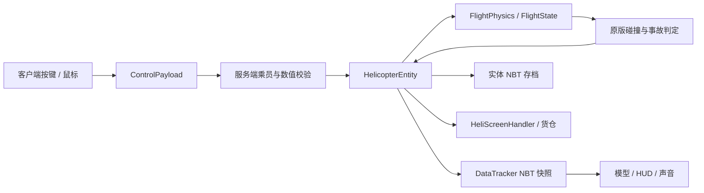

# 24号直升机开发手册

## 1. 项目总览

目标：Minecraft 1.21.1、Yarn 1.21.1+build.3、Fabric Loader 0.19.2、Fabric API 0.116.17+1.21.1。模组 ID `no_24_heli`，Java 包 `org.DJB.no_24_heli`。Loom 1.11.8 使用拆分的 main/client source set。Java 字节码目标为 21；本机使用 JDK 25 运行 Gradle 9.6.1。

本次开发遵循项目内《代码规范.txt》，当前自动驾驶需求以《自动驾驶第二版.docx》为准。函数、常量和关键逻辑采用中文注释；仅保留本手册和面向玩家的 README 两种说明文档。临时测试源码、测试任务及生成数据完成后删除。已有许可证、项目规范、构建资源不属于新增说明文档。

构建：先选择支持 Gradle 9.6.1 的 JDK（本机为 25），在项目根目录运行 `./gradlew.bat build`。发行包为 `build/libs/No.24_Heli-1.4.0.jar`，源码包带 `-sources` 后缀；本次发行保留之前的 JAR。`runClient` 与 `runServer` 是 Loom 提供的开发启动任务。MP3 解码依赖 Maven Central 的 `javazoom:jlayer:1.0.1`，使用 Loom include 嵌入发行包，不要求玩家另装解码库。

## 2. 整体设计框架

服务端拥有所有物理、坐标、燃油、耐久、库存与事故判定。客户端仅提交操纵意图和离散动作，读取服务器快照绘制模型、HUD、声音与 GUI。



实体位置通过原版跟踪包同步并在客户端插值。`getControllingPassenger()` 返回 null，阻止原版载具移动包把驾驶员客户端坐标回写服务器；驾驶权限由 `isPilot()` 与 `getFirstPassenger()` 独立判定。不可随意改回返回驾驶员，否则需要重新审查位置权威。

## 3. 文件引用关系

1.2.0 新增模块：

| 文件 | 职责与引用 |
|---|---|
| `flight/NavigationController.java` | 导航距离→目标水平速度→加速度→机体姿态，复用 FlightPhysics |
| `NavigationPayload.java` | 客户端地图提交/清除导航点，实体校验机上乘员和坐标 |
| `AirspaceState.java` | 每维度 PersistentState 保存雷达位置、半径与所有者 |
| `RadarBlock.java` | 放置建区、右键打开服务器配置、破坏删区 |
| `RadarPayload.java` | 双向雷达半径请求/回执，服务端验证距离与归属 |
| `AirspacePayload.java` | 发给乘员的禁飞区快照，不发送所有者身份 |
| `client/HeliRadar.java` | 5 tick 一次扫描已跟踪玩家/其他完好飞机，共享地图目标 |
| `client/HeliMapScreen.java` | 分块 GPU 地形缓存；从 ExploredMap 增量读取探索区块、导航设点、禁飞圈、拖动缩放 |
| `client/RadarScreen.java` | 半径输入校验、等待保存结果、只读提示 |
| `mixin/client/HeliHotbarMixin.java` | 乘机时取消 InGameHud.renderHotbar |
| `mixin/client/HeliDismountMixin.java` | KeyboardInput.tick 尾部拦截蹲下，上升沿请求服务端二次确认 |


| 文件 | 职责与主要依赖 |
|---|---|
| `No_24_heli.java` | 注册物品/方块/实体/声音/菜单/物品组，读取配置，注册网络与乘员维修事件 |
| `HeliConfig.java` | Gson 配置及数值范围校验，难度默认参数 |
| `flight/FlightState.java` | 速度、姿态、旋翼、部件、辅助及输入的纯数据 |
| `flight/FlightPhysics.java` | 20 Hz 积分器，依赖 FlightState 和 HeliConfig |
| `ControlPayload.java` | C2S 包、动作位与有限数校验 |
| `SettingsPayload.java` | 双向方块破坏设置包，服务器确认权限、结果与保存状态 |
| `DifficultyPayload.java` | 独立难度请求/回执，保持旧 settings 包格式 |
| `HelicopterEntity.java` | 权限、世界碰撞、部件、乘员、维修、GUI、自检、存档、同步 |
| `HelicopterItem.java` | 整机物品放置和空间检查 |
| `HelipadBlock.java` | 材料检查、停机坪组装与原子扣料 |
| `HeliScreenHandler.java` | 燃料槽、18 格货仓、36 格玩家背包、快速转移和访问权限 |
| `RopeSeatEntity.java` | 分段惯性绳、多玩家独立 W/S 挂点、顶部 E 入副驾与脱绳确认 |
| `client/No_24_heliClient.java` | 按键、鼠标输入、音源生命周期、客户端注册 |
| `client/HelicopterRenderer.java` | 机身、玻璃、尾梁、主/尾旋翼、起落架、绳索 |
| `client/HeliHud.java` | 空速、高度、垂速、旋翼/总距、油量、部件条、地平仪、告警 |
| `client/HeliScreen.java` | 容器绘制与物品提示 |
| `client/HeliSettingsScreen.java` | 设置按钮、服务器读取/保存反馈、本地默认设置 |
| `client/HeliView.java` | 登离机视角切换、跟随开关、指数平滑 |
| `mixin/client/HeliCameraMixin.java` | 相机更新尾部应用跟随角度与 4–24 格可调距离，保留原版墙壁检测 |
| `mixin/client/HeliMouseMixin.java` | 乘机且无界面时拦截视角锁定所绑定的鼠标键，避免触发原版选取方块 |
| `mixin/client/HeliCrewRendererMixin.java` | 隐藏直升机内 LivingEntity；绳降与下机恢复 |
| `client/RotorSound.java` | 连续旋翼声音随转速/总距/空速变调变音量 |
| `client/RopeRenderer.java` | 按绳端到机腹的实际向量绘制，独立视锥裁剪，乘员由原版渲染 |
| `src/main/resources/assets/no_24_heli` | 语言、模型 JSON、贴图、声音 |
| `src/main/resources/data/no_24_heli` | 1.21.1 单数目录 recipe、advancement、loot_table |

模板中的 DataGenerator 和服务端空 mixin 配置保留用于后续扩展。客户端 DrivingInputMixin 只在本机玩家驾驶时拦截原版 Q/E 动作，防止丢弃物品或弹出背包；不覆盖原版键绑定，离机后恢复原行为。Z/V 提供可重绑的脚蹬输入。

## 4. 函数调用关系

`ModInitializer.onInitialize → HeliConfig.load → 注册物品组、UseItemCallback、PayloadTypeRegistry、ServerPlayNetworking`。

`ClientTickEvents → ControlPayload → 服务端线程 → HelicopterEntity.control → 校验乘员/驾驶员/数据/频率 → 更新 FlightState 输入和辅助开关`。

`HelicopterEntity.tick → 输入超时清除 → 地面燃料消耗与停机坪补给 → FlightPhysics.handleAbandonment → FlightPhysics.step → Entity.move → collide / destroy → DataTracker.set`。

`interact → 维修 / 涂装 / 村民装载 / openMenu / startRiding`；`HelipadBlock.onUseWithItem → 检查材料与空间 → spawnEntity → 扣料`。

`B → safeHover → ensureRopeCarrier → attach`；机内 `Y → rappel → board(false)`，外部 `Y → 服务端绳形距离查询 → board(true)`；`RopeSeatEntity.tick → 分段积分/长度约束/碰撞 → 每名玩家独立挂点`。W/S 只改变个人沿绳距离，松键回中；顶部 E 经 ROPE_BOARD 显式进入副驾，空驾驶座仍按弃机规则处理。空绳继续展开，直到驾驶员收绳或飞机损毁。

`writeCustomDataToNbt → saveFlight + Inventories.writeNbt`；`readCustomDataFromNbt → loadFlight + Inventories.readNbt`。

## 5. 关键类与关键函数参考

### 1.2.0 高度保持与导航

`FlightPhysics.step` 在完成旋翼更新和姿态积分之后计算高度保持。高度误差乘 0.025 得目标垂速，限制 ±0.16 格/tick；垂速误差乘 0.18 得加速度指令，限制 ±0.018 格/tick²。所需总距为 `(重力 + 垂向阻尼补偿 + 指令加速度) / 当前垂向升力系数`，升力系数包含 rpm²、旋翼耐久、引擎耐久、雨天系数、cos(pitch) 与 cos(roll)。总距变化限制为每 tick 0.045。不使用积分项，因此升力不足时不会积分饱和。手动总距继续沿用每 tick 0.008，并实时重设目标高度。

`NavigationController.step` 只负责导航输入：真实速度反馈加空气阻力前馈生成水平加速度，再转换为机体系俯仰和侧倾目标，沿用 `FlightPhysics` 的姿态响应、旋翼升力与高度闭环；脚蹬使用曲率前馈、航向误差与偏航角速度阻尼。杆量、目标速度和侧倾均有限幅与变化率限制。输入不随中性网络包、路径采样点或阶段切换清零。详细参数和 1.3.1b 调用链见第 20 章；手动控制与 `AutoFlightController` 保持原实现。

### 1.2.0 回收、下机与动画

`canRecover()`：非残骸、无乘员、引擎关闭、rpm<0.05、水平速度<0.08、|vy|<0.08，并且落地/方块支撑/接触水之一成立。水中每 tick 水平速度乘 0.65、垂速限制不低于 -0.06、rpm 额外减 0.025；引擎耐久不影响回收许可。空手蹲下交互将 Flight 和 19 槽库存放入整机物品 `minecraft:custom_data`，唯一物品交付后清空旧库存并移除实体。`restorePacked()` 只走模组字段读取，不应用任意 Entity NBT；重新放置归零速度/旋翼/总距/弃机计时并停机。

`requestDismount()` 在服务器保存每位乘员的 60 tick 确认期限。地面、方块支撑和水中直接下机；空中第一次警告，第二次确认。客户端先屏蔽原版 input.sneaking，只在按下上升沿发送 DISMOUNT，长按不能确认。绳上 Shift 也走同一客户端按下边沿拦截，RopeSeatEntity.control 按实际离地高度决定立即释放或 60 tick 二次确认；事故强制离机不受影响。

客户端每 tick 使用 0.45/0.40 两级姿态滤波，再由渲染帧 delta 在前后 tick 间插值；起落架也使用帧间插值。主体宽从 28 增至 34 像素，机头延伸至 Z=27，实体包围盒宽从 2.8 增至 3.4 格；整机放置与停机坪组装沿用实体包围盒检查。主旋翼尺寸保留。机腹重复立方体被删除，侧窗与编号放在外壳外侧，避免共面闪烁。


### FlightPhysics.step

输入：状态、服务端配置、是否落地、所在方块是否下雨、世界 Y、世界 tick。直接修改状态中的速度和姿态，不访问 Minecraft 世界，不执行爆炸。

旋翼转速归一化到 0–1。启动以 `1/spoolTicks` 每 tick 增加；达到 0.995 才置 `armed`。未置 armed 时总距不产生升力。起飞后 armed 不因瞬时转速不足清除，允许残余转速与无动力自转产生升力；落地且转速低于 0.05 时解除。

升力基础值为 `0.072 × collective × rpm² × rotorHealth × enginePower`，再以俯仰/横滚分解到水平和垂直方向。每 tick 重力 0.04。雨天引擎系数 0.94、旋翼效率 0.97。水平阻尼休闲 0.981，曼巴 0.994，垂向阻尼 0.985。速度上限：水平各轴 ±2.2、垂直 [-2.5,1.1] 格/tick。

无动力时低总距结合下降/前飞气流驱动旋翼；高总距消耗旋翼储能。前飞与下降还贡献受上限限制的自转气动力。该模型是可玩性导向的近似，不是六自由度空气动力学求解器。

### HelicopterEntity.control

不信任客户端数值。拒绝 NaN/Infinity、未知动作位、非乘员、非驾驶员飞控。同一世界 tick 只接受一份连续轴量；离散动作独立限流，避免同 tick 到达的中性包吞掉按键；连续输入超时 10 tick 自动回中，惯性仍保留。开关动作至少间隔 5 tick，引擎启停至少间隔 20 tick。货仓/绳降可由副驾驶操作。

### FlightPhysics.handleAbandonment

每次积分前按真正的第一座驾驶员是否为玩家判断。已预转且离地的无人驾驶飞机保存目标高度，前 60 tick 清除遗留输入、抑制水平漂移，将上升速度限制为不大于 0 并调总距；之后关闭高度保持与动力，逐步降总距，横滚趋向 55°、俯仰趋向 38°，逐渐失控下降。重新登机或落地清零计时；不会自动重启已关闭的引擎。AbandonedTicks 持久化，防止重载不断刷新三秒保护。

### HeliView / 地面输入约束

登机保存原 Perspective 并设 THIRD_PERSON_BACK；离机、换乘、断线时恢复。跟随用约 350 ms 时间常数平滑相机偏航/俯仰，只修改 Camera，绝不修改玩家朝向，避免把相机运动反馈到飞控。相机初始距离 10 格，滚轮限制在 4–24 格，clipToSpace 沿观察方向收缩距离。第一人称及其他载具不受相机 mixin 影响。

客户端落地时不产生鼠标操纵量；服务端 grounded 时清除周期变距和脚蹬、归平姿态并禁止偏航。两端都约束，避免仅靠客户端过滤。

自动配平默认 J。首次升级时检查 config/no_24_heli_keys_v2.marker，只有仍绑定 K 才迁移到 J 并保存 options.txt；写入迁移标记后不再覆盖玩家后续的自定义选择。

### collide / destroy

只计算真正碰撞轴上的入射速度，不把平行擦过墙面的速度全部算作撞击，也不只计算被阻挡的剩余位移。空中横向或向上碰撞超过 0.02 格/tick 直接爆炸；向下接地仍按速度阈值判断，保留自转迫降。空中非玩家实体接触的相对速度超过 0.02 格/tick 也会爆炸。crashObstacle 统一排除玩家、观察者、本机乘员和绳降座/乘员；collidesWith 同步使用过滤规则，避免原版实体移动碰撞先产生事故。脚底 0.08 格的薄盒仅查询方块支撑，连续 3 tick 离开支撑后启用实体事故；地面与刚放置的飞机忽略其他实体接触。查询使用实际包围盒，取消先前扩大的 0.05 格预碰撞范围。地面碰撞按速度线性扣耐久或在高速时解体。地面重力贴地的小量速度不算事故。

爆炸阈值休闲 0.9、曼巴 0.66 格/tick。起落架收起乘 0.75；俯仰或横滚绝对值大于 30 度再乘 0.7。机身清零但未触发高速事故时生成非爆炸残骸。爆炸事故先复制乘员列表再解除乘骑，并使用 genericKill 对机组造成致命伤害。

`explosionBlockDamage` 同时控制点火与方块破坏。残骸复用原实体并将 Wreck 置 true，故不会因服务器重启恢复成完整飞机。货物掉落一次后清空。回收后 discard，防止重复刷零件。

### HeliScreenHandler

槽 0=燃料，槽 1–18=货仓，槽 19–45=玩家主背包，槽 46–54=快捷栏。只允许煤油和原油进入燃料槽。界面访问要求距离小于 8 格且载具完好，并满足乘员身份或载具落地。菜单传输不接受客户端直接修改飞机统计值。

## 6. 接口介绍

### 1.2.0 新增协议

| ID | 方向与字段 | 校验与处理 |
|---|---|---|
| `navigation` | C2S：double X、double Z、boolean clear | 当前机上乘员、有限数、±29999984、世界边界；改点退出自动驾驶，仅驾驶员能开启 |
| `radar_settings` | 双向：BlockPos、VarInt radius、boolean update/editable/saved | 距离≤8 格、区块已加载、方块确为雷达、所有者或权限≥2、半径16–512；客户端只能信任回执 |
| `airspace` | S2C：VarInt 数量，重复 BlockPos/VarInt radius | 实体每20 tick发给乘员；按当前维度产生快照。1.3.1a取消512项上限，按包内实际剩余字节校验数量，字段顺序保持 |
| `controls` 扩展 | AUTOPILOT=256、DISMOUNT=512、AUTO_FLIGHT=1024 | 当前允许动作掩码4095；副驾驶可请求下机，自动驾驶/起降仅驾驶员 |

调用链：`M → HeliMapScreen.mouseClicked → NavigationPayload → HelicopterEntity.navigate`；`U → ControlPayload → control → NavigationPilot.step → NavigationPlanningService.submit → 后台 NavigationRoute.plan → 主线程取结果 → NavigationController.step → FlightPhysics.step`。当前任务取消、结果失效与平面算法见第 20 章。

禁飞区：`RadarBlock.onPlaced → AirspaceState.put`；`onUse → RadarPayload → RadarScreen → RadarPayload → 服务端距离/归属校验 → markDirty`；`HelicopterEntity.tick 每20 tick → contains → Restricted 快照/乘员文字 → 客户端每40 tick播放警报`。方块 `onStateReplaced` 删除范围，包括爆炸替换。地面雷达并不强制加载区块，不攻击飞机。


C2S 自定义负载 ID：`no_24_heli:controls`。线格式：4 个 float（pitch, roll, pedal, collective）加 1 个 VarInt（actions）。服务端将操纵量限制到 [-1,1]。

| 动作位 | 数值 | 行为 |
|---|---:|---|
| ENGINE | 1 | 启停 |
| ALTITUDE | 2 | 高度保持 |
| TRIM | 4 | 配平 |
| CRUISE | 8 | 巡航 |
| GEAR | 16 | 起落架 |
| ROPE | 32 | 放/收绳 |
| EXIT_ROPE | 64 | 机内挂绳 / 外部抓取任意绳段 |
| MENU | 128 | 打开容器 |
| AUTOPILOT | 256 | 导航自动驾驶 |
| DISMOUNT | 512 | 二次确认下机 |
| AUTO_FLIGHT | 1024 | 一键起降/取消 |
| ROPE_BOARD | 2048 | 绳顶按 E 进入空闲副驾 |

设置负载 ID：`no_24_heli:settings`，C2S/S2C 共用 codec，依次为 4 个 boolean：update（读取/修改）、destruction（期望/实际值）、editable（服务端权限结果）、saved（服务端保存结果）。服务器忽略客户端的 editable/saved，只允许 2 级权限玩家或整合服务器房主修改。失败时回滚配置并返回真实值。界面在收到回复前禁用按钮，避免乐观更新造成假状态；成功写入 config/no_24_heli.json 后立即生效。

`ScreenEvents.AFTER_INIT → OptionsScreen 唯一按钮 → HeliSettingsScreen → SettingsPayload → 服务端线程权限校验 → HeliConfig.save → SettingsPayload 回执 → 更新界面`。主菜单界面无服务器连接时直接保存本地默认配置。暂停菜单及设置子页面不注入入口。

难度负载 `no_24_heli:difficulty` 的格式为 boolean update、VarInt mode、boolean editable、boolean saved；mode=0/1/2 对应 CASUAL/MAMBA/ZOBAYAN。服务端校验枚举编号，仅使用发包者 UUID 读写 `PlayerFlightSettings`，所有玩家可修改自己的模式，不能指定其他玩家。`get(server)` 从主世界 PersistentState 获取共享个人表，`set` 标脏后随世界保存；`mode` 缺省使用配置 difficulty。驾驶员更新立即调用本机 `applyDifficulty`，其余飞机不受影响；机体每 tick 检查当前驾驶员模式并通过 `HeliConfig.forMode` 生成飞控配置。无人时保留本机模式，`DifficultyMode` 与 `HardcoreMode` 快照继续兼容。settings 仍仅管理员可修改全服爆炸破坏/着火，客户端 editable 位不受信任。联机双方必须使用本次同一修订构建。

S2C 飞行状态使用原版 `DataTracker<NbtCompound>`，每 2 tick 更新一次，实体坐标仍使用原版跟踪包。容器 PropertyDelegate 的索引 0–7 分别为燃油、容量、旋翼、尾桨、引擎、油箱、机身、转速百分比。容量上限 30000，适配原版容器 short 属性同步。

## 7. 参数介绍

| 参数 | 默认/范围 | 作用 |
|---|---|---|
| difficulty | CASUAL / MAMBA / ZOBAYAN | 未配置个人模式时的默认值；实际飞控按驾驶员个人模式计算 |
| rotorPreSpin | true | 预转 100 / 240 tick；关闭为 1 tick |
| wind | true | 基于时间的平滑风扰动，雨天更强 |
| explosionBlockDamage | true | 爆炸破坏与着火 |
| fuelCapacity | 1200，100–30000 | 油箱容量 |
| explosionPower | 5，0–12 | 原版爆炸强度 |
| autopilotCruiseKmh | 75，20–80 km/h | 自动驾驶巡航目标，20 TPS 下除以72换算格/tick |
| autopilotLookMin | 8，4–16 格 | 低速前视弧长 |
| autopilotLookMax | 30，最小前视–48 格 | 高速前视上限 |
| gridCellSize | 2，0.25–64 格 | 八邻接 A* 的初始方格边长 |
| pathSafetyMargin | 2，0–1024 格 | 禁飞圆扩张中的附加余量，另加机体碰撞箱外接圆半径 |
| pathBoundaryMargin | 16，1–4096 格 | 全部圆及起终点的动态外边界余量 |
| pathMaxCells | 1000000，1–2000000 | 单次网格分配上限 |
| pathMaxNodes | 1000000，1–2000000 | 单次规划含细化与宽路线尝试的累计节点上限 |
| 维修恢复量 | 地面 30 / 应急 3 | 油箱只允许地面大修 |
| 维修间隔 | 20 / 200 tick | 防止每 tick 消耗维修包刷恢复 |
| 绳降门槛 | 3 < AGL ≤ 24；水平 < .10，垂直 < .075 | 单位格/tick |
| 绳降速度 | .23 格/tick | 约 4.6 格/秒 |

燃油基础消耗为 0.016/tick，按空速、周期变距、总距操纵、引擎损伤和难度放大。油箱低于 80 时，额外漏油 `(80-tank)×0.0015/tick`。

## 8. 存档格式与版本兼容

实体顶层保留原版 Entity NBT 字段。自定义 `Flight` Compound 的 Version 当前为 4；货仓按原版 `Items` 列表及 1.21.1 ItemStack 编解码器保存。实体类型 ID 不可随意更名，否则旧存档会丢失载具。1.2.1 新增字段及旧版迁移见本手册末尾。

| 字段组 | 键 |
|---|---|
| 飞行连续量 | Rpm, Collective, Pitch, Roll, Yaw, YawRate, Vx, Vy, Vz |
| 燃油与耐久 | Fuel, Rotor, Tail, Engine, Tank, Hull |
| 辅助目标 | TargetAltitude, TargetSpeed |
| 状态开关 | Running, Armed, Altitude, Trim, Cruise, Gear, Wreck, Rope, HardcoreMode |
| 外观/绳长 | Paint, RopeLength |
| 无人驾驶 | AbandonedTicks（旧版缺省为 0，加载限制 0–1000000） |

缺少部件字段时默认 100；燃油默认 0，起落架默认放下。所有连续值加载时校验有限数并限幅。重载清除操纵输入并收回机上绳索；已经在绳降座上的乘员通过原版 passenger NBT 继续下降。数据格式增加字段时提供旧版默认值；不应重置 Wreck、燃油或现有库存。

本版没有承诺与其他 Minecraft 版本二进制兼容。升级 Minecraft 时应同时检查实体 tick、DataTracker、数据包 codec、ItemStack NBT 和资源目录名。

### 新增涂装与 HUD 布局

紫金涂装追加在 PAINTS 尾部，索引 5；旧 0–4 索引保持。新增 paint_purple_gold 物品、无序配方、配方解锁、物品贴图与 heli_5.png 实体 UV 贴图。主色 RGB #552583，饰色 #FDB927。HelicopterRenderer 的 number 子模型在 paint==5 时显示，用双侧像素几何形成“24”；左右沿 Z 方向相反排列，从机外均可正读。编号用 (192,192) 附近金色 UV 区，避开机窗，不修改其他涂装贴图。

HeliHud 以 0.85 倍 GUI 比例绘制。底部组额外使用 min(1,宽度/560) 缩放：最左下为燃油/旋翼/总距仪表，控制状态和机身模式在其上方，机组占位框在文字区上方。底部中央为 150 单位宽的连续五段耐久条，无段间留白，损伤仍独立计算。最右下为空速盘，向左依次为垂速竖条和高度/垂速数字。垂速指针 ±20 m/s 范围，正值向上，零居中，超量程仅钳制指针，数字保留真实值。高度数字为世界 Y。右上为雷达及姿态仪。设置入口在横向居中的可用空行放置。

## 9. 扩展开发指南

| 常见任务 | 修改位置与检查点 |
|---|---|
| 调整飞行手感 | FlightPhysics；验证预转锁定、悬停、惯性、无动力拉平，不能只看构建 |
| 增加机型 | 独立注册实体/物品，参数化 FlightPhysics，重新定义座位与碰撞尺寸 |
| 增加后排 | canAddPassenger、updatePassengerPosition、绳降选择、模型与座舱视角一起修改 |
| 新增燃料 | 注册物品、槽位过滤、quickMove、地面补给、停机坪扫描、配方和文档同步修改 |
| 新涂装 | PAINTS、纹理、存档 Paint 范围、模型纹理选择、翻译和配方 |
| 新部件 | FlightState、NBT、DataTracker、伤害映射、维修、HUD、GUI、配方同步扩展 |
| 新控制 | ControlPayload 位掩码、valid、服务端权限、键绑定、语言文件和玩家说明 |
| 改爆炸 | 保持服务端执行与单次残骸转换；重测乘员致命伤害和方块破坏开关 |
| 改存档 | Version 递增，显式迁移逻辑，验证带货仓的旧损坏飞机与残骸 |

## 10. 常见故障定位

- 启动就崩溃：先检查 Java/Fabric/API/Minecraft 版本，再看日志中的首个异常，不把所有后续异常当作独立错误。
- 旋翼满转仍不升空：检查总距、旋翼耐久、引擎功率、雨天、是否被方块阻挡。零总距不产生升力。
- 高度保持不起作用：需要引擎运行、已完成预转、在空中且不在手动改变总距；引擎无动力会退出自动高度和巡航。
- 机体突然回弹：检查是否误启用原版客户端载具移动权威，或网络输入处理跨线程。
- HUD 有数值而机体不动：检查服务器 move、碰撞轴和客户端插值；禁止通过每 tick 瞬移修饰问题。
- 燃料不补充：必须落地，燃料槽物品正确且油箱至少能容纳完整一份；故障漏油可能抵消补给。
- 绳索不部署：检查实际地表射线距离、水平/垂直速度。世界 Y 坐标并不是离地高度。
- 物品紫黑格：检查 models/item、textures/item、注册路径和资源大小写。
- 配方不显示：1.21.1 使用 recipe 单数目录；检查 JSON result.id、解锁 advancement 与配方书搜索。
- 旧版 K 仍冲突：检查迁移标记和按键界面，手动重绑 J 或其他未占用键；迁移只执行一次。
- 设置不可点击：读取期间暂时禁用；普通玩家可修改自己的飞行模式；只有爆炸破坏与着火需要房主/管理员权限，保存失败检查写权限。
- 中键跟随不响应：必须乘坐直升机且没有打开界面；跟随与 N 鼠标飞控是独立开关。视角锁定可以在原版控制菜单中重绑键盘或鼠标。
- 编译使用 Java 8：Windows 默认 java 可能仍是 8，先明确 JAVA_HOME，再运行 wrapper。

## 11. 附录：注册 ID / 翻译键 / 常量

所有下列 ID 都以 `no_24_heli:` 为命名空间。

| 类型 | ID |
|---|---|
| 实体 | helicopter, rope_seat |
| 物品 | helicopter, rotor_assembly, tail_rotor, engine_module, fuel_tank, fuselage, repair_kit, kerosene, crude_oil |
| 涂装 | paint_olive, paint_snow, paint_desert, paint_black, paint_rescue, paint_purple_gold |
| 方块及方块物品 | helipad |
| 物品组 | equipment |
| 容器 | service |
| 声音 | rotor, alarm, rotor_damage, radio（MP3 虚拟流） |
| 网络 | controls, settings, difficulty |

语言文件 `zh_cn.json` 和 `en_us.json`。前缀包括 `item.no_24_heli.*`、`block.no_24_heli.*`、`entity.no_24_heli.*`、`key.no_24_heli.*`、`hud.no_24_heli.*`、`warning.no_24_heli.*`、`message.no_24_heli.*`、`gui.no_24_heli.*`、`subtitles.no_24_heli.*`、`screen.no_24_heli.*`。每个客户端显示文本应通过翻译键输出。

## 12. 本版验证与边界

2026-10-10：使用真实 Fabric 0.19.2 / Minecraft 1.21.1 测试服务端，10 项 GameTest 全部通过。验证项包括预转门槛、低总距禁飞、惯性与方向、尾桨失效及反向脚蹬、故障漏油与雨天功率、自转迫降、高度保持、实体/货仓保存、双座与驾驶权限、非法输入、地面燃料与应急维修、真实碰撞生成残骸。

自转测试从 55 格模拟高度开始，低总距下滑并近地拉总距，接地垂速约 0.282 格/tick，未达到解体阈值。这个结果只证明该测试情境可迫降，不代表任意姿态或损伤状态都可安全着陆。

真实客户端已成功载入测试存档，并通过驾驶 E 键拦截和村民绳降无伤落地验收（接地后生命值仍为 20）。绳降座必须清除自身 fallDistance 并覆盖 handleFallDamage，防止原版把载体跌落伤害转发给乘员。核对实体贴图、旋翼动画、飞行 HUD 和燃油/货仓界面，并修正了乘员位置、模型表面剔除与第一人称遮挡。第一人称显示驾驶 HUD 和无遮挡外部视野；第三人称显示完整机体。多人网络延迟、长时间飞行、复杂地形和大型整合包仍需要实机联机验收；原生模型、合成音效与简化飞控是首版实现。


### 1.1.0 回归验收

2026-10-10：9 项真实 Fabric GameTest 已通过：地面姿态锁定、跳机高总距悬停转下坠、重新登机中断计时、计时存档与旧格式缺省、空中撞墙/撞顶/撞实体、低速接地不爆炸、高速接地解体。其中关闭方块破坏时，撞墙爆炸后测试墙保持完整。补充 2 项 GameTest 也通过：低速空中接触实体触发爆炸、开启方块破坏后实际炸毁测试墙。本次共 11 项服务端验收。

真实客户端 13 项检查通过：登机第三人称、相机距离约 10.0000006 格、有效旧版 options.txt 中 K 迁移为 J、实际 Mouse.onMouseButton 中键回调、相机逐渐追上机头、选项页入口、设置页打开、服务器修改与文件持久化、真实无人驾驶实体在 Y=135 附近短暂悬停后下坠、退出恢复视角及关闭跟随。画面检查确认乘员模型隐藏；修正 Screen.render 再次绘制模糊背景导致说明文字模糊的问题，复拍确认标题、解释、保存反馈和按钮清晰。

尚未进行两个独立客户端的联机及第三方相机/按键模组兼容验收。测试入口、测试代码和临时世界在验收后删除，发行包不携带测试组件。


### 1.1.0 同版本修订验收

2026-10-10：本次 10 项真实 Fabric GameTest 全部通过，覆盖实际整机物品贴近玩家放置、地面动物接触、空中非乘员玩家接触、正常载人悬停不自爆、真实空中动物接触仍触发事故、撞墙、高速/低速接地、已有飞机的难度即时切换及状态保留、紫金涂装应用与 NBT 保存。飞行用例使用测试结构内部空域，避免结构外支撑把测试飞机变成地面停放。

真实客户端完成 12 项检查：GUI 2/3 下入口水平居中与不遮挡原控件、房主难度按钮可用、真实网络开启曼巴、配置持久化、现有飞机辅助立即关闭、重新打开设置读取模式、HUD 接收模式，以及暂停菜单入口。截图核对新涂装左右两侧“24”均正读、窗口无遮挡，HUD 三分区和小型姿态仪正常；现有五种涂装贴图未修改。没有进行第三方相机模组或独立多客户端联机验收。

版本号按要求保持 1.1.0，原 settings 网络格式保持；新增 difficulty 通道和 paint_purple_gold 注册项，联机需客户端与服务器使用同一修订构建。临时源码、任务、世界、截图和 IDE 测试运行配置全部在验收后清除。


## 1.2.0 存档与维护补充

- 实体 `Flight.Version=3`，新增 `Waypoint`、`WaypointX`、`WaypointZ`、`Autopilot`、`Restricted`。客户端快照读取全部字段，磁盘存档加载主动关闭 Autopilot/Restricted；旧存档缺少导航字段默认无导航点。已有 Flight 字段和货仓槽位不改名。
- 回收物品使用 `minecraft:custom_data` 下的 `Flight` 与原版 `Inventories.writeNbt` 生成的 `Items`。再次放置保留损伤及货物；创造模式也消耗带 CUSTOM_DATA 的回收机。
- 禁飞区写入各维度 `data/no_24_heli_airspace.dat`：`Version=1`，`Zones` 为列表，元素含 `Pos`（BlockPos long）、`Radius`（int）、`Owner`（UUID）。通过 PersistentStateManager 按维度管理，重启/卸载区块不丢失。
- 按键迁移标记 `config/no_24_heli_keys_v3.marker` 只把仍为旧默认 M 的鼠标操纵切换移到 N；地图默认 M，自动驾驶默认 U。已有 v2 配平迁移仍保留。
- 雷达注册 ID 为 `no_24_heli:radar`，同时用于方块、物品、模型、方块状态、配方与战利品。新增语言键使用 `key.*.map/autopilot`、`screen.*.map/radar/radius`、`hud.*.crew/radar/waypoint/autopilot`、`message.*.recovered/recover_unsafe/exit_warning/restricted` 等命名；具体文案以 zh_cn/en_us 资源为准。

### 常见改动速查与故障定位

- 调高度保持：改 FlightPhysics 的目标垂速与加速度限幅，至少回归晴雨、两种难度、80%部件、爬升初速度和前飞后回平；不能只在静止完好机上试验。
- 调导航：改 NavigationController，保留控制权先判手动再生成导航指令；不得用坐标瞬移替代物理。
- 调禁飞范围：同步修改 AirspaceState 常量、RadarScreen 输入长度/限制和文档。增加协议字段时同时更新 CODEC 双端。
- 雷达看不到远处玩家：机载雷达通过 radar_contacts 接收512米内的服务端已加载目标，每10tick刷新；检查两端是否更新、目标区块是否在服务器加载。1.2.1 地图纸色区域代表该客户端尚未记录地形，已记录的卸载区块可继续显示。
- 无法回收：检查乘员、running、rpm、速度及支撑/接水状态；引擎耐久零不应阻止回收。必须空手蹲下；普通物品蹲下是货仓入口。
- 自动驾驶开启失败：检查驾驶员、导航点、引擎、armed、实际离地至少10格，以及是否仍按住操纵键。鼠标操纵模式下转动鼠标会主动接管。
- 禁飞区保存失败：检查操作距离、方块是否仍在、所有者/管理员权限、半径范围；拆除雷达会撤销该区。1.3.1a取消旧512区上限，NBT中的全部有效记录均会加载。
- 重复设置按钮：只允许 `screen.getClass()==OptionsScreen.class` 注入，注入前删除同文案旧按钮；模组设置及暂停页面不应注入。

### 1.2.0 验证记录

正式构建通过。临时纯物理验收共12项：8组高度保持（休闲/曼巴×晴/雨×100%/80%部件，含初始垂速及前飞后归平），2组导航到点悬停，2项动力故障和预转回归。高度测试末段误差及波动均低于0.08格，导航最终距点小于0.44格。

隔离专用服务端18项验收通过：损坏机体地面/水中回收、物品交付和移除、燃油/损伤/涂装/7颗钻石货物保留、运行中禁止回收、导航坐标有限数、自动驾驶开启与接管、空中两次确认/地面直接下机、禁飞边界、NBT写入、拆雷达删区、未知动作位拒绝。

真实开发客户端连接本机专用服务端，16项检查通过：选项入口唯一/重复打开不增殖/子设置及暂停无入口、登机视角、禁飞区同步、其他飞机扫描、相机距离上下限、地图设点与雷达半径网络往返、真实U键开启自动驾驶、W接管、Shift长按不跳机及松开再按确认。已查看实际截图中的机身/机头、无快捷栏HUD、边缘状态面板、乘员、雷达、地图和半径界面。

验收针对原版Fabric开发环境。未做第三方相机/地图模组兼容或多人公网压力测试；该历史版本当时不包含自动避障；2026-10-11 修订已增加前视制动与爬升检查。临时测试代码、启动配置、测试世界、截图及产物在验收后删除，不随发行包保留。

## 1.2.1 架构、接口与维护补充

### 新模块及调用关系

| 文件 | 职责 / 调用方 |
|---|---|
| `flight/AutoFlightController` | 以起降水平锚点计算刹车杆量；预转→爬升，降落使用已有高度控制；由实体 tick 调用 |
| `client/ExploredMap` | 监听 ClientChunkEvents，采样原版地图颜色，按世界/维度缓存已探索区块；HeliMapScreen.sample 调用 color |
| `RadioPayload` | C2S VarInt track，-1关台、0–7八槽；No_24_heli 接收后调用实体 selectRadio |
| `client/RadioLibrary` | 按连接类型选择本机config或服务器缓存；公开 available/prepare/open 接口供圆盘、管理器与解码器调用 |
| `client/RadioWheelScreen` | Tab 持续按住显示，鼠标八扇区选择，松手发送 RadioPayload；中心关台，Esc 取消 |
| `client/RadioManager / RadioSound` | 每架已跟踪飞机一条音源；机内相对音源、机外按玩家实际位置衰减，切歌/离机/销毁清理 |
| `client/Mp3AudioStream` | JLayer逐帧MP3→16bit little-endian PCM，循环与偏移接入；实现 Minecraft AudioStream |
| `mixin/client/RadioSoundLoaderMixin` | 仅拦截本模组虚拟 sounds/radio 路径，将原版流加载替换成异步 MP3 解码 |

起降链：`K → ControlPayload.AUTO_FLIGHT → HelicopterEntity.toggleAutoFlight → 地形与模式校验 → autoPhase → AutoFlightController.step → FlightPhysics.step → 原版碰撞 → 接地停机`。不直接移动实体或跳过事故判定。输入接管、换点、切换模式、入水、动力故障和失去驾驶员均取消自动任务。空中按 K 会探测中心与四角 ±1.5 格，要求无流体、支撑面高差≤0.25；起飞检查包围盒向上10格的通道。降落目标设为表面下0.2格，使高度控制缓慢压向地面；终止必须 `isOnGround()`，不能只用提前0.08格触发的支撑探测。

电台链：`Tab → RadioWheelScreen → RadioPayload → selectRadio → DataTracker → RadioManager → RadioSound → SoundLoader mixin → Mp3AudioStream → OpenAL`。选曲允许本机驾驶/副驾驶，拒绝残骸、越界槽位、非乘员和5tick内重复请求。声音类别为 RECORDS；虚拟路径含槽位与从 `RadioStarted` 算出的毫秒进度，不允许服务器指定任意文件路径或 URL。客户端文件未就绪时不播放，坏文件记录日志；再次关台/选曲可清除失效音源。

### 参数与模式约束

| 参数 / 状态 | 含义 |
|---|---|
| autoPhase | 0关闭、1预转、2爬升、3降落；地面目标为当前位置+10格 |
| autoX/autoZ/autoY | 起降临时锚点，不持久化；水平位置反馈0.008、速度阻尼0.15，加速度限制±0.015 |
| navAligned | 单次导航是否已完成初始对准；重新启用U时清零，不跨存档恢复 |
| radioTrack / radioRevision / radioStartedTick | 当前槽、切歌序号、开始世界tick；序号区分同一首歌曲重新播放 |
| RadioSound.gain | 机内0.65；机外 `0.65×max(0,1-distance/64)²`，两者再乘游戏音量设置 |
| 佐巴扬飞行磨损 | 离地、armed且rpm>0.2时：引擎0.002、机身0.0005、主旋翼0.0006、尾桨0.0003 每tick |

`hardcore()` 表示曼巴或佐巴扬，控制既有硬核物理及禁用K；`unassisted()` 只表示佐巴扬。后者在网络操作门禁与物理入口双重禁用全部飞控辅助，避免旧NBT或伪造包绕过。休闲默认配平/高度保持开启、巡航关闭；曼巴默认全部关闭但可手动开启及使用U；佐巴扬始终全部关闭，不使用弃机的三秒辅助悬停。相机跟随、雷达、地图、警报、电台不属于飞控辅助，仍可使用。

雷达 `relative(dx,dz,yaw)` 统一转换实体、导航点及方位字：`x=-dx*cos(yaw)-dz*sin(yaw)`，`y=dx*sin(yaw)-dz*cos(yaw)`；Minecraft 偏航0为南。圆半径38像素，超范围导航点保持方位钳在圆周。方位字保持正立并在外圈转动，移除标题与距离文字；本机指针缩小。禁飞区边界共用 relative 变换，逐像素圆形裁剪红色弧线，圆心在雷达外也可显示边界。机体耐久以五段独立比例拼成底部横条；双座框直接读取乘员数量，不传输或渲染姓名。

### 探索地图与存档兼容

客户端每tick最多采样4个收到的区块，卸载前再采样一次，脚下区块每秒刷新。每块保存16×16原版地图色字节，以WORLD_SURFACE定位表面，透明颜色继续向下查找；高度差决定地图明暗。内存最多32768块，超出按最近使用顺序淘汰，磁盘保留。文件是 `config/no_24_heli_maps/<世界及维度UUID>/<chunkX>_<chunkZ>.bin`，长度256字节。UUID由单人存档绝对路径或服务器地址加维度ID生成；改服务器地址/移动单人存档会使用新缓存。磁盘写入通过单线程队列与临时文件替换，界面只排队，IO线程按需读取旧瓦片，最多256个在途读取，不保存或加载世界实体。未探索区域缓存为空瓦片并显示纸色。删除该目录只会清除本客户端地图记录。

`Flight.Version=4` 新增 `DifficultyMode`、`AutoPhase`、`RadioTrack`、`RadioRevision`、`RadioStarted`。快照需要读取起降/电台状态，磁盘加载则强制关闭 autoPhase/autopilot/radioTrack/restricted，不恢复未完成任务；导航点、库存、燃油、耐久和涂装照旧保留。Version<4的旧飞机迁移时关闭巡航；缺少完整难度字段时，在驾驶员登机后应用其个人模式，未配置者沿用服务器默认。回收整机继续走相同迁移流程。禁飞区PersistentState版本仍为1，不需要重设半径。

### 扩展、排查及注册ID

- 添加音乐：单人放本地 `config/no_24_heli_radio/slot_1.mp3`…`slot_8.mp3`，多人放服务器的同名目录。多人客户端自动获取服务器文件，不读本机同名歌曲或资源包。服务器添加/替换文件后重启世界以刷新目录；单人新增文件会刷新可用槽，替换当前歌曲需关台重选。
- 扩展曲目数量：同时修改 RadioFiles.TRACKS、服务端track范围、RadioManager数组、圆盘分区和NBT限制，不能只改GUI；新增的目录/下载状态数组也须保持一致。
- 修改起降：在 AutoFlightController 调整杆量，保留实体模式/碰撞门禁；不要通过setPosition实现自动飞行。若K不响应，检查模式、燃油、引擎≥30、旋翼≥70、头顶净空与地面平整。
- MP3静音：检查固定文件名、唱片机/音符盒音量、空槽提示与日志“MP3无法播放”；支持解码的是实际MP3，改文件扩展名不能转换格式。JLayer在客户端使用，专用服务端不加载声音类。
- 地图旧地形缺失：先确认该客户端安装1.2.1后实际接收过区块，再检查服务器地址/维度是否改变及缓存是否可写。不会读取服务器未发送的世界文件，不能补回安装前的探索历史。
- UV扩展：机身箱体自动UV宽为 `2×(宽+深)`，机身颜色只占贴图前128列；34×38越界，现沿Z拆成两个34×19箱体，各占106列。紫金编号底牌只采纯紫区域，数字位于底牌外层，避免金条重叠和共面闪烁。
- 新协议ID `no_24_heli:radio_control`、声音ID `no_24_heli:radio`；新按键翻译 `key.no_24_heli.auto_flight`；电台翻译前缀 `radio.no_24_heli.*`；方位字 `hud.no_24_heli.north/east/south/west`。Tab为固定键，乘机时屏蔽原版玩家列表，下机恢复。

JLayer保持未修改，其逐文件版权声明与对应源码、LGPL文本放在发行包 `META-INF/licenses/`；运行依赖由Loom单独嵌入 `META-INF/jars/`。升级依赖时同步更新该许可证/源码资源与Maven坐标，不将其混同于模组自身许可证。

### 1.2.1 验证记录

纯物理13个场景通过：休闲/曼巴各4个初始航向的先对准后到点、一键预转爬升10格、低速降落、严格模式清除辅助、引擎磨损大于机身、地面无飞行磨损。MP3使用临时1秒双声道测试音验证采样格式、非静音PCM、循环、一小时偏移接入、非法文件拒绝；该测试音不作为音乐交付。

专用服务端11项检查通过，包含真实实体起降及接地关机、默认巡航关闭、槽位边界、存档清除自动任务/电台、两种高难模式禁用K、严格模式服务端拒绝辅助。

真实客户端18项检查通过，包含方向变换、空槽、八分区选择、MP3进入OpenAL播放、机内固定音量/外放衰减函数、镜头最远时警报相对音源、M仅乘机开启及再次关闭、右键设点、区块卸载后从磁盘恢复探索地图、模式网络同步与严格限制、离机后的M门禁。已查看实际HUD、两侧紫金编号及机头、地图和电台圆盘截图，并修正雷达底部方位与标题的重叠。外放衰减验证基于客户端计算及实际音源，不声称进行了两台电脑的听感测试；未验证第三方UI/声音模组组合。临时验收入口、测试任务、世界、截图、音频及依赖测试目录完成后删除。

## 1.2.1 同版本电台来源修订

此修订不改版本号、实体NBT、选曲协议及音量规则，仅改变MP3来源。服务器与客户端都应更换为本次构建。`MinecraftClient.getServer()!=null`表示本机整合服务器，直接读本机config；专用服玩家及LAN来宾从服务器获取，LAN房主的本机config同时就是服务器config。远程目录未同步、空槽或下载失败时保持等待/静音，绝不回退成本地同名文件或资源包歌曲。

### 新增模块与网络格式

| 模块 / ID | 作用与边界 |
|---|---|
| RadioFiles | 固定八个文件名、32MiB单曲上限、24KiB分片、流式SHA-256；不接收网络路径 |
| RadioTransferServer | SERVER_STARTED后台建目录，每名听者每tick最多处理一个分片；服务器停止清理IO线程，离线清理队列 |
| `radio_catalog` S2C | 固定8组 VarInt size + 长度≤64的hash字符串；size=0/hash空代表空槽，非空必须是64位小写十六进制SHA-256 |
| `radio_request` C2S | VarInt track + VarInt offset；槽位0–7、偏移非负且按24KiB对齐、严格小于文件长度 |
| `radio_data` S2C | VarInt track + VarInt offset + 最多24KiB字节数组；空数组表示失败 |
| client/ServerRadioCache | 连接INIT/断开清理会话；缓存检查→排队→逐包获取→摘要校验→可播放，失败有超时及重试 |

上述网络ID均属于 `no_24_heli` 命名空间。分片许可还要求玩家64格内有正在播放该槽位的完好飞机，附近未乘机玩家也可获取外放。每位玩家只允许一个待处理/读取中的请求，服务器单IO线程每次仅读取一个分片，不把八首歌曲常驻内存。目录哈希计算、文件读取不阻塞服务器tick；目录初始化完成后发给在线玩家和后来加入者。读取分片时比较文件大小及修改时间，歌曲中途被替换会拒绝继续传输，管理员需重启世界建立新目录。

客户端只在需要播放时请求歌曲，不在登录时下载全部八首。完整缓存按 `config/no_24_heli_radio_cache/<会话UUID>/<SHA256>.mp3` 存储；同一连接中的相同内容可复用，不同服务器的不同内容不会串曲。复用前在IO线程校验长度与摘要；新数据按请求的槽位/偏移/剩余长度逐包写入临时 `.part` 文件，最终摘要正确才替换完整文件。一次最多下载一首，15秒无响应判失败，10秒后可重试；断线/CLIENT_STOPPING 先停止音源、关闭已打开的解码流及分片，再异步删除该会话的完整和未完成文件；快速重连换会话目录，连接代数阻止旧异步回调污染新会话。缓存不写实体存档，删除后可重新获取。

调用链新增：`RadioManager → RadioLibrary.prepare → ServerRadioCache → radio_request → RadioTransferServer → radio_data → 校验缓存 → RadioSound → Mp3AudioStream`。圆盘是否可选依服务器目录，是否可播放另由prepare判断；目录晚到时圆盘会刷新。下载完成时沿用RadioStarted进度计算，音乐不会从头与其他听者错开。单人直接打开本机文件，跳过下载链。

排查：先检查文件是否放在实际服务端运行目录的config、目录初始化日志和32MiB限制，再看客户端缓存目录写权限及下载失败提示。更换服务器歌曲后必须重启世界；本机同名文件不影响远程播放。包版本显示均为1.2.1，因此排查时还需确认双方使用本次同版本修订包。

修订验收：真实开发客户端连接专用服务器，11项检查通过，包括本地有文件但服务器空槽时不可选、服务器独有歌曲可选、本地同名内容不影响选择、多分片获取及SHA-256一致、两首服务器MP3实际播放、切歌清理、缓存复用、非法请求不中断连接和关台释放音源。另进入真实单人存档，8项检查通过，包括整合服务器识别、本机槽位目录、忽略网络目录、直接读取本地原文件、超限目录/非法摘要拒绝、本地MP3播放及不需要下载缓存。临时测试代码、测试世界、音频、缓存和启动配置验证后清理；未进行多人公网带宽压力测试。


## 17. 2026-10-11 绳索救援、航线避障及客户端性能修订

本章保留当时实现与验证记录；当前多人手动攀爬和 GPU 地图增量更新以第 23 章为准。

本章保留历史修订与验收记录；其中可见图寻路、圈内驶离规则已由第 19 章的 1.3.1a 二维 BFS 替代。

### 17.1 新增类、接口与调用关系

| 类 / 接口 | 责任与调用者 |
|---|---|
| `RadarContactsPayload` / `radar_contacts` | S2C；实体每10tick给机内玩家发送512米内最近512个已加载目标，仅含机体ID、X/Z与目标类型；HeliRadar.receive接收 |
| `NavigationRoute.Point / Circle` | 不依赖世界的平面航路数据；plan构造外接十六边形可见图，clear检查整条线段与所有禁飞圆柱的距离 |
| `NavigationPilot.step` | HelicopterEntity每tick调用；缓存AirspaceState.revision与终点，按需规划，前方与惯性方向净空检查，输出速度上限与高度目标 |
| `RopeSeatEntity.attach / board / control` | 绑定机体UUID、接收一名乘员、处理方向和Shift确认；ground玩家Y只允许从3格内空绳端进入 |
| `RopeRenderer.shouldRender / render` | 绳端与机体包围盒并集参加裁剪；四元数把模型朝向实际机腹连接点，不依赖机体本身是否可见 |
| `ServerRadioCache.clearSession` | 停止音源、清目录/分片状态、同步关闭解码输入流，退休目录交IO队列删除；关闭客户端最长等5秒完成队列 |
| `ExploredMap.color / revision` | 主线程只访问LRU或提交异步读取；世代号排除旧世界回调，新瓦片改变revision触发地图纹理刷新 |

服务器 `ControlPayload` 不增加动作位：机内Y为EXIT_ROPE，地面Y抓绳；绳上collective正/负改变攀升/下降方向，DISMOUNT交给绳端确认。非有限输入、旁观者地面抓绳、远距离抓取及已占用绳索均拒绝。绳端的getControllingPassenger返回null，客户端不能通过原版载具坐标包绕过服务端物理。

### 17.2 参数和约束

- 放绳：`3 < AGL ≤ 24`，水平速度 `<0.10`、垂速绝对值 `<0.075` 格/tick。
- 绳端：向上缩绳 `.14`、下降放绳 `.23` 格/tick；满舱保留 `2.5` 格绳长；重力 `.04`，速度阻尼 `.985`，去除拉紧时的径向外速度、保留切向惯性。落地清零乘员和绳端跌落累计。主动脱绳只继承当前速度，之后正常累计坠落。
- 地面抓取：绳端附近3格，实际查询框为玩家包围盒扩展2.5格；一根绳一次一人，已占用时拒绝收绳。空位恢复后攀升乘员自动转移入舱。
- 主动脱绳：向下4格射线，以绳端上方0.15格的人物脚部为准；`≤3` 格单次释放，`>3` 格需要60tick内第二次Shift按下边沿。
- 航线：目标速度上限 `.80` 格/tick（57.6 km/h），距离减速系数 `.025`，实际速度还受阻力限制；角差超过30°重置对齐，低于6°且角速度低于0.7再前飞。
- 禁飞规划：圆半径外预留18格安全距离；每圈16个候选点，最多取距直接航线最近的24个圈构图，但所有边都对完整禁飞区列表检查。图规模有上限，复杂包围场景找不到路线时制动悬停，每100tick可重试。贴圈终点可能没有足够安全余量。
- 局部避障：旋翼包围盒水平扩展2格、垂直扩展0.7；前视距离至少24格，随速度增加到 `speed×50+12`；惯性方向看40tick。只访问已加载区块，抬高4、8…24格逐一检查竖直通道和前方通道，没有净空时停止水平前进。
- 地图：192×112纹理、最高10Hz刷新、每帧一个地形四边形；32768块LRU/空瓦片负缓存、256个在途读取；关闭界面释放GPU纹理，区块缓存继续保留。地图宽为GUI宽-40，高为GUI高-112。
- HUD：五段耐久总宽最多240逻辑像素，外框5像素高，文字缩放0.65；主仪表随屏幕空间缩放，均有数字读数。`key.no_24_heli.follow` 默认mouse.middle，原版options保存重绑结果。

### 17.3 存档与兼容

直升机Flight存档版本仍为4，新增航线缓存属于临时状态，不写盘，不改变燃油、货仓、损伤、涂装与原导航点。绳端写入 `Anchor` UUID、`Length` 与 `Direction`，原版Passenger NBT保留乘员。旧绳降座缺少Anchor时沿用下降；机体重载依旧收绳，已离机乘员安全下降，不自动恢复无人导航。锚点未加载时先等待100tick再采用旧式下降，避免立即丢失乘员。

新增radar_contacts网络包，两端须同时更新同版本修订包。radio_cache是可丢弃下载数据，与玩家原始radio目录严格分离；正常退出清空当前会话，崩溃/强杀不保证触发退出回调。地图磁盘格式仍为每区块256字节，与既有探索记录兼容。

### 17.4 扩展与定位

- 改雷达范围：同时检查RadarContactsPayload.RADIUS、HelicopterEntity查询框、HeliRadar绘制比例和翻译文本；保持轻量快照，勿为雷达扩大完整实体跟踪或强制加载远方区块。
- 改航线：优先调整NavigationRoute的间距与节点策略；改局部障碍策略在NavigationPilot，保持未知区块阻挡与完整通道净空检查。手动FlightPhysics未为本次导航而修改。
- 绳端不显示：先检查flight.rope与锚点追踪ID，再检查RopeRenderer的并集包围盒。绳端用服务端位置插值，不能用机体小包围盒裁剪。
- 满舱不入舱：检查两座是否占满；空座且绳长缩到2.5、距离平方小于10时自动转移。下绳方向不会触发自动回舱。
- 缓存删除失败：检查文件是否被其他程序占用；内部播放流在清理前关闭，日志指出失败目录。退出清理不删除源MP3。
- 缩图首帧纸色：旧瓦片后台读取，revision变化后补绘；不会同步读盘。持续卡顿需区分瓦片采样、禁飞圈数量及外部模组渲染负载。


### 17.5 本次验证记录

17项真实Fabric GameTest通过：放绳3格边界、攀升入舱、满舱惯性与腾座后自动入舱、高空两次Shift、低空立即脱绳、沿绳落地、禁飞区设点拦截、单圈/重叠圈绕行、不可达路线、巡航提速/到点/高度、实际飞行轨迹不穿禁飞区、动态禁飞数据版本、原有地面与弃机物理、真实方块墙前制动爬升后继续、新增禁飞区重规划、人物脚部3.01格二次确认。手动飞行积分器保持原样。

14项真实客户端检查通过：渲染器注册、300米外已加载雷达目标、默认中键、改绑键盘、键盘实际切换跟随、横向地图比例、GPU地形纹理、最大缩小、缓存采样、关闭界面释放纹理、占用中的音乐流关闭并删除缓存、部署绳端存在、机体包围盒完全离开视锥、绳端仍可渲染。截图复核了HUD、正常/缩小地图及机身不可见但绳段可见的场景。

16,384次地图color内存查询在本机单次约2.23ms；这仅是采样检查，不代表完整帧耗时，也不作为所有机器帧率保证。未进行第三方整合包兼容、复杂无限迷宫导航或多人公网压力测试。全部临时入口、任务、世界、截图与输出在验证后清除，最终用clean build重新生成发行包。


## 16. 2026-10-11 乘员安全、个人模式与 HUD 修订

### 调用关系与接口

- `DifficultyPayload → PlayerFlightSettings.get/set → HelicopterEntity.applyDifficulty`；实体 tick 从驾驶员 UUID 获取模式，`flightConfig → HeliConfig.forMode → FlightPhysics.step/handleAbandonment/catastrophic`，不再从全服 difficulty 强制覆盖飞行中的其他飞机。
- `damage` 在部件扣血前检查 DamageSource 的攻击者与直接来源，机上乘员近战与可归因投射物返回 false。创造飞行由 `HeliDismountMixin` 在原版消费跳跃输入前屏蔽，服务端 tick 再清除乘员 flying 并同步；allowFlying 保留，总距仍读取 jumpKey。
- `collidesWith=false` 将机体自身移动中的实体接触从方块阻挡分离，防止动物触发撞墙爆炸。每 tick 查询移动扫掠包围盒，实体伤害按相对速度×12、冷却10 tick；速度≤`ENTITY_DAMAGE_SPEED=.5` 格/tick 不反伤机体，超过后使用原事故损伤/爆炸门槛。玩家、同载具和绳降实体保持排除。方块碰撞与软硬着陆规则保留。
- `control` 在 U 开启分支校验 `heightAboveGround()>=10`；K 一键起降保持自己的离地与净空流程。`navigate` 允许本机乘员设点/清点，仍校验有限坐标、世界边界、禁飞区，并取消旧自动任务；自动驾驶控制权限仍由 isPilot 限制。
- `HeliKeyBindingMixin` 在注册和重建键表后移除视角键占用并恢复同键原操作；`HeliMouseMixin` / `HeliKeyboardMixin` 只在本机乘机且无 GUI 时消费事件。键盘重复事件不反复切换，释放事件保留以避免原版按住状态残留。
- `ClientTickEvents → GroundProximityWarning.tick → heightAboveGround`，向下最多64格查询方块或流体，未命中返回65。未接地且 armed 才启用；HUD 与音效共用同次采样。30/20/10/5 米档间隔50/30/15/7 tick、音量0.22/0.4/0.65/0.9，越近音高越高；下机、接地或入水清除。
- `ServerRadioCache.tick` 保留下载、校验、重试，只移除 loading 通知，下载失败仍限当前乘员提示。
- `RADAR` 注册 nonOpaque，`RadarBlock.getOutlineShape` 对齐底座、支架与天线组合；避免整块遮挡剔除下方方块顶面，不需修改纹理或全局深度状态。

### 存档兼容与扩展

新增主世界 `data/no_24_heli_player_modes.dat`，Version=1，Players 列表每项为 Player(UUID) 和 Mode(0/1/2)。非法模式/缺失 UUID 忽略，未配置者使用原 JSON difficulty 默认。机体 Flight.Version 仍为4，既有燃油、耐久、货仓、绳降、导航点字段不变，旧个人表不存在时无需迁移。多人更换驾驶员时重新取新驾驶员模式，副驾驶改模式不改变本机。

修改近地阈值时同步 `band`、音效间隔/音量、HUD 档位与翻译；修改雷达范围需同步世界到圆内像素的比例。`hud.no_24_heli.altimeter` 为世界高度，`warning.no_24_heli.ground` 为真实离地距离，二者不能互换。新增翻译键：`message.no_24_heli.autopilot_low`、`warning.no_24_heli.ground`、`screen.no_24_heli.personal_saved`。


### 本次验证

12 项真实 Fabric GameTest 通过：驾驶/副驾驶攻击拦截、乘员投射物拦截、低速动物碰撞只伤实体、高速动物碰撞事故、撞墙仍解体、自动驾驶9/10米边界、副驾驶导航与控制权限、个人模式隔离及序列化、实际驾驶员模式与创造飞行、旧存档缺省模式、雷达非整块遮挡、30米射线范围。客户端7项运行时检查通过：下机中键、重绑E保留背包、近地四档边界、机上视角键、机上不误开背包、创造飞行输入与总距分离、服务器个人模式同步。另已检查实际GUI比例2/3/4的HUD及设置截图。尚未进行两台独立客户端的联机听感验收。临时测试代码、任务、存档和截图验收后清除。


## 17. 2026-10-12 滚动仪表、圆盘停机坪与导航修订

### 文件职责与调用关系

| 文件 | 新增或修订职责 |
|---|---|
| `client/HeliHud` | 四行机组文字、固定中央指针、连续滚动刻度、渐变透明度、普通离地高度与下降率警告 |
| `client/GroundProximityWarning` | 50/30/20/10/5 米采样状态机、单次回调、下降率判定及语音扩展接口 |
| `HelipadBlock` | 中心、圆形分格碰撞、组装、整盘拆除、选取物品与支撑识别 |
| `HelipadSurfaceBlock` | 圆盘承重碎片，偏移状态指向唯一中心，交互转发到中心 |
| `HelipadItem` | 放置前检查完整圆盘区域，不覆盖阻挡方块，不提前扣物品 |
| `HelipadBlockEntity` | 记录方块位置供分格圆盘渲染，无额外自定义 NBT |
| `client/HelipadRenderer` | 64 边圆周、四像素厚底座、黄色边环、白色大 H，按方格裁切并缓存网格 |
| `flight/NavigationRoute` | 安全圆柱可见图，圈内驶离、边缘起点向外离开、合法边缘终点接近、切向与重叠圆节点 |
| `flight/NavigationPilot` | 动态重规划、连续前视转弯、最终剩余航程、沿航线地形扫描、限速和实际惯性通道校验 |
| `flight/NavigationController` | 导航限定的柔和姿态输出与近点微调，一键起降继续使用原控制参数 |
| `HelicopterEntity.tick` | 薄圆盘和承重碎片的停机补给支撑识别 |

`HUD render → smoothTapes / verticalTape / crewName`；`ClientTickEvents → GroundProximityWarning.tick → Monitor.update → VoiceListener.onNotice`。

`BlockItem.place → HelipadItem.getPlacementState → canBuild → HelipadBlock.onPlaced → 生成 helipad_surface`；任意碎片的 `onUseWithItem → 中心 onUseWithItem → 原子材料检查 → spawnEntity → 扣料`。`onStateReplaced → 中心拆除 / 清理碎片`。`BlockEntityRendererFactories → HelipadRenderer.render → mesh / cell / clip → 彩色顶面与侧面`。

停机坪主体现使用 `RenderLayer.getSolid()` 原版方块管线，复用既有停机坪方块图集纹理的纯白 H 中心采样，原材质配色保持。天空光和方块光从露出表面所在格、上方格及朝外相邻格取得，面明暗采用原版方块朝向亮度；避免实体光照程序对地面使用另一套定向光。仅保留真实圆周外壁，去掉按方格裁切产生的内部侧墙。底座、黄色边环和白色 H 均不自发光，不使用固定满亮度。旧 `getDebugQuads` 层曾忽略光照，随后使用的实体实心层又存在采光位置和着色方式不适合薄地面的问题；当前实现及日夜验收见第 22 章。

黄环内外半径分别为 4.62 / 4.85 格；16 盏暖黄色指示灯的中心均位于半径 4.735 格的圆周，每隔 22.5° 一盏。灯座直径 0.17 格、灯芯直径 0.12 格，均为低矮八边形；灯座底/顶高度为 0.252 / 0.277 格，灯芯顶高度为 0.289 格。灯具整体外轮廓保留在黄环的真实六十四边轮廓内。`lampMesh → lampOutline → cell` 按方格裁切并缓存灯座和灯芯，不需要重新放置已存在的圆盘。

`HelipadRenderer.render → lampsOn` 依据客户端同步的太阳角度和雨/雷梯度实时自动切换，沿用 `World.calculateAmbientDarkness` 的太阳光强、天气衰减公式与原版 `isNight` 的四级暗度阈值，时间固定、没有自然夜晚的维度保持熄灭；雷雨导致原版夜晚判定成立时也会亮灯。不能直接调用客户端 `World.isNight`：该方法读取缓存 `ambientDarkness`，而 1.21.1 的 `ClientWorld` 只在构造时计算该缓存，之后时间同步与 tick 均不刷新，可能导致入夜后仍判断为白天。实时计算只用于灯的开关，不调用世界暗度更新、不改变其他渲染的光照。白天灯芯为暗琥珀色并使用环境光照，夜间仅灯芯使用 `RenderLayer.getEntityTranslucentEmissive` 与 `LightmapTextureManager.MAX_LIGHT_COORDINATE`。灯座和圆盘主体继续走普通受光层。该指示灯为视觉模型，不写入服务端方块光照，不增加方块、碰撞、持久状态或网络协议；光晕外观取决于玩家的光影配置。

2026-10-16：本次为单处渲染光照修复，按《代码规范.txt》8.1 的小改动流程使用 JDK25 执行 `gradlew.bat build --offline --console=plain`，结果为 `BUILD SUCCESSFUL`，版本保留 1.3.1b。未启动实机或第三方光影验证；Gradle 的 `test NO-SOURCE` 不作为测试通过证据。未新增测试源码、测试世界、截图或依赖。

同日增加指示灯后再次离线构建成功，检查发行包包含灯具模型类、资源 JSON 有效、字节码目标仍为 Java21，且没有测试入口。按完整灯座外接圆验证黄环净空：距内环至少 0.030 格，距外环六十四边形边界至少 0.024158 格；16 盏角间距均为 22.5°。本次未启动实机或第三方光影验收，未新增依赖或临时测试文件。

同日针对夜间不亮的反馈检查了 1.21.1 映射字节码：`World.isNight → isDay → ambientDarkness`，客户端仅在 `ClientWorld` 构造中调用 `calculateAmbientDarkness`，时间同步与客户端 tick 不更新该缓存；灯芯原版自发光着色器不采样环境光照，因此本次根因位于灯开关。替换为实时计算后离线构建成功，编译后的渲染器已无 `World.isNight` 调用，并保留独立灯芯自发光层。按单处逻辑修复的构建验证流程交付；未进行实机或第三方光影复测。

`HelicopterEntity.tick → NavigationPilot.step → NavigationRoute.plan / travelClear → previewTerrain / corridorClear → NavigationController.step → 原 FlightPhysics.step → 原 Entity.move / 碰撞判定`。导航不改实体坐标积分器，不绕过事故判定。

### 仪表几何与透明度

空速左边从左到右为垂速、世界高度两个等大刻度带。垂速短刻度间距 5 m/s，整 10 m/s 为带数字的长刻度；高度短刻度间距 50 m，整 100 m 为带数字的长刻度。相邻刻度间距 12 个 HUD 单位，两表数字和刻度统一靠左，垂速零刻度不带符号。刻度位置 `mid + (value - mark) / step × spacing`，因此数值增加时刻度下移、减少时上移。固定中心箭头与放大数字窗的滚动规则见末尾 PFD 仪表章节。中心刻度 alpha=255，边缘 alpha=128。显示值使用 120ms 指数滤波，换乘或长帧立即初始化。世界高度仅由底部高度表显示，实际离地高度仍由近地提示提供。

原版 DrawContext 的 scissor 不随 MatrixStack 转换，所以两角先转换为屏幕坐标再裁剪，兼容 0.85 总缩放、窄窗口底部缩放及 GUI 比例 2/3/4。姓名按真实乘员列表顺序显示，空座使用翻译键；村民等非玩家乘员显示其实际实体名称。

### 近地语音接口与扩展

档位高度 `HEIGHTS={50,30,20,10,5}`，对应危险下降率 `SINK_LIMITS={5,4,3,2,1.5}` m/s。以服务器快照的 `vy × 20` 判定，负号表示下降。普通 HUD 使用 `hud.no_24_heli.ground_height`，危险下降使用 `warning.no_24_heli.sink_rate`。只有下降会产生事件，向上、悬停没有警报；未 armed、残骸、接地、入水和离机清除状态。

客户端初始化阶段调用：

```java
GroundProximityWarning.setVoiceListener(notice -> {
    // notice.threshold() 是档位，notice.actualHeight() 是实际离地高度。
    // notice.verticalSpeed() 为带符号的垂速，notice.warning() 区分普通播报与下降率警告。
    // 在此选择并播放对应语音，使用相对音源避免第三人称距离影响音量。
});
```

`Notice(int band, int threshold, double actualHeight, double verticalSpeed, boolean warning)` 为客户端事件，不新增网络协议。传入 null 恢复无声占位。同一次进入一档，普通高度播报和危险警告各最多一次；普通进入后下降率恶化允许一次升级警告，但不循环。离开阈值至少 1 米才重新允许该档，避免阈值抖动。一次采样跨过多档仅播报当前最近档，避免排队播报已经过时的高度。语音异常捕获记录，不影响 HUD 和操纵。

修改阈值同时调整 HEIGHTS、SINK_LIMITS、band 与相应验证边界；64 格向下地面射线仍覆盖新增 50 米档。世界 Y 高度表和实际离地高度提示不得混用。语音素材未加入发行包。

### 圆盘结构、存档与物品

圆盘半径 5 格、厚度 0.25 格。圆周与方格相交才生成承重碎片，外围方格只占部分面积，四角不占用；不是十乘十方形碰撞。分格碰撞按 Z 方向细分 16 条并取圆内范围。64 边渲染网格按相同中心裁切，H 与边环在顶面各错开 0.001 格避免共面闪烁。每格独立渲染，中心离开视锥不会让可见部分消失。网格首次构建后缓存。

注册项：`helipad` 中心保留原 ID 和配方，新增 `helipad_surface` 承重方块、`helipad` BlockEntityType；碎片没有物品和掉落池。`offset_x/offset_z` 整数状态 0–10 保存相对中心偏移（实际偏移=值-5），默认中心为 5/5，无新自定义 NBT 或持久状态版本。现有直升机 Flight.Version 和全部网络协议保持。旧单块停机坪需拆下后在空闲圆盘区域重新放置，不自动覆盖旧建筑。

放置先确认整片已加载、在世界边界内且可替换，失败不扣物品。一次放置消耗一个物品；任意碎片组装都转到中心，飞机脚部位于中心 Y+0.26。破坏中心清理相同中心的所有碎片；破坏碎片拆除中心，中心掉落一个完整停机坪，碎片无掉落。活塞不能拆散结构。承重碎片与中心均使用铁镐挖掘标签。中心与碎片的创造选取均返回完整停机坪。

停机补给现在检查飞机脚部 Y-0.05 的支撑方块，识别中心和碎片，保证薄圆盘与边缘着陆仍有原停机补给。燃料容量、库存、配方与组装材料没有改变。

### 自动驾驶参数、失效处理与扩展

以下为 1.2.1 历史可见图算法及当时验证记录；1.3.1a 已替换平面寻路与圈内驶离规则，当前规则以第 20 章为准。原有地形前视、高度保持与手动飞控继续沿用。

圈外跟随安全余量 `MARGIN=36` 格，规划航段额外预留 `TURN_SPACE=16` 格，总规划余量为 52 格，以更宽的外沿为连续转弯留出空间。已处于某个实际禁飞圆柱内时，允许沿目标路径离开当前占用范围，但圈外不能重新穿入；在安全余量内且实际圈外的起点只允许沿径向向外，避免以贴边起点为由穿越圆柱。终点仍拒绝实际禁飞范围，合法但贴近安全余量的终点使用该点到圆心距离作为航段最小余量，规划和实际跟随均保留这一规则。每条边检查完整线段。

图中保留最近 24 个圆的候选节点，所有边校验仍使用全部禁飞区。外接十六边形之外补充起终点径向/切向点、重叠安全圆交点，节点上限 640，A* 使用欧氏启发式。雷达数据版本、目标变化或当前航段失效立即重规划；空路线每 20 tick 重试。`lookAhead` 沿当前位置、当前节点和后续航段选取 `clamp(20+水平速度×80,20,84)` 格的连续前视目标；跨过折线拐角前检查当前位置到目标的完整 `travelClear`，不安全则用 12 次二分缩回安全位置。距离当前节点小于 `max(2,速度×12)` 或已经进入下一航段方向时，只有当前位置到下一节点的完整航段安全才推进；不要求经过节点中心，也不重置 navAligned。控制器单独接收当前位置到当前节点及后续航段的总剩余路程，只在最终目标附近刹停，避免前视点或途经节点被误当成停车点。

每 10 tick 沿剩余路线预看最多 256 格，纵向每 8 格、横向中线及左右各 3 格查询已加载地形。地形目标为 MOTION_BLOCKING_NO_LEAVES 高度+10 格。提前抬高 targetAltitude，每 tick 增量不超过 0.10 格；同时按峰前剩余距离/尚需爬升高度限制水平速度。实际前视范围至少 24 格、按当前速度增长，净空分小段扫掠，避免斜向大 AABB 误判旁侧山体。上方局部通道阻塞不继续抬高目标；顶棚环境保持局部制动检查。未知区块不强制同步加载。

仅 s.autopilot=true 使用水平加速度上限 0.008 格/tick²、周期变距上限 0.4、杆量变化上限 0.02/tick 和目标偏航角速度闭环；`FlightPhysics` 与一键起降控制器未修改。原手动物理、高度保持、相机、音乐、绳索、个人模式与碰撞事故流程保持。复杂地形没有可行通道时仍制动，不保证任意迷宫或未加载山脉必有可用路径。

2026-10-14 本次平滑绕行以正式 `NavigationRoute`、`NavigationController` 与 `FlightPhysics` 做 6 项一次性闭环轨迹检查：半径 16/128 格单圈、重叠圈、圈内驶离、合法近边界终点、曼巴模式反向初始航向。全部到点停稳，最终误差 0.44 格以内；初始对正结束且距最终目标较远的阶段没有低于 0.04 格/tick 的停车转向，实际禁飞边界均未重新穿入。普通单圈和重叠圈没有触发惯性零限速，近边界终点有 5 tick 的安全制动但未形成中途停走。此检查未创建游戏世界，不包含真实世界碰撞、地形加载或游戏内视觉手感验收；临时源码在项目外完成后删除。

### 本次验证

13 项真实 Fabric GameTest 通过：边缘多起点绕行、圈内多方向驶离、重叠圆、合法近边缘终点与非法终点、圆形承重和状态中心、放置失败原子性、单件拆除掉落、边缘组装与薄盘净空、120 格外山体的提前平缓爬升、动态雷达重规划、四航向到点与高度保持、实际飞控圈内脱离、实际飞控近边界绕行。山体验收检查在距离山体至少 60 格时已经抬高超过 4 格、全程无世界碰撞、垂速小于 3.6 m/s、俯仰横滚小于 13°；这些是该测试场景的结果，不是所有机况和地形的保证。

26 项真实客户端运行检查通过，覆盖五档边界、正常下降和危险升级、同档仅一次、上升/悬停无警报、阈值回差、重新进入、落地/离机清除、滚动方向和透明度、真实乘员顺序、圆盘与承重碎片同步、渲染器注册、实际离地采样及语音接口单次派发。实际查看 GUI 比例 2/3/4、爬升/下降仪表和完整圆盘模型。实际画面检查发现并修复原版裁剪不随缩放矩阵变化的问题；补充飞控闭环发现并修复近点重规划卡住问题。

只更新 README 与本手册作为项目说明，新增代码采用中文注释。临时测试入口、源码、任务、存档和输出完成后清理，再用 JDK25 执行 clean build --offline。未验证复杂整合包、两台独立客户端联机或公网压力场景。

## 18. PFD 垂速与高度仪表

`client/HeliHud.draw` 每帧从 `net.minecraft.entity.Entity#getLerpedPos` 读取世界 Y，从已有同步飞行状态读取 `vy × 20`（m/s），沿用 120 ms 指数滤波。两个外框的基础几何均为 58×114 HUD 像素，顶部 14 像素为单位栏；通过 `TAPE_SCALE=2/3` 连同标题和内部元素统一缩放，实际外框约 38.7×76 HUD 像素。标题局部缩放从 0.7 改为 `TAPE_TITLE_SCALE=1.05`，文字大小为此前的 1.5 倍；标题位置从 top-11 调整到 top-15，为增大的文字保留单位栏上方间距。以空速表的 `AIRSPEED_CENTER_Y+AIRSPEED_RADIUS+1` 作为共同下边界，两表底部与圆盘底部对齐。两表刻度边缘均为 x+1，刻度数字从长线右侧同一位置向右排，固定箭头均向左。只读客户端表现，不增加网络字段或写入飞行状态。

中央数字窗由左侧 18 像素高的单行框与右侧 42 像素高的低位框连通组成，外形为向左凸字形。垂速仅个位区域加高，高度仅十位和个位区域加高；左侧符号和高位仍只占一行。`tailLeft=floor(numberLeft+(digits-tailWidth+1)×DIGIT_WIDTH×scale)-READOUT_TAIL_PADDING`，垂速 tailWidth=1、高度 tailWidth=2，台阶随实际字符列位置和缩放计算，在低位左边保留 2 HUD 像素；两块内填色交叠，中央不画分隔线。高位框内部高 16 像素，容纳最大 1.25 倍缩放后约 13.75 像素的单行裁剪区域，避免换位时文字擦过边框。

`verticalTape` 绘制长短刻度，`tapeReadout` 绘制中心数字窗，`rollingDigits` 绘制被裁剪的数字鼓。取 `lower=floor(value/step)×step`，垂速 step=1 m/s，高度 step=20 m；低位保留 lower-step、lower、lower+step、lower+2×step 的相邻数字，各行沿用窗外的 `(value-mark)/step×spacing`，读数增加向下、减少向上，正负数与跨零过程使用相同规则。真实 mark 保留符号用于数轴位置计算，仅在生成数字字符时取绝对值，禁止循环取模把零的邻值误画成 9 或 80。

高位数字区域单独裁剪为 11 个基础字体像素的一行格。相邻区间上下界相同的高位固定在中央；不同时只绘制 lower 与 lower+step 的两位，让下一位滑入、当前位滑出，禁止将所有低位邻行复制到十位、百位。高位与低位共用行偏移，使垂速个位每 1 m/s 滚动、十位和百位只在进位/借位时切换。高度末两位仍以 00/20/40/60/80 成组滚动，整个 20 米区间连续过渡；710 米为 00→20 的 50% 过渡，790 米为 80→00 与百位 7→8 的同步 50% 过渡。

正负号在 `tapeReadout` 中独立绘制一次，位置固定为窗内左侧中央，距左框 `READOUT_PADDING=3` HUD 像素。数字缩放计算为左右各预留 3 像素，避免读数位数增加时与符号重叠。`centered=round(value/step)×step` 表示最靠近中心的数字行，centered=0 时隐藏符号；垂速正数加 +、负数加 -，高度正数不加 +、负数加 -，与各自外侧刻度一致。符号不进入低位滚动循环，也不随各行移动。

`tapeScissor` 使用 `net.minecraft.client.gui.DrawContext#getMatrices` 的当前位置矩阵把局部矩形转为 GUI 裁剪坐标，每次裁剪与 `disableScissor` 成对调用；高位格使用嵌套裁剪，结束后恢复外层数字窗裁剪。文字行用矩阵平移保留亚像素位置，先对读数取整会使滚动失效。发生数字窗越界时先查矩阵转换与裁剪恢复；高位出现完整多行时查中央格及两行替换范围；发生 780→800 拼接错位时检查百位是否使用相同的 20 米进位区间。

雷达下方的独立高度文字及 `hud.no_24_heli.exact_altitude` 中英双语键已移除。世界高度与 GroundProximityWarning 的真实离地高度分别取值。

本次按最新《代码规范.txt》的分级验证要求，使用 JDK 25 执行 `gradlew.bat build --offline --console=plain`，结果为 `BUILD SUCCESSFUL`。未启动客户端实机验收，未创建临时测试类、测试存档或项目截图。

## 19. 1.3.1a 二维 BFS 自动驾驶历史记录

本章保留第一版设计及其历史验证，当前实现由第 20 章替代。

本次平面算法按《Minecraft 直升机自动驾驶第一版.docx》实现，以《代码规范.txt》约束代码和验证流程。旧版外接多边形可见图、最近 24 圆截取、640 图节点上限、A* 以及自动从禁飞圆内驶离的规则已被替换；原有高度控制、地形前视、手动接管和实体物理继续使用原链路。

### 19.1 模块职责与公开接口

| 模块 | 职责与依赖 |
|---|---|
| `flight/NavigationRoute` | 纯坐标规划入口、输入校验、起终点合法性、独立封闭标记和结果状态；不访问 Minecraft 世界 |
| `flight/NavigationGrid` | 用起终点及所有扩张圆计算动态矩形；圆与方格相交即整格阻挡，不截取禁飞圆 |
| `flight/NavigationBfs` | FIFO 队列、四邻接网格搜索和可通行边界洪泛；维护访问预算及父节点 |
| `flight/NavigationRegions` | 用真实圆相交形成的闭环与绕数复核封闭性，区分真实封闭与粗网格造成的假封闭 |
| `flight/NavigationPath` | 从父节点转换世界坐标路径；简化航段前验证完整线段与全部扩张圆的安全间距 |
| `flight/NavigationPlanningService` | 全进程单后台工作线程、16 个排队任务，提交不可变快照并支持取消 |
| `flight/NavigationPilot` | 服务端 tick 制作快照、提交/取消任务、轮询结果、校验动态失效、生成水平操纵并保留地形检查 |
| `HelicopterEntity` | 驾驶员权限、U 开关、手动接管与到点退出；不把实体或世界引用传入后台任务 |

`NavigationRoute.plan(Point start, Point goal, List<Circle> zones, Settings settings)` 返回 `Result`。`Point(double x,double z)` 与 `Circle(double x,double z,double radius)` 是不可变平面记录。`Settings(double cellSize,double horizontalRadius,double safetyMargin,double boundaryMargin,int maxCells,int maxNodes)` 中所有距离以格为单位；`horizontalRadius` 来自飞机当前水平碰撞箱外接圆，宽 3.4 格时约为 `sqrt(1.7²+1.7²)=2.404` 格，不使用旧版固定 36/52 格余量。

`Result(Status status,List<Point> path,int expandedNodes,boolean startEnclosed,boolean goalEnclosed,double cellSize)` 将状态、路径、实际访问节点数、两端封闭标记和本次格长同时返回。封闭标记说明各点所在自由区域是否与外边界连通，不代替起终点之间的可达性判断；`SUCCESS` 可以同时具有两个封闭标记。

`NavigationPlanningService.submit(start,goal,circles,settings)` 返回 `Future<NavigationRoute.Result>`；`cancel(task)` 中断正在执行的任务，并从有界队列移除尚未执行的任务。所有 Minecraft / Fabric API，包括 `net.minecraft.server.world.ServerWorld`、`net.minecraft.world.PersistentState`、区块查询、碰撞箱查询、玩家提示与飞行状态修改，都只在服务端主线程使用。

### 19.2 规划步骤、边界与判定

1. 检查坐标、半径、格长和预算是否合法。先以真实圆判断起终点，圆内或边界上的点拒绝规划，分别返回起点、终点或双端非法；不再沿旧规则自动驶离。合法起终点相同时直接返回 `ALREADY_ARRIVED`。
2. 每个禁飞圆按 `真实半径 + horizontalRadius + safetyMargin` 扩张。动态矩形完整覆盖起终点及全部扩张圆，再增加 `boundaryMargin` 与可通行外边界；不允许圆被边界裁断，远处雷达也参与边界计算。
3. 以 `cellSize` 栅格化矩形。圆到方格的最短距离不大于扩张半径时整格阻挡，避免只检查格心造成漏判。合法点若被当前整格标记阻挡，明确返回 `GRID_RESOLUTION`。
4. 只按上、下、左、右访问可通行邻格，以 FIFO 队列进行 BFS，维护访问状态和父节点。成功时得到当前四邻接网格中的最少步数路径；不是连续平面欧氏最短航线承诺。
5. 分别分析起终点与自由外边界的连通性，再判断起终点是否互通。位于同一封闭自由区域时允许成功；互不连通时才区分起点封闭、终点封闭或不同封闭区域。若离散结果疑似被围住，使用真实圆相交闭环与绕数复核；真实几何未封闭时返回网格精度不足，不把粗网格结果报告为物理上无路。
6. 从父节点转换世界坐标并保留最终精确目标。路径简化和连续前视选点都检查完整航段与全部扩张圆，额外保留最多半格跟随净空；每个圆的额外量取半格与本航段两端实际安全净空的最小值，靠边的真实端点不被移动。这个额外量只约束平滑与前视，不改变 BFS 障碍范围或封闭判断。飞机继续通过原操纵和 `net.minecraft.entity.Entity#move` 运动，不用瞬移代替飞行。

平面规划只处理全高度禁飞圆柱。地形、建筑、未知区块、世界边界以及旋翼/机体净空继续由主线程的原有地形前视和局部通道检查处理；没有安全地形通道时制动等待，二维结果成功不代表任意三维地形均能通过。

### 19.3 异步任务生命周期与悬停

U 接管后，规划未完成时保持高度并制动水平漂移；提交任务只包含起终点、全部圈的不可变副本和本次配置。主线程不等待搜索完成，每 tick 检查 `Future.isDone()`，只在完成后读取结果。

提交前水平速度先降至 0.03 格/tick，减小后台起点过时的误差；实体水平外接半径由稳定的 `net.minecraft.entity.Entity#getWidth()` 计算，不能用平移后包围盒两端坐标相减的浮点噪声触发重规划。跟随时制动估计采用 0.004 格/tick² 与 12 tick 姿态响应余量，按到扩张圆的净空限速；完整安全、径向向外的航段允许按最多半格净空折算的低速推进，避免贴边静止后被径向限速永久锁住。惯性检查时长为 `max(40,水平速度/(2×0.004)+12)` tick，通道不安全仍立即零限速制动。

实际最终距离小于 0.5 格且水平速度小于 0.01 格/tick 才结束导航。后台 `ALREADY_ARRIVED` 结果发布时也复查真实位置与速度，提交后的残余漂移不会被当成已经停稳。

修改/删除/新增禁飞区、目标变化、当前航段失效、手动接管、切换飞行模式或自动任务退出会使旧结果失效。主线程取消旧任务并更新快照，不能把旧版本结果覆盖到新目标。地图更换导航点沿用原有取消行为，玩家再次按 U 后开始新规划；禁飞区动态变化由正在运行的自动驾驶重新规划。后台队列已满时明确提示 `route_busy`，制动悬停并限频重试，不在主线程补做 BFS。

失败或资源超限时保持制动悬停，玩家可以按 U 或主动操纵接管；重规划期间不继续沿失效旧路线前飞。实际到达最终导航点后退出自动驾驶，保留高度保持和悬停；到点退出不会把先前的巡航空速重新交给当前飞机。动力不足、损伤、入水、落地或失去驾驶员仍遵循原来的自动退出和物理规则。

### 19.4 配置、资源预算与数据兼容

五个新配置键见第 7 章与 README。`HeliConfig.load()` 在配置文件系统边界校验有限数与合法范围；非有限距离恢复默认值，越界值限制到合法范围，修正后记录日志并写回文件。`forMode()` 把五个键复制到驾驶员模式配置，个人难度不改变服务器规划资源和安全余量。手工修改后重启世界/服务器生效。

单次动态矩形的格数超过 `pathMaxCells` 时，在分配大数组前返回 `CELL_LIMIT`；洪泛和搜索累计访问节点超过 `pathMaxNodes` 时返回 `NODE_LIMIT`。几何栅格化与真实封闭复核的有限操作预算为 `max(262144,pathMaxCells×32)`，超过返回 `GEOMETRY_LIMIT`。后台线程数量与排队长度固定有界，任务可中断；这些限制不会截取圈列表，也不会把资源不足改报为无路。

`AirspaceState` 取消旧 `MAX_ZONES=512`，加载 NBT `Zones` 的全部有效记录，雷达半径范围仍为 16～512 格，NBT `Version=1` 保持；放置和首次认领的所有者逻辑、管理员权限不变。`AirspacePayload` 网络格式仍为 VarInt 数量后依次写 BlockPos、VarInt 半径，每项至少占 9 字节；解码拒绝负数量或超出 `readableBytes()/9` 的伪造数量，不做任意固定圈数截断。

网络仍发送完整快照，没有新增分片协议。实际包大小继续受 Minecraft 网络帧和压缩检查约束：1.21.1 的 `net.minecraft.network.handler.SizePrepender` / `SplitterHandler` 使用最多 3 字节帧长 VarInt，压缩解码器仍执行原版解压大小检查。取消旧 512 圈限制不等于取消游戏网络帧约束。实体 `Flight.Version=4` 和既有导航点、货仓、燃油、耐久、涂装存档均保持；后台任务、网格和路线不写入磁盘，重载后仍需手动启用自动驾驶。

### 19.5 状态与故障定位

| 算法状态 / 任务状态 | 提示后缀 | 含义或处理 |
|---|---|---|
| 规划中 | `route_planning` | 主线程制动等待后台结果 |
| SUCCESS | `route_success` | 获得可跟随路径，封闭标记可同时为真 |
| ALREADY_ARRIVED / 实际到点 | `route_arrived` | 不提交无意义航程，或结束已完成的自动驾驶并悬停 |
| START_FORBIDDEN / GOAL_FORBIDDEN / START_AND_GOAL_FORBIDDEN | `route_start_forbidden` / `route_goal_forbidden` / `route_both_forbidden` | 真实圆内或边界上的非法起终点 |
| START_ENCLOSED / GOAL_ENCLOSED / DIFFERENT_ENCLOSED_REGIONS | `route_start_enclosed` / `route_goal_enclosed` / `route_different_enclosed` | 真实封闭且起终点不互通；同一封闭区域不会因此失败 |
| GRID_RESOLUTION | `route_grid_resolution` | 合法点被整格阻挡或离散通道不足，检查格长和安全间距 |
| CELL_LIMIT / NODE_LIMIT / GEOMETRY_LIMIT | `route_cell_limit` / `route_node_limit` / `route_geometry_limit` | 分别检查动态边界规模、访问预算、圆栅格化与闭合复核成本 |
| INTERRUPTED | `route_interrupted` | 任务被取消或中断，禁止使用其旧路径 |
| INVALID_INPUT | `route_invalid_input` | 检查有限坐标、正半径及本次设置 |
| 队列已满 / 后台异常 | `route_busy` / `route_failed` | 限频重试或记录异常，保持制动悬停 |

服务端 SLF4J 日志记录规划状态、访问节点、路径点数、起终点封闭布尔值、格长及原因。无法规划时先看明确状态，再检查导航点与真实圆、动态矩形尺寸、配置和圈布局；不能通过提高节点预算解决真实圆封闭，也不能通过缩小格长解决飞机自身安全宽度不足的通道。动态更改后仍飞旧路线时检查取消与 revision 校验；服务器 tick 卡顿时检查是否在主线程调用纯算法或把世界 API 引入后台线程；到点仍前飞时检查最终目标与剩余路线长度、到点退出时的巡航状态。

非法输入、资源耗尽或中断状态可能尚未完成区域分类；此时两个封闭字段的默认 false 不构成已经确认开放的结论，应先依据 status 排查。安全宽度不足无法仅靠缩小网格解决。

### 19.6 本次验证与发行

2026-10-14 使用 JDK 25 执行 `gradlew.bat build --offline --console=plain`，最终构建为 `BUILD SUCCESSFUL`，编译输出仍以 Java 21 为目标。发行包为 `build/libs/No.24_Heli-1.3.1a.jar`，同时生成源码包；没有运行 clean，构建前存在的旧 JAR 逐一比对 SHA-256 均保持不变。

一次性纯 Java 算法验证共 50 项通过，覆盖文档十类场景、起点封闭、同坐标合法性、真实圆边界、负小数坐标、整格堵塞、安全宽度、0.4 格合法缝的粗网格假封闭与细网格可达、假封闭内部可达、601 个圆、三类资源状态、中断和 20 组确定性布局。成功路径每条线段均用独立几何计算确认不接触任何扩张圆。

另执行 17 项使用正式 `NavigationPilot`、`NavigationController`、`FlightPhysics`、后台服务与算法源码的闭环及任务生命周期验证。休闲和曼巴分别覆盖直线、单圆、重叠圆、完整外绕长墙、有风单圆、近安全边缘终点及已到达结果返回前的残余漂移；检查取消、禁区版本变化与目标变化不会发布旧结果。实际每 tick 移动段均通过扩张圆检查，最终距目标 0.326～0.492 格、水平速度低于 0.01 格/tick，并退出导航、保留配平/高度保持、关闭巡航。检查曾发现并修复前视切线把飞机吸到安全边缘后永久停车的问题。

后台服务另有 3 项验证通过：单线程占用时第 17 个排队请求被明确拒绝，取消及时移出排队任务，提交后的原圆列表修改不会污染快照；3000 个圆、约 86 万格的大搜索运行中被中断后，在 2 秒内退出并返回 `INTERRUPTED`。本次合计 70 项一次性验证。

这些闭环以临时空世界和实体接口替身提供 Minecraft 环境，保留正式跟随与飞行源码；它们验证平面运动和异步状态，不代替真实游戏世界的地形、方块碰撞、网络或视觉验收。本次未启动真实服务端/客户端。临时验证源码与编译输出位于项目外，验证完成后清理；发行包不携带测试入口或测试类。

## 20. 1.3.1b 连续轨迹自动驾驶

本版依据《自动驾驶第二版.docx》重做导航规划和控制。修改范围限于自动驾驶、必要的输入衔接、服务端规划配置与双语提示；沿用现有 flight 包作为实体飞控模块。禁区管理、存档协议、机体物理、高度闭环、手动飞行、一键起降、个人难度、HUD、音频和停机坪不为本次导航另行改写。

### 旧实现诊断

旧控制器以 0.008 格/tick² 限制水平加速度，没有空气阻力稳态前馈，导致目标与实际速度长期有差距；0.8 格/tick 的目标上限也只有 57.6 km/h。旧路线只作折线可见性简化，20–84 格前视与按圆径向距离限速会使切向绕行过度制动。规划原本已有后台 Future，没有每 tick 运行 BFS，也没有以服务端 setPos 模拟导航；本次针对真实控制瓶颈修正，未重写已有客户端位置插值。

`No_24_heliClient` 实际把 Q/E（兼容 Z/V）映射到 pedal 偏航，A/D 映射到 cyclicRoll；与方案中的 Q/E 侧倾假设不同。自动驾驶直接使用同一套 FlightState 输入，不模拟键盘事件，不触发丢物品。客户端持续发送的中性操纵包曾覆盖自动输入，现只刷新在线时间；有效手动操纵仍在此之前退出自动驾驶，恢复原辅助状态并立即采用玩家输入。

### 职责与调用链

| 文件 | 当前职责 |
| --- | --- |
| NavigationRoute | 输入/扩张圆校验、真实封闭区域分类、A* 入口和有限精度细化、运动射线限速 |
| NavigationGrid / NavigationAStar | 全圆快照的保守网格、八邻搜索、禁止对角切角、索引最小堆和父链 |
| NavigationRegions / NavigationPath | 原圆并集孔洞分类及完整线段简化，保留真实目标坐标 |
| NavigationTrajectory | 二次 Bezier 切角、完整采样段安全验证、累计弧长、曲率和倒推减速包络 |
| NavigationFollower | 单调局部投影、动态前视、禁止跨自交路线跳段、前视连线安全缩短 |
| NavigationController | 真实速度和姿态反馈、阻力前馈、偏航控制、侧倾/俯仰限幅及虚拟输入适配 |
| NavigationPlanningService | 单后台线程、16 项排队上限、不可变快照、旧轨迹全段检查、取消与完整结果交付 |
| NavigationPilot | 服务端状态机、任务版本检查、轻量跟随、原地形/碰撞前视与诊断统计 |

`HelicopterEntity.tick → NavigationPilot → 后台 NavigationPlanningService → NavigationRoute / NavigationTrajectory → 主线程取完整结果 → NavigationFollower → NavigationController → 原 FlightPhysics.step → Entity.move(MovementType.SELF, velocity)`。权威运动只由服务端计算，客户端继续用已有同步位置和姿态插值。

### 规划、曲线与预算

先验证有限坐标、原始圆边界和机体扩张净空，再用真实圆并集的闭环绕数区分同一孔洞与不同自由区域。能安全直达时不分配网格，仍检查全部圆。需要绕行时用八方向 A*，正交代价1、对角代价√2、启发式为八方向距离；对角方向的两个正交邻格也必须通行。索引堆每格最多一项，不用无限重复入队对象。

优先使用额外12格转弯余量；失败后允许回到玩家配置的安全范围，此额外余量不改变禁区管理数据。疑似栅格误堵只允许三轮细化，最细0.25格；宽路线与细化累计展开节点受 pathMaxNodes 限制。每次网格受 pathMaxCells 限制，几何预算和取消检查独立存在。有限精度、节点/单元/几何预算耗尽都不冒充真实不可达。

简化后的内部转角取相邻边长度45%与48格的较小值作为切角距离，生成与两侧直线相切的二次 Bezier。曲线每段不超过约0.5格，全部线段对所有扩张圆复核，并另留0.25格曲线弦误差余量；直线采样不超过2格。不安全曲线最多缩小8次，曲率超过2/格（半径不足0.5格）拒绝。无法生成可执行轨迹返回 TRAJECTORY_UNSAFE 并悬停，不输出未经验证的部分轨迹。采样点总量也受 pathMaxCells 约束。

速度表按 `min(巡航速度, sqrt(0.008 / |曲率|), radians(1.4) / |曲率|)` 限制弯速，再以保守0.004格/tick²从终点向前倒推制动距离；真正控制允许0.008格/tick²的目标减速，为姿态与速度响应留出余量。只有最终终点速度包络归零，中间采样点不作为停车点。

### 跟随、控制与状态

每刻只在当前段附近最多128个相邻采样段投影，进度单调，单次推进不超过 `max(4,实际速度×3)` 格，不全局搜最近点。前视弧长为 `clamp(最小前视+实际速度×20,最小前视,最大前视)`，默认8–30格。当前位置到前视点的完整连线仍检查禁区，必要时沿轨迹缩短，不能直接切过圆。末端保留位置微调权限，避免过冲后因速度表为零永久停在错误位置。

速度反馈使用实际 FlightState.vx/vz（由原物理积分和碰撞处理维护），目标巡航默认75/72格/tick，可设置到80/72。采用原休闲阻力0.981、曼巴阻力0.994的逆算前馈 `v×(1/drag-1)`，叠加0.10倍速度误差。目标速度每 tick 增加不超过0.004、减少不超过0.008；安全限速为零时立即请求制动，实际惯性仍由物理消除。临近终点再按剩余距离×0.025降低目标。

加速度转成俯仰与侧倾目标，俯仰不超过30°、侧倾不超过25°；姿态目标同时限制在当前姿态±8°内，杆量变化不超过0.025/tick。偏航角差正确跨越±180°，以0.055角差增益、曲率前馈、0.7角速度阻尼及0.29稳态前馈生成脚蹬，目标角速度限于±1.4°/tick，脚蹬变化不超过0.08/tick。无积分项，因此无积分饱和；不增加额外物理循环，低TPS只放慢真实时间，不按FPS重算飞行。

状态包括 IDLE、PLANNING、READY、ACCELERATING、CRUISING、TURNING、DECELERATING、ARRIVING、COMPLETED、REPLANNING、FAILED、CANCELLED。阶段变化不清空速度或杆量记忆。只在手动接管、退出或实体移除时取消 Future、释放控制器。后台结果记录耗时、展开节点、格长及复用标志；状态和统计可通过 NavigationPilot 的只读方法检查，不增加网络包。

### 动态安全与已知边界

首次启用先制动至0.03格/tick以内再提交规划。禁区版本变化取消过期 Future，后台验证完整旧轨迹；仍安全时复用同一轨迹对象和跟随进度。验证/重规划期间，如果当前前视仍安全则连续飞行；本地前视不安全或偏离超过12格，则立即请求制动并丢弃旧轨迹，重试间隔40 tick。队列满也以40 tick限频，不在游戏主线程补做搜索。失败后悬停，等待配置/禁区变化或玩家重新启用。

运动射线按实际速度方向求与扩张圆的首次交点，并用0.008格/tick²、12 tick响应余量限制速度；不再把切向飞行的径向净空当作必须停车的距离。方块/实体的惯性扫掠距离也按速度与制动响应计算。原256格已加载地形前视、10格净空和每 tick 0.10格目标高度爬升继续使用。

不强制加载未知区块；未知区块或前方碰撞通道阻挡时制动等待。这是二维禁区绕行，未实现建筑迷宫三维寻路。新禁区直接覆盖飞机或突然出现在物理制动距离之内，正常物理无法保证瞬间消除惯性，系统请求制动并允许手动接管，不以瞬移逃逸。动力不足、损伤、风与低TPS仍会影响速度和高度；75–80 km/h是正常动力条件下的目标，不通过修改位移或放宽原物理上限伪造。

### 本次非实机验证

按本次要求不启动客户端或实机飞行。验证围绕六组核心点：A*及封闭/资源状态、曲线及速度包络、75/80高速直线、连续绕行与姿态、取消/旧轨迹复用/动态失效、构建及发布包检查。

一次性外部验证直接调用正式 NavigationPlanningService、NavigationRoute、NavigationTrajectory、NavigationFollower、NavigationController、FlightPhysics 和 HeliConfig，没有用简化物理替换积分器。11个闭环场景覆盖75/80直线、16/64/128格单圆、重叠圆、有风、近边界终点、左右弯、连续弯及反向初始航向的曼巴模式。每刻完整位移线段均满足机体扩张圆安全；最终位置误差0.082–0.471格、水平速度小于0.01格/tick。无风直线实际速度分别达到75.000/80.000 km/h；场景最大侧倾14.41°，最大轨迹偏离1.69格，启动结束且距终点35格以外未出现低于0.04格/tick的停车。终点提前减速后不再过冲回转。

几何和异步生命周期检查覆盖同一封闭区、内外不连通、不同孔洞、原圆边界、非有限输入、单元/节点限制、中断、所有曲线段净空与制动包络、自交支路不跳段、切向不误刹、旧轨迹安全时复用、动态增圈时重算、取消后新目标。此验证不覆盖 Minecraft 世界碰撞、真实网络延迟、客户端渲染手感或区块加载时序；不宣称实机验收通过。Gradle 原 test 任务无长期用例，NO-SOURCE 不作为测试通过证据；上述检查在项目外临时编译，结束后删除源码和类文件。

构建使用 JDK25，编译目标仍为Java21；离线 build/check 通过后检查 fabric.mod.json 版本1.3.1b、主/客户端入口、嵌入MP3依赖、新导航类及无临时测试类。旧JAR逐一比对SHA-256保持不变。没有新增构建依赖或长期测试目录。

## 21. 停机坪扫描、地图交互与禁飞限制

本章为上一轮扫描共用和悬停弹层实现及其验证记录；固定地图目录、圆形直接点击图标与自然光照的当前实现以第 22 章为准。

`HelipadBlockEntity.setWorld / cancelRemoval → 登记中心`，`markRemoved → 移除中心`。索引使用每个服务端世界的弱键与中心位置集合，仅记录当前已加载的中心方块；承重碎片继续独立渲染但不会生成重复雷达标记。既有中心随区块加载自动登记，无需重放圆盘；卸载和拆除后不保留幽灵扫描目标。索引不写入 NBT，不主动加载区块。

`HelicopterEntity.tick` 保持每 10 tick 向机上乘员发送机载雷达快照，在原有实体目标之外加入水平 512 格内的停机坪，按距离选最近的最多 512 个中心。服务器确认中心区块已加载且中心方块仍存在，附上完整圆盘的禁用状态。`HeliRadar.helipads` 按当前飞机 ID 读取快照，HUD 和地图共用数据；换乘或离开世界清空旧目标。H 为停机坪，青色可导航、红色受限。

`RadarContactsPayload` 保留开头的飞机 VarInt ID、实体目标 VarInt 数量及每项 double X / double Z / boolean 飞机类型，末尾追加 VarInt 停机坪数量与每项 BlockPos 中心 / boolean 受限状态。停机坪数量为 0～512，每项至少 9 字节，解码时先校验数量与剩余包长度。协议扩展要求客户端和服务器同步更新；`NavigationPayload` 的 X/Z/clear 字段与导航规划、物理、存档协议保持。

`HeliMapScreen.padAt → selectedPad → renderPadPopup`：悬停七像素范围内最近的 H 后保留选中中心，离开 H 不隐藏弹层，鼠标经过空隙和进入按钮均能保持。弹层内不被背后的标记抢占，按钮最后绘制并优先接收点击。点击空白、拖动地图、完成设点，或目标离开扫描/地图范围时清除。受限 H 保留弹层和不可用按钮，并显示原因。合法按钮发送停机坪精确中心 X+0.5 / Z+0.5；直接右键 H 走同一校验。

`HelipadBlock.intersectsZone` 使用真实禁飞圆和停机坪半径 5 格，中心距不大于两半径之和即相交或相切；不使用自动驾驶规划的安全扩张圈。`canBuild → HelipadItem.getPlacementState` 在服务端物品放置前拒绝受限圆盘，失败不改动方块、不扣物品并给出提示。旧圆盘不会被删除，但 `isRestrictedTarget → HelicopterEntity.navigate` 拒绝落在受限旧圆盘上的导航点，普通地图右键也不能绕过。禁区位置或半径改变后按当前服务端记录重新判定，不信任客户端按钮状态。

`headingArrow` 使用北向基准图形与 `RotationAxis.POSITIVE_Z` 旋转 yaw+180°；Minecraft 偏航 0/90/180/-90 分别对应地图南/西/北/东。自己的箭头取所乘飞机的插值偏航，不取玩家自由观察方向；其他已跟踪飞机也使用各自插值偏航，地图仍保持北向。

2026-10-16 验证：真实 Fabric 1.21.1 专用服务器 13 项检查通过，包括中心/碎片去重索引、旧圆盘边缘与禁区相交但中心在区外、相切拒绝和外侧允许、非法放置不扣物品、合法放置扣一个、方块实体移除/恢复索引，以及合法设点、旧圆盘普通标点绕过拒绝、原有禁区设点拒绝。真实客户端连接该服务器，12 项检查通过，包括扫描快照及受限状态解码、远处目标过滤、悬停弹层、离开标记经过空隙和移入按钮时保持、实际按钮点击及服务端精确中心设点、受限按钮禁用和直接发包绕过拒绝。

已查看实际地图截图：H 标记、合法/禁用弹层、白色向东与橙色向西机头箭头均正确。检查中修正了把 `Screen.render` 放在末尾导致地图被背景模糊的问题；弹层按钮现在以 selectable 子控件接收输入并手动最后绘制，地图保持清晰。修正后上述服务端和客户端检查再次通过，离线 build 成功。检查 JAR 版本仍为 1.3.1b、Java21 字节码、68 个有效 JSON 与170 个中英文一致翻译键，发行包无临时验证入口。临时客户端/服务端已退出，项目外的一次性源码、世界、日志、截图和启动配置已清理。未验证第三方整合包或公网多人压力。

上一轮发行 JAR SHA-256：`b9ed43217913aa63ddf28ef6611b88de3f5e4ed0b1402575b07e75ab51f89227`。

## 22. 固定停机坪地图、直接导航图标与自然光照

地图和雷达分别使用独立数据。`HelipadState` 按维度保存完整圆盘中心，存储名为 `no_24_heli_helipads`，NBT `Version=1`、`Centers` 为 BlockPos 打包后的 long 数组。`HelipadBlockEntity.setWorld / cancelRemoval` 同时登记持久目录和已加载雷达索引；`markRemoved` 只清理已加载索引；真实中心 `HelipadBlock.onStateReplaced` 才删除持久目录。因此离开探测范围、区块卸载或正常保存后重进世界均不会删除固定标记。升级前尚未登记的旧停机坪在所在区块首次加载时补录，不遍历磁盘区块或强制加载世界。

`HelipadMapPayload` 使用独立 `helipad_map` 服务端到客户端通道，VarInt 数量后依次发送八字节 BlockPos。解码按剩余包长度校验非负数量，不继承雷达 512 目标上限；总包大小仍受原版网络限制。服务端每 20 tick 向机上乘员发送当前维度完整目录，包括空目录，以清除已拆除标记。`HeliRadar.mapHelipads()` 独立保存地图快照；世界切换清空，换乘飞机和扫描范围变化不清空。原 `RadarContactsPayload` 继续每 10 tick 发送水平 512 格内已加载的最近目标，超出范围只从雷达消失。

`HeliMapScreen` 以固定直径 15 个 GUI 逻辑像素绘制圆形停机坪按钮，H 使用五乘七像素的可见笔画居中，无字体尾留白和阴影；绘制和命中共用半径 7 的圆。左键点击直接发送圆盘中心导航点，图标按下到松键期间消费拖动，避免误拖地图。原悬停选择、弹层、确认按钮及对应翻译键已移除。受限圆形图标显示红色，点击给出拒绝提示；普通右键和远处固定标记均经服务端真实禁区与完整停机坪范围复核。`isRestrictedTarget` 改用持久目录，卸载的受限旧圆盘也不能绕过。

飞机图标为 11×12 个 GUI 逻辑像素的无柄凹尾导航箭头，地图缩放不改变图标尺寸；仍以 `getYaw(delta)` 插值偏航旋转 yaw+180°，自己的箭头取飞机朝向而非自由观察视角。地图北向、拖动、滚轮缩放、右键设点、清除导航点和 M 开关保持原操作。

自然光照使用标准方块图集与 `RenderLayer.getSolid`，无需新增纹理或自定义着色器。`BlockEntityRenderDispatcher` 原入口只取方块实体所在格的光照，薄平台顶面改为将该格与上方格的天空光/方块光分量分别取较强值；圆周外壁另参考朝外相邻格。`world.getBrightness` 提供方块面朝向明暗，斜圆周按法线分量平方混合，避免套用实体定向光。图集采样中心为已有停机坪贴图的纯白 H 像素，保留灰底、黄环与白 H 原配色。顶点逐项写入，避免 SpriteTexturedVertexConsumer 链式返回底层消费者导致图集 UV 变换丢失。

圆盘和跨格灯体仅取消内部裁切边的侧墙，保留所有真实外轮廓；灯具的数量、位置和尺寸保持。主体、灯座和白天灯芯均使用真实环境光照，屋顶遮挡与附近光源仍有效；夜晚仅灯芯继续使用独立自发光层与原实时昼夜公式，不重新引入整个平台夜间满亮。当前原版管线修改不能代替对特定第三方光影包的验收。

## 23. 多人手动绳索与地图增量 GPU 渲染

`RopeSeatEntity` 将整绳长度与乘员挂点分开。展开长度仍由 B 在原安全悬停条件下确定；实际总长为初始长度与当前机腹离地距离减 0.2 格的较小值，最低零格。玩家攀爬只修改自己的沿绳距离，不修改绳端、初始长度或他人距离。空绳也可随飞行持续展开，主动 B 收回仍要求无人挂绳。

十六个绳段采用重力 0.04 格/tick² 的 Verlet 积分。阻尼按真实挂绳玩家数 N 取 `0.90 + 0.085 / (1 + 0.55 × N)`，空载保持 0.985，多人负载逐步增强衰减但不清空上一帧速度。十二轮距离约束后再从固定机腹投影各段，消除累计拉伸；节点射线处理方块碰撞。每 tick 的 DataTracker NBT 同步 Length、Points 的 X/Y/Z 和 Riders 的 Id/Distance；客户端只插值服务端曲线，不模拟第二套权威绳形。RopeRenderer 按每段的世界坐标和四元数分别绘制、还原矩阵，以整根曲线包围盒做视锥裁剪。

Y 只吸附，外部可在任意实际绳段三格内挂绳；服务端先在二十七格候选框内取绳，再按曲线距离精确校验，不因已有乘员拒绝。每人独立存储沿绳距离、输入时间与 Shift 确认窗口。W/S 通过 controls.collective 发送 +1/-1，松键或打开界面发送零；十 tick 无包回中。速度保持上升 0.14、下降 0.23 格/tick。村民仍按原行为自动下降并在地面解绳，玩家不自动移动或解绳。

ROPE_BOARD=2048 为绳上 E 按下边沿；动作掩码为4095，线格式仍为四个 float 与 VarInt。攀爬上限沿实际绳形计算：挂点脚底偏移 0.15 格，加乘员当前高度，头顶必须在机腹/起落架最低包络下方至少 0.1 格；短绳和客户端插值也夹紧最终高度。安全上限下方 0.5 格内、副驾空闲且挂点确实靠近机腹时允许登机；`canBoardHelicopter` 供 HUD 与服务端 E 共用，HUD 在准星右侧显示“按下 E 进入飞机”。`HelicopterEntity.RopeCopilot` UUID 随 Flight 状态同步与保存，用于固定副驾身份；空驾驶座不会把绳索副驾提升为驾驶员，后续普通登机仍可进入驾驶座。普通乘员顺序和手动飞行物理保持。E 在绳上只拦截默认 E 背包，不改变下绳后的原版行为。高空 Shift 二次确认保持，每人按自身脚下射线判断。

探索地图保留原版地图色与本地256字节区块缓存。`ExploredMap.tick` 每 tick 在三毫秒采样预算内最多处理三十二区块，先处理玩家附近；附近四乘四区块轮换入队，地形施工约一秒内重采样。世界读取在客户端主线程，磁盘写入及旧瓦片读取在后台；不强制加载世界区块，不将 Minecraft 世界访问移到后台或 GPU。

`MapTerrainRenderer` 按128×128像素页面缓存 GPU 纹理，随地图缩放选择1/2/4/8/16格采样步长。新页先填纸色，真实瓦片按区块矩形使用 NativeImage.upload 增量上传；每帧采样最多1024个候选区块、三毫秒预算。新增瓦片仅更新对应页的局部，不再因 revision 变化把整个192×112视口重新采样，也不受10Hz整屏刷新限制。拖图和缩放由 DrawContext 的矩阵交给 GPU 绘制缓存页。默认保留六十四页约四MiB像素图像；大视口至少保留全部可见页，绘制提交后才回收旧页，关闭地图释放全部 GPU 纹理。磁盘与已探索区块缓存继续复用。

固定停机坪目录、圆形直接导航按钮、无柄机头箭头和环境采光沿用第22章的实现，与本次绳索、地图更新一起进入发行包。地图依旧北向；普通右键设点、禁区限制、雷达范围及导航算法保持。

本次验证使用隔离的 Fabric 1.21.1 专用服务端和真实联网客户端，未修改玩家实际存档。十五项绳索服务端检查使用两名独立 PlayerEntity 乘员，覆盖同时挂绳、无输入静止、W/S、另一名玩家挂点不变、松键停住、整绳长度、顶部 E、驾驶座保留、副驾身份、弯曲与端点惯性、当前离地长度约束。真实客户端通过十二项地图/雷达交互检查，以及六项光照检查、六项绳索网络检查；W/S 使用实际客户端按键绑定经 C2S 发送，顶部入舱验证实际 ROPE_BOARD 网络动作和角色回传。

已查看真实客户端截图确认无柄箭头、居中圆形 H、直接设点和独立地图地形纹理；白天、夜晚及海晶灯照射时，停机坪主体按环境受光，夜晚仅指示灯芯自发光。没有进行两台真实客户端同时操作、公网延迟压力、第三方光影兼容或 FPS 前后对比，不能将上述检查解释为这些场景已验收。

离线 build 成功，发行版本1.3.1b、Java21字节码、68个JSON有效、167个中英文翻译键一致，内嵌JLayer与正式绳索/地图类完整，发行包无临时验证类。旧1.2.1与1.3.1a的发行/源码JAR逐一比对SHA-256未变化。本节验证包SHA-256：41069c3b7d957889ee87e8d3418af84345a178744cc66e3fa1fdefc1be1030ac。

## 24. 停机坪视距、放置轴向与地图图标对齐

`HelipadRenderer.isInRenderDistance` 取消原版 BlockEntityRenderer 默认64格球形距离筛选，候选方块实体仍由 WorldRenderer 按已加载区块、地形视距和可见性处理。不强制加载远处区块，不绕过地形遮挡或视锥，也不把平台放入全局方块实体列表。

`HelipadBlock.MARKING_AXIS` 复用 Properties.HORIZONTAL_AXIS，方块状态名 axis，取值 x/z，分别表示 H 两根长笔的东西/南北方向。getPlacementState 从 ItemPlacementContext 的放置者水平朝向取得轴向；onPlaced 将相同值传播给全部承重碎片。默认轴为 Z，旧存档缺失 axis 时保持原方向；新方向通过原版方块状态保存、同步。放好后不读取相机方位，不随观察者转动。圆盘外形、碰撞、灯具布局与禁飞校验保持。

渲染网格按轴向和碎片偏移缓存，共最多242项。东西向 H 仅在构建缓存时旋转90度，然后和原来一样按方格裁切，沿用原表面高度、颜色与逐格环境采光。地图中的 H 保持屏幕正立；以三个无阴影的实色矩形绘制5×7笔画，笔画包围盒与15像素圆形按钮共用同一像素中心，命中半径和直接设点行为保持。本机箭头保持11×12逻辑像素，其他飞机用0.8倍尺寸绘制，朝向算法保持。

真实 Fabric 1.21.1 服务端使用停机坪物品分别按两种朝向放置，确认中心及全部碎片轴向一致、默认旧方向为Z。真实客户端收到两种状态；从北侧、东侧、正上方及超过64格的位置查看，方向保持固定，远处两座圆盘和 H 均可见。已查看对应游戏截图。地图截图按像素检查，H 恰有17个可见笔画像素，范围为中心左右各2、上下各3，偏移处只有按钮底色；其他飞机指针实测9×10，本机11×12，圆形 H 仍可直接点击。服务端与客户端针对性检查均通过。

本次离线 build 成功；发行版本仍为1.3.1b，Java21字节码，68个JSON有效，包内无临时验证类。旧1.2.1和1.3.1a的发行/源码JAR哈希均未变化。本次发行包SHA-256：30afeed82e4099d37c449a40e14e7428c70dc205f7ae29d607603a789df71503。临时客户端、服务端已退出，一次性源码、存档、截图、日志及验证JAR已清理。

## 25. 停机坪光影与绳顶交互修正

停机坪灰底、黄环和 H 在同一 0.25 格顶面上按几何分区拼接：灰色内盘扣除 H 笔画，再分别绘制黄环和外侧灰环，不再叠放高度仅相差 0.001～0.002 格的表面。外侧壁单独缓存，颜色分区不产生内部侧墙。凸多边形的三角扇再拆为非退化四边形，纹理坐标在已有白色 H 像素内按面展开，消除零面积三角形和固定 UV 对光影切线计算的影响。灯芯夜间改用原版 `RenderLayer.getBeaconBeam(texture, false)` 的无光照贴图、不透明深度渲染路径，普通底座和灯座仍使用环境光；开灯时段、颜色、尺寸和数量保持。

救援绳负载阻尼、头顶净空、半格登机范围与共用提示判定见第 23 章。本次按要求仅执行离线编译构建，不进行游戏内、多人或第三方光影实测；上述历史章节的实机记录不代表此次修订已通过实机验收。版本保持 1.3.1b。

## 26. 1.4.0 绳索登机许可、撞墙脱离与统一渲染

登机资格只由服务器根据实际挂点、顶部半格范围和空闲副驾判定，`SHAPE.Riders` 追加 `BoardReady` 布尔值，客户端 HUD 不再用插值节点和可见机身姿态重新计算距离。服务器在原始半格范围内续期六 tick；松开 W 后仍可直接按 E。为吸收提示下行和按键上行延迟，原许可允许额外 0.25 格的短暂宽限，主动下降不使用该宽限，副驾占用或乘骑关系变化仍立即拒绝。弯绳的锚点距离取实际安全顶部挂点，避免将其错误替换为垂直净空。HUD 使用两段翻译文字与 18×18 GUI 像素圆角键帽，中间显示 E。

玩家跟绳定位使用上次服务端安全脚底位置，通过 `Entity.adjustMovementForCollisions` 扫掠整个人物碰撞箱；传入空实体碰撞列表，只查询方块与世界边界，飞机和同绳乘员不会成为墙。任一方向实际位移与请求位移相差超过 0.001 格，或人物已被方块包围时立即脱绳。`requestTeleport` 将人物留在受限位移终点，碰撞方向速度归零，未被阻挡的切向速度保留。伤害取本次请求速度与上次跟绳速度中较大的平方乘 20，速度单位为格/tick、伤害单位为生命值；例如 0.5 格/tick 为 5 点，1 格/tick 为 20 点基础伤害，走原版 `flyIntoWall` 防护与无敌规则。脱绳后的正常重力和跌落伤害继续生效。这是游戏中的速度伤害规则，不向飞机反向施力。

节点方块碰撞之后再次从锚点限制每段不超过总长的 1/16；发生修正时同步平移上一积分位置，避免把约束修正当成新动量。极端绷紧绕墙情况下优先保持绳长上限，不模拟可无限伸长或承重的绕墙滑轮。`HelicopterEntity` 缓存唯一绳实体，超出附近搜索范围不会重建；已知实体卸载时按其 UUID 等待恢复，真正销毁后才重新创建。`Flight.RopeCarrierId` 同步客户端唯一绘制实体，旧重复绳在服务端解除乘员并丢弃。机身模型删除后备直绳，全部救援绳只由 `RopeRenderer` 绘制。

客户端对全部绳节点施加同一锚点插值偏移，不再只将第零节点拉到飞机位置。人物挂点和整绳视锥包围盒使用一致的偏移，消除飞行时紧贴机腹的第一段因两套插值时序而拉直、伸长或折角的表现。

本次按要求只执行离线构建和发行包检查，不启动客户端或服务端进行游戏验证；实际撞墙伤害、多人延迟与视觉效果由玩家验收。版本更新为 1.4.0，客户端和服务端需同时更新，旧版本 JAR 保留。

离线 `build --offline --console=plain` 已通过，主代码和客户端代码均编译成功；发行包内版本为 1.4.0，JSON 资源有效，中英文翻译键对应一致。1.2.1、1.3.1a、1.3.1b 的发行包及源码包 SHA-256 与构建前相同。1.4.0 发行包 SHA-256：`183196a784819a925ebc30346b53fadaa0241a4527944a1f4cad4c9c8467b862`。

## 更新日志

### v1.4.0 — 2026-10-16

- 修复：登机提示直接读取服务端许可，加入同步宽限，松开 W 后可单独按 E 入副驾。
- 修改：登机提示中的 E 使用圆角正方形键帽。
- 新增：挂绳玩家被方块阻挡时自动脱离，按运动速度平方承受可致命的撞击伤害。
- 修复：节点碰撞后重新限制绳长，缓存唯一绳实体并移除后备直绳，避免拉长与重复绳线。
- 修复：整绳和乘员统一补偿锚点插值差，处理飞行时机腹下第一段的异常拉扯折角。

### v1.3.1b — 2026-10-16

- 修复：停机坪消除叠面、退化四边形和固定 UV，夜间灯芯改用信标发光管线，处理斜视噪点与部分光影下灯芯不亮的问题。
- 修改：绳上玩家越多摆动阻尼越强，保留原有节点惯性。
- 修复：攀爬上限根据人物高度和机腹姿态留出头顶净空，避免人物穿入机模。
- 新增：安全攀爬上限下方半格内可按 E 进入空闲副驾，并在屏幕中央偏右显示登机提示。

- 修复：停机坪不再被方块实体默认64格距离提前剔除，显示范围跟随已加载地形。
- 新增：停机坪 H 在放置时确定东西或南北轴向，全部碎片同步保存，放好后固定。
- 修改：地图其他飞机指针缩小至本机八成，圆形停机坪 H 按可见笔画居中且无阴影。

- 修改：绳索支持多名玩家独立 W/S 手动上下，Y 只吸附，松键停住，到顶按 E 进入指定副驾。
- 修改：整绳采用分段惯性和弯曲约束，长度独立于乘员位置，并按初始展开长度与离地净空取小值。
- 修改：探索地图按区块增量上传 GPU 页面，拖动缩放复用纹理，并提高附近新地形采样吞吐。

- 新增：地图独立持久登记停机坪，离开雷达范围、区块卸载和重进世界后保留固定圆形 H 标记；雷达继续按探测范围显示。
- 修改：停机坪图标改为居中 H 的圆形按钮，直接点击设点，移除悬停确认弹层。
- 修改：地图飞机标记改为随机头插值偏航旋转的适中无柄导航箭头。
- 修改：服务端禁止将完整停机坪放入或接触禁飞区，已被覆盖的旧圆盘禁用导航，并拦截普通右键绕过。
- 修复：指示灯不再读取客户端未随时间更新的夜晚缓存，改为按同步太阳角度及天气实时判定，避免入夜后仍熄灭。
- 新增：黄色边环内均匀布置16盏小型暖黄色指示灯，灯体不超出黄环，白天熄灭、夜晚开启，仅开启的灯芯自发光。
- 修复：停机坪由调试彩色层改为普通受光实心层，底座、黄色边环与白色 H 随环境光照变化，消除忽略光照造成的夜间异常发亮。
- 修复：停机坪改用原版方块采光和着色，采样露出表面的真实亮度并移除内部裁切侧墙，处理异常发黑和不自然的明暗。

### v1.3.1b — 2026-10-15

- 新增：安全 Bezier 连续轨迹、曲率速度包络、局部前视跟随、显式导航状态和规划诊断统计。
- 修改：全局规划改为有界八邻 A*，仅按需后台运行，并保留原圆并集封闭识别与有限精度细化。
- 修改：默认导航巡航目标75 km/h，可配置到80 km/h；弯前减速、协调侧倾和偏航、出弯恢复加速。
- 修复：水平阻力未补偿导致实际低速、中性输入包覆盖自动杆量、切向过度制动及终点过冲后微调被锁死。
- 删除：旧 NavigationBfs 和旧长前视折线跟随控制；保留手动飞行、一键起降和高度物理。
- 修改：发行版本为1.3.1b，完成非实机闭环及几何生命周期验证，保留旧JAR并同步当前说明。

### v1.3.1a — 2026-10-14

- 新增：二维网格、四邻接 BFS 自动驾驶规划，按飞机水平半径与安全余量扩张全部禁飞圆。
- 新增：独立起终点封闭判断、真实圆闭合复核，以及网格精度、资源限制、非法坐标和任务状态的双语提示。
- 新增：可取消的单线程后台规划与有界任务队列，主线程仅制作快照、应用有效结果和执行世界检查。
- 修改：规划边界动态完整覆盖起终点及所有禁飞圆，规划网格、搜索节点与几何运算受明确资源预算约束。
- 修改：起终点位于真实禁飞圆内或边界上时拒绝规划，同一封闭区域内仍允许到达，最终到点退出自动驾驶并悬停。
- 修复：连续前视过度贴近安全圆后限速归零导致永久停车，平滑保留跟随余量并允许安全外向低速推进。
- 删除：禁飞区持久数据的512圈硬上限及旧可见图/A*路径规划，保持原NBT版本和网络字段顺序。
- 修改：发行版本命名为1.3.1a，保留之前的JAR文件，并同步当前使用说明与开发接口。

### v1.2.1 — 2026-10-14

- 修改：自动驾驶以更宽的禁飞区绕行空间和连续前视目标边前飞边转弯，途经节点不再停车重新对准。
- 修改：导航转向改为受限目标角速度闭环，平滑正常操纵杆变化，仅在最终导航点附近减速悬停。
- 修改：垂速与高度采用等大 PFD 刻度带，分别每 5 m/s、50 m 标短刻度，整十/整百标长刻度与数字。
- 新增：固定中心放大数字窗，垂速逐位连续进位，高度每 20 米连续过渡并同步百位进位。
- 删除：雷达下方的独立世界高度文字及其双语翻译键。
- 修复：垂速零刻度带正号的问题，零刻度显示为 0。
- 修复：中心数字窗与外侧刻度移动方向相反的问题，正负数及跨零过程统一按数值增加向下、减少向上滚动。
- 修复：中心数字窗低位跨零时的邻值错误，沿真实带符号数轴滚动。
- 修改：十位、百位及更高位使用中央单行格，仅在进位/借位时滑入下一位、滑出当前位。
- 修改：正负号固定在窗内左侧中央，只绘制一次，中心数字为零时隐藏。
- 修改：垂速和高度仪表整体缩小至原来的 2/3，并与空速表底部对齐。
- 修改：“垂速”和“高度”标题增大至此前的 1.5 倍，并上移保留间距。
- 修改：两表刻度数字和中心箭头统一靠左，固定正负号距左框保留 3 HUD 像素。
- 修改：中心数字窗改为向左凸字形，垂速仅个位、高度仅十位和个位使用上下加高框。
