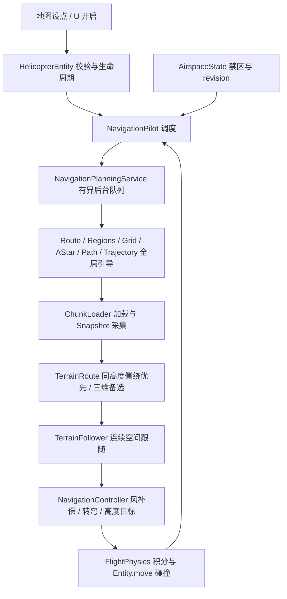

# 飞机自动导航算法说明

适用版本：**No.24 Heli 2.5.0**。本文说明本次交付的实际源码。它是按本次需求新增的专项文档；安装与操作见 [README](README.md)，通用维护约定见 [开发手册](开发手册.md)。

## 1. 总体实现逻辑

自动导航分为全局引导、局部空间避障、连续跟随和实际物理执行四层。全局引导负责长距离选定禁区外的通路；局部搜索同时处理地形和禁飞圆柱；跟随器在已验证的空间通道内生成连续目标；控制器只输出正常操纵量。实体依然通过原有飞行积分和 Minecraft 碰撞移动，不瞬移、不直接清零惯性。

### 1.1 禁飞区的空间语义

每个禁区是以雷达 X/Z 为轴心、有固定水平半径、**无限高**的实心圆柱。其高度不受地形、飞行高度或快照顶面影响。任意多个圆柱可以重叠，通行区域是所有圆柱并集的外部。实现时逐圆检查完整线段；任何一个圆不满足净空就拒绝，因此不会把重叠边界当成可穿过的缝隙。

硬性禁入半径为 `radius + max(实体水平外接半径 + pathSafetyMargin, 8)`。八格来自七格整机旋转包络加一格控制余量。所有搜索边、平滑段、跟随连线和惯性限速使用一致的硬边界；不允许通过爬升越过禁区。

软余量用于偏好排序，不是新增禁区：圆柱外十二格内增加最多 0.75 倍用时成本；在地形硬包络之外再检查三层体素邻域，附近有地形则增加 0.8 倍成本，两者合计封顶一倍。这样优先选择有空间连续转弯的路线，同时保留合法贴边终点及窄通道的可达性。

### 1.2 决策顺序与代价

1. 全局引导先尝试额外十二格转弯余量，预算允许时回退到硬安全范围。
2. 沿引导顺序按最多 512 格航程、累计九十度转向选局部目标。允许一个空间航段包住连续绕弯，不再因一条直弦碰圆就拆成许多短段；起终点弦已知被圆柱阻挡时直接扩大采集区域。
3. 已知露天直达走廊安全则零搜索节点交付。
4. 同高度八邻搜索优先：最多 `min(16000, 总节点预算/4)` 个节点。得到的风险加权代价不超过水平直飞时间下界的 1.8 倍时采用。
5. 同高度失败或绕路过长时，使用剩余预算做二十六邻三维加权 A*，父节点可见直连最长 128 格。若同高度路线也存在，最后比较两者代价。
6. 对完整路径进行有界简化、安全 Bezier 圆角及两格以内加密。圆角最大切角距离 48 格，同时受相邻段长度 40% 和完整净空约束。

每段基础时间 `T = max(水平距离/限速, |高差|/升降速度)`；爬升估计速度 0.14、下降 0.12 格/tick。总成本再加入半倍垂直用时、软余量比例及洞道风险。顶棚内限速 0.25 格/tick，顶棚比例对应额外两倍基础时间，每次进入另加 400 tick 风险。终点必须在已确认无顶棚区域。`costTicks` 是路线比较成本，不是含加载、加速、天气和转弯全过程的 ETA。

总空间搜索最多 `min(400000, pathMaxNodes)` 个展开节点，同高度与三维阶段合计计算；启发式权重 1.15。有限体素、窗口、父节点直连和加权搜索不保证连续空间全局最优。

### 1.3 连续转弯与爬升

跟随器每次只投影相邻最多 64 段；投影连线须安全，避免隔山/隔禁区跳到后面的回程段。前视随速度在配置的 8..30 格内变化，跨接缝时由至少一份快照完整证明每个小段安全。三维弧长进度只前进。

候选前视点检查完整斜向连线，以及**当前短程高度控制量**的垂直净空。已取消“必须先原地到达远处高度，再证明整个远端水平段安全”的串行升降限制；短程高度确实受阻时缩小高差，仍不能执行才缩短前视。实际机体前视和惯性扫掠依然每 tick 复查。

`altitudeTarget` 将目标高度误差限制为上升 `0.14/0.025=5.6` 格、下降 `0.12/0.025=4.8` 格的提前量，交给已有高度闭环；删除旧的每 tick 0.10 格目标积分限制。水平速度同时受坡度限制，因此能边前进边爬升。原物理的 0.16 格/tick 辅助垂速上限未改动，不能把此优化理解为任意大落差都能保持巡航速度。

曲率限速兼顾侧向加速度 0.008 格/tick² 和 1.4°/tick 偏航能力。输出曲率在相邻节点插值；控制器按 `曲率 × 指令速度²` 提前侧倾，并将加速度限制在同一能力范围内。风补偿复用 `FlightPhysics.windX/windZ`，起步、爬升及等待时均不靠左右漂移积累误差后才修正。

已就绪续段保留控制器状态连续交接；已经安全越过接缝时不要求倒飞回旧点。尚未完成的纯爬升和山脊/谷底反坡仍保留保护。

### 1.4 线程、等待与失败

世界、实体、方块、区块票只在服务端主线程操作。后台仅处理不可变坐标、占用数组和配置。当前段飞行时提前加载和规划下一段；只有缺少安全续段或出现真实危险时才在安全范围内减速等待。

未知区块先请求 FULL，不把等待当作障碍失败。安全规划失败等待所需区块齐全并冷却至少 100 tick 后重新采集，最多两次。真实堵塞持续 80 tick、或畅通通道 240 tick 无一格三维进度才触发脱困；脱困同处最多两次，实际前进或新任务才清零。修改目标/禁区修订会取消旧 Future；取消、移除或完成会释放票据。

## 2. 模块分工与贡献程度

贡献程度是对安全和飞行功能的职责评估，**不是可相加的性能百分比**。核心表示直接决定路线或操纵；关键表示缺失会失去安全性/连续性；支撑表示完成明确的几何、数据或转换工作。某模块耗时较少并不代表贡献低。

| 模块 | 贡献程度 | 在自动驾驶中的作用 |
|---|---|---|
| [NavigationPilot](src/main/java/org/DJB/no_24_heli/flight/NavigationPilot.java) | 核心：调度与安全裁决 | 服务端每架飞机一个实例；实体 tick 调用。负责两级 Future、当前/下一空间航段、区块票、交接、动态障碍、到达及有限重试。它决定什么时候能飞，不负责积分物理。 |
| [NavigationPlanningService](src/main/java/org/DJB/no_24_heli/flight/NavigationPlanningService.java) | 关键：主线程与搜索解耦 | 单后台工作线程、16 个排队任务。全局引导和空间搜索使用同一有界队列；结果只在服务端 isDone 后接收，取消时移除排队项。贡献是避免一次大搜索阻塞世界 tick，不能消除区块生成等待。 |
| [NavigationRoute](src/main/java/org/DJB/no_24_heli/flight/NavigationRoute.java) | 关键：全局禁区几何入口 | 校验真实起终点、配置和预算；协调圆并集拓扑、八邻网格、路径转换，提供完整线段净空和真实速度射线制动距离。只在 X/Z 上计算，是无限高圆柱的精确水平投影，不是把禁区看作可翻越山体。 |
| [NavigationRegions](src/main/java/org/DJB/no_24_heli/flight/NavigationRegions.java) | 关键：可达性分类 | 分析扩张圆的交叠、闭环及两端所在区域，区分同一封闭区域、不同封闭区域和实际不可达。重叠禁区取并集，不能从重叠缝隙或圆的顶部穿过。 |
| [NavigationGrid](src/main/java/org/DJB/no_24_heli/flight/NavigationGrid.java) | 支撑：有限搜索空间 | 建立包含全部圆和端点的网格，栅格化并集；接触扩张圆的格不可通行。真实贴边端点可通过完整安全连接段接入邻格。Budget 同时限制几何操作与搜索节点。 |
| [NavigationAStar](src/main/java/org/DJB/no_24_heli/flight/NavigationAStar.java) | 支撑：全局八邻搜索 | 搜索禁飞圆外的全局引导路径，保持独立节点预算、取消响应和父节点链；不能直接作为飞控指令执行。 |
| [NavigationPath](src/main/java/org/DJB/no_24_heli/flight/NavigationPath.java) | 支撑：引导点恢复与简化 | 把格心父节点链还原为真实起终点，按完整线段可见性删除多余节点并保留跟随余量。 |
| [NavigationTrajectory](src/main/java/org/DJB/no_24_heli/flight/NavigationTrajectory.java) | 支撑：连续全局引导 | 将二维引导折线做安全圆角并加密，供空间航段选择目标。只保存 points；不再维护无人使用的二维弧长、曲率及速度表。实际飞行速度由三维跟随器唯一维护。 |
| [NavigationChunkLoader](src/main/java/org/DJB/no_24_heli/flight/NavigationChunkLoader.java) | 关键：航路数据可用性 | 每机独立 UUID 票据；每 tick 最多请求 16 个 FULL 区块，异步等待并保留当前、续段及正在采集的区域，取消/移除时释放。未知区块不能当作空气。 |
| [NavigationTerrainSnapshot](src/main/java/org/DJB/no_24_heli/flight/NavigationTerrainSnapshot.java) | 关键：世界到不可变空间数据 | 服务端按全服务器共享 4 ms/tick 和单次 16384 格上限采集四格占用体素。纯后台搜索不读世界；高度图仅用于跳过确认的高空空气，保留洞穴真实结构。 |
| [NavigationTerrainRoute](src/main/java/org/DJB/no_24_heli/flight/NavigationTerrainRoute.java) | 核心：空间避障决策 | 将方块占用扩成整机配置空间，把每个禁区作为无限高圆柱并集。直达检查之后先搜索同高度侧绕；侧绕过长/失败才执行共享预算的三维搜索。统一比较飞行时间、高差、靠近障碍的成本和洞道风险，最后校验完整圆角轨迹。 |
| [NavigationTerrainFollower](src/main/java/org/DJB/no_24_heli/flight/NavigationTerrainFollower.java) | 核心：空间轨迹连续执行 | 单调局部投影、连续前视、坡度和曲率速度包络、快照联合检查、反坡保护及续段交接。只选择当前位置可安全接入的轨迹，保留原控制器速度和杆量。 |
| [NavigationController](src/main/java/org/DJB/no_24_heli/flight/NavigationController.java) | 核心：轨迹到飞行操纵 | 把安全目标转换为速度、周期变距和脚蹬。抵消实际阵风与阻力，给转弯加入有界横向加速度前馈，向原高度保持提供有界提前量；不修改位置、实际速度或物理上限。 |

## 3. 全部导航专用函数接口

以下逐项列出当前导航专用类显式声明的构造器及函数，包括私有算法函数和嵌套类型的方法。接口保留参数类型及返回类型；职责说明来自对应实现注释。`Point/Circle/Settings/Result/Sample/Planned/Build/Connection/Classification/Search/Conversion` 等 record 的编译器自动访问器按其字段返回纯数据，不产生飞行副作用；显式紧凑构造器单列说明。

坐标和距离单位为格；速度为格/tick；加速度为格/tick²；角度在飞行状态里为度，几何转角与曲率约束使用弧度；时间预算为 tick 或纳秒，具体见接口注释。全局坐标为 X/Z，空间坐标为 X/Y/Z。

### 3.1 NavigationPilot

服务端每架飞机一个实例；实体 tick 调用。负责两级 Future、当前/下一空间航段、区块票、交接、动态障碍、到达及有限重试。它决定什么时候能飞，不负责积分物理。

| 函数接口 | 具体作用与贡献 |
|---|---|
| `public Phase phase()` | 读取当前阶段供诊断；服务端，无 MC API，无副作用。 |
| `public long planningNanos()` | 读取最近一次后台耗时，单位纳秒；无副作用。 |
| `public int expandedNodes()` | 读取最近一次全局展开节点数；无副作用。 |
| `public void reset()` | 取消计算并丢弃临时路线，不改飞行速度和保存的导航点。 |
| `public void step(HelicopterEntity h,boolean rain)` | 更新快照、非阻塞接收规划结果，并输出当前航段操纵意图。 |
| `private void request(HelicopterEntity h,NavigationRoute.Point pos,NavigationRoute.Point goal,long now)` | 提交坐标快照，队列饱和时限频重试并继续悬停。 |
| `private void receive(HelicopterEntity h)` | 仅读取已完成的结果，在主线程设置航路并记录状态与规模。 |
| `private static String messageKey(NavigationRoute.Status status)` | 逐项对应双语提示，分别说明资源限制、精度不足与封闭原因。 |
| `private void cancelTerrain()` | 取消采集、搜索和跟随，释放 ServerChunkManager 的本机临时票据，不改变真实速度。 |
| `private boolean prepareTerrain(HelicopterEntity h,ServerWorld world)` | 主动加载规划区域，飞行期间提前采集和计算续段，非阻塞接收三维路线。 |
| `private void useTerrain(NavigationTerrainRoute.Result result,int goalNode)` | 交接已完成航段并预计算连续速度包络，不重置真实速度或导航控制器。 |
| `private void replanTerrain(HelicopterEntity h,long now)` | 障碍或卡滞重规划时保留尚未抵达的局部目标，禁止从整段旧起点重新选取引导点。 |
| `private void retainChunks()` | 仅保留当前、续段及在途采集的区块票；主线程调用，已飞过的区块可以正常卸载。 |
| `private void terrainFailed(HelicopterEntity h,NavigationRoute.Status status,long now)` | 安全失败保留采集区票据，加载齐全并等待 100 tick 后最多重新采集两次；资源失败沿用限频。 |
| `private static NavigationTerrainRoute.Point terrainPosition(HelicopterEntity h)` | 获取实体原点的纯三维快照；MC API：net.minecraft.entity.Entity#getX/#getY/#getZ；仅主线程。 |
| `private void follow(HelicopterEntity h,ServerWorld world,NavigationRoute.Point pos,NavigationRoute.Point goal)` | 连续前视跟随已验证的三维轨迹，提前交接续段，只有最终点或真实障碍要求停稳。 |
| `private boolean replanIfStalled(HelicopterEntity h,ServerWorld world,boolean clear)` | 整段通道安全却长期无三维航路进展时，从实际机位重规划，耗尽后明确提示并制动悬停。 |
| `private boolean corridorClear(ServerWorld world,HelicopterEntity h,Box base,Vec3d delta)` | 小段扫掠避免斜向航线的大包围盒把旁侧障碍误报为整条通道堵塞。 |
| `private boolean clear(ServerWorld world,HelicopterEntity h,Box box)` | 先异步请求未知区块，加载完成后再检查真实方块、流体与动态实体净空。 |
| `private static void notify(HelicopterEntity h,String key)` | 通过 net.minecraft.entity.player.PlayerEntity#sendMessage 向当前驾驶员显示双语动作栏；仅服务端调用。 |

### 3.2 NavigationPlanningService

单后台工作线程、16 个排队任务。全局引导和空间搜索使用同一有界队列；结果只在服务端 isDone 后接收，取消时移除排队项。贡献是避免一次大搜索阻塞世界 tick，不能消除区块生成等待。

| 函数接口 | 具体作用与贡献 |
|---|---|
| `private NavigationPlanningService()` | 无实例状态；任务的生命周期由调用方管理。 |
| `static Future<NavigationTerrainRoute.Result> submitTerrain(NavigationTerrainSnapshot snapshot)` | 把已完成的地形快照送入同一有界工作队列；不新增线程或绕开取消机制。 |
| `public static Future<Planned> submit(NavigationRoute.Point start, NavigationRoute.Point goal, List<NavigationRoute.Circle> circles, NavigationRoute.Settings settings, NavigationTrajectory existing, int nextNode)` | 提交一次规划，队列满时由调用方处理 RejectedExecutionException 并继续悬停。 |
| `static Planned plan(NavigationRoute.Point start, NavigationRoute.Point goal, List<NavigationRoute.Circle> circles, NavigationRoute.Settings settings, NavigationTrajectory existing, int nextNode)` | 先验证旧轨迹或选择宽弧路线，完成全局引导平滑后一次性交付。 |
| `private static boolean remainingClear(NavigationRoute.Point start, NavigationTrajectory trajectory, int node, List<NavigationRoute.Circle> circles, NavigationRoute.Settings settings)` | 后台检查全部剩余段；资源耗尽则重新规划，绝不在主线程扫描完整轨迹。 |
| `public static void cancel(Future<?> task)` | 中断运行中的纯算法，并立即移除尚未执行的排队请求。 |

### 3.3 NavigationRoute

校验真实起终点、配置和预算；协调圆并集拓扑、八邻网格、路径转换，提供完整线段净空和真实速度射线制动距离。只在 X/Z 上计算，是无限高圆柱的精确水平投影，不是把禁区看作可翻越山体。

下表 `clearance()` 属于嵌套 `Settings`；其余函数属于 `NavigationRoute`。

| 函数接口 | 具体作用与贡献 |
|---|---|
| `public double clearance()` | 返回机体与安全间距的圆半径扩张量；无 MC API、无副作用。 |
| `public static double speedLimit(Point pos,double vx,double vz,List<Circle> circles,Settings settings,double cruise)` | 按真实速度射线与扩张圆的首次交点限速，不把圆的径向距离误当切向制动距离。 |
| `private NavigationRoute()` | 禁止实例化工具入口；无 MC API、无副作用。 |
| `public static double distance(Point a, Point b)` | 返回二维欧氏距离；无 MC API，任意线程，无副作用。 |
| `public static double segmentDistance(Point a, Point b, Circle c)` | 返回圆心到完整闭线段的最短距离；无 MC API、无副作用。 |
| `public static boolean clear(Point a, Point b, List<Circle> zones, Settings settings)` | 按机体半径与安全间距检查完整线段，包括两端。 |
| `static boolean followingSegmentClear(Point a, Point b, Circle circle, Settings settings)` | 检查完整航段相对单圆的跟随余量；不改变网格、封闭区域或真实终点合法性。 |
| `public static Result plan(Point start,Point goal,List<Circle> zones,Settings settings)` | 构建八邻网格、A* 搜索及真实圆并集封闭校验。 |
| `private static Result planAtResolution(Point start,Point goal,List<Circle> zones,Settings settings)` | 执行一次指定精度的有限规划；仅后台纯计算，预算与状态独立返回。 |
| `private static Status validate(Point start,Point goal,List<Circle> zones,Settings s,NavigationGrid.Budget budget)` | 先检查有限输入和真实圆含边界，再允许已到达；无 MC API、无外部副作用。 |
| `private static boolean finite(Point p)` | 检查两个坐标均有限；无 MC API、无副作用。 |
| `private static Status disconnectedStatus(NavigationRegions.Classification r)` | 区分单端封闭、不同封闭区域与网格误堵；无 MC API、无副作用。 |
| `private static Result result(Status status,List<Point> path,NavigationGrid.Budget budget, boolean startEnclosed,boolean goalEnclosed,Settings settings)` | 统一封装实际展开数及设置；无 MC API、无副作用。 |

显式 `Result { path = List.copyOf(path); }` 紧凑构造器：复制路径列表，隔离主线程与后台，防止已交付路径被外部修改。

### 3.4 NavigationRegions

分析扩张圆的交叠、闭环及两端所在区域，区分同一封闭区域、不同封闭区域和实际不可达。重叠禁区取并集，不能从重叠缝隙或圆的顶部穿过。

| 函数接口 | 具体作用与贡献 |
|---|---|
| `private NavigationRegions()` | 禁止实例化纯几何工具；无 MC API、无副作用。 |
| `static Classification classify(NavigationRoute.Point start, NavigationRoute.Point goal, List<NavigationRoute.Circle> zones, NavigationRoute.Settings settings, NavigationGrid.Budget budget)` | 按扩张圆真实相交关系生成森林，再计算全部闭环对两端坐标的整数绕数。 |
| `private static NavigationRoute.Status forest(List<NavigationRoute.Circle> zones, double clearance, NavigationGrid.Budget budget, int[] parent, int[] size, int[] heads, int[] neighbors, int[] next)` | 将真实相交圆中心连边，用并查集保留生成森林，切触也算闭障碍接触。 |
| `private static NavigationRoute.Status angles(NavigationRoute.Point start, NavigationRoute.Point goal, List<NavigationRoute.Circle> zones, NavigationGrid.Budget budget, int[] heads, int[] neighbors, int[] next, double[] startAngles, double[] goalAngles)` | 逐棵树累计两端坐标对中心连线的有向角，供非树边快速还原闭环绕数。 |
| `private static Classification windings(NavigationRoute.Point start, NavigationRoute.Point goal, List<NavigationRoute.Circle> zones, double clearance, NavigationGrid.Budget budget, double[] startAngles, double[] goalAngles)` | 比较森林加每条相交边产生的基本环绕数，真实识别不同圆并集孔洞。 |
| `private static boolean overlap(NavigationRoute.Circle a, NavigationRoute.Circle b, double clearance)` | 判断两扩张闭圆是否真实接触；无 MC API、无副作用。 |
| `private static int root(int[] parent, int at)` | 取得并压缩并查集根节点；无 MC API，仅修改本次数组。 |
| `private static double angle(NavigationRoute.Circle from, NavigationRoute.Circle to, NavigationRoute.Point p)` | 返回圆外点观察中心连线的有向最小角，范围为负π到π，单位为弧度。 |
| `private static Classification failure(NavigationRoute.Status status)` | 生成未完成分类的资源失败结果；无 MC API、无副作用。 |

### 3.5 NavigationGrid

建立包含全部圆和端点的网格，栅格化并集；接触扩张圆的格不可通行。真实贴边端点可通过完整安全连接段接入邻格。Budget 同时限制几何操作与搜索节点。

下表从 `Budget(...)` 到 `remainingGeometry()` 属于嵌套 `Budget`；其余函数属于 `NavigationGrid`。

| 函数接口 | 具体作用与贡献 |
|---|---|
| `private NavigationGrid(double minX,double minZ,double cellSize,int width,int height,boolean[] blocked)` | 接收已验证的几何和障碍数组；无 MC API、无外部副作用。 |
| `Budget(int maxCells,int maxNodes)` | 生成有限独立预算；无 MC API、无副作用。 |
| `NavigationRoute.Status geometry()` | 记账一次几何操作并响应中断；无 MC API，只修改本次计数。 |
| `NavigationRoute.Status node()` | 记账一个展开节点并响应中断；无 MC API，只修改本次计数。 |
| `int expandedNodes()` | 返回合计实际展开数；无 MC API、无副作用。 |
| `long remainingGeometry()` | 返回剩余几何预算，圆交叠图在分配数组前检查最低工作量。 |
| `static Build build(NavigationRoute.Point start,NavigationRoute.Point goal, List<NavigationRoute.Circle> zones,NavigationRoute.Settings s,Budget budget)` | 动态覆盖起终点和所有扩张圆，再栅格化闭圆并集。 |
| `private NavigationRoute.Status rasterize(List<NavigationRoute.Circle> zones,double clearance,Budget budget)` | 逐圆扫描包围矩形，闭格与扩张圆接触则合入障碍并集。 |
| `int cell(NavigationRoute.Point p)` | 将已覆盖的真实坐标映射到所在格；无 MC API、无副作用。 |
| `NavigationRoute.Point center(int index)` | 返回格心水平航点；无 MC API、无副作用。 |
| `Connection connect(NavigationRoute.Point point,List<NavigationRoute.Circle> zones, NavigationRoute.Settings settings,Budget budget)` | 端点所在格被圆边缘擦到时，在两格邻域寻找完整可见的安全格心，不移动真实端点。 |
| `boolean blocked(int index)` | 查询障碍掩码；无 MC API、无副作用。 |
| `int size()` | 返回网格总单元数；无 MC API、无副作用。 |
| `int width()` | 返回列数用于四邻边界判断；无 MC API、无副作用。 |

### 3.6 NavigationAStar

搜索禁飞圆外的全局引导路径，保持独立节点预算、取消响应和父节点链；不能直接作为飞控指令执行。

| 函数接口 | 具体作用与贡献 |
|---|---|
| `private NavigationAStar(int cells)` | 分配受网格预算约束的数组；无 MC API，无外部副作用。 |
| `static Search search(NavigationGrid grid, int start, int target, NavigationGrid.Budget budget)` | 用一致的八方向启发式寻找代价最小路径，到达终点立即结束。 |
| `private static double heuristic(int from, int to, int width)` | 八方向距离的可采纳启发式；无 MC API，无副作用。 |
| `private void offer(int cell, double priority)` | 插入或降低一个格子的代价，不产生重复队列项；仅改本实例。 |
| `private int poll()` | 弹出最小总代价格并标记关闭；无 MC API，仅改本实例。 |
| `private void swap(int a, int b)` | 交换堆项并同步反向索引；无 MC API，仅改本实例。 |

### 3.7 NavigationPath

把格心父节点链还原为真实起终点，按完整线段可见性删除多余节点并保留跟随余量。

| 函数接口 | 具体作用与贡献 |
|---|---|
| `private NavigationPath()` | 禁止实例化转换工具；无 MC API、无副作用。 |
| `static Conversion convert(NavigationRoute.Point start, NavigationRoute.Point goal, List<NavigationRoute.Circle> zones, NavigationRoute.Settings settings, NavigationGrid grid, int startCell, int goalCell, int[] previous, NavigationGrid.Budget budget)` | 恢复格心路径，连接真实起终点并以可见性删除多余航点。 |
| `private static Conversion smooth(List<NavigationRoute.Point> raw, List<NavigationRoute.Circle> zones, NavigationRoute.Settings settings, NavigationGrid.Budget budget)` | 顺序扩展可见航段，遇障碍保留上一个可见点，工作量受有限预算约束。 |
| `private static NavigationRoute.Status validate(List<NavigationRoute.Point> path, List<NavigationRoute.Circle> zones, NavigationRoute.Settings settings, NavigationGrid.Budget budget)` | 验证相邻航点的完整线段，资源失败与几何不安全分开返回。 |
| `private static NavigationRoute.Status segment(NavigationRoute.Point from, NavigationRoute.Point to, List<NavigationRoute.Circle> zones, NavigationRoute.Settings settings, NavigationGrid.Budget budget)` | 带预算验证单个闭线段，机体与安全间距不因靠近终点而降低。 |
| `private static NavigationRoute.Status followingSegment(NavigationRoute.Point from, NavigationRoute.Point to, List<NavigationRoute.Circle> zones, NavigationRoute.Settings settings, NavigationGrid.Budget budget)` | 平滑时保留原四邻格心线的半格额外净空，真实起终点按自身实际净空放宽。 |
| `private static Conversion failure(NavigationRoute.Status status)` | 失败时不交付未完成路径；无 MC API、无副作用。 |

### 3.8 NavigationTrajectory

将二维引导折线做安全圆角并加密，供空间航段选择目标。只保存 points；不再维护无人使用的二维弧长、曲率及速度表。实际飞行速度由三维跟随器唯一维护。

| 函数接口 | 具体作用与贡献 |
|---|---|
| `private NavigationTrajectory(List<NavigationRoute.Point> points)` | 保存不可变全局引导点；仅后台调用，不分配未参与飞行的二维速度表。 |
| `public static Build build(NavigationRoute.Point start, List<NavigationRoute.Point> path, List<NavigationRoute.Circle> circles, NavigationRoute.Settings settings)` | 将可见性折线变成切线连续的二次 Bezier 曲线，供空间规划选择连续航段目标。 |
| `private static NavigationRoute.Status validate(List<NavigationRoute.Point> path, List<NavigationRoute.Circle> circles, NavigationRoute.Settings settings, NavigationGrid.Budget budget, double extra)` | 完整线段逐圆验证，带资源和取消检查；只修改局部预算，无 MC API。 |
| `private static boolean appendLine(List<NavigationRoute.Point> points, NavigationRoute.Point end, int maxPoints)` | 有界加密直线以固定跟踪窗口工作量；无 MC API，仅追加局部点集。 |
| `private static double bend(NavigationRoute.Point a, NavigationRoute.Point b, NavigationRoute.Point c)` | 三点外接圆的有符号曲率，正值对应正偏航（左转），单位 1/格；无 MC API。 |
| `public static NavigationRoute.Point interpolate(NavigationRoute.Point a, NavigationRoute.Point b, double t)` | 线段内插，参数限制由调用者保证；无 MC API，无副作用。 |
| `public List<NavigationRoute.Point> points()` | 返回只读采样点，供跟随和原地形扫描；无副作用。 |

### 3.9 NavigationChunkLoader

每机独立 UUID 票据；每 tick 最多请求 16 个 FULL 区块，异步等待并保留当前、续段及正在采集的区域，取消/移除时释放。未知区块不能当作空气。

| 函数接口 | 具体作用与贡献 |
|---|---|
| `NavigationChunkLoader(ServerWorld world)` | 绑定当前维度，尚不加载任何区块；仅服务端，无副作用。 |
| `void retain(NavigationTerrainRoute.Result active,NavigationTerrainRoute.Result next,NavigationTerrainSnapshot request)` | 保留当前、已完成续段和采集区域的区块，释放已飞过的区域；仅主线程修改票据。 |
| `private void addRoute(Set<ChunkPos> output,NavigationTerrainRoute.Result route)` | 直达路线只保留真实飞行走廊；需要搜索绕行的路线保留其完整配置空间。 |
| `private void addRegion(Set<ChunkPos> output,double x,double z,int nx,int nz)` | 包含碰撞查询的一格邻域；WorldBorder#contains 排除完全在世界边界外的区块。 |
| `void step()` | 非阻塞推进加载请求；生成完成由快照通过 getWorldChunk 查询，不在世界 tick 等待 Future。 |
| `void beginChecks()` | 开始本 tick 的实时净空检查；仅服务端主线程，旧查询票在 retain 时按新范围释放。 |
| `boolean load(Box box)` | 请求净空盒及一格碰撞邻域的区块，全部 FULL 后才允许判断障碍。 |
| `boolean ready()` | 确认全部规划票已发出且区块达到 FULL；getWorldChunk 不阻塞，等待不消耗安全重试次数。 |
| `void close()` | 取消或卸载时释放本机全部票据和待加载请求；服务端调用，不改变其他加载来源。 |

### 3.10 NavigationTerrainSnapshot

服务端按全服务器共享 4 ms/tick 和单次 16384 格上限采集四格占用体素。纯后台搜索不读世界；高度图仅用于跳过确认的高空空气，保留洞穴真实结构。

| 函数接口 | 具体作用与贡献 |
|---|---|
| `NavigationTerrainSnapshot(ServerWorld world,NavigationTerrainRoute.Point start,NavigationRoute.Point goal, List<NavigationRoute.Circle> circles,NavigationRoute.Settings settings,double cruise,boolean directOnly)` | 建立有界矩形规格；超过 pathMaxCells 时只记录失败，不分配大数组。 |
| `boolean tooLarge()` | 报告预算失败；无 MC API、无副作用，失败时禁止提交后台。 |
| `boolean complete()` | 检查是否完成采集；无 MC API、无副作用。 |
| `void step(ServerWorld world,HelicopterEntity heli)` | 在共享时间预算内推进采集，等待导航票加载未知列，水和碰撞方块视为障碍。 |
| `private void prepareColumn(ServerWorld world,double cx,double cz)` | 检查含邻块碰撞形状的一圈区块并读取当前四格方柱内最高高度。 |
| `private boolean empty(ServerWorld world,Box box)` | 相邻区块段均为空时跳过空气盒碰撞查询；含一格形状外伸余量，流体所在段不会被跳过。 |
| `boolean needsChunk(ChunkPos pos)` | 直达探测只加载走廊和查询邻块；三十二格含区块半对角线及碰撞邻域，端侧主线程。 |
| `private boolean nearLine(double cx,double cz,double radius)` | 计算到真实起终点线段的水平距离；无 MC API，不将走廊外未知区域当空气。 |
| `NavigationTerrainRoute.Result plan()` | 后台只读完成数组并建立三维路径；无 MC API，调用后主线程不得再推进本采集器。 |

### 3.11 NavigationTerrainRoute

将方块占用扩成整机配置空间，把每个禁区作为无限高圆柱并集。直达检查之后先搜索同高度侧绕；侧绕过长/失败才执行共享预算的三维搜索。统一比较飞行时间、高差、靠近障碍的成本和洞道风险，最后校验完整圆角轨迹。

下表 `horizontal()`、`distance(...)` 属于嵌套 `Point`；从 `Volume(...)` 到 `cost(...)` 属于嵌套 `Volume`；其余函数属于 `NavigationTerrainRoute`。

| 函数接口 | 具体作用与贡献 |
|---|---|
| `NavigationRoute.Point horizontal()` | 投影为原禁区规划坐标；无 MC API、无副作用。 |
| `double distance(Point other)` | 返回三维距离，供连续通道检查；无 MC API。 |
| `Volume(double x, double y, double z, int nx, int ny, int nz, byte[] occupied, List<NavigationRoute.Circle> circles, NavigationRoute.Settings settings, double cruise)` | 以三维前缀和膨胀占用格，保证整格内任意位置和任意机头方向均有整机净空。 |
| `private static int count(int[] sum,int sx,int layer,int x0,int y0,int z0,int x1,int y1,int z1)` | 查询半开长方体占用数；无 MC API，无副作用，坐标已由构造循环约束。 |
| `int index(int ix,int iy,int iz)` | 三维格坐标转连续索引；无 MC API，调用前须检查范围。 |
| `Point point(int at)` | 返回索引对应的世界格心；无 MC API。 |
| `int cell(Point p)` | 获取实际坐标所在配置空间格；快照外返回 -1，不当作空气。 |
| `boolean free(int at)` | 读取安全配置格；越界为障碍，无 MC API。 |
| `boolean covered(Point p)` | 检查点是否位于顶棚下；越界视为高风险，不输出未确认出口。 |
| `double speed(Point a,Point b)` | 整段只要经过顶棚就提前采用洞内限速；不能只看露天的入口前点和出口后点。 |
| `boolean clear(Point a,Point b)` | 连续线段的保守超覆盖检查，每两格检查所有跨过的配置格，禁止边角擦墙。 |
| `private boolean airspaceClear(Point a,Point b)` | 精确检查整条线段与整机扩张禁飞圆；无 MC API，不附加体素四角的额外膨胀。 |
| `boolean boxClear(int a,int b)` | 检查相邻配置格包围体，覆盖斜穿边缘时所有正交邻格；无 MC API。 |
| `private boolean boxCovered(int a,int b)` | 顶棚判定与净空使用同一超覆盖格集合，斜穿边角也按洞内限速和风险计价；无 MC API。 |
| `double cost(Point a,Point b)` | 连续段飞行时间加高差、贴障碍及顶棚风险，搜索、直连和平滑统一计价，单位 tick。 |
| `private NavigationTerrainRoute(int cells,int layerCells,int begin)` | 为本次有界三维搜索分配数组，无 MC API、无外部副作用。 |
| `static int goalNode(NavigationRoute.Point start,List<NavigationRoute.Point> route,int first,double look)` | 沿全局引导选择最多九十度累计转向的空间航段，不再把每条切圆短弦都拆成规划接缝。 |
| `static Result direct(Volume v,Point start,NavigationRoute.Point goal)` | 只在整机直线走廊已验证且无顶棚时交付快速路线；失败要求扩大采集范围，不猜测侧方地形。 |
| `static Result plan(Volume v,Point start,NavigationRoute.Point goal)` | 先尝试八邻同高度侧绕，再按共享预算执行二十六邻空间搜索，出口必须无顶棚。 |
| `private static Result search(Volume v,Point start,NavigationRoute.Point goal,boolean levelOnly,int limit)` | 共用八邻同高度/二十六邻空间搜索实现，两个阶段共享调用方给定的节点预算。 |
| `private Result finish(Volume v,int at,Point start,Point end,int expanded)` | 恢复真实起终点，有限可见性平滑只接受不增加风险代价的完整安全段；无 MC API。 |
| `private static Result success(Volume v,List<Point> raw,int expanded)` | 验证三维转弯曲线后加密轨迹，保留窄角原折线；无 MC API，后台执行。 |
| `private static void append(List<Point> output,Point end)` | 以不超过两格的间距追加直线，重复点不产生零长航段；无 MC API。 |
| `private static double travel(Point a,Point b,double cruise)` | 水平和垂直运动可同时进行，取较慢轴的时间；无 MC API，单位 tick。 |
| `private static double heuristic(Point p,NavigationRoute.Point goal,double cruise)` | 终点未指定高度，水平飞行时间是可采纳的一致启发式；无 MC API。 |
| `static Point interpolate(Point a,Point b,double t)` | 内插三维点；无 MC API、无副作用，调用者限定 t 在 0..1。 |
| `private static Result failure(NavigationRoute.Status status,Volume v,int expanded)` | 返回独立失败状态，不让未验证的部分航路进入控制器；无 MC API。 |
| `private void offer(int cell,double priority)` | 插入或降低索引堆优先级；无 MC API，仅修改本次搜索。 |
| `private int poll()` | 弹出最小 f 值并关闭该格；无 MC API。 |
| `private boolean less(int a,int b)` | 先比较时间与风险，再按原高度和前进进度打破同值，减少无收益升降及等值展开；无 MC API。 |
| `private void swap(int a,int b)` | 交换堆元素并同步反向索引；无 MC API。 |

显式 `Result { path = List.copyOf(path); }` 紧凑构造器：复制路径列表，隔离主线程与后台，防止已交付路径被外部修改。

### 3.12 NavigationTerrainFollower

单调局部投影、连续前视、坡度和曲率速度包络、快照联合检查、反坡保护及续段交接。只选择当前位置可安全接入的轨迹，保留原控制器速度和杆量。

| 函数接口 | 具体作用与贡献 |
|---|---|
| `void bind(NavigationTerrainRoute.Result next,double cruise)` | 绑定完整地形轨迹，预计算坡度、顶棚和转弯限速；无 MC API，不改飞行物理。 |
| `Sample sample(NavigationTerrainRoute.Point pos,double speed,double lookMin,double lookMax, NavigationTerrainRoute.Result next)` | 沿已验证轨迹连续跟随，下一航段已就绪时允许前视跨越接缝，不在中间航点逐点停车。 |
| `private NavigationTerrainRoute.Point reachableTarget(NavigationTerrainRoute.Point pos, NavigationTerrainRoute.Point target,NavigationTerrainRoute.Result next)` | 为坡面和绕障回接寻找可执行的水平/高度组合；无 MC API，仅在已验证的快照内调整。 |
| `private double altitudeHorizon(NavigationTerrainRoute.Point pos,double maximum, NavigationTerrainRoute.Result next)` | 将投影及前视限制在尚未经过的第一个高度转折处；无 MC API，服务端跟随调用。 |
| `private boolean clearAcross(NavigationTerrainRoute.Point from,NavigationTerrainRoute.Point to, NavigationTerrainRoute.Result next)` | 跨接缝前视逐小段使用能完整覆盖该段的地形快照，不将旧快照外的已验证续段判成障碍。 |
| `private double speedAcross(NavigationTerrainRoute.Point from,NavigationTerrainRoute.Point to, NavigationTerrainRoute.Result next)` | 只读取已覆盖且安全的小段限速，避免旧快照越界被当成洞内十八公里限速。 |
| `private NavigationTerrainRoute.Point pointAt(double distance,NavigationTerrainRoute.Result next)` | 在当前有序轨迹及下一段的开头插值，不做全局最近点跳跃；无 MC API。 |
| `boolean atEnd(NavigationTerrainRoute.Point pos,double speed,NavigationTerrainRoute.Result next)` | 接缝附近即可交接，保留真实速度；最终导航点仍由驾驶器单独停稳确认。 |
| `double progress()` | 返回本航段已推进的三维弧长，供无进展重规划检测；无 MC API，不计单纯偏航。 |
| `private static double curvature(NavigationTerrainRoute.Point a,NavigationTerrainRoute.Point b,NavigationTerrainRoute.Point c)` | 计算水平三点曲率，符号与原导航控制器一致；纯垂直段不产生偏航前馈。 |

### 3.13 NavigationController

把安全目标转换为速度、周期变距和脚蹬。抵消实际阵风与阻力，给转弯加入有界横向加速度前馈，向原高度保持提供有界提前量；不修改位置、实际速度或物理上限。

| 函数接口 | 具体作用与贡献 |
|---|---|
| `public void reset()` | 取消时释放控制器内部记忆；服务端，无 MC API，不修改实际运动。 |
| `void wind(double x,double z)` | 保存本 tick 的风加速度供导航和等待悬停共同抵消；无 MC API，主线程调用。 |
| `static double altitudeTarget(double y,double desired)` | 给原高度闭环提供有界提前量，连续爬升上限 0.14、下降 0.12 格/tick；不直接改速度。 |
| `public void step(FlightState s, double x, double z, NavigationRoute.Point target, double limit, double remaining, double curvature)` | 将轨迹目标和限速映射到原 FlightPhysics 的脚蹬及侧倾/俯仰输入。 |
| `public double commandedSpeed()` | 取得连续速度目标用于诊断状态；无 MC API，无副作用。 |
| `private static double stoppingSpeed(double remaining)` | 按剩余水平路程倒推能停稳的速度，包含惯性制动和闭环反应时间；无 MC API，单位格/tick。 |
| `private static double wrap(double angle)` | 限幅角差到 [-180,180)，避免跨北向时错误长转；无副作用。 |
| `private static double approach(double from, double to, double step)` | 限制控制信号单 tick 变化；无 MC API，无副作用。 |

## 4. 外部接口及它们对自动驾驶的贡献

这些类还承担非导航业务；这里列出参与自动驾驶的入口及依赖，不将货仓、舱门、渲染等无关函数混进算法清单。

| 外部接口 | 输入/输出与作用 | 贡献程度 |
|---|---|---|
| `NavigationPayload(double x, double z, boolean clear)` | 地图发送设点或清除意图；高度由空间规划选择 | 输入边界 |
| `NavigationPayload.CODEC.decode(RegistryByteBuf)` | 解码两个 double 和 clear 布尔量，返回载荷 | 输入边界 |
| `NavigationPayload.CODEC.encode(RegistryByteBuf, NavigationPayload)` | 按相同顺序编码，不直接控制飞机 | 输入边界 |
| `NavigationPayload.getId()` | 返回 `no_24_heli:navigation` 通道 ID | 注册支撑 |
| `No_24_heli.onInitialize()` 中的载荷注册与接收回调 | 注册 CODEC，接收回调转入服务端执行上下文并调用实体 navigate | 线程与权限关键 |
| `HelicopterEntity.navigate(PlayerEntity, NavigationPayload)` | 校验乘员身份、有限坐标、世界边界及禁区；取消旧任务，保存真实目标 | 生命周期关键 |
| `HelicopterEntity.control(...)` 的 AUTOPILOT 分支 | U 开关、驾驶权、动力/离地/手动输入检查；有效手动操纵交还控制 | 生命周期关键 |
| `HelicopterEntity.tick()` | 先检查任务有效性，再 `navigation.step(this,rain)`；之后原物理积分、姿态碰撞约束与移动 | 核心执行入口 |
| `HelicopterEntity.stopAutopilot()` | reset 规划与票据，恢复进入导航之前的辅助状态 | 生命周期关键 |
| `HelicopterEntity.finishAutopilot()` | 完成导航、配平和高度保持，关闭巡航并清除操纵意图 | 到达关键 |
| `HelicopterEntity.onRemoved()` | 删除实体时清理后台任务与区块票，避免遗留导航工作 | 资源关键 |
| `FlightState` 的 waypoint/waypointX/waypointZ/autopilot/targetAltitude/vx/vy/vz 等 | 数据契约；目标持久化，自动执行状态不盲目恢复 | 状态关键 |
| `FlightState.clearInputs()` | 清除操纵量，不删除真实惯性 | 接管支撑 |
| `FlightState.cancelAutoFlight()` | 关闭一键起降，防止与航路导航同时操纵 | 模式互斥 |
| `FlightPhysics.step(FlightState, HeliConfig, boolean grounded, boolean rain, double altitude, long tick)` | 原有固定 tick 的动力、姿态、升力、阻力、风和速度积分 | 核心物理执行 |
| `FlightPhysics.horizontalDrag(boolean, boolean)` | 返回与物理一致的阻力比例，供控制前馈逆算 | 控制一致性 |
| `FlightPhysics.windX(boolean rain,long tick)` / `windZ(...)` | 同一时刻同一天气的实际风加速度，导航只补偿而不削弱风 | 稳定性关键 |
| `HeliConfig.INSTANCE` 与 `HeliConfig.forMode(Difficulty)` | 服务端巡航、前视、几何预算及本机模式参数；导航不得擅自更改配置 | 配置支撑 |
| `AirspaceState.get(ServerWorld)` | 取得当前维度持久空域 | 数据关键 |
| `AirspaceState.revision()` | 修订号变化使快照失效并触发新规划 | 一致性关键 |
| `AirspaceState.zones()` | 只读全部圆集合，不按玩家当前加载范围截断 | 几何关键 |
| `AirspaceState.Zone.contains(double x,double z)` | 检查真实无限高圆柱，不依赖 Y | 输入校验关键 |
| `AirspaceState.at(BlockPos)` / `put(BlockPos,int,UUID)` / `remove(BlockPos)` | 查找、登记、删除雷达；增删改更新 revision 和持久状态 | 空域维护 |
| `AirspaceState.read(NbtCompound,WrapperLookup)` / `writeNbt(...)` | 保存、恢复雷达数据；不恢复进行中的导航 Future | 持久化支撑 |
| `HelicopterCollision.QUERY_RADIUS` | 提供整机任意姿态查询半径；空间规划再加一格安全余量 | 几何尺寸关键 |
| `HelicopterCollision.pose/limitRotation` 与 `Entity.move` | 实际姿态和位移的碰撞约束；最终执行不绕过原碰撞链 | 安全底线 |

地图与 HUD 只发送/展示意图和状态，不进行服务端寻路，也不直接积分飞机位置。自动起降 `AutoFlightController` 是独立任务，本次没有改写其天气补偿或落点检查。

## 5. 清理结果与保留理由

- 删除 `NavigationFollower.java`：旧二维跟随器没有生产调用，不能再与三维跟随并存误导维护。
- 删除 `NavigationTrajectory` 的二维 lengths/curvature/speeds、对应查询函数及 BRAKE 常量：它们仅被已删除的跟随器使用；全局引导仍需曲线生成和 points，故保留此类。
- 删除 `FlightState.navAligned` 及初始化/赋值：它已不参与起步或控制决策，不同步、不存档，属于无效状态。
- 删除二维规划服务不再使用的 cruise 参数，以及 Pilot 的 CLIMB_STEP 目标积分限制；曲率能力常量归入实际控制器。
- `NavigationGrid/AStar/Regions/Path` 仍服务长距离禁区全局引导，不能因三维搜索存在就当作僵尸文件删除。
- 一次性验证源码、桩和编译结果位于项目外，交付前清理；发行包不得包含验证入口。保留旧版发行 JAR。

## 6. 验证结果与适用边界

以下为相同雨天物理、相同体素障碍和初始机况的离线确定性闭环对比。直接调用生产 `FlightPhysics`、规划器、跟随器与控制器；世界/区块及实体碰撞由保守体素检查代替，**不是游戏内实机验收**。这里的用时不包含区块生成、采集及后台等待；平均速度按实际三维行程计，不能直接当作真实长途平均速度承诺。

| 场景 | 2.4.4 | 2.5.0 | 解释 |
|---|---:|---:|---|
| 重叠禁区旁高障碍，选择侧绕 | 558 tick | 587 tick | 多留转弯余量，路线稍长；新版保持原高度，中途无安全制动等待 |
| 全宽山脊，必须爬升 | 860 tick | 745 tick | 同步升降与提前量减少等待，约减少 13.4% 飞行 tick |
| 大落差高台，必须爬升 | 1307 tick | 994 tick | 约减少 23.9% 飞行 tick；新版留有额外高度净空 |
| 单禁区连续转弯 | 906 tick 时触发无进展 | 707 tick 到达 | 新版保持原高度并补偿风扰动 |
| 目标仅比硬安全圆外多 0.2 格 | 未纳入本次旧版对照 | 661 tick 到达 | 保留真实目标，完整轨迹及移动均在硬禁入范围之外 |

上述五个新版场景排除最初 40 tick 后，低于 0.03 格/tick 的水平低速采样各只有 1 tick；各用例都逐段验证实际移动安全。强制缩短局部前视为 128 格后得到三个航段，两次交接的水平速度约为 0.60、0.42 格/tick，未要求停稳后交接。

另验证：重叠圆柱在 200 格高度仍不能穿越、未知快照区域拒绝、线程中断生效、同高度与三维共用五节点的小预算不会超支。构建结果和 JAR 版本以开发手册本版本更新记录为准。

仍存在的合理减速：真实动态障碍、区块生成未完成、没有安全续段、窄弯转向能力限制、必须接近辅助垂速上限的陡坡、目标附近制动。该算法不会为了平均速度突破禁飞区、整机净空或飞行物理能力。
